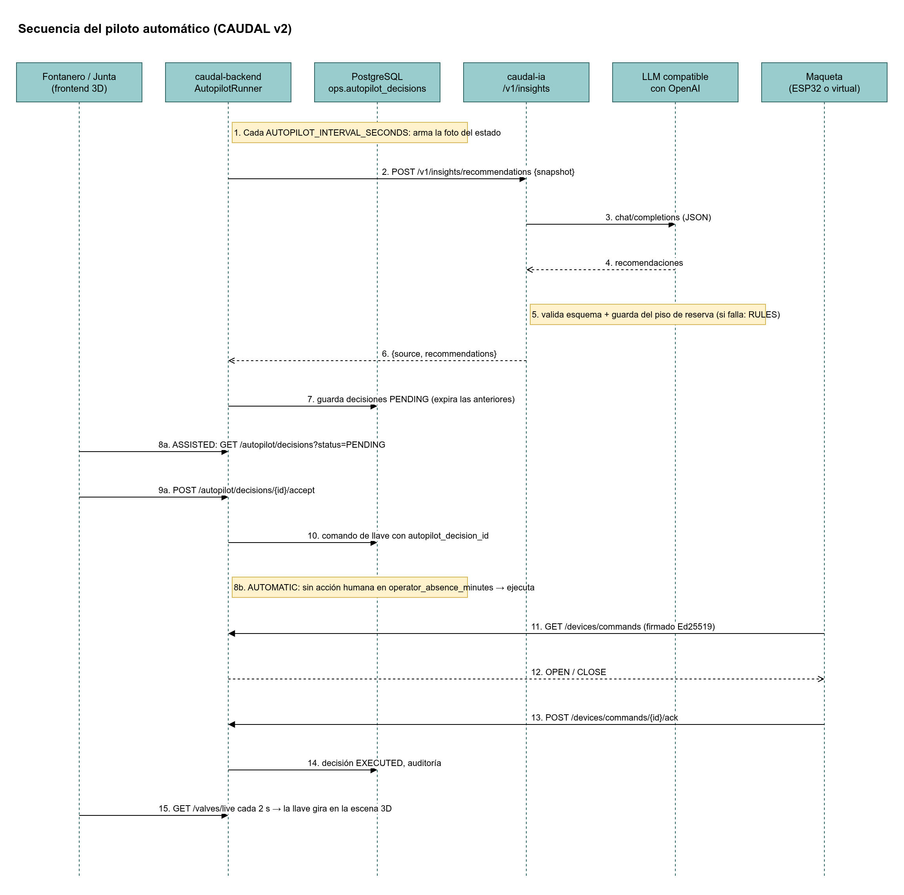
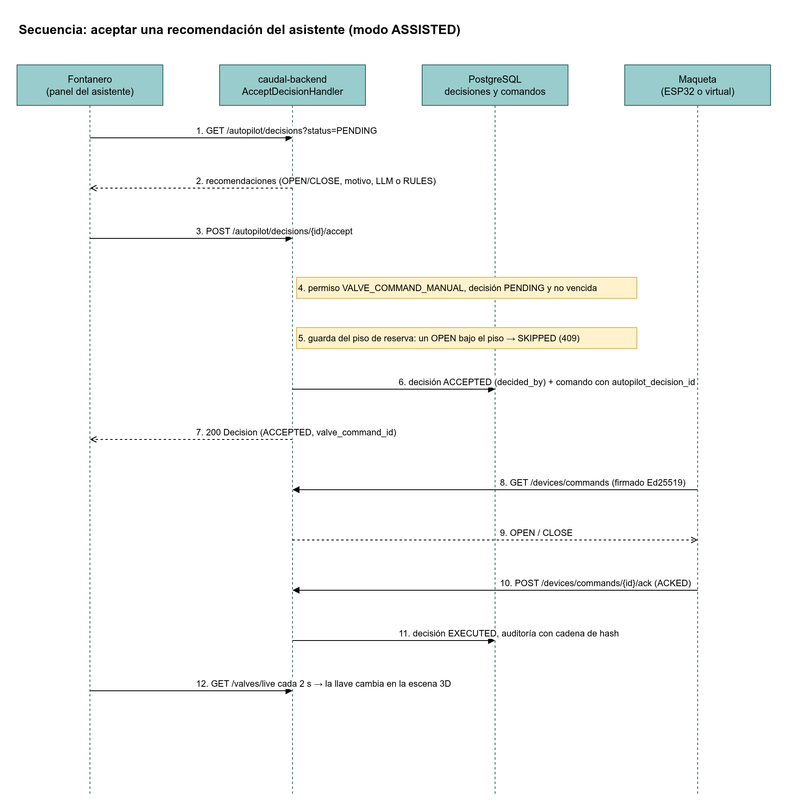

# API REST de CAUDAL

Este documento describe la API REST de `caudal-backend` en el modelo B2B para quien la implementa, la consume o la prueba. Cubre los endpoints de los módulos M1 a M10 de [Caudal.md](Caudal.md). La especificación formal (OpenAPI) se genera desde el código y se consulta en Swagger UI.

Convenciones de lectura:

- Los campos de tipo `texto` tienen límites tomados de `FieldLimits`. Cuando el límite todavía no está decidido se indica "por definir".
- Los códigos de error están en inglés. Los mensajes para el usuario están en español.
- Los valores de ejemplo son ficticios. Los valores de la maqueta (`maqueta-caudal`) se citan como ejemplo.
- Un permiso marcado "(propuesto)" o "(por definir)" no existe todavía en `iam.permissions`. Los permisos vigentes y la matriz por rol están en [Actores-y-permisos.md](Actores-y-permisos.md), sección 3.
- Un valor marcado "por definir" no se implementa hasta decidirlo.

Correspondencia de módulos con las secciones de este documento:

| Módulo (Caudal.md) | Secciones |
|---|---|
| M1 Login e instituciones | 2, 3, 4 |
| M2 Configuración de la institución | 6, 7 |
| M3 Sensor y tanque en vivo | 8 |
| M4 Válvulas y comandos | 10 |
| M5 Pronóstico y eventos | 9 |
| M6 Piloto y asistente | 11, 12 |
| M7 Observaciones, cierre del día y actas | 13 |
| M8 Dispositivos y maqueta | 16 |
| M9 Auditoría | 17 |
| M10 Instituciones simuladas | 15 |

## 1. Convenciones

### 1.1 Prefijo, formato y nombres

| Tema | Decisión |
|---|---|
| Prefijo | Todas las rutas empiezan con `/api/v1`. Excepciones: `/actuator/health` y la documentación (`/swagger-ui.html`, `/v3/api-docs`). |
| Formato de datos | JSON en UTF-8. Content-Type `application/json`. |
| Nombres de campos JSON | `snake_case`, igual que las columnas de la base de datos. El frontend en TypeScript usa `snake_case` en los DTO y `camelCase` solo en su capa de vista (`ApiDtoAdapter`). |
| Códigos de error y enums | Inglés en `SCREAMING_SNAKE_CASE` (`VALIDATION_ERROR`, `RECTANGULAR`, `INSTITUTION_ADMIN`). |
| Fechas y horas | ISO-8601 con zona, por ejemplo `2026-11-20T10:00:00-05:00`. El servidor guarda UTC y responde con `Z` o con el offset que corresponda. Fechas sin hora (`date`) usan `YYYY-MM-DD`. |
| Números decimales | En JSON, con punto (`4.24`). La UI muestra coma (`4,24`). Las distancias del sensor son enteros en mm. |
| Identificadores | UUID en texto. Los generados por el cliente (puntos de telemetría) son UUID versión 7 recomendados. Los `slug` de institución son texto en minúsculas. |
| Zona horaria | Los datos se muestran en `America/Bogota`. |

El campo de correlación se llama `request_id`, en `snake_case` como el resto del JSON.

### 1.2 Autenticación

Hay cuatro mecanismos, según el actor:

| Actor | Mecanismo | Cabecera o cookie |
|---|---|---|
| Personas (`PLATFORM_ADMIN`, `INSTITUTION_ADMIN`, `OPERATOR`, `VIEWER`) | JWT de acceso (HS256, 15 minutos) | `Authorization: Bearer <access_token>` |
| Sesión de la persona | Refresh token opaco de 256 bits | Cookie `caudal_rt` (`HttpOnly; Secure; SameSite=None; Path=/api/v1/auth`), con cabecera `X-Requested-With: caudal-web` y verificación de `Origin` |
| Dispositivos (sensor, actuadores y puente USB) | Firma Ed25519 sobre la petición | Cabeceras `X-Device-Id`, `X-Timestamp`, `X-Nonce`, `X-Signature` (ver [Protocolo-de-dispositivos.md](Protocolo-de-dispositivos.md)) |
| Público | Ninguna | Solo `GET /api/v1/public/institutions` y `POST /api/v1/auth/login` |

Claims del JWT de acceso:

| Claim | Significado |
|---|---|
| `iss`, `aud`, `sub`, `iat`, `exp`, `jti` | Estándar. Se valida `iss`, `aud`, `exp` y `nbf`, con tolerancia de 30 segundos. |
| `role` | `PLATFORM_ADMIN`, `INSTITUTION_ADMIN`, `OPERATOR` o `VIEWER`. |
| `institution_id` | Institución activa del usuario. Ausente en el token de plataforma. |
| `scope` | `institution` (usuarios de una institución) o `platform` (superadmin). |
| `act_as` | Solo en el token temporal del superadmin (`act_as=platform`), sección 3.5. |
| `tv` | `token_version`. Debe coincidir con `iam.users.token_version`. |

Reglas del JWT:

- El algoritmo se valida de forma explícita (`HS256`). El secreto tiene al menos 256 bits.
- `Authorization` mayor de 2 KiB se rechaza antes de parsear (`413`).
- El access token vive solo en memoria del frontend. Nunca va en `localStorage`.
- El `institution_id` sale del token validado, nunca de la URL ni de un parámetro.

Refresh token: se rota en cada uso. Si se reutiliza un token ya rotado, se revoca toda su familia y se registra `TOKEN_REUSE_DETECTED`. Duración: 7 días; 30 días para `OPERATOR` (riesgo aceptado, ver [Seguridad.md](Seguridad.md)). La duración del `PLATFORM_ADMIN` está por confirmar.

Cambiar contraseña, cambiar rol o desactivar una cuenta incrementa `token_version` y revoca sus refresh tokens. Así los access tokens vigentes dejan de servir.

La cookie del refresh token se llama `caudal_rt`. El frontend (Vercel) y la API (Render) son sitios distintos, así que la cookie usa `SameSite=None; Secure; HttpOnly; Path=/api/v1/auth`. Además, la API exige la cabecera `X-Requested-With: caudal-web` y verifica que `Origin` esté en `CORS_ALLOWED_ORIGINS`.

### 1.3 Formato de error canónico

Toda respuesta de error tiene esta forma:

```json
{
  "error": {
    "code": "CALIBRATION_INVALID",
    "message": "La distancia de lleno debe ser menor que la de vacío (350 mm).",
    "details": {
      "empty_distance_mm": 350,
      "full_distance_mm": 400
    },
    "request_id": "7f3c2a9e-1d4b-4e1a-9c0e-2b8f5a6d1e33"
  }
}
```

- `code`: código del catálogo de la sección 1.4. El frontend decide su comportamiento con este campo, no con el texto.
- `message`: en español, pensado para mostrarse al usuario. No revela si un usuario existe ni si una institución existe.
- `details`: opcional. Siempre un objeto JSON. No contiene trazas, SQL ni secretos.
- `request_id`: correlaciona la respuesta con los logs. También viene en la cabecera `X-Request-Id`.

### 1.4 Catálogo de códigos de error

| Código | HTTP | Mensaje (español, ejemplo) | Cuándo |
|---|---|---|---|
| `VALIDATION_ERROR` | 400 | Revisa los datos enviados. | Formato, tipo, longitud, campo desconocido, JSON mal formado, rango de fechas inválido, UUID inválido, forma del tanque que no coincide con sus medidas |
| `CURSOR_INVALID` | 400 | El cursor de paginación no es válido. | Cursor alterado o expirado |
| `UNAUTHORIZED` | 401 | Sesión no válida. Vuelve a iniciar sesión. | Falta el token, expiró o no es válido |
| `INVALID_CREDENTIALS` | 401 | Usuario o contraseña incorrectos. | Login fallido. Igual con institución inexistente, cuenta bloqueada, cuenta desactivada o `mfa_code` incorrecto: no se revela el motivo |
| `MFA_REQUIRED` | 401 | Escribe el código de tu aplicación de autenticación. | La contraseña es correcta y la cuenta tiene MFA activo, pero falta `mfa_code` |
| `SESSION_REVOKED` | 401 | Tu sesión se cerró. Vuelve a iniciar sesión. | Refresh token reutilizado o familia revocada |
| `INVALID_SIGNATURE` | 401 | La firma del dispositivo no es válida. | Firma Ed25519 incorrecta, clave o dispositivo desconocido |
| `NONCE_REPLAY` | 401 | Petición repetida. | `X-Nonce` ya visto en los últimos 10 minutos |
| `TIMESTAMP_OUT_OF_WINDOW` | 401 | La hora de la petición está fuera de la ventana permitida. | `X-Timestamp` fuera de ±300 s |
| `FORBIDDEN` | 403 | No tienes permiso para esta acción. | Falta el permiso, o un `VIEWER` intenta una mutación |
| `PASSWORD_CHANGE_REQUIRED` | 403 | Debes cambiar tu contraseña antes de continuar. | `must_change_password = true`; solo se permiten `/auth/current-user`, `/auth/change-password` y `/auth/logout` |
| `PRIVACY_NOTICE_PENDING` | 403 | Debes aceptar el aviso de privacidad. | Hay una versión nueva sin aceptar |
| `DEVICE_INACTIVE` | 403 | El dispositivo no está activo. | Dispositivo `SUSPENDED` o `RETIRED` |
| `SIMULATED_ONLY` | 403 | Esta operación solo aplica a instituciones simuladas. | Importación fuera de `is_simulated = true` (propuesto; reemplaza `DEMO_ONLY`) |
| `NOT_FOUND` | 404 | No encontramos ese recurso. | Recurso inexistente o de otra institución (no se distingue, para no revelar existencia) |
| `CONFLICT` | 409 | Los datos cambiaron. Recarga e intenta de nuevo. | `lock_version` distinto, usuario o slug ya existente, cierre del día ya registrado, clave repetida, válvula que ya tiene actuador |
| `INVALID_STATE_TRANSITION` | 409 | Esta acción no es válida en el estado actual. | Transición no permitida (anomalía no `OPEN`, comando `EXPIRED` o `CANCELLED`, decisión ya no `PENDING`) |
| `RATE_LIMITED` | 429 | Hiciste demasiadas solicitudes. Espera un momento. | Límite de tasa. Incluye `Retry-After` en segundos |
| `PAYLOAD_TOO_LARGE` | 413 | El cuerpo de la petición es demasiado grande. | Supera el límite de la familia de rutas (sección 1.8) |
| `UNSUPPORTED_MEDIA_TYPE` | 415 | Tipo de contenido no soportado. | Content-Type distinto de `application/json` en rutas JSON |
| `DISTANCE_OUT_OF_RANGE` | 422 | La distancia del sensor está fuera de su alcance. | `distance_mm` menor que 0 (distinto de `-1`) o mayor que el alcance del sensor (propuesto) |
| `CALIBRATION_INVALID` | 422 | Revisa la calibración del tanque. | `full_distance_mm >= empty_distance_mm`, o `empty_distance_mm` mayor que `height_mm` más el margen de montaje (propuesto) |
| `NO_LEVEL_DATA` | 422 | No hay una lectura válida del sensor. | Sin lectura válida para calibrar, pronosticar o preguntar al asistente |
| `MISSING_TIMESTAMP` | 422 | Falta la fecha y hora de la medida. | `observed_at` ausente o no válido |
| `FUTURE_TIMESTAMP` | 422 | La fecha de la medida está en el futuro. | `observed_at` mayor que ahora + 5 minutos |
| `TIMESTAMP_TOO_OLD` | 422 | La medida es demasiado antigua para registrarla. | `observed_at` anterior a `max_backdate_hours` de la institución (`org.institution_settings`, ejemplo 48 h). Aplica a telemetría por lotes del puente e importaciones. |
| `REASON_REQUIRED` | 422 | Escribe el motivo (entre 10 y 500 caracteres). | Descarte de una anomalía sin nota, observación `OTHER` sin texto |
| `PASSWORD_POLICY_VIOLATION` | 422 | La contraseña no cumple la política. | Menos de 12 caracteres, en la lista de comunes, contiene el usuario, repetida del historial |
| `INVALID_KEY` | 422 | La clave pública no es válida. | No es Ed25519 de 32 bytes en base64url |
| `IMPORT_LIMIT_EXCEEDED` | 422 | El lote supera 5.000 filas. | Importación con más filas del límite |
| `IA_UNAVAILABLE` | 503 | El servicio de pronóstico no responde. Se usa la estimación simple. | Solo si fallan la IA y la estimación de respaldo a la vez. El fallo normal de la IA no devuelve error: responde `200`/`201` con `is_fallback = true`. |
| `INTERNAL_ERROR` | 500 | Ocurrió un error. Intenta de nuevo más tarde. | Error no controlado. Sin trazas en la respuesta. |

Notas del catálogo:

- Los códigos del servicio de IA (`INSUFFICIENT_HISTORY`, `INVALID_SERIES`, `MODEL_NOT_READY`) no llegan al cliente. El backend los convierte en respaldo (ver [Contrato-IA.md](Contrato-IA.md)).
- Los códigos de reglas versionadas, turnos, lecturas manuales, correcciones y público salen del catálogo (sección 21.2).
- Los códigos de permiso y de recurso son `FORBIDDEN` (403) y `NOT_FOUND` (404). No existen `PERMISSION_DENIED` ni `RESOURCE_NOT_FOUND`.

### 1.5 Paginación por cursor

Las colecciones son paginadas con cursor opaco firmado.

- Parámetros: `limit` (entero de 1 a 100, por defecto 20) y `cursor` (texto opaco, opcional).
- Respuesta: `items` (lista) y `next_cursor` (texto o `null` si no hay más).

```json
{
  "items": [{ "id": "0190f3a2-7c1d-7b2e-9f11-3d4c5e6f7a81", "kind": "POSSIBLE_LEAK", "status": "OPEN" }],
  "next_cursor": "eyJvIjoyMH0.c2lnbmF0dXJh"
}
```

- El cursor se firma con HMAC. Un cursor alterado responde `400 CURSOR_INVALID`.
- Las listas tienen orden estable (por `observed_at`, `created_at`, `detected_at` o `id`, según el recurso, descendente por defecto).
- No se soportan `offset` ni conteos totales.

### 1.6 Idempotencia

| Operación | Clave de idempotencia | Comportamiento |
|---|---|---|
| `POST /devices/telemetry` | `id` de cada punto | Un punto repetido con el mismo contenido se cuenta en `duplicates` y no se guarda otra vez. Mismo `id` con contenido distinto: `CONFLICT`. |
| `POST /imports/readings` | `file_sha256` del archivo | Un archivo ya importado responde `409 CONFLICT`. |
| `POST /valve-commands/manual` | Sin cabecera | No hay idempotencia por cabecera. Un comando nuevo sobre una válvula con un comando activo la reemplaza (ver sección 10.1). |
| Resto de `POST` | Por definir | No hay idempotencia por cabecera en esta versión. Usar `lock_version` donde aplique. |

### 1.7 Versionado

- Versión en la ruta: `/api/v1`.
- Cambios aditivos (campos nuevos en respuestas, endpoints nuevos, valores nuevos opcionales) no suben la versión. Los clientes deben ignorar campos desconocidos en respuestas.
- Cambios incompatibles (quitar campos, cambiar tipos, cambiar significado de un código) requieren `/api/v2`.
- El contrato con la IA tiene su propia versión (`/v1/*` en el servicio de IA). Ver [Contrato-IA.md](Contrato-IA.md).

La migración del modelo B2B no cambia la versión de la ruta: los endpoints eliminados se quitan con la versión 1 en uso y se listan en la sección 21.1.

### 1.8 Límites de tamaño y de tasa

| Límite | Valor | Fuente |
|---|---|---|
| Cuerpo JSON (por defecto) | 64 KiB | Hechos, sección 11 |
| Cuerpo de telemetría | 256 KiB | Hechos, sección 11 |
| Cuerpo de importación | 1 MiB o 5.000 filas por lote | Hechos, sección 11 |
| Cabecera `Authorization` | 2 KiB | Hechos, sección 11 |
| Profundidad JSON | 10 niveles | Hechos, sección 11 |
| Elementos por lista | 100 (salvo que el campo indique otro) | Hechos, sección 11 |
| Texto global | 2.000 caracteres (tope por campo además) | Hechos, sección 11 |
| Campos desconocidos | Se rechazan (`VALIDATION_ERROR`) | `FAIL_ON_UNKNOWN_PROPERTIES` |
| Tipos | Sin coerción (un número no es texto) | Hechos, sección 11 |
| Login por (IP, institución) | 5 por minuto | Seguridad.md, sección 2.10 |
| Login por IP | 20 intentos en 15 minutos | Sección 2.2 |
| Directorio público | Por IP. Valor por definir | Seguridad.md, sección 2.10 |
| API autenticada | 120 por minuto por usuario | Hechos, sección 11 |
| Telemetría | 60 por minuto por dispositivo, en todas las rutas firmadas | Reglas-de-negocio.md, sección 4.1 |
| Recálculo de pronóstico | 10 por hora por institución | Hechos, sección 11 |
| Otros grupos (importación, evaluación) | Por definir | |

Respuesta al exceder un límite: `429 RATE_LIMITED` con la cabecera `Retry-After` (segundos, redondeados hacia arriba) y el mismo valor en `details.retry_after_seconds`. El contador es un bucket de Bucket4j en PostgreSQL (`iam.rate_limit_buckets`, con bloqueos *advisory*) para que sea compartido entre instancias. La clave nunca lleva la IP en claro: es `login-ip:` más su HMAC. El límite de login cuenta todos los intentos, exitosos o no, y se decide antes de mirar la contraseña.

Presupuesto de los dispositivos: cada dispositivo tiene su propio cupo de 60 por minuto. Un sensor que envía `DISTANCE` cada 2 s usa 30 por minuto. Un actuador que consulta `GET /devices/commands` cada 2 s usa otras 30. La consulta de `GET /devices/config` debe caber en lo que sobra. Su cadencia está por definir (propuesta: cada 30 s o al cambiar `config_version`).

Campo `text` con normalización: NFC, recorte de espacios, colapso de espacios internos en nombres. Se rechazan caracteres de control (salvo `\n` en textos largos), caracteres bidi (U+202A a U+202E, U+2066 a U+2069) y de ancho cero (U+200B a U+200F, U+FEFF).

### 1.9 Documentación Swagger

- Swagger UI: `/swagger-ui.html`. OpenAPI JSON: `/v3/api-docs`.
- Activo en todos los entornos. Se apaga con `API_DOCS_ENABLED=false`.
- `/v3/api-docs` y `/swagger-ui.html` son públicos (solo documentación). Cabecera CSP de `/swagger-ui/**`: `default-src 'self'; script-src 'self'; style-src 'self' 'unsafe-inline'; img-src 'self' data:; frame-ancestors 'none'`. El resto de la API usa `default-src 'none'; frame-ancestors 'none'`.
- Esquema de seguridad `bearerAuth` (JWT). Ejecutar peticiones desde Swagger requiere un JWT válido.
- Cada endpoint tiene `summary` y `description` en español.
- Los ejemplos usan datos ficticios. No se publican datos reales de personas ni de instituciones.

### 1.10 Notación de este documento

Cada endpoint indica:

- **Permiso:** código requerido. `Autenticado` significa solo sesión, sin permiso adicional. `Público` significa sin sesión. La matriz por rol está en [Actores-y-permisos.md](Actores-y-permisos.md), sección 3.2.
- **Cuerpo:** campos, tipo, si es obligatorio y límites.
- **Respuesta:** campos principales.
- **Errores:** códigos posibles, además de los comunes: `401 UNAUTHORIZED` si no hay sesión, `403 FORBIDDEN` si falta el permiso, `404 NOT_FOUND` si el recurso no existe en la institución, `429 RATE_LIMITED` si se excede la tasa, `500 INTERNAL_ERROR`. Estos comunes no se repiten en cada endpoint.
- **Ejemplo:** fragmento corto.

Todos los endpoints de institución (`/institution/*`, `/tanks/*`, `/service-lines/*`, etc.) toman la institución del token. Un `PLATFORM_ADMIN` sin `act_as` solo puede usar los endpoints de `/platform/*`.

## 2. Público y autenticación (`/public`, `/auth`)

### 2.1 `GET /api/v1/public/institutions`

- **Permiso:** `Público`. Limitado por tasa (sección 1.8).
- **Alcance:** solo instituciones activas. Responde `{slug, name}`. No hace join con usuarios, tanques ni datos de operación. Lo filtra `PublicInstitutionDirectoryProxy` (patrón Proxy).
- **Respuesta 200:** `items` con `slug` y `name`. Sin paginación: la lista es corta (por definir si crece).
- **Nota:** el frontend también puede entrar por `/i/{slug}/login`, que es una ruta de la aplicación web y no de la API.
- **Riesgo aceptado:** el directorio expone qué instituciones son clientes. Ver [Riesgos.md](Riesgos.md), RG-06.
- **Ejemplo:**

```json
{ "items": [{ "slug": "maqueta-caudal", "name": "Maqueta CAUDAL" }] }
```

### 2.2 `POST /api/v1/auth/login`

- **Permiso:** `Público`.
- **Cuerpo:**

| Campo | Tipo | Oblig. | Límites |
|---|---|---|---|
| `institution_slug` | texto | No (por ahora) | Slug de la institución elegida en el directorio. Si se omite, el usuario debe ser único en toda la plataforma (comportamiento anterior, para clientes que aún no envían el campo). Con el campo, la cuenta se busca por (institución, usuario) y la membresía debe estar vigente en esa institución. Para el superadmin, `null` (opción "CAUDAL (plataforma)"; llega en otra ronda). Límites: `FieldLimits.AQUEDUCT_SLUG_*`. |
| `username` | texto | Sí | 3 a 32, `^[a-z0-9][a-z0-9._-]{1,30}[a-z0-9]$`, se normaliza a minúsculas (`FieldLimits.USERNAME`) |
| `password` | texto | Sí | 12 a 128, NFKC (`FieldLimits.PASSWORD`) |
| `mfa_code` | texto | Si la cuenta tiene MFA activo | 6 dígitos (`FieldLimits.TOTP_CODE_PATTERN`) o un código de respaldo |

- **Respuesta 200:** `access_token` (texto), `token_type` (`Bearer`), `expires_in` (900), `user` (`id`, `username`, `full_name`, `role`, `institution_id`, `institution_slug`, `must_change_password`). Para el superadmin, `institution_id` y `institution_slug` son `null` y `role` es `PLATFORM_ADMIN`. Cookie `Set-Cookie` con el refresh token.
- **Errores:** `401 INVALID_CREDENTIALS` (siempre con el mismo mensaje y el mismo tiempo de respuesta: institución inexistente, usuario inexistente en esa institución, contraseña incorrecta, cuenta bloqueada o desactivada, `mfa_code` incorrecto o ya usado), `401 MFA_REQUIRED` (solo si la contraseña es correcta), `429 RATE_LIMITED`.
- **Reglas:**
  - El usuario es único por institución `(institution_id, username)`. Dos instituciones pueden tener un usuario `admin`.
  - Bloqueo por cuenta: 5 fallos consecutivos en 15 minutos bloquean 15 minutos; el bloqueo se duplica hasta 24 horas.
  - Bloqueo por IP: 20 intentos fallidos en 15 minutos.
  - Hash señuelo para tiempo constante cuando el usuario o la institución no existen.
  - `MFA_REQUIRED` solo se responde después de verificar la contraseña. Un `mfa_code` incorrecto queda como `MFA_FAILED` en `iam.login_attempts` y en `iam.security_events`, y cuenta para el bloqueo.
- **Ejemplo:**

```json
{ "institution_slug": "maqueta-caudal", "username": "operador.ejemplo", "password": "contraseña-de-ejemplo-larga" }
```

### 2.3 `POST /api/v1/auth/refresh`

- **Permiso:** cookie `caudal_rt` válida, cabecera `X-Requested-With: caudal-web` y `Origin` permitido. Sin cuerpo.
- **Respuesta 200:** `access_token` nuevo y `expires_in`. Cookie rotada.
- **Errores:** `401 UNAUTHORIZED` (sin cookie o vencida), `401 SESSION_REVOKED` (reutilización detectada: se revoca la familia), `403 FORBIDDEN` (falta `X-Requested-With` o `Origin` no permitido).

### 2.4 `POST /api/v1/auth/logout`

- **Permiso:** `Autenticado`.
- **Respuesta 204.** Revoca la familia del refresh token actual (`LOGOUT`) y borra la cookie.

### 2.5 `POST /api/v1/auth/logout-all`

- **Permiso:** `Autenticado`.
- **Respuesta 204.** Revoca todos los refresh tokens del usuario (`LOGOUT_ALL`).
- **Efecto:** además incrementa `token_version`, así que los access tokens ya emitidos responden `401 UNAUTHORIZED` en su siguiente uso. Borra la cookie `caudal_rt`.

### 2.6 `POST /api/v1/auth/change-password`

- **Permiso:** `Autenticado`. Permitido aunque `must_change_password = true`.
- **Cuerpo:**

| Campo | Tipo | Oblig. | Límites |
|---|---|---|---|
| `current_password` | texto | Sí | 1 a 128 |
| `new_password` | texto | Sí | 12 a 128, NFKC, sin lista de comunes, sin el usuario, no repetida de las últimas 5 |

- **Respuesta 204.** Incrementa `token_version`, revoca los refresh tokens (`PASSWORD_CHANGED`) y pone `must_change_password = false`.
- **Errores:** `401 UNAUTHORIZED` (contraseña actual incorrecta), `422 PASSWORD_POLICY_VIOLATION` (`details.rule`: `TOO_SHORT`, `TOO_LONG`, `COMMON`, `CONTAINS_USERNAME` o `RECENTLY_USED`).
- **Historial:** se comparan la contraseña vigente y las anteriores de `iam.password_history`, hasta `PASSWORD_HISTORY_SIZE` en total.
- **Ejemplo:**

```json
{ "current_password": "contraseña-temporal-ejemplo", "new_password": "nueva-contraseña-de-ejemplo" }
```

### 2.7 `POST /api/v1/auth/reset-password`

- **Permiso:** `Público` (con código de un solo uso emitido por el administrador de la institución o por el superadmin).
- **Cuerpo:** `institution_slug` (texto, obligatorio; el usuario es único solo dentro de su institución), `username` (mismo tope de entrada que login), `code` (texto de 1 a 32 caracteres; el código real tiene 12 caracteres Crockford base32, se muestra como `ABCD-EFGH-JKMN` y se acepta en minúsculas, con espacios o guiones), `new_password` (mismo límite que 2.6).
- **Respuesta 204.** Marca el código como usado, incrementa `token_version` y revoca las sesiones (`PASSWORD_CHANGED`). No cambia `must_change_password`: una cuenta nueva sigue obligada a cambiar su contraseña tras el primer ingreso. Si la contraseña no cumple la política responde 422 y el código no se gasta.
- **Errores:** `401 UNAUTHORIZED` (código inválido, vencido o usado, o institución o usuario inexistentes; mensaje genérico), `422 PASSWORD_POLICY_VIOLATION`, `429 RATE_LIMITED`.

### 2.8 `GET /api/v1/auth/current-user`

- **Permiso:** `Autenticado`. Permitido aunque `must_change_password = true`.
- **Respuesta 200:** `id`, `username`, `full_name`, `role`, `institution` (`id`, `slug`, `name`, `is_simulated`; `null` para el superadmin), `must_change_password`, `privacy_accepted_version` y `permissions` (lista de códigos vigentes en esa institución).
- **Ejemplo:**

```json
{
  "id": "0190f3a2-0000-7000-8000-000000000001",
  "username": "operador.ejemplo",
  "full_name": "Persona de Ejemplo",
  "role": "OPERATOR",
  "institution": { "id": "0190f3a2-0000-7000-8000-0000000000aa", "slug": "maqueta-caudal", "name": "Maqueta CAUDAL", "is_simulated": false },
  "must_change_password": false,
  "permissions": ["NETWORK_VIEW", "STATUS_VIEW", "VALVE_COMMAND_MANUAL", "OBSERVATION_CREATE", "DAY_CLOSE", "MINUTES_VIEW", "ASSISTANT_USE"]
}
```

### 2.9 `POST /api/v1/auth/mfa/enroll` y `POST /api/v1/auth/mfa/confirm`

- **Permiso:** `Autenticado`, solo para los roles de `MFA_ALLOWED_ROLES`: `PLATFORM_ADMIN` e `INSTITUTION_ADMIN`. Otro rol responde `403 FORBIDDEN`. Hacerlo obligatorio para `INSTITUTION_ADMIN` está por definir (ver [Actores-y-permisos.md](Actores-y-permisos.md), sección 2).
- **TOTP:** RFC 6238 con HMAC-SHA1, 6 dígitos y pasos de 30 segundos; se acepta un paso de desfase hacia cada lado. Un código no sirve dos veces (`last_used_step`).
- **`POST /auth/mfa/enroll`:** sin cuerpo. Genera un secreto de 20 bytes, lo guarda cifrado con AES-256-GCM (clave `MFA_ENCRYPTION_KEY`, id `MFA_KEY_ID`, ligado a la cuenta) y responde `201` con `secret` (Base32) y `otpauth_uri` (para el QR), una sola vez. `409 CONFLICT` con `details.reason = MFA_ALREADY_ACTIVE` si ya está activo.
- **`POST /auth/mfa/confirm`:** cuerpo `code` (6 dígitos). Activa el factor pendiente y responde `200` con `recovery_codes`: 10 códigos de respaldo de un solo uso, que se muestran una sola vez; solo se guarda su SHA-256 en `iam.mfa_recovery_codes`. Errores: `400 VALIDATION_ERROR` (código incorrecto), `404 NOT_FOUND` (no hay enrolamiento pendiente), `409 CONFLICT` (ya activo).
- **Login:** con MFA activo, `POST /auth/login` pide `mfa_code` (sección 2.2).

## 3. Plataforma: instituciones (`/platform`)

Estos endpoints usan el token de `PLATFORM_ADMIN` (`scope = platform`, sin `institution_id`). Solo tienen el permiso `PLATFORM_MANAGE`. Las operaciones entre instituciones pasan por funciones `SECURITY DEFINER` de la base de datos (`platform.create_institution`, `platform.list_institutions`), ver [Seguridad-de-la-base-de-datos.md](Seguridad-de-la-base-de-datos.md), sección 5.4.

### 3.1 `GET /api/v1/platform/institutions`

- **Permiso:** `PLATFORM_MANAGE`.
- **Parámetros:** `is_active` (opcional), `limit`, `cursor`.
- **Respuesta 200:** `items` con `id`, `slug`, `name`, `is_simulated`, `is_active` y `created_at`. Orden por `created_at`, descendente. Next cursor.

### 3.2 `POST /api/v1/platform/institutions`

- **Permiso:** `PLATFORM_MANAGE`.
- **Efecto:** crea la institución a partir de una plantilla (patrón Prototype). La plantilla copia el tanque, las líneas, las válvulas y los parámetros de `org.institution_settings`. En la misma transacción se fija `SET LOCAL app.institution_id` con el id nuevo. La función es `platform.create_institution(...)`.
- **Cuerpo:**

| Campo | Tipo | Oblig. | Límites |
|---|---|---|---|
| `slug` | texto | Sí | 3 a 40, `^[a-z0-9]+(-[a-z0-9]+)*$`, único. Límite exacto por definir en `FieldLimits.INSTITUTION_SLUG`. |
| `name` | texto | Sí | 2 a 80 (por definir en `FieldLimits`) |
| `is_simulated` | booleano | No | Por defecto `false`. Se decide al crear y no cambia después (propuesto). |
| `template_code` | texto | No | Código de la plantilla. Por definir; si falta, se usa la plantilla por defecto. |

- **Respuesta 201:** institución creada (`id`, `slug`, `name`, `is_simulated`, `is_active`).
- **Errores:** `400 VALIDATION_ERROR` (slug con formato inválido), `404 NOT_FOUND` (plantilla inexistente), `409 CONFLICT` (slug repetido).
- **Ejemplo:**

```json
{ "slug": "escuela-ejemplo", "name": "Escuela de Ejemplo", "is_simulated": true }
```

### 3.3 `PATCH /api/v1/platform/institutions/{id}`

- **Permiso:** `PLATFORM_MANAGE`.
- **Cuerpo (todos opcionales):** `name`, `is_active`. Desactivar una institución la quita del directorio público (`GET /public/institutions`) y bloquea su login. El `slug` y `is_simulated` no cambian.
- **Respuesta 200:** institución actualizada.
- **Errores:** `404 NOT_FOUND`.

### 3.4 `POST /api/v1/platform/institutions/{id}/admin`

- **Permiso:** `PLATFORM_MANAGE`.
- **Cuerpo:** `username` (3 a 32, regex de login), `full_name` (2 a 80, `FieldLimits.PERSON_NAME`).
- **Respuesta 201:** `user` (`id`, `username`, `role` = `INSTITUTION_ADMIN`), `activation_code` y `expires_at`. El código se muestra una sola vez. El usuario fija su contraseña con `POST /auth/reset-password`.
- **Errores:** `409 CONFLICT` (usuario ya existe en esa institución), `404 NOT_FOUND`.

### 3.5 `POST /api/v1/platform/institutions/{id}/act-as`

- **Permiso:** `PLATFORM_MANAGE`.
- **Cuerpo:** ninguno.
- **Efecto:** emite un token temporal de 15 minutos con `institution_id` de la institución indicada y `act_as = platform`. Sus permisos son los de `INSTITUTION_ADMIN` en esa institución. No se puede renovar: al expirar hay que volver a emitirlo (por confirmar). La emisión, cada acción y el cierre quedan en `audit.audit_log` con el actor `PLATFORM_ADMIN` y la institución objetivo.
- **Respuesta 200:** `access_token`, `token_type`, `expires_in` (900), `institution_id`, `act_as` = `platform`.
- **Errores:** `404 NOT_FOUND` (institución inexistente).

## 4. Usuarios (`/users`)

Un usuario pertenece a una sola institución. La institución sale del token, no del cuerpo. No hay ruta `/memberships`: cada usuario tiene una sola membresía activa en `iam.memberships`, que guarda su rol ([Actores-y-permisos.md](Actores-y-permisos.md), sección 1).

### 4.1 `GET /api/v1/users`

- **Permiso:** `USER_MANAGE`.
- **Parámetros:** `status` (`ACTIVE`, `LOCKED`, `DISABLED`), `role` (`INSTITUTION_ADMIN`, `OPERATOR`, `VIEWER`), `limit`, `cursor`.
- **Alcance:** usuarios de la institución del token, ordenados por `username`.
- **Respuesta:** `items` con `id`, `username`, `full_name` (solo para `INSTITUTION_ADMIN`), `role`, `status`, `locked_until`, `must_change_password`, `last_login_at`, y `next_cursor`.
- **Errores:** `400 VALIDATION_ERROR`, `400 CURSOR_INVALID`.

### 4.2 `POST /api/v1/users`

- **Permiso:** `USER_MANAGE`.
- **Cuerpo:**

| Campo | Tipo | Oblig. | Límites |
|---|---|---|---|
| `username` | texto | Sí | 3 a 32, regex de login (`FieldLimits.USERNAME`). Único en la institución. |
| `full_name` | texto | Sí | 2 a 80, letras, espacio, `'`, `-`, `.` (`FieldLimits.PERSON_NAME`) |
| `role` | texto | Sí | `INSTITUTION_ADMIN`, `OPERATOR` o `VIEWER`. `PLATFORM_ADMIN` no se asigna aquí. |

- **Respuesta 201:** usuario creado con `must_change_password = true`. Se guarda un hash Argon2id de 32 bytes aleatorios, que no sirve para entrar. El sistema emite un código de activación de un solo uso (`iam.password_reset_grants`): la respuesta trae `activation_code` y `expires_at`, y el código se muestra una sola vez.
- **Errores:** `409 CONFLICT` (usuario ya existe en la institución), `400 VALIDATION_ERROR` (formato o rol no permitido).
- **Ejemplo:**

```json
{ "username": "operador.ejemplo", "full_name": "Persona de Ejemplo", "role": "OPERATOR" }
```

### 4.3 `PATCH /api/v1/users/{id}`

- **Permiso:** `USER_MANAGE`.
- **Cuerpo (todos opcionales):** `full_name` (2 a 80), `role` (`INSTITUTION_ADMIN`, `OPERATOR` o `VIEWER`), `status` (`ACTIVE`, `LOCKED` o `DISABLED`).
- **Efecto:** cambiar el rol o desactivar o bloquear la cuenta incrementa `token_version` y revoca sus refresh tokens (`ROLE_CHANGED`). `LOCKED` puesto por un administrador no tiene fin y dura hasta que alguien envíe `ACTIVE`. `DISABLED` es definitivo y guarda `disabled_at`.
- **Respuesta 200:** usuario actualizado.
- **Errores:** `404 NOT_FOUND` (la cuenta no existe o es de otra institución), `409 INVALID_STATE_TRANSITION` (una cuenta `DISABLED` no cambia de estado), `409 CONFLICT` con `details.reason = SELF_LOCKOUT` (un administrador no bloquea, desactiva ni baja su propio rol).
- **Ejemplo:** `{ "status": "DISABLED" }`

### 4.4 `POST /api/v1/users/{id}/reset-grants`

- **Permiso:** `USER_MANAGE`.
- **Cuerpo:** `reason` (texto, 10 a 500, `FieldLimits.REASON`).
- **Respuesta 201:** `id`, `code` (se muestra una sola vez), `expires_at`. Solo se guarda el hash SHA-256 del código. Los códigos anteriores no usados quedan revocados (`revoked_at`).
- **Errores:** `422 REASON_REQUIRED`, `404 NOT_FOUND`, `409 INVALID_STATE_TRANSITION` (cuenta `DISABLED`).
- **Ejemplo:** `{ "code": "ABCD-2345", "expires_at": "2026-11-21T10:00:00-05:00" }` (valores ficticios)

## 5. Meta, catálogos y aviso de privacidad

### 5.1 `GET /api/v1/meta/constraints`

- **Permiso:** `Público`.
- **Respuesta:** los límites de `FieldLimits` que el frontend usa para armar sus esquemas Zod. Cada campo trae `min`, `max`, `pattern` (si aplica) y topes propios. Campos principales: `username`, `password`, `person_name`, `place_name`, `institution_slug`, `observation.note`, `reason`, `reset_code`, `mfa_code`, `tank.dimension_mm`, `setting.*`, `page.limit`, `list.items`, `text`, `body.bytes`. Los valores que aún no están decididos se marcan "por definir" en [Configuracion-sin-valores-quemados.md](Configuracion-sin-valores-quemados.md).
- **Caché:** una hora (`Cache-Control: max-age=3600, public`).
- **Los parámetros de negocio no están aquí.** Viven en `org.institution_settings` (sección 6).
- **Ejemplo:**

```json
{ "username": { "min": 3, "max": 32 }, "password": { "min": 12, "max": 128 }, "observation.note": { "min": 10, "max": 500 } }
```

### 5.2 `GET /api/v1/catalogs/{catalog}`

- **Permiso:** `Público` (solo etiquetas).
- **Parámetro de ruta:** `catalog`. Otro valor: `404 NOT_FOUND`.
- **Respuesta:** lista de `code`, `label_es`, `sort_order`, solo elementos activos.
- **Nota:** los tipos de observación (`WATER_DIRTY`, `WATER_MUDDY`, `VISIBLE_DAMAGE`, `OTHER`) son un enum fijo del código, no un catálogo. Los catálogos de la versión 1 (`WATER_APPEARANCE`, `DAMAGE_CATEGORY`) salen con las lecturas manuales y los reportes públicos. Qué catálogos quedan en la semilla está por definir.
- **Ejemplo:** `{ "items": [{ "code": "WATER_DIRTY", "label_es": "Agua sucia", "sort_order": 1 }] }` (ejemplo; la semilla está por definir)

### 5.3 `GET /api/v1/privacy-notice/current`

- **Permiso:** `Autenticado`.
- **Respuesta:** `version`, `text_es`, `text_sha256`, `effective_at`. La vigente es la versión más alta con `effective_at` ya cumplido.
- **Errores:** `404 NOT_FOUND` (no hay aviso vigente).

### 5.4 `POST /api/v1/privacy-notice/accept`

- **Permiso:** `Autenticado`.
- **Cuerpo:** `version` (entero, obligatorio, debe ser la versión vigente).
- **Respuesta 201:** `user_id`, `version`, `accepted_at`. Se guarda la IP en HMAC. Aceptar otra vez la misma versión devuelve la primera aceptación.
- **Errores:** `409 CONFLICT` con `details.current_version` (la versión ya no es la vigente).

## 6. Configuración de la institución (`/institution/settings`)

Los parámetros de negocio viven en `org.institution_settings`: una fila por institución, editable por el administrador, auditada y sin versiones. Reemplazan a las reglas versionadas (`rule_sets`), que se quitan del producto. Los valores de ejemplo son de [Reglas-de-negocio.md](Reglas-de-negocio.md), sección 13, y no son configuración real.

### 6.1 `GET /api/v1/institution/settings`

- **Permiso:** `STATUS_VIEW`.
- **Respuesta 200:** la fila completa de `org.institution_settings` de la institución del token, con `updated_by` y `updated_at`.
- **Ejemplo:**

```json
{
  "reserve_level_pct": 20.00,
  "low_level_pct": 30.00,
  "critical_level_pct": 10.00,
  "stale_after_seconds": 30,
  "persist_interval_seconds": 60,
  "max_backdate_hours": 48,
  "max_level_change_per_minute": 2.00,
  "sensor_stuck_window_seconds": 120,
  "trend_window_minutes": 10,
  "forecast_step_seconds": 300,
  "forecast_horizon_steps": 12,
  "forecast_context_steps": 288,
  "operator_absence_minutes": 30,
  "reserve_floor_pct": 15.00,
  "autopilot_mode": "ASSISTED",
  "updated_at": "2026-11-20T09:00:00-05:00"
}
```

### 6.2 `PATCH /api/v1/institution/settings`

- **Permiso:** `INSTITUTION_CONFIGURE` para los campos generales. Los campos del piloto (`autopilot_mode`, `operator_absence_minutes`, `reserve_floor_pct`) exigen además `AUTOPILOT_CONFIGURE`. Es la única ruta para cambiar el modo del piloto: no existe `PUT /autopilot/mode`.
- **Cuerpo (todos opcionales):**

| Campo | Tipo | Límites |
|---|---|---|
| `reserve_level_pct`, `low_level_pct`, `critical_level_pct` | decimal (2) | 0 a 100. `critical_level_pct < low_level_pct`. |
| `stale_after_seconds` | entero | Mayor que 0 |
| `persist_interval_seconds` | entero | Mayor que 0 |
| `max_backdate_hours` | entero | Mayor que 0. Antigüedad máxima de un punto (`TIMESTAMP_TOO_OLD`). |
| `max_level_change_per_minute` | decimal (2) | Mayor o igual a 0, en mm/min |
| `sensor_stuck_window_seconds` | entero | Mayor que 0 |
| `trend_window_minutes` | entero | Mayor que 0 |
| `forecast_step_seconds` | entero | Mayor que 0 |
| `forecast_horizon_steps`, `forecast_context_steps` | entero | Mayor que 0. Límites máximos por definir. |
| `operator_absence_minutes` | entero | 1 a 1440 |
| `reserve_floor_pct` | decimal (2) | 0 a 100 |
| `autopilot_mode` | texto | `MANUAL`, `ASSISTED` o `AUTOMATIC` |

- **Respuesta 200:** la fila completa, como 6.1.
- **Efecto:** cada cambio queda en `audit.audit_log` con su valor anterior y el nuevo (`INSTITUTION_SETTINGS_CHANGED`, propuesto). Rige desde la siguiente lectura o ciclo.
- **Errores:** `400 VALIDATION_ERROR` (rango inválido, por ejemplo `critical_level_pct >= low_level_pct`, o modo desconocido), `403 FORBIDDEN` (falta el permiso del campo).
- **Ejemplo:** `{ "reserve_level_pct": 25.00, "autopilot_mode": "AUTOMATIC" }`

Nota: la escala del pronóstico (`forecast_*`) se expresa en pasos de tiempo. La maqueta usa segundos o minutos (ver [Modulo-IA.md](Modulo-IA.md)).

## 7. Tanque, líneas y válvulas (configuración)

El administrador configura la red de la institución: el tanque y su geometría, las líneas de servicio y una válvula por línea. Una línea de servicio se llama "Acueducto N" en la interfaz, y su nombre es editable. En código se llama `service_line`. Ver [Reglas-de-negocio.md](Reglas-de-negocio.md), secciones 1 a 3 y 9.

Todos los cambios de esta sección llegan al puente sin reiniciarlo, porque el puente relee `GET /devices/config` (sección 16.1).

### 7.1 `GET /api/v1/tanks`

- **Permiso:** `NETWORK_VIEW`.
- **Respuesta:** `items` con `id`, `name`, `shape` (`CYLINDER` o `RECTANGULAR`), `height_mm`, `diameter_mm` o `length_mm` y `width_mm` (según la forma), `empty_distance_mm`, `full_distance_mm`, `blind_zone_mm` y `is_active`. El volumen no se guarda: se calcula (sección 8).

### 7.2 `POST /api/v1/tanks`

- **Permiso:** `INSTITUTION_CONFIGURE`.
- **Uso:** normalmente el tanque lo crea la plantilla de la institución (sección 3.2). Esta ruta sirve para una institución que aún no tiene tanque. Una institución tiene un solo tanque en esta versión (propuesto): un segundo tanque responde `409 CONFLICT`.
- **Cuerpo:**

| Campo | Tipo | Oblig. | Límites |
|---|---|---|---|
| `name` | texto | Sí | 2 a 60 (`PLACE_NAME`) |
| `shape` | texto | Sí | `CYLINDER` o `RECTANGULAR` |
| `height_mm` | entero | Sí | Mayor que 0 |
| `diameter_mm` | entero | Si `shape = CYLINDER` | Mayor que 0. No se envía con `RECTANGULAR`. |
| `length_mm`, `width_mm` | entero | Si `shape = RECTANGULAR` | Mayores que 0. No se envían con `CYLINDER`. |
| `empty_distance_mm` | entero | Sí | Distancia del sensor al fondo, con el tanque vacío. Entre 0 y 4000 (alcance del HC-SR04). |
| `full_distance_mm` | entero | Sí | Distancia del sensor a la superficie, con el tanque lleno. Entre 0 y 4000. Reglas de calibración en 7.3. |
| `blind_zone_mm` | entero | No | Mayor o igual a 0. Por defecto por definir (la maqueta usa 20 mm como ejemplo). |

- **Respuesta 201:** tanque creado.
- **Errores:** `400 VALIDATION_ERROR` (la forma no coincide con sus medidas), `422 CALIBRATION_INVALID` (ver 7.3), `409 CONFLICT` (la institución ya tiene tanque).
- **Ejemplo (medidas de la maqueta, ejemplo):**

```json
{ "name": "Tanque de la maqueta", "shape": "CYLINDER", "height_mm": 300, "diameter_mm": 200, "empty_distance_mm": 350, "full_distance_mm": 80, "blind_zone_mm": 20 }
```

### 7.3 `PATCH /api/v1/tanks/{id}`

- **Permiso:** `INSTITUTION_CONFIGURE`.
- **Cuerpo (todos opcionales):** los campos de 7.2, salvo que `shape` solo cambia junto con sus medidas.
- **Reglas de calibración** (se validan al guardar):

| Regla | Ejemplo que pasa | Ejemplo que falla |
|---|---|---|
| `full_distance_mm < empty_distance_mm` | `80 < 350` | `full = 400` con `empty = 350` |
| `empty_distance_mm <= height_mm + margen_de_montaje` | `350 <= 300 + 50` (margen de ejemplo 50 mm) | `empty = 360` |

El margen de montaje está por definir. Si una regla falla, la respuesta es `422 CALIBRATION_INVALID` y no cambia nada.

- **Respuesta 200:** tanque actualizado.
- **Errores:** `400 VALIDATION_ERROR`, `422 CALIBRATION_INVALID`, `404 NOT_FOUND`.

### 7.4 `POST /api/v1/tanks/{id}/calibration`

- **Permiso:** `INSTITUTION_CONFIGURE`.
- **Efecto:** calibra con la última lectura cruda válida del sensor, sin escribir la distancia a mano. El botón "usar lectura actual como vacío" o "como lleno" de la interfaz llama a esta ruta.
- **Cuerpo:** `point` (texto, obligatorio): `EMPTY` (guarda `empty_distance_mm`) o `FULL` (guarda `full_distance_mm`).
- **Respuesta 200:** tanque actualizado y `distance_mm` usada, con `observed_at`.
- **Reglas:** solo se calibra con una lectura cuyo `sensor_status` sea `OK` (sección 8.1). Con `NO_ECHO` o `STALE` la ruta responde `422 NO_LEVEL_DATA`. Después de guardar, aplica las reglas de 7.3.
- **Errores:** `422 NO_LEVEL_DATA`, `422 CALIBRATION_INVALID`, `400 VALIDATION_ERROR` (`point` desconocido), `404 NOT_FOUND`.
- **Ejemplo:** `{ "point": "EMPTY" }`

### 7.5 `GET /api/v1/service-lines`

- **Permiso:** `NETWORK_VIEW`.
- **Respuesta:** `items` con `id`, `tank_id`, `name`, `is_active` y `valve` (la válvula de la línea: `id`, `code`, `is_motorized`, `servo_channel`, `open_angle_deg`, `closed_angle_deg`, `hold_torque_after_move`, `fail_safe_position`, `is_active`; `null` si la línea aún no tiene válvula).
- **Ejemplo de respuesta:**

```json
{
  "items": [
    {
      "id": "0190f3a2-e001-7000-8000-000000000001",
      "tank_id": "0190f3a2-e000-7000-8000-000000000001",
      "name": "Acueducto 1",
      "is_active": true,
      "valve": { "id": "0190f3a2-e002-7000-8000-000000000001", "code": "V1", "is_motorized": true, "servo_channel": 1, "open_angle_deg": 90, "closed_angle_deg": 0, "hold_torque_after_move": true, "fail_safe_position": "KEEP", "is_active": true }
    }
  ]
}
```

### 7.6 `POST /api/v1/service-lines`

- **Permiso:** `INSTITUTION_CONFIGURE`.
- **Cuerpo:** `tank_id` (UUID, obligatorio, tanque de la institución) y `name` (texto, 2 a 60, `PLACE_NAME`).
- **Respuesta 201:** línea creada, sin válvula todavía.
- **Límite de líneas:** por definir. Lo acota la cantidad de canales del actuador.
- **Errores:** `404 NOT_FOUND` (tanque inexistente o de otra institución), `400 VALIDATION_ERROR`.

### 7.7 `PATCH /api/v1/service-lines/{id}`

- **Permiso:** `INSTITUTION_CONFIGURE`.
- **Cuerpo (todos opcionales):** `name`, `is_active`. No hay borrado: una línea se desactiva con `is_active = false`.
- **Respuesta 200:** línea actualizada.
- **Errores:** `404 NOT_FOUND`.

### 7.8 `POST /api/v1/service-lines/{id}/valves`

- **Permiso:** `INSTITUTION_CONFIGURE`.
- **Regla:** cada línea tiene una sola válvula. Si ya tiene una, responde `409 CONFLICT`.
- **Cuerpo:**

| Campo | Tipo | Oblig. | Límites |
|---|---|---|---|
| `code` | texto | Sí | 1 a 20, `^[A-Z0-9-]+$`, único en la institución (`FieldLimits.VALVE_CODE`) |
| `is_motorized` | booleano | No | Por defecto `false`. Una válvula motorizada tiene actuador. |
| `servo_channel` | entero | Si `is_motorized` | Canal del servo en el actuador. Único por actuador. Rango por definir. En la maqueta, 1 y 2. |
| `open_angle_deg`, `closed_angle_deg` | entero | Si `is_motorized` | 0 a 180 (rango del servo). Deben ser distintos. |
| `hold_torque_after_move` | booleano | No | Por defecto `true`. Si es `false`, el puente envía `R<n>` al recibir `DONE` y el servo queda suelto. |
| `fail_safe_position` | texto | No | `KEEP`, `OPEN` o `CLOSED`. Por defecto `KEEP`. |

- **Respuesta 201:** válvula creada.
- **Errores:** `400 VALIDATION_ERROR` (motorizada sin canal o sin ángulos, o ángulos iguales), `409 CONFLICT` (la línea ya tiene válvula, código repetido o canal ocupado), `404 NOT_FOUND`.
- **Ejemplo:**

```json
{ "code": "V1", "is_motorized": true, "servo_channel": 1, "open_angle_deg": 90, "closed_angle_deg": 0, "hold_torque_after_move": true, "fail_safe_position": "KEEP" }
```

### 7.9 `PATCH /api/v1/valves/{id}`

- **Permiso:** `INSTITUTION_CONFIGURE`.
- **Cuerpo (todos opcionales):** `is_motorized`, `servo_channel`, `open_angle_deg`, `closed_angle_deg`, `hold_torque_after_move`, `fail_safe_position`, `is_active`. El `code` no cambia.
- **Efecto:** el puente aplica el nuevo canal o ángulo en su siguiente lectura de `GET /devices/config`, sin reiniciar.
- **Respuesta 200:** válvula actualizada.
- **Errores:** `400 VALIDATION_ERROR` (ángulos iguales o fuera de 0 a 180), `409 CONFLICT` (canal ocupado por otra válvula), `404 NOT_FOUND`.

### 7.10 `GET /api/v1/valves`

- **Permiso:** `NETWORK_VIEW`.
- **Respuesta:** lista plana de válvulas de la institución, con `id`, `service_line_id`, `code`, `is_motorized`, `servo_channel`, `open_angle_deg`, `closed_angle_deg`, `hold_torque_after_move`, `fail_safe_position` e `is_active`. Para el estado en vivo, ver 10.3.

### 7.11 `GET /api/v1/network` (por definir)

- **Estado:** por definir. [Actores-y-permisos.md](Actores-y-permisos.md) lo lista con `NETWORK_VIEW`. Su forma anterior (árbol de sectores y regiones) se quita. Si se mantiene, devolvería el tanque, las líneas y sus válvulas en una sola respuesta. Hasta decidirlo, usar `GET /tanks`, `GET /service-lines` y `GET /valves`.

## 8. Sensor en vivo

El sensor ultrasónico HC-SR04 envía la distancia en mm. El backend la convierte en nivel y en volumen con la geometría del tanque (patrón Strategy, `CylinderGeometry` o `RectangularGeometry`). Las fórmulas están en [Reglas-de-negocio.md](Reglas-de-negocio.md), sección 2.

### 8.1 `GET /api/v1/tanks/{id}/live`

- **Permiso:** `STATUS_VIEW`.
- **Uso:** la interfaz consulta este endpoint cada 2 segundos.
- **Respuesta 200:**

| Campo | Significado |
|---|---|
| `distance_mm` | Distancia cruda del último punto (mm). `-1` si no hubo eco. |
| `level_mm`, `level_pct` | Nivel (sección 2 de Reglas). Nulos si no hay nivel (sin eco o zona ciega). |
| `volume_l` | Litros. Nulo si no hay nivel. |
| `observed_at` | Momento de la medida (UTC). |
| `age_seconds` | Segundos desde `observed_at`. |
| `sensor_status` | `OK`, `NO_ECHO` o `STALE`. |

- **Regla de `sensor_status`**, en este orden:
  1. `STALE` si no llegó ningún punto en `stale_after_seconds`.
  2. `NO_ECHO` si el último punto fue `-1`, o si cae en la zona ciega (`distance_mm < blind_zone_mm`).
  3. `OK` en los demás casos.
- **Sin ningún punto:** `sensor_status = STALE` y los campos de medida en `null` (propuesto).
- **Errores:** `404 NOT_FOUND`.
- **Ejemplo** (lectura de 215 mm en la maqueta):

```json
{
  "distance_mm": 215,
  "level_mm": 135.0,
  "level_pct": 50.0,
  "volume_l": 4.24,
  "observed_at": "2026-11-20T20:30:00Z",
  "age_seconds": 2,
  "sensor_status": "OK"
}
```

### 8.2 `GET /api/v1/readings`

- **Permiso:** `STATUS_VIEW` (propuesto; el permiso de lectura de lecturas crudas no existe todavía, ver [Actores-y-permisos.md](Actores-y-permisos.md), sección 3.2).
- **Solo lectura.** No hay alta manual de lecturas. La fuente es el sensor, y en instituciones simuladas, la importación de historial (sección 15).
- **Parámetros:** `tank_id` (obligatorio), `from` y `to` (ISO-8601 con zona, inclusivos; `from` no puede ser posterior a `to`), `limit` (1 a 100, 20 por defecto), `cursor`.
- **Orden:** de la más reciente a la más antigua por `observed_at`.
- **Respuesta 200:** `items` con `id`, `observed_at`, `distance_mm`, `level_mm`, `level_pct`, `volume_l`, `source` (`SENSOR` o `IMPORT`), `device_id` y `next_cursor`.
- **Qué se guarda:** los puntos crudos van a `devices.telemetry_points`. Las lecturas efectivas van a `ops.readings` cada `persist_interval_seconds`, o antes si el nivel cambia más de un umbral (por definir). Ver [Protocolo-de-dispositivos.md](Protocolo-de-dispositivos.md), sección 4.3.
- **Errores:** `400 VALIDATION_ERROR` (rango invertido o `limit` fuera de 1 a 100), `400 CURSOR_INVALID`, `404 NOT_FOUND` (tanque inexistente o de otra institución).

## 9. Pronóstico, eventos y anomalías

El pronóstico tiene tres salidas separadas (ver [Reglas-de-negocio.md](Reglas-de-negocio.md), sección 6). Los eventos y las recomendaciones del piloto se muestran aparte.

### 9.1 `GET /api/v1/tanks/{id}/outlook`

- **Permiso:** `STATUS_VIEW`.
- **Respuesta 200:** las tres salidas, cada una con su origen.

| Bloque | Origen | Qué contiene |
|---|---|---|
| `water_left` | `OBSERVED` | Litros y porcentaje que quedan, por geometría. Sin predicción. |
| `time_to_reserve` | `ESTIMATED` (determinista) | Minutos hasta la reserva, con la pendiente de `trend_window_minutes`. `status`: `FALLING`, `NOT_EMPTYING_AT_CURRENT_RATE` o `ALREADY_BELOW_RESERVE`. |
| `time_to_empty` | `ESTIMATED` (determinista) | Minutos hasta vaciarse, con la misma pendiente. Mismos `status`. |
| `chronos_band` | `ESTIMATED` (modelo Chronos) | Banda p10, p50 y p90 por paso de `forecast_step_seconds`, hasta `forecast_horizon_steps`, en `level_mm` y en `level_pct`. Con `is_fallback` y `fallback_reason` si se usó respaldo. |

- **Campos comunes:** `sensor_status` y `age_seconds`. Si el sensor no está en `OK`, las salidas usan el último dato válido y muestran su `age_seconds`.
- **Sin lectura válida:** `200` con `water_left` nulo y `sensor_status` distinto de `OK` (propuesto), para que la pantalla lo muestre.
- **Respuesta de ejemplo** (datos de la sección 6 de Reglas, ejemplo):

```json
{
  "water_left": { "origin": "OBSERVED", "liters": 4.24, "level_pct": 50.0, "observed_at": "2026-11-20T20:30:00Z" },
  "time_to_reserve": { "origin": "ESTIMATED", "status": "FALLING", "minutes": 40.5 },
  "time_to_empty": { "origin": "ESTIMATED", "status": "FALLING", "minutes": 67.5 },
  "chronos_band": {
    "origin": "ESTIMATED",
    "is_fallback": false,
    "fallback_reason": null,
    "step_seconds": 300,
    "points": [{ "offset_seconds": 300, "level_mm": { "p10": 126.9, "p50": 133.7, "p90": 140.4 }, "level_pct": { "p10": 47.0, "p50": 49.5, "p90": 52.0 } }]
  },
  "sensor_status": "OK",
  "age_seconds": 2
}
```

- **Errores:** `404 NOT_FOUND`.

### 9.2 `POST /api/v1/tanks/{id}/forecasts`

- **Permiso:** `FORECAST_RUN`.
- **Cuerpo:** `horizon_steps` (entero de 1 a `forecast_horizon_steps` de la institución, opcional; por defecto ese valor).
- **Serie:** las lecturas efectivas de los últimos `forecast_context_steps` pasos de `forecast_step_seconds` (remuestreadas). La llamada a `caudal-ia` ocurre fuera de la transacción y respeta los timeouts de [Contrato-IA.md](Contrato-IA.md).
- **Respuesta 201:** corrida con `run_id`, `model_name`, `is_fallback`, `fallback_reason` (`IA_TIMEOUT`, `CIRCUIT_OPEN`, `IA_ERROR` o `INSUFFICIENT_HISTORY`) y `points`. La estimación simple que se calcula junto a la IA se guarda con `fallback_reason = SHADOW_BASELINE` y nunca se devuelve como pronóstico principal.
- **Errores:** `400 VALIDATION_ERROR`, `404 NOT_FOUND`, `422 NO_LEVEL_DATA` (sin lecturas en la ventana), `429 RATE_LIMITED` (10 por hora por institución), `503 IA_UNAVAILABLE` (solo si también falla la estimación simple).
- **Ejemplo:** `{ "horizon_steps": 12 }`

### 9.3 `GET /api/v1/events`

- **Permiso:** `STATUS_VIEW` (propuesto; la lectura general de eventos está por definir en [Actores-y-permisos.md](Actores-y-permisos.md)).
- **Parámetros:** `tank_id` (obligatorio), `kind` (opcional: `LOW_LEVEL`, `CRITICAL_LEVEL`, `COMMAND_FAILED`, `OBSERVATION`, `ANOMALY`), `from`, `to`, `limit`, `cursor`.
- **Respuesta 200:** `items` con `id`, `kind`, `occurred_at`, `origin` (`OBSERVED` para alertas, comandos y observaciones; `INFERRED` para anomalías), `summary_es` y `ref` (tipo e id del objeto de origen).
- **Nota:** las alertas de nivel usan `low_level_pct` y `critical_level_pct` de la institución. Un comando `FAILED` o `EXPIRED` genera `COMMAND_FAILED`.

### 9.4 `GET /api/v1/anomalies`

- **Permiso:** `STATUS_VIEW`.
- **Parámetros:** `status` (`OPEN`, `CONFIRMED`, `DISMISSED`), `kind` (`SENSOR_FAULT`, `STALE_DATA`, `ABNORMAL_DROP`, `POSSIBLE_LEAK`), `limit`, `cursor`.
- **Respuesta:** `items` con `id`, `kind`, `detected_at`, `status`, `evidence` (los valores que dispararon la regla), `resolved_by`, `resolved_at`, `resolution_note` y `next_cursor`. Son sospechas (`INFERRED`) hasta que alguien las confirme.
- **Reglas de detección** (escala de segundos, sensor cada ~2 s):

| `kind` | Condición | Parámetro |
|---|---|---|
| `SENSOR_FAULT` | Sin eco o valor pegado durante la ventana, con alguna válvula abierta. Con todas las válvulas cerradas, un valor estable es normal. | `sensor_stuck_window_seconds` |
| `STALE_DATA` | Sin telemetría durante más de `stale_after_seconds` | `stale_after_seconds` |
| `ABNORMAL_DROP` | El nivel baja más rápido que `max_level_change_per_minute` | `max_level_change_per_minute` |
| `POSSIBLE_LEAK` | El nivel baja con todas las válvulas cerradas, más que la tolerancia | Tolerancia por definir |

- Los duplicados no son anomalías: un envío repetido se rechaza por `X-Nonce` (sección 16.2).

### 9.5 `PATCH /api/v1/anomalies/{id}`

- **Permiso:** `ANOMALY_REVIEW` (`INSTITUTION_ADMIN` y `OPERATOR`). `VIEWER` no lo tiene.
- **Cuerpo:** `status` (`CONFIRMED` o `DISMISSED`) y `resolution_note` (texto, 0 a 500). Al descartar es obligatoria (10 a 500 caracteres; propuesta). Si la nota es opcional al confirmar, está por definir.
- **Respuesta 200:** anomalía actualizada.
- **Errores:** `409 INVALID_STATE_TRANSITION` (no está `OPEN`), `422 REASON_REQUIRED` (descarte sin nota).
- **Ejemplo:** `{ "status": "DISMISSED", "resolution_note": "Se revisó la válvula; la caída fue por la lluvia y no por fuga." }`

## 10. Válvulas y comandos

Un comando de válvula tiene un solo origen: manual (la persona lo pide en la interfaz) o piloto (decisión de `ops.autopilot_decisions`, sección 11). Cada comando pasa por una máquina de estados (patrón State, `ValveCommandState`): `PENDING`, `DELIVERED`, `ACKED`, `FAILED`, `EXPIRED`, `CANCELLED`. La tabla completa está en [Protocolo-de-dispositivos.md](Protocolo-de-dispositivos.md), sección 5.2.

Flujo de extremo a extremo: `POST /valve-commands/manual` crea el comando en `PENDING`; el puente lo recoge con `GET /devices/commands`, lo envía por serie al Arduino (`S<n> <grados>`), recibe `DONE` y confirma con `POST /devices/commands/{id}/ack` (`ACKED`). La interfaz consulta el estado con `GET /valve-commands/{id}`.

### 10.1 `POST /api/v1/valve-commands/manual`

- **Permiso:** `VALVE_COMMAND_MANUAL` (`OPERATOR` e `INSTITUTION_ADMIN`). Enviar un comando manual cuenta como acción humana y pausa al piloto automático.
- **Cuerpo:**

| Campo | Tipo | Oblig. | Límites |
|---|---|---|---|
| `valve_id` | UUID | Sí | Válvula motorizada de la institución, con actuador activo |
| `command` | texto | Sí | `OPEN` o `CLOSE` |
| `manual_reason` | texto | No | 10 a 500 si viene. Si falta, se guarda el texto por defecto "Operación manual desde la app". Así todo comando manual tiene motivo. |
| `not_before` | fecha y hora | No | Por defecto, ahora. El comando no se entrega antes. |
| `expires_at` | fecha y hora | No | Mayor que `not_before`. Por defecto, ahora más 2 minutos. Si llega ese momento sin entregarse, pasa a `EXPIRED`. |

- **Respuesta 201:** comando en `PENDING`.
- **Un solo comando activo por válvula:** si la válvula ya tiene un comando `PENDING` o `DELIVERED`, el nuevo lo reemplaza. El anterior pasa a `CANCELLED` con motivo `SUPERSEDED` (`devices.valve_command_events`). No hay `409` por esta causa.
- **Errores:** `400 VALIDATION_ERROR` (`expires_at <= not_before`), `422 REASON_REQUIRED` (motivo de menos de 10 caracteres), `404 NOT_FOUND` (válvula inexistente, de otra institución o sin actuador activo).
- **Ejemplo:**

```json
{ "valve_id": "0190f3a2-e002-7000-8000-000000000001", "command": "CLOSE", "manual_reason": "Fuga visible en la manguera; cierre preventivo." }
```

### 10.2 `GET /api/v1/valve-commands/{id}`

- **Permiso:** `VALVE_COMMAND_MANUAL` (lo tienen `OPERATOR` e `INSTITUTION_ADMIN`).
- **Respuesta 200:** `id`, `valve_id`, `command`, `status`, `origin` (`MANUAL` o `AUTOPILOT`), `manual_reason` o `autopilot_decision_id`, `not_before`, `expires_at`, `created_by` (nulo si lo creó el piloto), `created_at`, `delivered_at`, `acked_at`, `detail` (texto del último ack) y `events` (transiciones: `event`, `detail`, `occurred_at`).
- **Errores:** `404 NOT_FOUND`.

### 10.3 `GET /api/v1/valves/live`

- **Permiso:** `STATUS_VIEW`. La interfaz la consulta cada 2 segundos.
- **Respuesta 200:** `items` con `valve_id`, `service_line_id`, `state` (`OPEN`, `CLOSED` o `UNKNOWN`) y `last_command` (`id`, `command`, `status`, `origin`, `created_at`, `updated_at`; `null` si no hay ninguno).
- **Cómo sale el estado:** del último comando `ACKED` de esa válvula. `OPEN` si fue una apertura, `CLOSED` si fue un cierre, `UNKNOWN` si no tiene ningún ack. Un comando `FAILED` o `EXPIRED` no cambia el estado.
- **Significado:** `ACKED` confirma que el actuador respondió. No confirma que el agua haya fluido.
- **Ejemplo:**

```json
{
  "items": [
    {
      "valve_id": "0190f3a2-e002-7000-8000-000000000001",
      "service_line_id": "0190f3a2-e001-7000-8000-000000000001",
      "state": "OPEN",
      "last_command": { "id": "0190f3a2-e003-7000-8000-000000000001", "command": "OPEN", "status": "ACKED", "origin": "MANUAL", "created_at": "2026-11-20T10:00:00Z", "updated_at": "2026-11-20T10:00:03Z" }
    }
  ]
}
```

## 11. Piloto automático (`/autopilot`)





El piloto automático es el actor de sistema `AUTOPILOT` (sin cuenta). Cada `AUTOPILOT_INTERVAL_SECONDS` segundos (60 por defecto) toma una foto de la institución (nivel, pronóstico, tendencia, anomalías abiertas, estado de las válvulas y modo) y calcula las recomendaciones con reglas deterministas (`source: "RULES"`, `model: "rules-v1"`). El LLM no genera recomendaciones y el piloto no llama a `caudal-ia` para decidir.

El backend valida cada recomendación antes de guardarla: descarta acciones desconocidas y válvulas que no están en la foto, exige una válvula motorizada con actuador para `OPEN` y `CLOSE`, recorta el motivo a 280 caracteres, limita la confianza a 0..1 y deja como máximo 5 recomendaciones. Cada una queda como una **decisión** en `ops.autopilot_decisions`.

Acciones: `OPEN`, `CLOSE`, `WAIT` (no hacer nada por ahora) e `INSPECT` (revisar en campo). Las reglas que eligen entre ellas están en [Reglas-de-negocio.md](Reglas-de-negocio.md), sección 10.2.

**Qué hace el piloto con cada decisión según el modo** (`institution_settings.autopilot_mode`, sección 6):

| Modo | Efecto |
|---|---|
| `MANUAL` | La decisión queda `PENDING` y solo se muestra; no se puede aceptar. |
| `ASSISTED` | Queda `PENDING` hasta que una persona la acepte (crea el comando) o la rechace. |
| `AUTOMATIC` | Un `OPEN` o `CLOSE` se ejecuta solo si nadie actuó en `operator_absence_minutes` (un comando manual, una aceptación o un rechazo): crea el comando con origen `AUTOPILOT` y la decisión pasa a `EXECUTED`. Si el operador estuvo activo, queda `PENDING` con `status_detail: "OPERATOR_ACTIVE"`. |

**Guardas comunes a todos los modos:**

- **Piso de reserva** (`reserve_floor_pct`): un `OPEN` nunca se ejecuta con el nivel en o por debajo del piso (un nivel desconocido cuenta como bajo la reserva). La decisión queda `SKIPPED` con `status_detail: "RESERVE_FLOOR"`. Si la válvula ya está abierta, la recomendación es `CLOSE`. La misma guarda se aplica al aceptar a mano, con el nivel de ese momento (responde `409 CONFLICT`).
- **Prioridad humana** (`operator_absence_minutes`): mientras una persona haya enviado un comando a una válvula hace menos de ese tiempo, el piloto no cambia esa válvula y recomienda `WAIT`.
- Cuando un ciclo crea decisiones nuevas, las `PENDING` anteriores pasan a `EXPIRED`.
- Un comando de una decisión lleva `autopilot_decision_id` como único origen. Si lo acepta una persona, `created_by` es esa persona. La decisión aceptada pasa a `EXECUTED` cuando el actuador confirma el comando (`ACKED`).
- Todo queda en la auditoría: `AUTOPILOT_DECISION_ACCEPTED`, `AUTOPILOT_DECISION_REJECTED` y `AUTOPILOT_EXECUTED` (esta última con el actor `SYSTEM`). Los cambios de modo quedan como `INSTITUTION_SETTINGS_CHANGED` (sección 6.2).

**Configuración del piloto.** El modo, la prioridad humana y el piso de reserva viven en `org.institution_settings`. La ruta `/autopilot/settings` de la versión anterior se quita. El cambio de modo es `PATCH /institution/settings` (sección 6.2), con `AUTOPILOT_CONFIGURE`.

**Esquema `Decision`:**

| Campo | Significado |
|---|---|
| `id`, `created_at` | Identificador y momento de la decisión |
| `source` | Siempre `RULES` |
| `model` | Modelo que la produjo (`rules-v1` o el del servicio) |
| `action` | `OPEN`, `CLOSE`, `WAIT` o `INSPECT` |
| `valve_id` | Válvula. Nulo en `WAIT` e `INSPECT`. |
| `reason` | Motivo en español, hasta 280 caracteres |
| `confidence` | 0 a 1 |
| `status` | `PENDING`, `ACCEPTED`, `REJECTED`, `EXECUTED`, `EXPIRED` o `SKIPPED` |
| `status_detail` | Nulo, `RESERVE_FLOOR`, `COMMAND_REFUSED`, `OPERATOR_ACTIVE` o el motivo del rechazo |
| `decided_by`, `decided_at` | Quién decidió (persona o `AUTOPILOT`) y cuándo |
| `valve_command_id` | Comando creado, si lo hubo |

### 11.1 `GET /api/v1/autopilot/decisions`

- **Permiso:** `STATUS_VIEW`.
- **Parámetros:** `status` (opcional) y `limit` (1 a 100, 100 por defecto).
- **Respuesta 200:** `{ "items": [Decision] }`, de la más nueva a la más vieja. La pantalla consulta `status=PENDING` cada 2 segundos.
- **Errores:** `400 VALIDATION_ERROR` (estado o límite no válidos).

### 11.2 `GET /api/v1/autopilot/recommendations`

- **Permiso:** `STATUS_VIEW`.
- **Respuesta 200:** atajo de `GET /autopilot/decisions?status=PENDING`.

### 11.3 `POST /api/v1/autopilot/decisions/{id}/accept`

- **Permiso:** `VALVE_COMMAND_MANUAL` (`INSTITUTION_ADMIN` y `OPERATOR`).
- **Cuerpo:** ninguno.
- **Respuesta 200:** la `Decision` en `ACCEPTED`. Para `OPEN` y `CLOSE` crea el comando de la válvula (`PENDING`). Cuenta como acción humana.
- **Errores:** `404 NOT_FOUND` (decisión inexistente, o válvula no motorizada o sin actuador activo), `409 CONFLICT` (modo `MANUAL`, `OPEN` bajo el piso de reserva, que deja la decisión en `SKIPPED`, o ya hay un comando activo de la válvula), `409 INVALID_STATE_TRANSITION` (la decisión ya no está `PENDING`).

### 11.4 `POST /api/v1/autopilot/decisions/{id}/reject`

- **Permiso:** `ASSISTANT_USE`.
- **Cuerpo (opcional):** `{ "reason": "hasta 200 caracteres" }`.
- **Respuesta 200:** la `Decision` en `REJECTED`, con el motivo en `status_detail`. No crea comando. Cuenta como acción humana.
- **Errores:** `404 NOT_FOUND`, `409 INVALID_STATE_TRANSITION`.

### 11.5 `POST /api/v1/autopilot/run`

- **Permiso:** `AUTOPILOT_CONFIGURE`.
- **Uso:** fuerza un ciclo del piloto, para la demostración.
- **Respuesta 200:** `{ "items": [Decision] }` con las decisiones del ciclo. Vacío si la institución no tiene tanque ni válvulas motorizadas.

## 12. Asistente y reportes

### 12.1 `POST /api/v1/assistant/ask`

- **Permiso:** `ASSISTANT_USE` (`INSTITUTION_ADMIN` y `OPERATOR`; el `VIEWER` no lo tiene, según [Actores-y-permisos.md](Actores-y-permisos.md), sección 3.3).
- **Rol del LLM:** responde preguntas en lenguaje natural. No decide, no envía comandos y no inventa cifras. Recibe el `outlook`, los eventos y el estado de las válvulas de la institución, y sus respuestas usan esos datos. Preguntas sugeridas: "¿cuánta agua queda?", "¿cuándo llega a la reserva?" y "¿qué pasó hoy?".
- **Cuerpo:** `{ "question": "..." }` (3 a 500 caracteres).
- **Respuesta 200:** `{ "source": "LLM" | "RULES", "model": "...", "answer": "...", "generated_at": "..." }`. Si `caudal-ia` no responde o supera `INSIGHTS_READ_TIMEOUT_MS`, contesta una plantilla de reglas con los mismos datos.
- **Errores:** `400 VALIDATION_ERROR`, `422 NO_LEVEL_DATA` (sin lectura válida para responder con cifras).
- **Ejemplo:** `{ "question": "¿cuánta agua queda?" }`, con respuesta `"Quedan 4,24 L (50,0 %)."`.

### 12.2 `GET /api/v1/reports?from=&to=`

- **Permiso:** `REPORT_VIEW` (`INSTITUTION_ADMIN`).
- **Parámetros:** `from` (inclusive) y `to` (exclusivo), fechas y horas ISO 8601. El periodo dura como máximo 92 días.
- **Respuesta 200:** `{ "from", "to", "aggregates": { "levels", "valve_commands", "autopilot_decisions", "observations", "anomalies", "closures" } }`:
  - `levels`: nivel mínimo, máximo y promedio, en mm y en %;
  - `valve_commands`: comandos por origen (`MANUAL`, `AUTOPILOT`) y estado;
  - `autopilot_decisions`: decisiones por origen, acción y estado;
  - `observations`: observaciones por tipo;
  - `anomalies`: anomalías por tipo y estado;
  - `closures`: días cerrados.
- **Nota:** no incluye datos personales de los usuarios.
- **Errores:** `400 VALIDATION_ERROR` (periodo vacío, invertido o de más de 92 días).

### 12.3 `POST /api/v1/reports/narrative`

- **Permiso:** `REPORT_VIEW`.
- **Cuerpo:** `{ "from": "...", "to": "..." }`.
- **Respuesta 200:** `{ "source", "model", "generated_at", "title", "summary", "findings": [..], "recommendations": [..], "markdown": "..." }`, escrito en español por el asistente o, si el servicio falla, por una plantilla. Se imprime desde el navegador.
- **Errores:** `400 VALIDATION_ERROR`.

## 13. Observaciones, cierre del día y actas

### 13.1 `POST /api/v1/observations`

- **Permiso:** `OBSERVATION_CREATE` (`OPERATOR` e `INSTITUTION_ADMIN`). El `VIEWER` solo lee.
- **Uso:** el operador anota lo que ve en campo. Una observación no es una medida del sensor.
- **Cuerpo:**

| Campo | Tipo | Oblig. | Límites |
|---|---|---|---|
| `kind` | texto | Sí | `WATER_DIRTY` (agua sucia), `WATER_MUDDY` (agua turbia), `VISIBLE_DAMAGE` (daño visible) u `OTHER` (otro) |
| `service_line_id` | UUID | No | Línea de la institución, si la observación es de una línea |
| `note` | texto | Según `kind` | 10 a 500 caracteres (`FieldLimits`). Obligatoria con `OTHER`. |

- **Hora:** la asigna el servidor al recibir la observación. Aceptar la hora del cliente está por definir.
- **Respuesta 201:** observación con `id`, `kind`, `note`, `service_line_id`, `recorded_by`, `observed_at` y `origin` (`OBSERVED`).
- **Errores:** `400 VALIDATION_ERROR` (tipo desconocido), `422 REASON_REQUIRED` (`OTHER` sin texto), `404 NOT_FOUND` (línea de otra institución).
- **Ejemplo:**

```json
{ "kind": "WATER_MUDDY", "service_line_id": "0190f3a2-e001-7000-8000-000000000001", "note": "El agua sale con barro después de abrir la manguera." }
```

### 13.2 `GET /api/v1/observations`

- **Permiso:** `STATUS_VIEW`.
- **Parámetros:** `from`, `to`, `kind`, `limit` (1 a 100), `cursor`.
- **Respuesta:** `items` de la más reciente a la más antigua, con los campos de 13.1 y `next_cursor`.

### 13.3 `GET /api/v1/days/{date}/closure`

- **Permiso:** `STATUS_VIEW`.
- **Parámetro:** `date` (`YYYY-MM-DD`, día de servicio en `America/Bogota`).
- **Respuesta 200:**

| Campo | Significado |
|---|---|
| `service_date` | Día consultado |
| `closed` | `true` si el día ya está cerrado |
| `summary` | Resumen automático del día: aperturas y cierres por válvula con su origen, nivel mínimo y máximo (mm y %), litros entregados estimados (método por definir), eventos y observaciones |
| `closure` | Cierre (`id`, `notes`, `closed_by`, `closed_at`) o `null` si el día aún no se cierra |

- **Nota:** el resumen existe antes del cierre. El operador lo revisa, agrega novedades y cierra (13.4).
- **Errores:** `400 VALIDATION_ERROR` (fecha con formato inválido).

### 13.4 `POST /api/v1/days/{date}/closure`

- **Permiso:** `DAY_CLOSE` (`OPERATOR` e `INSTITUTION_ADMIN`).
- **Cuerpo:** `notes` (texto, 0 a 500, máximo 10 líneas, `FieldLimits.NOTE`).
- **Efecto:** congela el resumen del día y guarda las novedades del operador. El cierre alimenta las actas (13.5).
- **Respuesta 201:** cierre creado, con su `summary` congelado.
- **Errores:** `409 CONFLICT` (el día ya está cerrado, también si dos cierres llegan a la vez), `400 VALIDATION_ERROR`.
- **Ejemplo:** `{ "notes": "Día sin novedades mayores. Una manguera se pisó a medias por la lluvia." }`

### 13.5 Actas (`/minutes`)

Las actas usan los cuatro estatus epistémicos (ver [Reglas-de-negocio.md](Reglas-de-negocio.md), sección 12): cada registro cae en una sola sección.

| Sección | Qué datos van |
|---|---|
| `observed` | Lecturas efectivas, agua que queda, observaciones y novedades del cierre |
| `estimated` | Banda Chronos, tiempos hasta la reserva y hasta vaciarse, litros entregados estimados |
| `inferred` | Anomalías abiertas o descartadas, recomendaciones del piloto |
| `confirmed` | Comandos `ACKED` y anomalías confirmadas en campo |

**Estados:** `DRAFT` (se puede regenerar) y `FINAL` (inmutable, con `pdf_sha256` y `audit_head_hash`). El periodo y el alcance de cada acta están por definir.

#### `POST /api/v1/minutes`

- **Permiso:** `MINUTES_GENERATE` (`INSTITUTION_ADMIN`).
- **Cuerpo:** `period_from`, `period_to` (fechas, `period_to >= period_from`).
- **Respuesta 201:** acta en `DRAFT` con `content` (secciones de la tabla).
- **Errores:** `400 VALIDATION_ERROR` (periodo invertido o de más de 366 días).

#### `POST /api/v1/minutes/{id}/finalize`

- **Permiso:** `MINUTES_GENERATE`. Sin cuerpo.
- **Respuesta 200:** acta en `FINAL`, con `finalized_by`, `finalized_at` y `pdf_sha256`.
- **Errores:** `409 INVALID_STATE_TRANSITION` (el acta no está en `DRAFT`), `404 NOT_FOUND`.

#### `GET /api/v1/minutes/{id}`

- **Permiso:** `MINUTES_VIEW` (`INSTITUTION_ADMIN`, `OPERATOR` y `VIEWER`, según [Actores-y-permisos.md](Actores-y-permisos.md), sección 3.3).
- **Respuesta:** acta con `status`, `period_from`, `period_to`, `content`, `generated_by`, `generated_at`, `pdf_sha256` y `audit_head_hash` (si está `FINAL`).

#### `GET /api/v1/minutes`

- **Permiso:** `MINUTES_VIEW`. Solo ve las actas de su institución.
- **Parámetros:** `limit` (1 a 100, 20 por defecto) y `cursor`.
- **Orden:** del acta más reciente a la más antigua, por `generated_at` y luego por `id`.
- **Respuesta:** `items` con `id`, `period_from`, `period_to`, `status`, `generated_at`, `finalized_at` y `pdf_sha256` (nulos mientras es `DRAFT`), y `next_cursor`. No trae `content`: su detalle está en `GET /minutes/{id}`.

#### `GET /api/v1/minutes/{id}/pdf`

- **Permiso:** `MINUTES_VIEW`.
- **Respuesta 200:** `application/pdf` (OpenPDF). Un acta en `DRAFT` lleva la marca "BORRADOR". Un acta `FINAL` trae la cabecera `X-Content-SHA256`, igual a `pdf_sha256`: el PDF es determinista y se vuelve a generar idéntico. Cada descarga queda en `audit.data_access_log`.
- **Errores:** `404 NOT_FOUND`.

## 14. Evaluación de la IA

### 14.1 `GET /api/v1/forecast-evaluation`

- **Permiso:** `EVALUATION_VIEW` (`INSTITUTION_ADMIN`).
- **Parámetros:** `horizon_steps` (1 a `forecast_horizon_steps`), `from`, `to`.
- **Respuesta 200:**

| Campo | Significado |
|---|---|
| `n` | Número de pronósticos evaluados |
| `mae_ia`, `mae_simple` | Error absoluto medio del p50, del modelo y de la estimación simple |
| `wql_ia` | Pérdida cuantílica ponderada |
| `coverage_80` | Proporción de reales dentro de [p10, p90] (meta cercana a 80 %) |
| `avg_interval_width` | Ancho medio del intervalo |
| `skill` | `1 - MAE_ia / MAE_simple` |
| `helps` | `true` si `skill > 0` de forma sostenida, con al menos 30 pronósticos y cobertura entre 70 % y 90 % |

- **Ejemplo:** `{ "horizon_steps": 12, "n": 34, "skill": 0.12, "coverage_80": 0.78, "helps": true }` (valores ficticios)

## 15. Importación de historial simulado (`/imports`)

Solo para instituciones con `is_simulated = true`. Lo usa el superadmin con un token `act_as=platform` (permiso `IMPORT_SIMULATED`, que no tiene ningún rol de institución). En cualquier otra institución responde `403 SIMULATED_ONLY` y queda el evento `IMPORT_REJECTED` en `iam.security_events`. La base de datos lo rechaza también con `sim.guard_simulated_only` (propuesto; antes `sim.guard_demo_only`).

Límites: cuerpo de 1 MiB o 5.000 filas por lote (lo que llegue primero). Más filas: `422 IMPORT_LIMIT_EXCEEDED`. La importación puede enviar fechas anteriores a `max_backdate_hours`: es la excepción de la regla de antigüedad, que aplica a los lotes del puente. Cada importación crea una fila en `sim.import_batches` antes que sus datos.

### 15.1 `POST /api/v1/imports/readings`

- **Permiso:** `IMPORT_SIMULATED`. Lista de endpoints de importación por definir.
- **Cuerpo común:**

| Campo | Tipo | Oblig. | Límites |
|---|---|---|---|
| `scenario_name` | texto | Sí | 1 a 60 |
| `seed` | entero (64 bits) | Sí | Semilla del simulador |
| `simulator_version` | texto | Sí | 1 a 30 |
| `file_sha256` | texto | Sí | 64 caracteres hexadecimales. Repetido: `409 CONFLICT`. |
| `rows` | lista | Sí | 1 a 5.000 |

- **Cada fila:** `observed_at` (fecha y hora) y `distance_mm` (entero; `-1` sin eco, o de 0 a 4000). Si la importación envía distancia cruda o nivel está por definir. Las filas pasan por la misma cadena de validación del sensor (Reglas, sección 4.2). No aplica `TIMESTAMP_TOO_OLD`, porque la importación puede enviar fechas antiguas.
- **Respuesta 201:** `import_batch_id`, `rows_received`, `rows_accepted`, `rows_rejected` y `rejections` (lista de `row`, la posición en el archivo desde 1, y `code`).

## 16. Dispositivos (firmados)

Las rutas de dispositivos no usan JWT. Cada petición lleva firma Ed25519. El protocolo completo, con la cadena canónica, la validación en orden y los vectores de prueba, está en [Protocolo-de-dispositivos.md](Protocolo-de-dispositivos.md). Los dispositivos de la institución de prueba son un sensor (`LEVEL_SENSOR`) y dos actuadores (`VALVE_ACTUATOR`) que el puente USB firma (ver [Simulador-y-hardware.md](Simulador-y-hardware.md)).

### 16.1 `GET /api/v1/devices/config`

- **Autenticación:** firma del dispositivo. Cuerpo vacío.
- **Efecto:** entrega a cada dispositivo su configuración. El puente la relee sin reiniciarse. El firmware del Arduino no cambia: recibe ángulos crudos.
- **Respuesta 200 para un sensor:**

```json
{
  "config_version": 7,
  "device_id": "0190f3a2-9999-7000-8000-000000000001",
  "kind": "LEVEL_SENSOR",
  "sensor": { "empty_distance_mm": 350, "full_distance_mm": 80, "blind_zone_mm": 20, "sample_interval_seconds": 2 }
}
```

- **Respuesta 200 para un actuador:**

```json
{
  "config_version": 7,
  "device_id": "0190f3a2-9999-7000-8000-000000000002",
  "kind": "VALVE_ACTUATOR",
  "actuator": { "valve_id": "0190f3a2-e002-7000-8000-000000000001", "servo_channel": 1, "open_angle_deg": 90, "closed_angle_deg": 0, "hold_torque_after_move": true, "fail_safe_position": "KEEP" }
}
```

- **Campos:** `config_version` cambia con cada edición de la configuración. Así el puente solo aplica una configuración nueva. `sample_interval_seconds` y `max_travel_seconds` (tiempo máximo de recorrido del servo) son valores por definir en el lado del backend o del puente.
- **Cadencia:** por definir (propuesta: cada 30 segundos, o al cambiar `config_version`). Debe caber en el cupo de 60 por minuto del dispositivo (sección 1.8).
- **Errores:** las mismas firmas que 16.2, `403 DEVICE_INACTIVE`.

### 16.2 `POST /api/v1/devices/telemetry`

- **Autenticación:** firma del dispositivo (`X-Device-Id`, `X-Timestamp`, `X-Nonce`, `X-Signature`).
- **Límite:** 256 KiB de cuerpo, 60 peticiones por minuto por dispositivo.
- **Cuerpo:** `points` (lista de 1 a 100):

| Campo | Tipo | Oblig. | Límites |
|---|---|---|---|
| `id` | UUID | Sí | Generado por el dispositivo (idempotencia) |
| `metric` | texto | Sí | `DISTANCE` (sensor, mm crudos), `VALVE_POSITION`, `BATTERY_V` o `RSSI`. Las tres últimas por definir: la maqueta por USB no las mide. |
| `value` | entero | Sí | Para `DISTANCE`: `-1` (sin eco) o de 0 a 4000 mm. |
| `observed_at` | fecha y hora | Sí | ISO-8601 con zona |

- **Respuesta 200:** `accepted`, `duplicates`, `rejected` y `results` (por `id`: `ACCEPTED` o `DUPLICATE`, con `reading_id` si el punto produjo una lectura efectiva en ese momento). Un punto inválido no se guarda: su elemento trae `error` con `code` (`DISTANCE_OUT_OF_RANGE`, `FUTURE_TIMESTAMP`, `TIMESTAMP_TOO_OLD` o `VALIDATION_ERROR`).
- **Un `-1` se guarda como punto crudo.** No crea lectura en `ops.readings`, no produce nivel y cuenta para `SENSOR_FAULT` (Reglas, sección 4.2). Por eso el puente envía `-1` cuando no hay eco, en lugar de callar.
- **Errores:** `401 INVALID_SIGNATURE`, `401 NONCE_REPLAY`, `401 TIMESTAMP_OUT_OF_WINDOW`, `403 DEVICE_INACTIVE`, `413 PAYLOAD_TOO_LARGE`, `400 VALIDATION_ERROR`, `429 RATE_LIMITED`.
- **Ejemplo:**

```json
{
  "points": [
    { "id": "0190f3a2-6666-7000-8000-000000000001", "metric": "DISTANCE", "value": 215, "observed_at": "2026-11-20T15:30:00-05:00" },
    { "id": "0190f3a2-6666-7000-8000-000000000002", "metric": "DISTANCE", "value": -1, "observed_at": "2026-11-20T15:30:02-05:00" }
  ]
}
```

### 16.3 `GET /api/v1/devices/commands`

- **Autenticación:** firma del dispositivo. Cuerpo vacío.
- **Respuesta 200:** `items` (hasta 100) con `id`, `valve_id`, `command` (`OPEN` o `CLOSE`), `not_before`, `expires_at`. Solo comandos `PENDING` o `DELIVERED` sin confirmar, cuyo `not_before` ya llegó y que no vencieron. Al entregarse pasan a `DELIVERED`.
- **Entrega:** al menos una vez. El puente debe tratar cada comando como idempotente.
- **Errores:** las mismas firmas que 16.2, `403 DEVICE_INACTIVE`.

### 16.4 `POST /api/v1/devices/commands/{id}/ack`

- **Autenticación:** firma del dispositivo.
- **Cuerpo:** `result` (`ACKED` o `FAILED`, obligatorio) y `detail` (texto, 0 a 200).
- **Respuesta 200:** comando con su nuevo `status`. Es idempotente: confirmar dos veces el mismo comando responde igual.
- **Errores:** `409 INVALID_STATE_TRANSITION` (comando `EXPIRED` o `CANCELLED`), `404 NOT_FOUND` (comando de otro dispositivo).
- **Ejemplo:** `{ "result": "ACKED", "detail": "DONE S1 90 recibido del Arduino." }`

### 16.5 `POST /api/v1/devices`

- **Permiso:** `DEVICE_MANAGE` (`INSTITUTION_ADMIN`, o `PLATFORM_ADMIN` con `act_as`). Quién puede dar de alta claves está por definir.
- **Cuerpo:**

| Campo | Tipo | Oblig. | Límites |
|---|---|---|---|
| `kind` | texto | Sí | `LEVEL_SENSOR`, `VALVE_ACTUATOR` o `GATEWAY` |
| `name` | texto | Sí | 2 a 60 (`PLACE_NAME`) |
| `tank_id` | UUID | Según `kind` | Obligatorio para `LEVEL_SENSOR` |
| `valve_id` | UUID | Según `kind` | Obligatorio para `VALVE_ACTUATOR` |
| `firmware_version` | texto | No | Hasta 30 |

- **Respuesta 201:** dispositivo con `status = ACTIVE`. Todavía sin clave: no acepta firmas hasta registrar una.

### 16.6 `POST /api/v1/devices/{id}/keys`

- **Permiso:** `DEVICE_MANAGE`.
- **Cuerpo:** `public_key` (texto, base64url sin relleno, 43 caracteres que decodifican a 32 bytes).
- **Respuesta 201:** `key_id`, `fingerprint` (SHA-256 de la clave en hexadecimal, 64 caracteres) y `activated_at`. La clave anterior, si existía, sigue válida 7 días (`DEVICE_KEY_ROTATION_DAYS`) y después queda revocada.
- **Errores:** `422 INVALID_KEY`, `409 CONFLICT` (la misma clave ya está registrada).

### 16.7 `PATCH /api/v1/devices/{id}`

- **Permiso:** `DEVICE_MANAGE`.
- **Cuerpo:** `status` (`ACTIVE`, `SUSPENDED` o `RETIRED`, obligatorio).
- **Respuesta 200:** dispositivo actualizado. Un dispositivo `SUSPENDED` o `RETIRED` no acepta telemetría ni entrega comandos (`403 DEVICE_INACTIVE`).
- **Ejemplo:** `{ "status": "SUSPENDED" }`

### 16.8 `DELETE /api/v1/devices/{id}/keys/{keyId}`

- **Permiso:** `DEVICE_MANAGE`.
- **Respuesta 204.** Revoca la clave: hace `UPDATE` de `revoked_at`, no borra la fila. Desde ese momento las firmas con esa clave dejan de aceptarse.
- **Errores:** `404 NOT_FOUND`, `409 CONFLICT` (la clave ya estaba revocada).

### 16.9 `GET /api/v1/devices`

- **Permiso:** `DEVICE_MANAGE`. Un `OPERATOR` o un `VIEWER` recibe `403 FORBIDDEN`.
- **Parámetros:** `limit` (1 a 100, por defecto 20) y `cursor`.
- **Alcance:** dispositivos de la institución del token, del registro más reciente al más antiguo.
- **Respuesta 200:** `items` y `next_cursor`. Cada elemento trae `id`, `kind`, `name`, `status`, `tank_id` (sensores), `valve_id` (actuadores), `created_at`, `last_seen_at` (nulo si nunca reportó) y `active_key`: `id`, `valid_from` y `valid_until` (nulo si no tiene fin). Si no tiene clave vigente, `active_key` es `null`.
- **Nunca devuelve:** el material de la clave pública, su huella, nonces ni secretos.
- **Errores:** `400 VALIDATION_ERROR`, `400 CURSOR_INVALID`, `401 UNAUTHORIZED`, `403 FORBIDDEN`.

## 17. Auditoría y seguridad

### 17.1 `GET /api/v1/audit-log`

- **Permiso:** `AUDIT_VIEW` (`INSTITUTION_ADMIN`). La vista del superadmin se hace con `act_as`.
- **Parámetros:** `from`, `to`, `action` (por ejemplo `INSTITUTION_SETTINGS_CHANGED`), `entity_type`, `actor_id`, `limit`, `cursor`.
- **Respuesta:** lista de `id`, `occurred_at`, `actor_type` (`USER`, `DEVICE`, `AUTOPILOT`, `PLATFORM_ADMIN` o `SYSTEM`), `actor_id`, `action`, `entity_type`, `entity_id`, `before_state`, `after_state` (redactados), `prev_hash` y `row_hash`.
- **Nota:** cada consulta escribe en `audit.data_access_log` con `resource = AUDIT_LOG`.

### 17.2 `GET /api/v1/security-events`

- **Permiso:** `AUDIT_VIEW`.
- **Parámetros:** `type` (`ACCOUNT_LOCKED`, `TOKEN_REUSE_DETECTED`, `FORBIDDEN`, `RATE_LIMITED`, `INVALID_SIGNATURE`, `NONCE_REPLAY`, `IMPORT_REJECTED`, `MFA_FAILED`), `severity`, `from`, `to`, `limit`, `cursor`.
- **Respuesta:** lista de `id`, `type`, `severity`, `actor_user_id`, `device_id`, `request_id`, `created_at` y `details` (sin secretos).

### 17.3 `PUT /api/v1/retention-policies/{data_class}`

- **Permiso:** `PLATFORM_MANAGE` (propuesto; la versión anterior usaba `PROJECT_TEAM`, que se quita). Es una política global de la plataforma.
- **Parámetro de ruta:** `data_class` = `LOGIN_ATTEMPTS`, `DEVICE_NONCES`, `SECURITY_EVENTS`, `REFRESH_TOKENS`, `DATA_ACCESS_LOG` o `TELEMETRY_POINTS`. Otro valor: `400 VALIDATION_ERROR`.
- **Cuerpo:** `retention_days` (entero, mayor que 0).
- **Respuesta 200:** política con `data_class`, `retention_days`, `updated_by` y `updated_at`.
- **Valores de la semilla:** `LOGIN_ATTEMPTS` 90 días, `DEVICE_NONCES` 1 día, `SECURITY_EVENTS` 365, `REFRESH_TOKENS` 30 días después de expirar, `DATA_ACCESS_LOG` 365, `TELEMETRY_POINTS` 730.
- **Ejemplo:** `{ "retention_days": 365 }`

## 18. Salud

### 18.1 `GET /actuator/health`

- **Permiso:** `Público`.
- **Respuesta 200:** `{"status": "UP"}`. No muestra detalles de base de datos, IA ni disco.
- **Nota:** la sonda de la plataforma usa este endpoint. Los detalles internos quedan solo en logs.

## 19. Configuración del piloto y del asistente

| Variable | Valor por defecto | Para qué sirve |
|---|---|---|
| `AUTOPILOT_ENABLED` | `true` | Enciende el planificador. El ciclo forzado de `POST /autopilot/run` funciona siempre. |
| `AUTOPILOT_INTERVAL_SECONDS` | `60` | Segundos entre ciclos; en desarrollo o demostración puede bajarse a 10. |
| `INSIGHTS_READ_TIMEOUT_MS` | `20000` | Espera máxima de la respuesta del asistente y de las recomendaciones. La URL, el token y los umbrales del circuit breaker son los de `IA_SERVICE_URL`, `IA_SERVICE_TOKEN` y `CIRCUIT_BREAKER_*`. |

Los parámetros de negocio (reserva, prioridad humana, piso) no son variables de entorno: están en `institution_settings` (sección 6).

## 20. Lista de endpoints

| Sección | Método | Ruta | Permiso |
|---|---|---|---|
| 2.1 | GET | `/public/institutions` | Público (limitado) |
| 2.2 | POST | `/auth/login` | Público (limitado) |
| 2.3 | POST | `/auth/refresh` | Cookie |
| 2.4 | POST | `/auth/logout` | Autenticado |
| 2.5 | POST | `/auth/logout-all` | Autenticado |
| 2.6 | POST | `/auth/change-password` | Autenticado |
| 2.7 | POST | `/auth/reset-password` | Público (código) |
| 2.8 | GET | `/auth/current-user` | Autenticado |
| 2.9 | POST | `/auth/mfa/enroll`, `/auth/mfa/confirm` | Autenticado (roles con MFA) |
| 3.1 | GET | `/platform/institutions` | `PLATFORM_MANAGE` |
| 3.2 | POST | `/platform/institutions` | `PLATFORM_MANAGE` |
| 3.3 | PATCH | `/platform/institutions/{id}` | `PLATFORM_MANAGE` |
| 3.4 | POST | `/platform/institutions/{id}/admin` | `PLATFORM_MANAGE` |
| 3.5 | POST | `/platform/institutions/{id}/act-as` | `PLATFORM_MANAGE` |
| 4.1 | GET | `/users` | `USER_MANAGE` |
| 4.2 | POST | `/users` | `USER_MANAGE` |
| 4.3 | PATCH | `/users/{id}` | `USER_MANAGE` |
| 4.4 | POST | `/users/{id}/reset-grants` | `USER_MANAGE` |
| 5.1 | GET | `/meta/constraints` | Público |
| 5.2 | GET | `/catalogs/{catalog}` | Público (solo etiquetas) |
| 5.3 | GET | `/privacy-notice/current` | Autenticado |
| 5.4 | POST | `/privacy-notice/accept` | Autenticado |
| 6.1 | GET | `/institution/settings` | `STATUS_VIEW` |
| 6.2 | PATCH | `/institution/settings` | `INSTITUTION_CONFIGURE` (campos del piloto: también `AUTOPILOT_CONFIGURE`) |
| 7.1 | GET | `/tanks` | `NETWORK_VIEW` |
| 7.2 | POST | `/tanks` | `INSTITUTION_CONFIGURE` |
| 7.3 | PATCH | `/tanks/{id}` | `INSTITUTION_CONFIGURE` |
| 7.4 | POST | `/tanks/{id}/calibration` | `INSTITUTION_CONFIGURE` |
| 7.5 | GET | `/service-lines` | `NETWORK_VIEW` |
| 7.6 | POST | `/service-lines` | `INSTITUTION_CONFIGURE` |
| 7.7 | PATCH | `/service-lines/{id}` | `INSTITUTION_CONFIGURE` |
| 7.8 | POST | `/service-lines/{id}/valves` | `INSTITUTION_CONFIGURE` |
| 7.9 | PATCH | `/valves/{id}` | `INSTITUTION_CONFIGURE` |
| 7.10 | GET | `/valves` | `NETWORK_VIEW` |
| 7.11 | GET | `/network` | Por definir |
| 8.1 | GET | `/tanks/{id}/live` | `STATUS_VIEW` |
| 8.2 | GET | `/readings` | `STATUS_VIEW` (propuesto) |
| 9.1 | GET | `/tanks/{id}/outlook` | `STATUS_VIEW` |
| 9.2 | POST | `/tanks/{id}/forecasts` | `FORECAST_RUN` |
| 9.3 | GET | `/events` | `STATUS_VIEW` (propuesto) |
| 9.4 | GET | `/anomalies` | `STATUS_VIEW` |
| 9.5 | PATCH | `/anomalies/{id}` | `ANOMALY_REVIEW` |
| 10.1 | POST | `/valve-commands/manual` | `VALVE_COMMAND_MANUAL` |
| 10.2 | GET | `/valve-commands/{id}` | `VALVE_COMMAND_MANUAL` |
| 10.3 | GET | `/valves/live` | `STATUS_VIEW` |
| 11.1 | GET | `/autopilot/decisions` | `STATUS_VIEW` |
| 11.2 | GET | `/autopilot/recommendations` | `STATUS_VIEW` |
| 11.3 | POST | `/autopilot/decisions/{id}/accept` | `VALVE_COMMAND_MANUAL` |
| 11.4 | POST | `/autopilot/decisions/{id}/reject` | `ASSISTANT_USE` |
| 11.5 | POST | `/autopilot/run` | `AUTOPILOT_CONFIGURE` |
| 12.1 | POST | `/assistant/ask` | `ASSISTANT_USE` |
| 12.2 | GET | `/reports` | `REPORT_VIEW` |
| 12.3 | POST | `/reports/narrative` | `REPORT_VIEW` |
| 13.1 | POST | `/observations` | `OBSERVATION_CREATE` |
| 13.2 | GET | `/observations` | `STATUS_VIEW` |
| 13.3 | GET | `/days/{date}/closure` | `STATUS_VIEW` |
| 13.4 | POST | `/days/{date}/closure` | `DAY_CLOSE` |
| 13.5 | POST | `/minutes`, `/minutes/{id}/finalize` | `MINUTES_GENERATE` |
| 13.5 | GET | `/minutes`, `/minutes/{id}`, `/minutes/{id}/pdf` | `MINUTES_VIEW` |
| 14.1 | GET | `/forecast-evaluation` | `EVALUATION_VIEW` |
| 15.1 | POST | `/imports/readings` | `IMPORT_SIMULATED` (solo instituciones simuladas) |
| 16.1 | GET | `/devices/config` | Firma |
| 16.2 | POST | `/devices/telemetry` | Firma |
| 16.3 | GET | `/devices/commands` | Firma |
| 16.4 | POST | `/devices/commands/{id}/ack` | Firma |
| 16.5 | POST | `/devices` | `DEVICE_MANAGE` |
| 16.6 | POST | `/devices/{id}/keys` | `DEVICE_MANAGE` |
| 16.7 | PATCH | `/devices/{id}` | `DEVICE_MANAGE` |
| 16.8 | DELETE | `/devices/{id}/keys/{keyId}` | `DEVICE_MANAGE` |
| 16.9 | GET | `/devices` | `DEVICE_MANAGE` |
| 17.1 | GET | `/audit-log` | `AUDIT_VIEW` |
| 17.2 | GET | `/security-events` | `AUDIT_VIEW` |
| 17.3 | PUT | `/retention-policies/{data_class}` | `PLATFORM_MANAGE` (propuesto) |
| 18.1 | GET | `/actuator/health` | Público |

## 21. Cambios respecto a la versión 1

### 21.1 Rutas eliminadas o reemplazadas

| Ruta anterior | Reemplazo |
|---|---|
| `/rule-sets`, `/rule-sets/{id}`, `/rule-sets/{id}/activate`, `/rule-sets/current` | Eliminadas. Los parámetros están en `/institution/settings` (6). |
| `POST /readings`, `POST /readings/batch`, `GET /readings/{id}`, `POST /readings/{id}/corrections` | Eliminadas. Solo queda `GET /readings` (8.2), con lecturas del sensor. |
| `GET /tanks/{id}/status`, `GET /tanks/{id}/forecasts/latest` | `GET /tanks/{id}/live` (8.1) y `GET /tanks/{id}/outlook` (9.1). |
| `/sectors`, `/sectors/{id}`, `/sectors/{id}/valves` | `/service-lines`, `/service-lines/{id}`, `/service-lines/{id}/valves` (7). |
| `GET /network` (árbol de regiones) | Por definir (7.11). |
| `/schedule-proposals*`, `POST /schedule-items/{id}/execution`, `GET /days/{date}/schedule` | Eliminadas. Sin turnos. |
| `/incidents*` | Eliminadas. Las observaciones van en `/observations` (13.1). |
| `/summary-shares*`, `GET /summaries` | Eliminadas. |
| `/public/{slug}/schedule*`, `/public/{slug}/damage-reports`, `/public/damage-reports/{trackingCode}` | Eliminadas. Solo queda `GET /public/institutions` (2.1). |
| `/memberships*` | Eliminadas (sección 4). Cada usuario tiene una sola membresía activa. |
| `/autopilot/settings` (GET y PUT) | `GET/PATCH /institution/settings` (6). |
| `POST /auth/switch-aqueduct` | Eliminado. Un usuario pertenece a una sola institución. |
| `GET /auth/me` | Alias de `GET /auth/current-user` mientras se publica el frontend nuevo. Se retira después. |
| `POST /imports/shift-executions`, `POST /imports/incidents` | Eliminadas. Se mantiene `POST /imports/readings` (15.1). |
| `POST /catalogs/{catalog}/items`, `PATCH /catalogs/{catalog}/items/{id}` | Por definir. La versión anterior los usaba `PROJECT_TEAM`, que se quita. |
| `GET /anomalies` y `PATCH /anomalies/{id}` | Se mantienen (9.4 y 9.5). La revisión ya no es de la Junta. |
| `GET /reports` con `shifts_by_sector` | Se quita el bloque de turnos (12.2). |
| `GET /valves/live` con `sector_id` y origen `SCHEDULE` | `service_line_id` y origen `MANUAL` o `AUTOPILOT` (10.3). |
| `POST /tanks` con `capacity_liters` | Se quita. El volumen se calcula con la geometría (8). |
| `POST /tanks/{id}/forecasts` con `horizon_days` | `horizon_steps`, en pasos de `forecast_step_seconds` (9.2). |
| `GET /forecast-evaluation` con `horizon_days` | `horizon_steps` (14.1). |
| `POST /devices/telemetry` con `metric = LEVEL` | `metric = DISTANCE`, en mm crudos (16.2). |

### 21.2 Códigos de error eliminados o renombrados

| Código anterior | Estado |
|---|---|
| `RULE_SET_IMMUTABLE`, `RULE_SET_INVALID` | Eliminados con las reglas versionadas. |
| `SCHEDULE_OVERLAP`, `HOURS_EXCEEDED`, `SHIFT_LENGTH_INVALID`, `OUTSIDE_OPERATING_WINDOW` | Eliminados con los turnos. |
| `DUPLICATE_READING` | Eliminado con las lecturas manuales. Los duplicados de telemetría se rechazan por `X-Nonce`. |
| `GAUGE_OUT_OF_RANGE` | Reemplazado por `DISTANCE_OUT_OF_RANGE` (propuesto). |
| `DEMO_ONLY` | Reemplazado por `SIMULATED_ONLY` (propuesto). |

### 21.3 Permisos eliminados

`RULESET_VIEW`, `RULESET_DRAFT`, `RULESET_ACTIVATE`, `PROPOSAL_GENERATE`, `PROPOSAL_VIEW`, `PROPOSAL_DECIDE`, `SCHEDULE_PUBLISH`, `SCHEDULE_VIEW`, `READING_CREATE`, `READING_CORRECT`, `INCIDENT_CREATE`, `INCIDENT_VIEW`, `INCIDENT_MANAGE`, `SUMMARY_SHARE_MANAGE`, `SUMMARY_VIEW`, `NETWORK_MANAGE` (lo absorbe `INSTITUTION_CONFIGURE`) y `IMPORT_RUN` (lo reemplaza `IMPORT_SIMULATED`). Lista completa en [Actores-y-permisos.md](Actores-y-permisos.md), sección 3.2.

Relacionados: [Caudal.md](Caudal.md) · [Actores-y-permisos.md](Actores-y-permisos.md) · [Reglas-de-negocio.md](Reglas-de-negocio.md) · [Protocolo-de-dispositivos.md](Protocolo-de-dispositivos.md) · [Contrato-IA.md](Contrato-IA.md) · [Diccionario-de-datos.md](Diccionario-de-datos.md) · [Configuracion-sin-valores-quemados.md](Configuracion-sin-valores-quemados.md)
