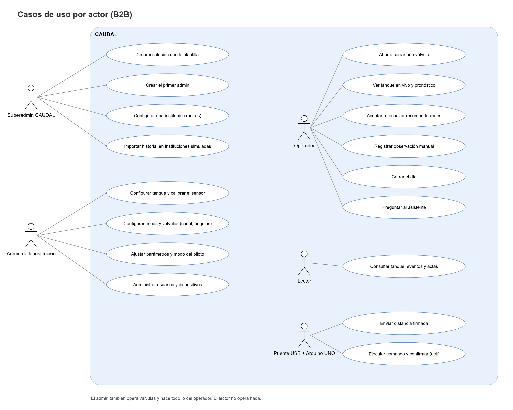

# Actores y permisos

Este documento define quién usa CAUDAL, en qué institución opera, qué puede hacer y qué le está prohibido. CAUDAL es un producto B2B: nosotros damos de alta cada **institución** y le configuramos su tanque, su sensor ultrasónico y sus válvulas. Cada institución tiene sus propios datos, aislados de las demás. La matriz de permisos es la fuente para el código: los roles y los códigos de permiso se guardan en la base de datos (`iam.roles`, `iam.permissions`, `iam.role_permissions`), y el código solo verifica códigos.

## 1. Actores

| Actor | Rol en el sistema | Objetivo | Necesidades | Contexto de uso | Canales |
|---|---|---|---|---|---|
| Superadmin de CAUDAL | `PLATFORM_ADMIN` | Dar de alta instituciones y dejarlas listas para operar. | Crear una institución desde una plantilla, crear su primer admin, registrar su hardware, ver el listado de instituciones y entrar a configurar una institución con un token temporal y auditado. | Computador de CAUDAL. No opera el agua día a día. | Consola de plataforma en el panel web; API `/api/v1/platform/*`. |
| Admin de la institución | `INSTITUTION_ADMIN` | Que el tanque, las líneas y las válvulas estén bien configurados y que la operación sea confiable. | Configurar tanque (forma, medidas, calibración del sensor), líneas y válvulas (cuántas, canal del servo, ángulos), usuarios, parámetros, piloto y dispositivos. También opera válvulas, registra observaciones, cierra el día y genera actas. | Computador o celular. Puede no ser experto en tecnología. | Panel web (PWA). |
| Operador | `OPERATOR` | Abrir y cerrar las válvulas, anotar lo que se observa y cerrar el día. | Ver el tanque en vivo, abrir o cerrar una válvula y ver si el comando se ejecutó, registrar una observación, cerrar el día y preguntar al asistente. | Celular o tableta junto al tanque. Pantalla pequeña y poca paciencia con formularios largos. | Panel web (PWA). |
| Lector | `VIEWER` | Saber qué pasa con el agua sin poder cambiar nada. | Ver el tanque en vivo, el pronóstico, los eventos y las actas. | Computador o celular, de forma esporádica. | Panel web (PWA). |
| Dispositivo sensor o actuador | Sistema, no persona | Enviar telemetría y ejecutar comandos firmados. | Firmar cada petición con su clave privada, leer su configuración firmada (`GET /devices/config`) y recibir solo comandos vigentes. | Hardware: sensor HC-SR04 y servos MG90S de la maqueta. | API `/api/v1/devices/*` con firmas Ed25519. |
| Puente USB | Sistema, no persona (es un dispositivo con dos roles lógicos) | Conectar la placa Arduino UNO por USB con el backend. | Leer la distancia del sensor por serie, enviarla como `DISTANCE` y pasar a la placa los comandos `S<n> <deg>`. | Equipo local que corre `caudal-sim maqueta-usb` (`caudal-simulador`). La clave privada vive en disco local. | API `/api/v1/devices/*` con firmas Ed25519; serie hacia la placa. |
| Piloto automático | `AUTOPILOT` (actor de sistema, sin cuenta) | Recomendar la acción de las válvulas y, si el modo lo permite, ejecutarla cuando el operador no está. | Leer el estado y el pronóstico, consultar al asistente y generar comandos de válvula solo en modo `AUTOMATIC`, sin bajar del piso de reserva. | Proceso programado en el backend (`application/autopilot/`). | Interno: llama a `caudal-ia` y crea comandos con `autopilot_decision_id`. |

Notas:

- El superadmin de CAUDAL reemplaza al "equipo del proyecto" de la versión anterior. Ya no hay actor de la Junta, de entidad de apoyo ni de familias: el sistema no tiene vía pública más allá del directorio de instituciones y el login.
- El piloto automático (`AUTOPILOT`) no tiene cuenta ni rol. Sus decisiones se registran en `ops.autopilot_decisions` y en `audit.audit_log` con el actor `AUTOPILOT`. Su modo (`MANUAL`, `ASSISTED` o `AUTOMATIC`) lo configura el `INSTITUTION_ADMIN` con `AUTOPILOT_CONFIGURE`. Cualquier acción manual de válvula pausa al piloto.
- El puente USB no es una persona, pero tiene su propia clave Ed25519 registrada como dispositivo. Su clave privada se guarda en disco local con permisos `600`.
- Un usuario pertenece a una sola institución. Su nombre de usuario es único dentro de esa institución. Por definir si una misma persona necesita cuentas en varias instituciones (hoy se resuelve con una cuenta por institución).

## 2. Roles del sistema (RBAC)

| Código | Nombre en español | Ámbito | Descripción | MFA | Duración de la sesión |
|---|---|---|---|---|---|
| `PLATFORM_ADMIN` | Superadmin de CAUDAL | Plataforma, sin institución | Crea instituciones, su primer admin y su hardware. Lista instituciones. Puede abrir una institución con un token temporal `act_as=platform`, auditado. | Opcional. | 7 días de refresh token (por confirmar). |
| `INSTITUTION_ADMIN` | Admin de la institución | Institución | Configura tanque, líneas, válvulas, dispositivos, usuarios, parámetros y piloto. Opera válvulas, registra observaciones, cierra el día y genera actas. | Opcional (recomendado). | 7 días de refresh token. |
| `OPERATOR` | Operador | Institución | Opera válvulas, registra observaciones, cierra el día, usa el asistente. Su pantalla inicial es el tanque en vivo con las válvulas. | No. | 30 días de refresh token (riesgo aceptado, ver `Seguridad.md`). |
| `VIEWER` | Lector | Institución | Solo lectura: tanque en vivo, pronóstico, eventos y actas. | No. | 7 días de refresh token. |

Notas sobre el MFA: TOTP es opcional para `PLATFORM_ADMIN` e `INSTITUTION_ADMIN`. Si el MFA pasa a obligatorio para el admin de la institución (es el rol con más poder dentro de su institución), está por definir. Ver `Seguridad.md`, sección 2.4.

Duración de la sesión: las cifras de refresh token están en `Seguridad.md`, sección 2.3. La de 7 días para `PLATFORM_ADMIN` es propuesta y está por confirmar.

## 3. Permisos

### 3.1 Convenciones

- Los códigos son `UPPER_SNAKE_CASE` en inglés (`^[A-Z][A-Z0-9_]*$`, tabla `iam.permissions`).
- El origen indica si el permiso se mantiene de la versión anterior (**se mantiene**), si es nuevo en el modelo B2B (**nuevo**) o si lo introduce este documento y está pendiente de validación (**propuesto, por definir**).
- Las acciones sin login son públicas y no tienen permiso. Son únicamente `GET /api/v1/public/institutions` (directorio con `{slug, name}`) y `POST /api/v1/auth/login`. Ambas tienen límite de tasa (ver `Seguridad.md`, sección 2.10).
- Las acciones solo sobre la propia cuenta (cambiar contraseña, cerrar sesión, MFA propio, aceptar el aviso de privacidad, `GET /auth/current-user`, catálogos) requieren estar autenticado, sin permiso adicional.
- `Sí (act_as)` significa que el superadmin de CAUDAL obtiene ese permiso solo mediante un token temporal `act_as=platform` de 15 minutos, que queda auditado. Nunca tiene el permiso directamente sobre una institución.

### 3.2 Matriz completa

Sí = el rol tiene el permiso. No = no lo tiene. Las reglas por objeto (membresía, institución del token, 404 para otra institución) están en la sección 4.

| Permiso | Origen | Acción y endpoints | `PLATFORM_ADMIN` | `INSTITUTION_ADMIN` | `OPERATOR` | `VIEWER` |
|---|---|---|---|---|---|---|
| `PLATFORM_MANAGE` | nuevo | Crear, listar y editar instituciones y crear su primer admin: `GET/POST /platform/institutions`, `PATCH /platform/institutions/{id}`, `POST /platform/institutions/{id}/admin`. Abrir una institución con `act_as` (ruta por definir). | Sí | No | No | No |
| `INSTITUTION_CONFIGURE` | nuevo | Configurar el tanque (forma, medidas y calibración), las líneas y las válvulas, y los parámetros: `PATCH /tanks/{id}` (incluye `empty_distance_mm`, `full_distance_mm`, `blind_zone_mm`), `GET/POST/PATCH /service-lines` (sin borrado; se desactiva con `is_active`), `POST/PATCH /valves`, `PATCH /institution/settings` | Sí (act_as) | Sí | No | No |
| `USER_MANAGE` | se mantiene | Usuarios de la institución: `GET/POST /users`, `PATCH /users/{id}`, `POST /users/{id}/reset-grants`. Las membresías (`/memberships`) están por definir (ver sección 1) | Sí (act_as) | Sí | No | No |
| `NETWORK_VIEW` | se mantiene | Ver tanque, líneas, válvulas y la escena 3D: `GET /tanks`, `GET /service-lines`, `GET /valves`, `GET /network` | Sí (act_as) | Sí | Sí | Sí |
| `STATUS_VIEW` | se mantiene | Ver el tanque en vivo, el pronóstico, eventos, válvulas, observaciones, cierre y parámetros: `GET /tanks/{id}/live`, `GET /tanks/{id}/outlook`, `GET /valves/live`, `GET /institution/settings`, `GET /anomalies`, `GET /observations`, `GET /days/{date}/closure`, `GET /autopilot/recommendations`. Lectura de eventos generales (`GET /events`) por definir | Sí (act_as) | Sí | Sí | Sí |
| `FORECAST_RUN` | se mantiene | Recalcular el pronóstico: `POST /tanks/{id}/forecasts` (límite 10 por hora por institución) | Sí (act_as) | Sí | No | No |
| `ANOMALY_REVIEW` | se mantiene | Confirmar o descartar una anomalía: `PATCH /anomalies/{id}` | Sí (act_as) | Sí | No | No |
| `VALVE_COMMAND_MANUAL` | se mantiene (ampliado) | Comando manual de válvula con motivo opcional (texto por defecto): `POST /valve-commands/manual`, `GET /valve-commands/{id}`. También sirve para aceptar una recomendación del piloto en modo `ASSISTED`. | Sí (act_as) | Sí | Sí | No |
| `OBSERVATION_CREATE` | nuevo | Registrar una observación manual (`WATER_DIRTY`, `WATER_MUDDY`, `VISIBLE_DAMAGE`, `OTHER`): `POST /observations` | Sí (act_as) | Sí | Sí | No |
| `DAY_CLOSE` | se mantiene (sin turnos) | Cerrar el día una sola vez, con las novedades del operador: `POST /days/{date}/closure`. Lectura del cierre: `STATUS_VIEW` | Sí (act_as) | Sí | Sí | No |
| `MINUTES_GENERATE` | se mantiene | Generar un acta del periodo: `POST /minutes` | Sí (act_as) | Sí | No | No |
| `MINUTES_VIEW` | se mantiene | Ver actas y descargarlas en PDF: `GET /minutes`, `GET /minutes/{id}`, `GET /minutes/{id}/pdf` | Sí (act_as) | Sí | Sí | Sí |
| `REPORT_VIEW` | se mantiene (ampliado) | Ver reportes del periodo y su narrativa: `GET /reports?from&to`, `POST /reports/narrative` | Sí (act_as) | Sí | No | No |
| `ASSISTANT_USE` | se mantiene (ampliado) | Preguntar al asistente (lenguaje natural, sin decisiones): `POST /assistant/ask`. Rechazar una recomendación del piloto solo exige este permiso. | Sí (act_as) | Sí | Sí | No |
| `AUTOPILOT_CONFIGURE` | se mantiene | Configurar el modo del piloto (`MANUAL`, `ASSISTED`, `AUTOMATIC`) y su piso de reserva: `PUT /autopilot/mode` (ruta por definir). Los parámetros `operator_absence_minutes` y `reserve_floor_pct` viven en `institution_settings`. | Sí (act_as) | Sí | No | No |
| `DEVICE_MANAGE` | se mantiene | Ver y registrar dispositivos y sus claves: `GET /devices`, `POST /devices`, `POST /devices/{id}/keys`. Quién puede dar de alta claves (solo plataforma o también el admin) está por definir. | Sí (act_as) | Sí | No | No |
| `IMPORT_SIMULATED` | se mantiene (restringido) | Importar historial simulado: `POST /imports/*` (lista por definir). Solo en instituciones con `is_simulated = true` (regla de objeto). | Sí (act_as, solo si `is_simulated`) | No | No | No |
| `EVALUATION_VIEW` | se mantiene | Evaluación del pronóstico (IA frente a estimación simple) y salud técnica: `GET /forecast-evaluation` | Sí (act_as) | Sí | No | No |
| `AUDIT_VIEW` | se mantiene | Bitácora y eventos de seguridad de la institución: `GET /audit-log`, `GET /security-events` | Sí (act_as) | Sí | No | No |

Notas de la matriz:

- **Permisos eliminados.** Salen `RULESET_VIEW`, `RULESET_DRAFT`, `RULESET_ACTIVATE`, `PROPOSAL_GENERATE`, `PROPOSAL_VIEW`, `PROPOSAL_DECIDE`, `SCHEDULE_PUBLISH`, `SCHEDULE_VIEW`, `READING_CREATE`, `READING_CORRECT`, `INCIDENT_CREATE`, `INCIDENT_VIEW`, `INCIDENT_MANAGE`, `SUMMARY_SHARE_MANAGE`, `SUMMARY_VIEW` y `NETWORK_MANAGE` (lo absorbe `INSTITUTION_CONFIGURE`).
- **`READING_VIEW` (por definir).** Ver las lecturas crudas del sensor (`GET /readings`) no tiene permiso propio en este modelo. Se propone cubrirlo con `STATUS_VIEW` o mantener un permiso aparte si se necesita para auditoría.
- **Cierre del día.** `DAY_CLOSE` escribe el cierre. Su lectura (`GET /days/{date}/closure`) usa `STATUS_VIEW`.
- **Comandos del piloto.** El actor `AUTOPILOT` no tiene permiso de rol. En modo `AUTOMATIC` crea comandos con `autopilot_decision_id`. En modo `ASSISTED`, aceptar una recomendación exige `VALVE_COMMAND_MANUAL`; rechazarla exige `ASSISTANT_USE`.
- **El LLM no decide.** `ASSISTANT_USE` y `REPORT_VIEW` dan acceso al lenguaje natural y a la redacción. Ninguno de los dos permite ejecutar una acción sobre una válvula.
- **Permisos de cuenta propia.** `POST /auth/change-password`, `POST /auth/logout`, `POST /auth/logout-all`, `POST /auth/mfa/*`, `POST /privacy-notice/accept`, `GET /auth/current-user`, `GET /meta/constraints`, `GET /catalogs/{catalog}` y `GET /privacy-notice/current` requieren autenticación y no tienen código de permiso.
- **Públicos.** `GET /api/v1/public/institutions` (solo `{slug, name}` de instituciones activas) y `POST /api/v1/auth/login` no requieren autenticación ni permiso. Están limitados por tasa.

### 3.3 Permisos por rol (semilla de `iam.role_permissions`)

| Rol | Permisos |
|---|---|
| `PLATFORM_ADMIN` | `PLATFORM_MANAGE`. Los demás permisos de institución solo se obtienen con `act_as`. |
| `INSTITUTION_ADMIN` | `INSTITUTION_CONFIGURE`, `USER_MANAGE`, `NETWORK_VIEW`, `STATUS_VIEW`, `FORECAST_RUN`, `ANOMALY_REVIEW`, `VALVE_COMMAND_MANUAL`, `OBSERVATION_CREATE`, `DAY_CLOSE`, `MINUTES_GENERATE`, `MINUTES_VIEW`, `REPORT_VIEW`, `ASSISTANT_USE`, `AUTOPILOT_CONFIGURE`, `DEVICE_MANAGE`, `EVALUATION_VIEW`, `AUDIT_VIEW`. No incluye `IMPORT_SIMULATED`. |
| `OPERATOR` | `NETWORK_VIEW`, `STATUS_VIEW`, `VALVE_COMMAND_MANUAL`, `OBSERVATION_CREATE`, `DAY_CLOSE`, `MINUTES_VIEW`, `ASSISTANT_USE`. |
| `VIEWER` | `NETWORK_VIEW`, `STATUS_VIEW`, `MINUTES_VIEW`. |

El admin de la institución no tiene `IMPORT_SIMULATED`: la importación de historial es una herramienta de CAUDAL que solo usa el superadmin en instituciones simuladas.

## 4. Reglas de autorización por objeto

La autorización tiene tres capas, en este orden. Si una falla, se rechaza (deny-by-default).

1. **Autenticación.** El access token (JWT HS256, 15 min) debe ser válido: `alg` explícito, `iss`, `aud`, `exp` y `nbf` con tolerancia de 30 s. El claim `tv` (token_version) debe coincidir con `iam.users.token_version`. Si no coincide, responde `401`.
2. **Permiso por institución.** El token lleva `institution_id` (la institución activa del usuario). El rol del usuario en esa institución determina los permisos (`iam.role_permissions`). Sin membresía vigente en esa institución: `403 FORBIDDEN`. Un token con `scope=platform` no tiene `institution_id` y solo recibe permisos de `PLATFORM_MANAGE`.
3. **Chequeo por objeto.** Todo recurso pertenece a una institución (`institution_id`). Un recurso de otra institución se responde como si no existiera (`404 RESOURCE_NOT_FOUND`), para no revelar su existencia. Las reglas adicionales son:

| Regla | Aplica a | Detalle |
|---|---|---|
| Institución del token | Todos los endpoints de institución | El `institution_id` sale del JWT validado, nunca de la URL ni de un parámetro. Un recurso de otra institución responde `404`. |
| Login sin enumeración | `POST /auth/login` | Si el usuario no existe en la institución indicada, si la institución no existe o si la contraseña es incorrecta, la respuesta es siempre `INVALID_CREDENTIALS`, con el mismo tiempo de respuesta. Nunca se dice que el usuario existe en otra institución. |
| Superadmin | `PLATFORM_MANAGE` | El token de plataforma (`scope=platform`) no tiene institución. Solo puede ejecutar las funciones `platform.*` de la base de datos (ver `Seguridad-de-la-base-de-datos.md`, sección 5.4). |
| Entrar a una institución como plataforma | `act_as=platform` | El superadmin recibe un token temporal de 15 min con `institution_id` y `act_as=platform`. Sus permisos son los de `INSTITUTION_ADMIN` de esa institución. Cada emisión, cada acción y su cierre quedan en `audit.audit_log` con el actor `PLATFORM_ADMIN` y la institución objetivo. No se puede renovar: al expirar hay que volver a entrar (por confirmar). |
| Solo instituciones simuladas | `IMPORT_SIMULATED` | `org.institutions.is_simulated = true`. En otra institución, `403 SIMULATED_ONLY` (propuesto; antes `DEMO_ONLY`) y evento `IMPORT_REJECTED` en `iam.security_events`. |
| Solo lectura | `VIEWER` | Cualquier intento de mutación responde `403 PERMISSION_DENIED`. |
| Válvulas de la institución | `VALVE_COMMAND_MANUAL` | El comando se crea sobre una válvula de la institución del token. Una válvula de otra institución responde `404`. |
| Piloto | `AUTOPILOT` | No tiene permisos de rol. Solo crea comandos con `autopilot_decision_id`, y solo en modo `AUTOMATIC` (o al aceptar una recomendación en `ASSISTED`, que exige `VALVE_COMMAND_MANUAL` del operador). |
| Directorio público | `GET /public/institutions` | Responde solo `{slug, name}` de instituciones activas. No se hace join con `iam.users`. |
| Cambio de rol o desactivación | Todos | Incrementa `token_version`, revoca refresh tokens (`revoked_reason = ROLE_CHANGED`) y el acceso se corta en el siguiente request. |
| Membresía vencida | Todos | Una membresía con `valid_to` pasado no da permisos aunque el rol siga guardado (propuesto, mientras exista `iam.memberships`). |

### 4.1 Seguridad a nivel de base de datos (RLS)

- Las tablas con `institution_id` y `rls: true` tienen `ENABLE` y `FORCE ROW LEVEL SECURITY`. Entre ellas: `iam.users`, `org.tanks`, `org.valves`, `org.service_lines`, `org.institution_settings`, `ops.readings`, `ops.observations`, `ops.day_closures`, `ops.autopilot_decisions`, `reporting.minutes`, `devices.devices`, `devices.valve_commands`.
- La política filtra por `institution_id = current_setting('app.institution_id')::uuid`. La aplicación fija la variable con `SET LOCAL` al inicio de cada transacción, a partir del claim `institution_id`.
- El token de plataforma (`scope=platform`) no fija `app.institution_id`. Sus operaciones entre instituciones pasan solo por funciones `SECURITY DEFINER` (`Seguridad-de-la-base-de-datos.md`, sección 5.4).
- La RLS es una segunda barrera. La primera es la verificación de la capa 2 en la aplicación, con pruebas que la cubren (ver [Requerimientos.md](Requerimientos.md), RNF-07).

## 5. Migración de roles anteriores

Los datos y los roles de la versión 1.0.0 se migran con una migración nueva (las migraciones aplicadas no se editan):

| Rol anterior | Rol nuevo | Nota |
|---|---|---|
| `BOARD_ADMIN` | `INSTITUTION_ADMIN` | Tiene el conjunto de permisos del admin, salvo `IMPORT_SIMULATED`. |
| `BOARD_MEMBER` | `INSTITUTION_ADMIN` | Se migra al admin porque el modelo ya no tiene Junta ni aprobación. Por confirmar si debe ser `OPERATOR`. |
| `OPERATOR` | `OPERATOR` | Sin cambios de nombre. Pierde `READING_CREATE` y `READING_CORRECT`, que ya no existen. |
| `PROJECT_TEAM` | `VIEWER` | Su acceso técnico pasa al superadmin de CAUDAL (`PLATFORM_ADMIN`), que se asigna a mano. |
| `SUPPORT_ENTITY` | Eliminado | Sus usuarios se desactivan. Sus autorizaciones de resúmenes (`reporting.summary_shares`) se eliminan con sus tablas. |

## 6. Diagrama de casos de uso

El diagrama [casos-de-uso.png](images/casos-de-uso.png) muestra los casos de uso agrupados por actor y la relación entre ellos. Está pendiente de redibujarse para el modelo B2B. La fuente es `docs/images/casos-de-uso.drawio`.

Relacionados: [Caudal.md](Caudal.md) · [Historias-de-usuario.md](Historias-de-usuario.md) · [Requerimientos.md](Requerimientos.md) · [Glosario.md](Glosario.md) · [Seguridad.md](Seguridad.md)
