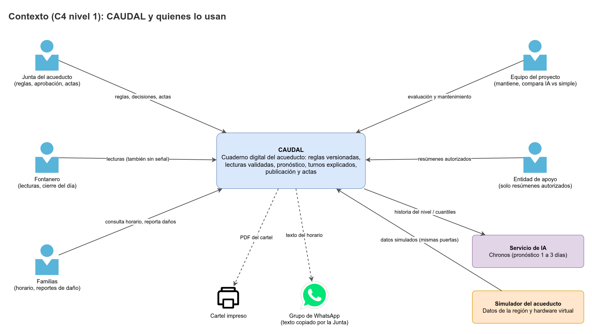
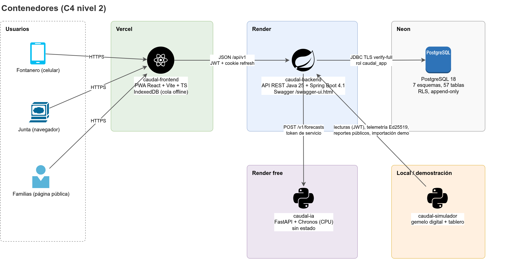
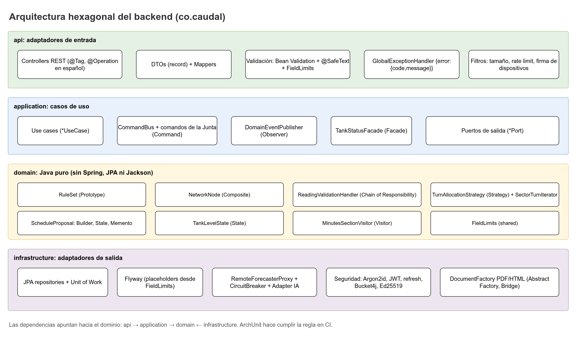
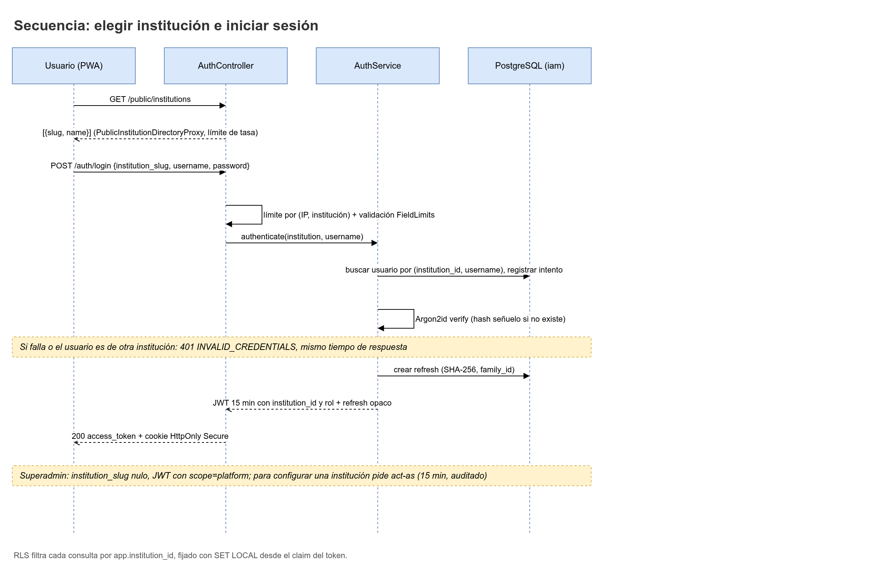
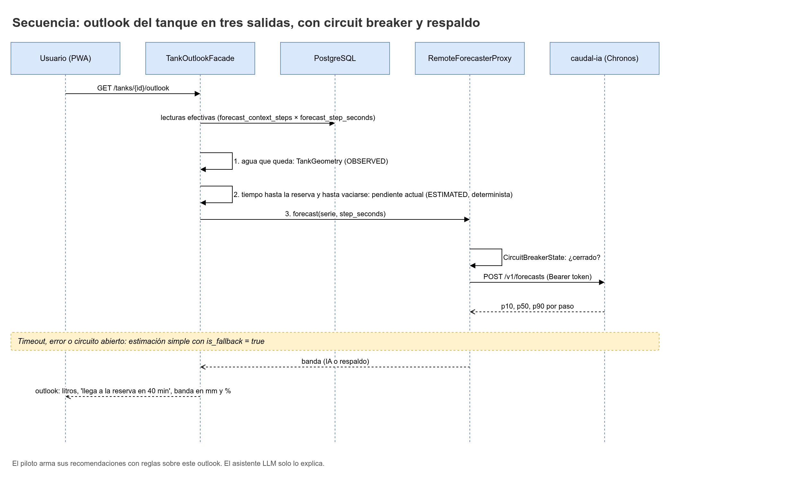
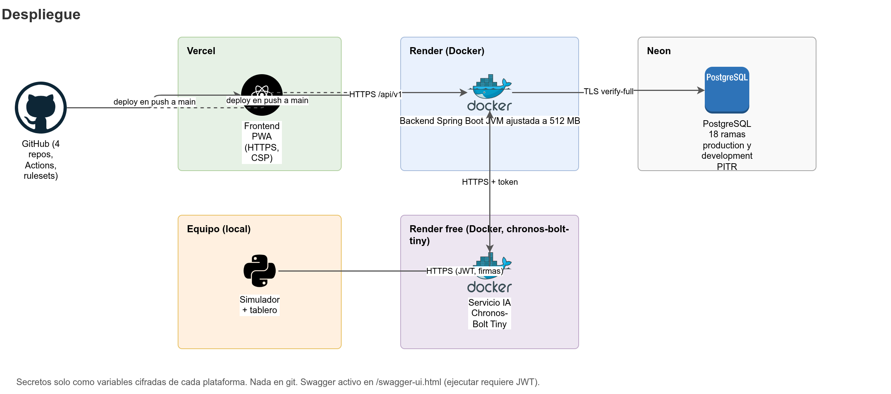
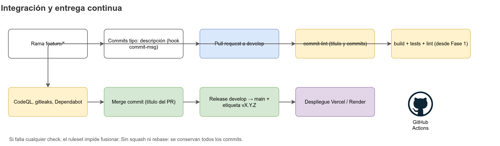
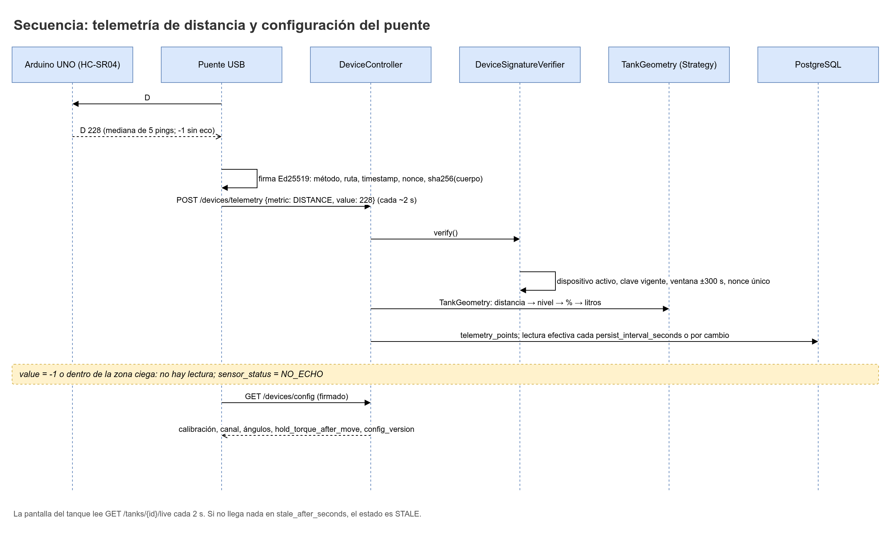
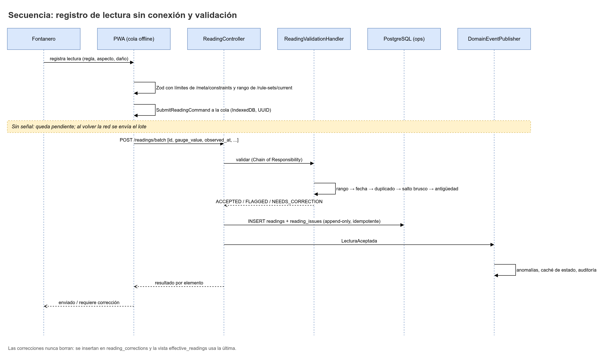

# Arquitectura de CAUDAL

> Documento de referencia de la arquitectura del sistema en el modelo B2B y, en detalle, del backend (`caudal-backend`). Los hechos canónicos (stack, cifras, nombres de endpoints) viven en la especificación del proyecto. Lo que aún no está decidido se marca "verificar" o "por definir". Los diagramas de `images/` que muestran el modelo anterior están enlazados y marcados "diagrama en actualización".

## 1. Vista general

CAUDAL es un producto B2B. Nosotros damos de alta cada **institución** (por ejemplo, una vereda o una sede) y le configuramos su tanque, su sensor ultrasónico y sus válvulas según el lugar. Cada institución opera con sus propios datos, aislados de las demás. El sistema muestra el tanque en tiempo real, ofrece un pronóstico en tres salidas separadas, registra eventos, permite abrir y cerrar válvulas con confirmación, y genera el cierre del día y las actas.

La arquitectura separa las piezas de producto (la aplicación web, la API y la base de datos) de los servicios de apoyo (la IA, el simulador de datos y el puente con el hardware de la maqueta).

### 1.1 Contexto del sistema (C4 nivel 1)



(Diagrama en actualización: muestra el modelo anterior.)

| Actor o sistema externo | Qué hace con CAUDAL | Canal |
|---|---|---|
| Superadmin de CAUDAL (`PLATFORM_ADMIN`) | Da de alta instituciones desde una plantilla, crea su primer admin y su hardware, y entra a configurar una institución con un token temporal auditado. | Panel web (consola de plataforma), API `/api/v1/platform/*` |
| Admin de la institución (`INSTITUTION_ADMIN`) | Configura tanque, líneas y válvulas, calibra el sensor, administra usuarios y parámetros, opera válvulas, registra observaciones, cierra el día y genera actas. | PWA |
| Operador (`OPERATOR`) | Abre y cierra válvulas, registra observaciones, cierra el día y usa el asistente. | PWA (celular o tableta junto al tanque) |
| Lector (`VIEWER`) | Solo consulta el tanque, el pronóstico, los eventos y las actas. | PWA |
| Puente USB (`caudal-sim maqueta-usb`) | Lee la distancia del sensor por serie, la envía como `DISTANCE` y pasa a la placa los comandos de los servos. | API (firma Ed25519) y puerto serie |
| Simulador (`caudal-simulador`) | Produce historial simulado para las instituciones simuladas. | API (importación, solo instituciones simuladas) |
| Servicio de IA (`caudal-ia`) | Calcula el pronóstico con Chronos y responde las preguntas del asistente. No guarda datos. | HTTP interno con token de servicio |
| LLM externo (por defecto Nemotron en OpenRouter) | Redacta respuestas y reportes a partir de los datos que le entrega `caudal-ia`. No decide ni inventa cifras. | HTTPS, `chat/completions`, desde `caudal-ia` |

### 1.2 Contenedores (C4 nivel 2)



(Diagrama en actualización: muestra el modelo anterior, con la página pública y WhatsApp.)

| Contenedor | Tecnología | Plataforma | Responsabilidad |
|---|---|---|---|
| Aplicación web (`caudal-frontend`) | React 19, Vite, TypeScript, PWA sin cola offline | Vercel | Login en dos pasos, inicio con tanque y válvulas, administración, eventos, cierre, actas y consola de plataforma. |
| API (`caudal-backend`) | Java 25 LTS, Spring Boot 4.1.x | Render (Docker) | Seguridad, configuración, sensor en vivo, comandos de válvula, pronóstico, auditoría y actas. |
| Base de datos | PostgreSQL 18 | Neon (local: Docker Compose) | Fuente de verdad, esquemas por responsabilidad y RLS por `institution_id`. |
| Servicio IA (`caudal-ia`) | Python 3.12, FastAPI, Chronos, cliente LLM compatible con OpenAI | Render free (Docker, CPU, 512 MB) | Pronóstico probabilístico y asistente, sin estado y sin acceso a la BD. |
| Simulador (`caudal-simulador`) | Python 3.12, Typer, FastAPI, tablero Vite/React, puente `maqueta-usb` | Local | Historial simulado para instituciones simuladas y puente USB de la maqueta. |
| Maqueta (`caudal-maqueta`) | Arduino UNO por USB, HC-SR04, 2 servos MG90S | Local | Institución de prueba `maqueta-caudal`. El firmware no cambia. |
| CI/CD | GitHub Actions, CodeQL, gitleaks, Dependabot | GitHub | Validación de commits, pruebas, análisis de seguridad. |

Protocolos principales:

| Desde | Hacia | Protocolo | Autenticación |
|---|---|---|---|
| Aplicación web | API | HTTPS, JSON, `/api/v1/*` | JWT de acceso en memoria, refresh en cookie `HttpOnly` |
| Cualquiera (sin sesión) | API | HTTPS, `GET /api/v1/public/institutions` | Ninguna. Solo devuelve `{slug, name}` de instituciones activas, con límite de tasa. |
| API | Servicio IA | HTTPS, `POST /v1/forecasts` y `/v1/insights/*` | `Authorization: Bearer <IA_SERVICE_TOKEN>` |
| API | PostgreSQL | TLS (`sslmode=verify-full`) | Roles `caudal_app`, `caudal_migrator`, `caudal_readonly` |
| Puente USB | API | HTTPS: `POST` de `DISTANCE`, `GET /api/v1/devices/commands`, `GET /api/v1/devices/config`, `POST /api/v1/devices/commands/{id}/ack` | Firma Ed25519 por dispositivo |
| Puente USB | Arduino UNO | Serie por USB, 115200 baudios | Ninguna (enlace local) |
| Simulador | API | HTTPS | JWT (como admin o importador) |

## 2. Arquitectura hexagonal del backend

El backend sigue arquitectura hexagonal (puertos y adaptadores). El dominio no conoce Spring, JPA ni Jackson. Las dependencias apuntan hacia el dominio.



(Diagrama en actualización: el paquete `publication` y sus canales se retiran.)

### 2.1 Paquetes y responsabilidades

Paquete base: `co.caudal`.

| Paquete | Contiene | No contiene |
|---|---|---|
| `co.caudal.api` | Controladores REST (`*Controller`), DTOs de entrada y salida (`*Request`, `*Response`, `record`), mapeadores DTO-caso de uso, manejador global de errores (`@RestControllerAdvice`), filtros HTTP de identificador de petición. | Reglas de negocio, consultas a la BD, llamadas a la IA. |
| `co.caudal.application` | Casos de uso (`*UseCase`, `*CommandHandler`), puertos de salida (`*Port`), `CommandBus`, publicación de eventos (`DomainEventPublisher`), `UnitOfWork`, fachadas (`TankStatusFacade`) y el puerto del directorio público. | Detalles de HTTP, JPA o de un proveedor externo. |
| `co.caudal.domain` | Modelo puro en Java: agregados (`Institution`, `Tank`, `Reading`, `Valve`, `ValveCommand`), value objects, geometría del tanque, validación de telemetría, estados, eventos de dominio, excepciones de negocio y patrones de dominio (Builder, Prototype, Strategy, State, Visitor, Flyweight). | Anotaciones de Spring, JPA o Jackson. Acceso a red, reloj del sistema o archivos. |
| `co.caudal.infrastructure` | Adaptadores de persistencia (`*PersistenceAdapter`, `*JpaRepository`, entidades `*Entity`), cliente de la IA (`IaForecastClientAdapter`, `IaInsightsClientAdapter`), proxy y respaldo de pronóstico, directorio público (`PublicInstitutionDirectoryProxy`), seguridad (filtros JWT, Argon2id, Bucket4j), verificación Ed25519 del puente, generación de PDF de actas (`DocumentFactory`), configuración (`@Configuration`), logging. | Reglas de negocio. Lógica que deba probarse sin base de datos. |
| `co.caudal.shared` | Constantes de límites (`FieldLimits`), utilidades sin estado (`SystemClock`, plantillas de mensajes `MessageTemplate`), errores base (`ErrorCode`, `DomainException`). | Dependencias hacia `api`, `application`, `domain` o `infrastructure`. |

### 2.2 Reglas de dependencia

```text
api  ──────────►  application  ──────────►  domain
                      ▲                       ▲
                      │ implementa puertos     │ no depende de nada
                      │                       │ de la capa externa
               infrastructure ────────────────┘
```

| Regla | Sentido permitido |
|---|---|
| `api` usa `application` | Sí. Los controladores llaman casos de uso y fachadas. |
| `api` usa `infrastructure` | No. |
| `application` usa `domain` | Sí. |
| `application` usa `infrastructure` | No. La infraestructura implementa los puertos. |
| `infrastructure` implementa puertos de `application` y usa `domain` | Sí. |
| `domain` usa cualquier otro paquete de `co.caudal` | No. Solo `java.*` y `shared`. |
| `shared` usa otros paquetes de `co.caudal` | No. |

Los casos de uso reciben entradas de tipo `*Input` (records definidos en `application`). Los controladores transforman `*Request` en `*Input` con un mapeador. Así la API nunca expone objetos del dominio.

### 2.3 Reglas ArchUnit

Las reglas viven en la clase `ArchitectureTest` (paquete `co.caudal.architecture`), con `archunit-junit5`. Cada regla es una prueba que falla el build si se incumple. Ninguna regla cambia con el modelo B2B.

| Id | Regla (resumen) |
|---|---|
| `ARCH-01` | El dominio no depende de Spring, JPA ni Jackson. |
| `ARCH-02` | El dominio no depende de otras capas de CAUDAL. |
| `ARCH-03` | La aplicación no depende de la API ni de la infraestructura. |
| `ARCH-04` | La API no depende de la infraestructura ni del dominio. Solo usa `application` y `shared`. |
| `ARCH-05` | No hay ciclos entre los paquetes de primer nivel bajo `co.caudal`. |
| `ARCH-06` | Los controladores están en `api` y su nombre termina en `Controller`. |
| `ARCH-07` | Las entidades JPA y los repositorios de Spring Data viven solo en `infrastructure.persistence`. |
| `ARCH-08` | Los adaptadores de salida se llaman `*Adapter` o `*Proxy` y viven en `infrastructure`. No hay excepciones. |
| `ARCH-09` | `shared` no depende de otros paquetes de `co.caudal`. |
| `ARCH-10` | Los puertos de salida son interfaces en `application.port.out` y su nombre termina en `Port`. |
| `ARCH-11` | Solo `SystemClock` lee la hora del sistema (con excepción de `co.caudal.shared.time.SystemClock`; verificar la API de ArchUnit). |

No hay excepciones a `ARCH-08`. Cualquier excepción nueva requiere revisión del líder de patrones.

### 2.4 Árbol de carpetas

Estructura del proyecto Maven en el modelo B2B. Los paquetes del código actual que dependían de lo eliminado (turnos, propuestas, publicación, reglas) se retiran con las tareas de la Fase 2 (ver `Plan-de-commits.md`).

```text
caudal-backend/
├── .agents/                       # Guías operativas para agentes
├── .githooks/commit-msg           # Validación del formato de commits
├── docs/                          # Documentación canónica del proyecto
│   └── images/                    # Fuentes .drawio y exportaciones .png
├── .env.example                   # Variables de entorno con marcadores seguros
├── Dockerfile                     # Build multi-etapa
├── docker-compose.yml             # PostgreSQL 18 local
├── mvnw, mvnw.cmd, .mvn/          # Maven Wrapper
├── pom.xml
└── src/
    ├── main/
    │   ├── java/co/caudal/
    │   │   ├── CaudalApplication.java
    │   │   ├── api/
    │   │   │   ├── controller/        # *Controller (platform, institution, tanks, service-lines, valves, devices, observations, days, ...)
    │   │   │   ├── dto/request/       # *Request (record)
    │   │   │   ├── dto/response/      # *Response (record)
    │   │   │   ├── mapper/
    │   │   │   └── error/             # ApiExceptionHandler, ErrorResponse
    │   │   ├── application/
    │   │   │   ├── usecase/           # *UseCase por área
    │   │   │   ├── device/command/    # ManualValveCommandHandler, DeviceCommandController (por reubicar)
    │   │   │   ├── port/out/          # *Port (repositorios, IA, reloj, almacenamiento, directorio público)
    │   │   │   ├── facade/            # TankStatusFacade (sensor en vivo y outlook)
    │   │   │   ├── uow/               # UnitOfWork
    │   │   │   └── event/             # DomainEventPublisher
    │   │   ├── domain/
    │   │   │   ├── tank/              # Tank, TankGeometry, CylinderGeometry, RectangularGeometry
    │   │   │   ├── institution/       # Institution, InstitutionTemplate (Prototype), InstitutionSettings
    │   │   │   ├── reading/           # Reading, validación de telemetría (Chain)
    │   │   │   ├── valve/             # Valve, ServiceLine, ValveCommand, ValveCommandState
    │   │   │   ├── forecast/          # Outlook: litros, tiempo a reserva, banda Chronos
    │   │   │   ├── anomaly/           # Anomaly, detectores de SENSOR_FAULT, STALE_DATA, ABNORMAL_DROP, POSSIBLE_LEAK
    │   │   │   ├── autopilot/         # AutopilotDecision, modos, guardas
    │   │   │   ├── observation/       # Observation, ObservationType
    │   │   │   ├── closure/           # DayClosure
    │   │   │   ├── minutes/           # MinutesBuilder, EpistemicRecord, MinutesSectionVisitor
    │   │   │   ├── catalog/           # CatalogItem y fábrica flyweight (por definir)
    │   │   │   ├── event/             # ReadingAccepted y eventos nuevos
    │   │   │   └── exception/         # Subclases de DomainException
    │   │   ├── infrastructure/
    │   │   │   ├── persistence/       # *Entity, *JpaRepository, *PersistenceAdapter, UnitOfWork
    │   │   │   ├── forecast/          # IaForecastClientAdapter, IaInsightsClientAdapter, NaivePersistenceForecastAdapter, RemoteForecasterProxy, CircuitBreakerState
    │   │   │   ├── device/            # DeviceTelemetryAdapter, verificación Ed25519, GET /devices/config
    │   │   │   ├── institution/       # PublicInstitutionDirectoryProxy
    │   │   │   ├── security/          # Filtros JWT, Argon2id, Bucket4j, MFA
    │   │   │   ├── document/          # DocumentRenderingAdapter, DocumentGenerator, DocumentFactory (PDF de actas)
    │   │   │   ├── event/             # Publicación de eventos tras el commit
    │   │   │   ├── time/              # Configuración del reloj
    │   │   │   └── config/            # @Configuration, propiedades tipadas
    │   │   └── shared/
    │   │       ├── FieldLimits.java
    │   │       ├── time/SystemClock.java
    │   │       ├── text/MessageTemplate.java
    │   │       └── error/ErrorCode.java, DomainException.java
    │   └── resources/
    │       ├── application.yml        # Configuración con ${VAR}
    │       ├── messages_es.properties # Textos de error en español
    │       └── db/migration/          # V*__*.sql (Flyway)
    └── test/
        └── java/co/caudal/
            ├── domain/                # Pruebas unitarias sin Spring
            ├── application/           # Casos de uso con puertos simulados
            ├── api/                   # @WebMvcTest (validación, seguridad)
            ├── infrastructure/        # Testcontainers PostgreSQL
            ├── architecture/          # ArchitectureTest
            └── drift/                 # Pruebas de deriva BD vs FieldLimits
```

## 3. Flujo: inicio de sesión por institución

Caso: un operador entra desde un celular. Primero elige su institución y luego escribe su usuario y su contraseña.



(Diagrama en actualización: falta el paso de la institución.)

1. La aplicación llama `GET /api/v1/public/institutions`, que devuelve solo `{slug, name}` de las instituciones activas (`PublicInstitutionDirectoryProxy`, con límite de tasa). También existe la ruta `/i/{slug}/login`, que salta la lista.
2. El usuario escribe usuario y contraseña. La aplicación envía `POST /api/v1/auth/login` con `{institution_slug, username, password, mfa_code?}`.
3. El límite de tasa se aplica por (IP, institución). Si se excede, responde `429 RATE_LIMITED`.
4. El backend busca el usuario por `(institution_id, username)`, valida la contraseña con Argon2id y el segundo factor si lo tiene.
5. Cualquier fallo (institución inexistente, usuario inexistente, contraseña incorrecta, membresía vencida) responde lo mismo: `401 INVALID_CREDENTIALS`, con un tiempo de respuesta parejo. Así el login no revela si existen usuarios en otra institución.
6. Si todo es correcto, el JWT lleva `institution_id` y el rol de esa institución. El refresh token va en cookie (ADR-04).
7. El superadmin entra con la opción "CAUDAL (plataforma)", con `institution_slug` nulo. Su token lleva `scope=platform` y no tiene `institution_id`.

## 4. Flujo: abrir o cerrar una válvula de punta a punta

Caso: el operador pulsa "Abrir" en la línea "Acueducto 1". La maqueta es un Arduino UNO conectado por USB al equipo que corre el puente. Un servo MG90S pisa una manguera. El comando se confirma solo cuando el servo llega a la posición y el puente lo reporta.

Diagrama por crear: secuencia del comando de válvula (no existe todavía en `images/`).

1. `POST /api/v1/valve-commands/manual` (permiso `VALVE_COMMAND_MANUAL`) crea el comando en `PENDING`, con origen `manual` (`manual_reason`, texto por defecto si no se escribe) y `expires_at`.
2. El puente consulta `GET /api/v1/devices/commands` cada 2 s, firmado con Ed25519. Al recogerlo, el comando pasa a `DELIVERED`.
3. El puente traduce `OPEN` o `CLOSE` al ángulo de `org.valves` (`open_angle_deg` o `closed_angle_deg`) y lo envía por serie como `S<n> <deg>`. El ángulo viene de `GET /api/v1/devices/config`, que el puente relee sin reiniciarse.
4. El UNO responde `OK S<n> <deg>` y, cuando el servo llega, `DONE S<n> <deg>`.
5. El puente responde `POST /api/v1/devices/commands/{id}/ack` con `ACKED`, o `FAILED` si `DONE` no llega en `max_travel_seconds`.
6. Si `expires_at` pasa antes de la entrega, el comando pasa a `EXPIRED`. Cada cambio queda en `devices.valve_command_events`.
7. `GET /api/v1/valves/live` muestra `OPEN`, `CLOSED` o `UNKNOWN`. El estado sale del último comando `ACKED`. Un `FAILED` o `EXPIRED` no cambia el estado.

El ciclo de estados está modelado con el patrón State (`ValveCommandState`). La regla de un solo comando activo por válvula y la vigencia exacta están en `Reglas-de-negocio.md`, sección 9.

Las pruebas de este flujo (banco de la maqueta, Fase 0 del plan) deben correr antes de cambiar código, para que cualquier falla se atribuya al cambio correcto y no al hardware.

## 5. Flujo: sensor en vivo y calibración

Caso: el tanque de la maqueta tiene un HC-SR04 en la tapa. La aplicación muestra la distancia que mide el sensor, el nivel, el porcentaje y los litros, y se refresca cada ~2 s.

Pasos:

1. El UNO mide con el HC-SR04 y responde `D <mm>` (mediana de 5 lecturas, `-1` sin eco). El puente envía al backend la métrica `DISTANCE` en mm crudos, firmada, cada ~2 s.
2. El límite es de 60 peticiones firmadas por minuto por dispositivo (`RATE_LIMIT_TELEMETRY_PER_MINUTE`). A 2 s hay 30 por minuto.
3. El backend valida cada punto con la cadena de validación (patrón Chain of Responsibility), en este orden:
   1. **Sin eco** (`distance_mm = -1`): no produce nivel y cuenta para `SENSOR_FAULT`.
   2. **Zona ciega** (`distance_mm < blind_zone_mm`): no produce nivel y cuenta para `SENSOR_FAULT`.
   3. **Fuera de rango físico** (menor que 0, distinto de `-1`, o mayor que el alcance del HC-SR04, 4000 mm): rechazo, no se guarda.
   4. **Futuro** (`observed_at` más de 5 min adelante): rechazo, no se guarda.
   5. **Duplicado por nonce** (la firma ya se usó dentro de `DEVICE_NONCE_TTL_SECONDS`): rechazo.
4. Cada punto crudo válido se guarda en `devices.telemetry_points`. La conversión a nivel la hace la estrategia de geometría (`TankGeometry`, con `CylinderGeometry` o `RectangularGeometry`):
   - `level_mm = clamp(empty_distance_mm - distance_mm, 0, empty_distance_mm - full_distance_mm)`
   - `level_pct = level_mm / (empty_distance_mm - full_distance_mm) * 100`
   - `volume_l = area_mm2 * level_mm / 1e6`
5. La lectura efectiva se guarda en `ops.readings` cada `persist_interval_seconds`, o antes si el nivel cambia más de un umbral (por definir). Así no se guardan unas 86 400 filas al día.
6. `GET /api/v1/tanks/{id}/live` devuelve `distance_mm`, `level_mm`, `level_pct`, `volume_l`, `observed_at`, `age_seconds` y `sensor_status` (`OK`, `NO_ECHO` o `STALE`). La aplicación lo consulta cada 2 s.
7. La calibración la hace el administrador con la lectura actual: `POST /api/v1/tanks/{id}/calibration` con `{point: EMPTY|FULL}` toma la última distancia y la guarda como `empty_distance_mm` o `full_distance_mm`.
8. Las anomalías de telemetría (`ops.anomalies`) se evalúan sobre `ops.readings`: `SENSOR_FAULT` (valor pegado o sin eco durante `sensor_stuck_window_seconds` con alguna válvula abierta; con todas cerradas, un valor estable es normal), `STALE_DATA` (sin telemetría en `stale_after_seconds`), `ABNORMAL_DROP` y `POSSIBLE_LEAK` (baja con todas las válvulas cerradas).

Un cambio de geometría o de calibración en `org.tanks` se aplica en caliente: el puente recibe la calibración con `GET /api/v1/devices/config` y la vista la recibe con su siguiente consulta.

## 6. Flujo: pronóstico, tres salidas y asistente

Caso: el administrador o el operador mira el panel de pronóstico. Ve tres bloques separados y rotulados, y después puede preguntar al asistente.



(Diagrama en actualización: muestra el modelo anterior, con pronóstico diario.)

Las tres salidas son independientes. `GET /api/v1/tanks/{id}/outlook` devuelve cada una con su origen:

1. **Agua que queda**: litros y porcentaje, calculados con la geometría a partir de la última lectura válida. Origen `OBSERVED`. No es IA.
2. **Tiempo hasta la reserva y hasta vaciarse**: con la tasa actual de cambio (pendiente sobre `trend_window_minutes`). Es determinista, sin IA. Origen `ESTIMATED`. Si el nivel sube o está estable, la respuesta es "no se vacía al ritmo actual".
3. **Banda Chronos**: cuantiles p10, p50 y p90 en pasos de `forecast_step_seconds`, hasta `forecast_horizon_steps`. Origen `ESTIMATED`. Si Chronos falla, se usa la estimación simple (`is_fallback`).

El cálculo de Chronos pasa por `ForecastPort`. La implementación es `RemoteForecasterProxy` (P11), que llama a `IaForecastClientAdapter` (P06) con timeouts de conexión de 2 s y de lectura de 10 s. Si la llamada falla o el circuito está abierto (P18), el proxy usa la estimación simple (`NaivePersistenceForecastAdapter`). Se guardan ambos pronósticos en `ops.forecast_runs` para compararlos después.

El pronóstico se recalcula con `POST /api/v1/tanks/{id}/forecasts` (límite de 10 por hora y por institución). La lectura del estado no llama a la IA.

El asistente funciona así:

1. El operador pregunta en lenguaje natural, por ejemplo "¿cuánta agua queda?", "¿cuándo llega a la reserva?" o "¿qué pasó hoy?".
2. El backend llama a `caudal-ia` (`/v1/insights/*`) con el contexto: el `outlook`, los eventos y el estado de las válvulas con el nombre de su línea.
3. `caudal-ia` llama al LLM externo. El LLM solo responde preguntas y redacta reportes. No decide, no envía comandos y no inventa cifras.
4. Si el LLM falla o supera `INSIGHTS_READ_TIMEOUT_MS` (20 s), `caudal-ia` responde con un texto de respaldo por reglas, con los mismos datos.

La decisión sobre las válvulas la toma el piloto automático (`MANUAL`, `ASSISTED` o `AUTOMATIC`), con recomendaciones `OPEN`, `CLOSE`, `WAIT` o `INSPECT` y sus guardas (piso de reserva y prioridad humana). Ver `Modulo-IA.md`.

## 7. Eventos de dominio

Los eventos de dominio describen hechos ocurridos en el dominio. Se nombran en inglés, en tiempo pasado. Las etiquetas en español solo sirven como texto visible.

| Evento (clase) | Cuándo se genera | Quién reacciona (ejemplos) |
|---|---|---|
| `ReadingAccepted` | Una lectura efectiva se guarda en `ops.readings`. | Recalcula el estado en vivo y evalúa anomalías (`SENSOR_FAULT`, `ABNORMAL_DROP`, `POSSIBLE_LEAK`). |
| `ValveCommandAcked` | Un comando de válvula pasa a `ACKED`. Propuesto (por definir). | Actualiza `GET /valves/live` y registra la línea de tiempo de eventos. |
| `ObservationRecorded` | Se registra una observación manual. Propuesto (por definir). | Agrega el evento `OBSERVED` a la línea de tiempo y al cierre del día. |

Los eventos `RuleSetActivated` y `SchedulePublished` se retiran con las reglas versionadas y los turnos.

Implementación:

- El agregado no llama a Spring. Registra sus eventos en una lista interna.
- `DomainEventPublisher` (puerto en `application.event`) recibe los eventos al final del caso de uso.
- `SpringDomainEventPublisher` (adaptador en `infrastructure.event`) los publica con `ApplicationEventPublisher`.
- Los oyentes usan `@TransactionalEventListener(phase = AFTER_COMMIT)`. Así un evento nunca se publica para una transacción revertida.
- Los oyentes que actualizan datos abren su propia unidad de trabajo.

P17 (Observer) se aplica aquí.

## 8. Transacciones, Unit of Work y aislamiento

- Cada caso de uso de escritura se ejecuta dentro de un `UnitOfWork` (puerto en `application.uow`). Su adaptador `SpringUnitOfWork` usa `TransactionTemplate`.
- Un caso de uso no abre transacciones directamente. Así la regla "una transacción por caso de uso" se verifica en un único lugar.
- Dentro de la transacción, el primer paso es fijar la institución: `SET LOCAL app.institution_id = '<uuid>'`. Es local a la transacción, así que no se filtra a otra petición que use la misma conexión del pool.
- Las políticas RLS filtran por `institution_id = current_setting('app.institution_id')::uuid` (función `audit.current_institution_id()`), con `FORCE ROW LEVEL SECURITY`.
- El token de plataforma (`scope=platform`) no fija `app.institution_id`. Las operaciones entre instituciones pasan solo por funciones `SECURITY DEFINER` (`platform.create_institution`, `platform.list_institutions`) con `search_path` fijo.
- Al crear una institución, la función hace `SET LOCAL app.institution_id` con el id nuevo para insertar sus filas dentro de la misma transacción.
- Nivel de aislamiento: `READ COMMITTED` (valor por defecto de PostgreSQL, verificar). La unicidad (`UNIQUE`, por ejemplo `(institution_id, username)` y `(institution_id, service_date)`) y las restricciones `CHECK` se resuelven en la BD; el código traduce la violación a un error de negocio.
- Un solo comando activo por válvula (`PENDING` o `DELIVERED`): la regla y su resolución (rechazar o reemplazar) están en `Reglas-de-negocio.md`, sección 9.3. El control de concurrencia de ese caso es por definir.
- Límites de sesión por rol en PostgreSQL: `statement_timeout` 5 s, `lock_timeout` 3 s, `idle_in_transaction_session_timeout` 10 s.

## 9. Manejo de errores

Todas las respuestas de error tienen el mismo formato:

```json
{
  "error": {
    "code": "VALIDATION_ERROR",
    "message": "El valor no cumple el formato esperado.",
    "details": { "field": "empty_distance_mm" },
    "request_id": "7f0c2a1e-5b8d-4c1f-9a3e-2d6b8e4f1a90"
  }
}
```

Reglas:

- `code` está en inglés y en mayúsculas (`ErrorCode`). `message` está en español y sale de `messages_es.properties`.
- `details` solo contiene datos que el usuario puede corregir. Nunca contiene trazas, consultas SQL, rutas internas ni datos de otras instituciones.
- `request_id` es el mismo que aparece en los logs.
- Las excepciones de negocio extienden `DomainException`, que lleva un `ErrorCode`. `ApiExceptionHandler` (`@RestControllerAdvice`) las convierte en el formato anterior.
- El login responde siempre `INVALID_CREDENTIALS`, sin revelar si la institución o el usuario existen.
- Un recurso de otra institución responde como si no existiera (`404 RESOURCE_NOT_FOUND`), para no revelar su existencia. El nombre exacto del código se alinea con `API.md`.
- La IA usa `INSUFFICIENT_HISTORY` e `INVALID_SERIES` (422) y `MODEL_NOT_READY` (503). El backend responde `IA_UNAVAILABLE` (503) solo si también falla la estimación simple.

Tabla de mapeo general (según `API.md`, por alinear):

| Situación | HTTP | Ejemplo de `code` |
|---|---|---|
| Formato, tipo, longitud o campo desconocido | `400` | `VALIDATION_ERROR` |
| Cursor de paginación inválido | `400` | `CURSOR_INVALID` |
| Credenciales incorrectas (login) | `401` | `INVALID_CREDENTIALS` |
| Sin sesión o token inválido | `401` | `UNAUTHORIZED` (sesión revocada: `SESSION_REVOKED`) |
| Sin permiso, o sin membresía en la institución | `403` | `FORBIDDEN` |
| Recurso inexistente o de otra institución (no se distingue) | `404` | `RESOURCE_NOT_FOUND` |
| Estado, lock, idempotencia o unicidad en conflicto | `409` | `CONFLICT`, `INVALID_STATE_TRANSITION` |
| Regla de negocio no cumplida (no se guarda nada) | `422` | Por definir en `API.md` |
| Cuerpo demasiado grande | `413` | `PAYLOAD_TOO_LARGE` |
| Límite de tasa | `429` | `RATE_LIMITED` (con `Retry-After`) |
| IA no disponible y sin estimación simple | `503` | `IA_UNAVAILABLE` |
| Error no esperado | `500` | `INTERNAL_ERROR` (sin detalles) |

## 10. Hora y zona

- En la base de datos toda marca de tiempo es `timestamptz` en UTC.
- En Java, el tiempo se maneja con `Instant` y el reloj se inyecta. `SystemClock` (P01) es la única instancia de reloj del sistema; las pruebas usan un reloj fijo.
- La API devuelve instantes en ISO-8601 con zona (`2026-11-20T14:30:00Z`).
- Las fechas de servicio (por ejemplo, el día de un cierre) se interpretan en la zona de la institución (`org.institutions`, por defecto `America/Bogota`, UTC-5).
- La aplicación convierte a la zona de la institución y muestra la hora en formato de 24 horas.
- Un día de servicio empieza a las 00:00 de la zona de la institución.

## 11. Aplicación web, IA, simulador y maqueta (alto nivel)

Los detalles de cada repositorio viven en su propio repositorio. Aquí solo se resume su relación con el backend.

| Repositorio o componente | Rol en la arquitectura | Relación con el backend | Documentación |
|---|---|---|---|
| [`caudal-frontend`](https://github.com/NicoalsD/caudal-frontend/blob/develop/README.md) | Aplicación por roles (`app`, `features`, `state`, `services`, `core`, `ui`). Login en dos pasos, inicio con tanque y válvulas, escena 3D a todo el ancho. Sin cola offline. | Consume `/api/v1/*` con tipos generados desde `/v3/api-docs`. Nunca guarda secretos en `localStorage`. Polling de 2 s para el sensor y las válvulas. | Ver `docs/` del repositorio (verificar). |
| [`caudal-ia`](https://github.com/NicoalsD/caudal-ia/blob/develop/README.md) | Servicio sin estado con Chronos y con el asistente (LLM). | `POST /v1/forecasts` y `/v1/insights/*`, con token de servicio. No accede a la BD. | Ver `docs/` del repositorio (verificar). |
| [`caudal-simulador`](https://github.com/NicoalsD/caudal-simulador/blob/develop/README.md) | Historial simulado para instituciones simuladas y puente USB de la maqueta (`caudal-sim maqueta-usb`). | Como importador en `/api/v1/imports/*` (solo instituciones simuladas). El puente firma con Ed25519 `DISTANCE`, la consulta de comandos y `GET /devices/config`. | Ver `docs/` del repositorio (verificar). |
| `caudal-maqueta` | Arduino UNO por USB con HC-SR04 y 2 servos MG90S. Firmware sin cambios. | Por el puente USB, no por red. El firmware no firma nada: la firma la hace el puente. | `docs/arduino-uno.md` |

La regla de separación es: el simulador y el puente no conocen la base de datos. Todo lo que el sistema "ve" del campo entra por la API, como lo haría un dispositivo real.

## 12. Despliegue



(Diagrama en actualización.)

| Componente | Plataforma | Notas |
|---|---|---|
| Aplicación web | Vercel | Despliegue por rama `main` (producción) y vistas previas por PR. |
| API | Render (servicio web con Docker) | Imagen construida desde el `Dockerfile` multi-etapa. Health check en `/actuator/health`. |
| PostgreSQL 18 | Neon | Rama de producción y rama de desarrollo. Conexión TLS `verify-full`. PITR de Neon como respaldo. |
| Servicio IA | Render free (servicio web con Docker, 512 MB) | Servicio `caudal-ia` con `amazon/chronos-bolt-tiny` y un hilo de torch. Se duerme sin tráfico; la primera llamada usa la estimación simple (`IA_TIMEOUT`). |
| Simulador y puente USB | Local | No se despliegan. El puente corre en el equipo conectado a la placa UNO. |
| Maqueta | Local | Institución de prueba `maqueta-caudal`. Base de desarrollo local en el puerto 5435 (`caudal-db-dev-5435`). |

Detalles de configuración en [`.agents/deployment.md`](../.agents/deployment.md).

## 13. CI/CD



Estado actual: existe el workflow `commit-lint` (valida el título del PR y cada commit con `.githooks/commit-msg`). Los demás workflows son propuestos y deben confirmarse (verificar):

| Workflow | Disparador | Qué hace |
|---|---|---|
| `commit-lint` | PR abierto o editado | Valida título y commits (existente). |
| `ci` | PR hacia `develop` y `main` | Compilación, Spotless, Checkstyle, pruebas, JaCoCo, SpotBugs, ArchUnit. |
| `codeql` | PR y semanal | Análisis estático de seguridad. |
| `secrets` | PR y push | gitleaks sobre el historial del PR. |
| `dependabot` | Semanal | Actualiza acciones de GitHub y dependencias (existente). |

Reglas del repositorio: PR obligatorio hacia `develop`, check `commit-lint` requerido, sin force-push ni borrado de ramas, solo merge commit.

## 14. Decisiones de arquitectura

Cada decisión sigue el formato corto: contexto, decisión y consecuencias.

### ADR-01: Arquitectura hexagonal en el backend

- **Contexto.** El proyecto es académico, con reglas de negocio que deben probarse sin base de datos, y con varios adaptadores (BD, IA, PDF, dispositivos).
- **Decisión.** Separar `api`, `application`, `domain`, `infrastructure` y `shared`. Verificar las reglas con ArchUnit.
- **Consecuencias.** Más clases (puertos, adaptadores, mapeadores). Las pruebas del dominio son rápidas y no necesitan Spring.

### ADR-02: Spring Boot 4.1.x con Java 25 LTS

- **Contexto.** Se necesita un framework maduro para API REST, seguridad, JPA, validación y actuator, y un lenguaje con `record` y `sealed`.
- **Decisión.** Spring Boot 4.1.x sobre Java 25 LTS, con Maven Wrapper.
- **Consecuencias.** Se usa la misma stack que la materia pide en Java. La lógica de negocio no depende del framework.

### ADR-03: PostgreSQL 18 con RLS por institución

- **Contexto.** El sistema es multi-institución por diseño. Un error de filtro en código no debe exponer datos de otra institución.
- **Decisión.** RLS con `FORCE ROW LEVEL SECURITY` y la variable de sesión `app.institution_id` (transaccional). Además, verificación por objeto en el caso de uso.
- **Consecuencias.** Dos capas de defensa. Las pruebas de integración deben cubrir RLS y el 404 entre instituciones. Las tablas sin `institution_id` o sin RLS se listan en el modelo de datos.

### ADR-04: Refresh token en cookie

- **Contexto.** El access token no debe guardarse en almacenamiento persistente del navegador. La sesión debe durar días para el operador.
- **Decisión.** El access token (JWT, 15 min) vive solo en memoria de la aplicación. El refresh token es opaco de 256 bits, guardado como SHA-256 en BD, con rotación y detección de reutilización, en cookie `caudal_rt` (`HttpOnly; Secure; SameSite=None; Path=/api/v1/auth`).
- **Consecuencias.** La aplicación (Vercel) y la API (Render) son sitios distintos, así que la cookie usa `SameSite=None` con la cabecera `X-Requested-With: caudal-web` y verificación de `Origin` contra `CORS_ALLOWED_ORIGINS`. Recargar la página obliga a llamar a `/auth/refresh`.

### ADR-05: Servicio de IA externo y sin estado

- **Contexto.** Chronos requiere PyTorch y un modelo con sus propios requisitos de memoria. El asistente necesita un LLM, que no cabe en el hosting gratuito. El backend no debe cargar ni versionar un modelo.
- **Decisión.** `caudal-ia` es un servicio FastAPI sin estado y sin acceso a la BD. Atiende `/v1/forecasts` (pronóstico) y `/v1/insights/*` (asistente). Si el pronóstico falla, el backend usa la estimación simple.
- **Consecuencias.** El backend siempre responde (respaldo). La evaluación de la IA contra la estimación simple requiere que el backend guarde ambos pronósticos.

### ADR-06: Simulador como proceso separado

- **Contexto.** Las instituciones simuladas necesitan historial, y la maqueta necesita un puente al hardware. Los datos deben entrar al sistema como lo harían los dispositivos y los usuarios.
- **Decisión.** `caudal-simulador` es un repositorio y un proceso propios. Se comunica solo por la API pública del backend y el token de cada tipo de actor. Las importaciones quedan trazadas en `sim.import_batches` y solo se aceptan en instituciones simuladas.
- **Consecuencias.** Hay un costo de integración, pero el backend no puede depender de atajos del simulador.

### ADR-07: Maqueta con Arduino UNO por USB, no por Wi-Fi

- **Contexto.** La maqueta está en un lugar con el equipo del proyecto. Un Arduino UNO no tiene conectividad, y el firmware ya funciona por serie.
- **Decisión.** El puente Python (`caudal-sim maqueta-usb`, con `pyserial`) habla con el UNO por serie a 115200 baudios y con el backend por la API firmada. El ESP32 con Wi-Fi queda como alternativa futura.
- **Consecuencias.** El firmware no cambia y no hace criptografía. Dos MG90S alimentados por USB pueden provocar reinicios del UNO: si aparece `READY` en medio de una prueba, el problema es de alimentación.

### ADR-08: Configuración del hardware desde la base de datos

- **Contexto.** Los ángulos de los servos y la calibración del sensor cambian por lugar. Si viven en archivos del puente, cada cambio exige reiniciarlo.
- **Decisión.** `GET /api/v1/devices/config` (firmado) entrega a cada dispositivo su canal, ángulos y calibración. El puente lo relee sin reiniciarse. El YAML del puente queda solo con el puerto serie y los tiempos.
- **Consecuencias.** La configuración vive en `org.tanks` y `org.valves`, auditada. La maqueta se configura desde la aplicación.

### ADR-09: Válvulas con comando confirmado (ack)

- **Contexto.** Una válvula que no confirma su posición puede dejar una línea sin agua sin que el operador lo sepa.
- **Decisión.** Cada comando pasa por `PENDING`, `DELIVERED` y `ACKED`, y solo `ACKED` cambia el estado de la válvula. Los fallos quedan en `FAILED` o `EXPIRED`.
- **Consecuencias.** La aplicación muestra el estado del comando, no una intención. Los tiempos de confirmación se miden en el banco de pruebas.

### ADR-10: Sin cola offline

- **Contexto.** En el modelo B2B la maqueta y el tanque están en un lugar con red. La cola offline añadía un esquema de sincronización (lotes, correcciones, duplicados) que el producto ya no necesita.
- **Decisión.** Se retira la cola sin conexión del backend y de la aplicación. El sensor es la fuente de los datos, y la pérdida de red se refleja como `STALE_DATA`.
- **Consecuencias.** Se quita `ops.sync_batches` y sus endpoints. Si una institución en campo necesita operar sin red, se reabre como decisión nueva.

## 15. Diagramas de secuencia

| Secuencia | Imagen | Estado y qué muestra |
|---|---|---|
| Inicio de sesión por institución |  | Diagrama en actualización. Sección 3. |
| Comando de válvula | Diagrama por crear | Sección 4. No existe todavía en `images/`. |
| Telemetría y sensor en vivo |  | Diagrama en actualización. Sección 5. |
| Pronóstico y asistente |  | Diagrama en actualización. Sección 6. |
| Lectura manual |  | Obsoleta: muestra el flujo de lectura manual que se retira. Sustituida por la sección 5. |

Los diagramas `secuencia-propuesta` y `estados-propuesta` se retiran del proyecto junto con los turnos, y sus enlaces ya no aparecen en este documento.

Relacionados: [Modelo de datos](Modelo-de-datos.md), [Reglas de negocio](Reglas-de-negocio.md), [Protocolo de dispositivos](Protocolo-de-dispositivos.md), [Patrones de diseño](Patrones-de-diseno.md), [Arquitectura operativa para agentes](../.agents/architecture.md), [Pruebas del backend](../.agents/testing-plan.md)
