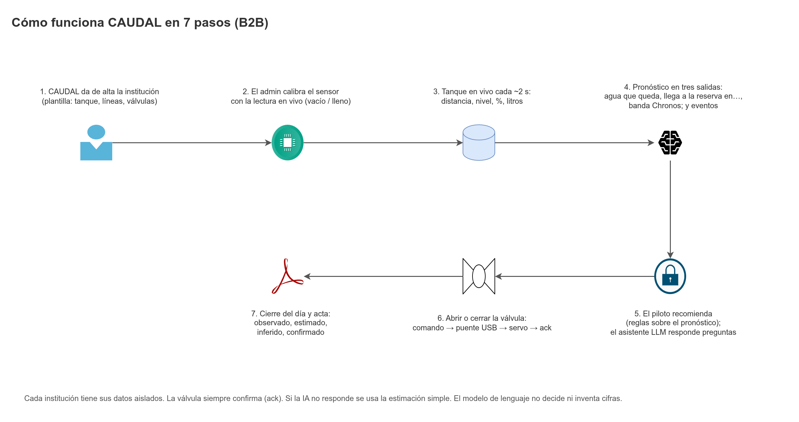

# CAUDAL: visión general del producto

> **El cuaderno del agua de cada institución, pero digital.**

Este documento explica qué problema resuelve CAUDAL, qué incluye esta versión, cómo funciona en palabras simples y cómo se organiza el trabajo. Es la puerta de entrada a la documentación. Los detalles viven en los demás documentos de `docs/` (ver la línea "Relacionados" al final).

> **Alcance B2B (2026-11-20).** CAUDAL es un producto B2B. Nosotros damos de alta cada institución y la configuramos según su lugar: tanque, sensor ultrasónico y válvulas. Cada institución tiene sus propios datos, aislados de las demás. Este documento reemplaza la versión anterior, que servía a la Junta de un acueducto veredal.

## 1. Problema

Una institución almacena agua en un tanque y la reparte por válvulas hacia distintas líneas de servicio. Hoy ese trabajo es manual:

- **Válvulas a mano:** alguien abre y cierra llaves según lo que ve en el tanque. No hay registro de quién abrió qué ni cuándo.
- **Nivel sin medir:** el nivel se estima mirando el tanque. No hay una lectura continua ni un historial que se pueda revisar.
- **Decisiones sin datos:** no hay un pronóstico de cuánta agua queda ni de cuándo llegará el tanque a su reserva. Se decide con la última impresión.
- **Registros dispersos:** las novedades, las observaciones (agua turbia, daño visible) y el cierre del día quedan en cuadernos o en la memoria de quien operó.

El resultado: agua mal repartida, poca capacidad de anticipar la escasez y ninguna evidencia de lo que pasó.

## 2. Objetivos

### 2.1 Objetivo general

Operar el tanque y sus válvulas desde una aplicación, con el nivel medido en vivo, un pronóstico claro, eventos explicados y registros auditables, separados por institución.

### 2.2 Objetivos específicos

| ID | Objetivo | Medida de verificación |
|---|---|---|
| OE-01 | Dar de alta una institución desde una plantilla y configurar su tanque, líneas y válvulas desde la app. | El superadmin crea una institución y su admin configura medidas, líneas y ángulos sin tocar código. |
| OE-02 | Medir el nivel del tanque con un sensor ultrasónico y mostrarlo en vivo, con calibración vacío/lleno. | La distancia y el nivel de `GET /tanks/{id}/live` coinciden con una medida real (±1 cm) y se refrescan cada ~2 s. |
| OE-03 | Abrir y cerrar válvulas desde la app con confirmación visible (ack) del dispositivo. | Desde la UI, cada válvula llega a `ACKED` en menos de ~5 s con el puente conectado. |
| OE-04 | Mostrar el pronóstico en tres salidas separadas: agua que queda, tiempo hasta la reserva o hasta vaciarse, y banda del modelo Chronos. | Cada salida se rotula y lleva su origen (`OBSERVED` o `ESTIMATED`). Con una válvula abierta, el tiempo a la reserva baja de forma coherente. |
| OE-05 | Registrar eventos (anomalías, alertas de nivel, comandos fallidos, observaciones) y mostrarlos aparte del pronóstico. | Cada evento tiene tipo, hora y origen, y se lista en `GET /events`. |
| OE-06 | Ofrecer un piloto automático con tres modos (`MANUAL`, `ASSISTED` y `AUTOMATIC`) y dos guardas. | En `AUTOMATIC` nunca se baja del piso de reserva y cualquier acción manual pausa el piloto. |
| OE-07 | Dar un asistente en lenguaje natural para preguntas y redacción de reportes, con respaldo de reglas. | El asistente responde "¿cuánta agua queda?" con los litros de `outlook`. Si el LLM falla, responden las reglas. |
| OE-08 | Aislar los datos de cada institución. | Un usuario de una institución no ve datos de otra (RLS y respuestas `404`). El login no revela si un usuario existe en otra institución. |
| OE-09 | Cerrar el día y generar actas con los cuatro estatus epistémicos. | Cada acta separa observado, estimado, inferido y confirmado, y un acta `FINAL` es inmutable. |
| OE-10 | Dejar trazabilidad de cada cambio y de cada comando de válvula. | Todo cambio relevante queda en `audit.audit_log`, de solo inserción. |
| OE-11 | Medir si la IA ayuda de verdad, comparándola con una estimación simple. | Existe una evaluación con MAE, WQL, cobertura y skill por horizonte. |
| OE-12 | Probar el sistema sin datos reales, con instituciones simuladas que producen datos verosímiles. | Los datos de una institución simulada se marcan "Datos simulados" en todas las pantallas. |
| OE-13 | Probar el lazo completo con una maqueta física: Arduino UNO por USB, sensor HC-SR04 y dos servos MG90S. | Con la maqueta conectada, una válvula abierta desde la UI pisa la manguera y el sensor refleja el cambio. |

## 3. Alcance

### 3.1 Incluye en esta versión

- Aplicación web instalable (PWA), con la escena 3D de la institución (tanque, líneas, flujo y válvulas) y un panel por rol.
- Alta de instituciones desde una plantilla, con su primer admin y su hardware.
- Configuración del tanque (forma, medidas y calibración), de las líneas de servicio y de las válvulas (cuántas, canal del servo, ángulos abierto y cerrado).
- Sensor en vivo: telemetría `DISTANCE` en mm, conversión a nivel y volumen, estado del sensor.
- Control de válvulas (manual o por decisión del piloto) con el ciclo de comando y su ack.
- Pronóstico en tres salidas: agua que queda, tiempo hasta la reserva o vaciado, y banda Chronos con respaldo de estimación simple.
- Eventos y anomalías automáticas (fuga posible, caída anormal, falla del sensor, dato viejo).
- Piloto automático con tres modos y dos guardas: piso de reserva y prioridad humana.
- Asistente LLM compatible con OpenAI, con respaldo de reglas, para preguntas y redacción de reportes.
- Observaciones manuales (agua sucia, agua turbia, daño visible, otro), cierre del día y actas en PDF.
- Parámetros por institución en `org.institution_settings`, editables por el admin y auditados.
- Instituciones simuladas, con importación de historial simulado solo en ellas.
- API REST en Java 25 con Spring Boot 4.1 y base de datos PostgreSQL 18.
- Dispositivos firmados (Ed25519), con telemetría y configuración `GET /devices/config` firmadas.
- Maqueta física (`caudal-maqueta`, Arduino UNO por USB) y maqueta virtual en el simulador.
- Vista en vivo con polling cada ~2 s (sin SSE en esta versión).

### 3.2 No incluye en esta versión

| Elemento | Motivo | Cómo se trata |
|---|---|---|
| Reglas de la institución versionadas (`rule_sets`, bandas HIGH, LOW y CRITICAL, borradores y activación) | El nivel se mide en vivo y los parámetros viven en una fila por institución. | Se reemplazan por `org.institution_settings`, sin versiones. Ver [Configuracion-sin-valores-quemados.md](Configuracion-sin-valores-quemados.md). |
| Propuestas de turnos, aprobación de la Junta, publicación y `ValveCommandScheduler` | Las válvulas se operan en tiempo real, no por turnos. | El piloto y el operador deciden en el momento. Ver [Reglas-de-negocio.md](Reglas-de-negocio.md). |
| Lecturas manuales, regla pintada, cola sin conexión y correcciones de lecturas | El sensor mide el nivel de forma continua. | Se elimina. Las observaciones manuales sí se conservan. |
| Página pública, WhatsApp, cartel PDF y reportes de daño de las familias | El producto atiende a la institución, no al público. | Se elimina. El directorio público solo lista instituciones (`{slug, name}`). |
| Rol `SUPPORT_ENTITY`, resúmenes autorizados y entidades de apoyo | Sin vía pública ni terceros en el alcance B2B. | Se elimina. |
| Árbol de regiones | Cada institución tiene líneas de servicio planas. | Se reemplaza por líneas de servicio (`service_lines`). |
| Envío automático de WhatsApp o SMS | Fuera del alcance B2B. | Por definir si se incorpora en una versión futura. |
| Hardware de campo (LoRa, LTE, panel solar, gabinete) | Esta versión construye solo la maqueta. | La propuesta de campo queda como referencia en [Simulador-y-hardware.md](Simulador-y-hardware.md). El ESP32 queda como alternativa futura. |
| Datos reales de las instituciones de terreno | No se dispone de ellos en esta versión. | Solo la maqueta produce datos reales. El resto son instituciones simuladas, marcadas "Datos simulados". |
| Facturación, cobro de agua o pagos | Fuera del problema. | No aplica. |
| Validación clínica o técnica formal de la IA | Requiere más datos. | El criterio de evaluación queda documentado en [Requerimientos.md](Requerimientos.md). |

CAUDAL **no reemplaza al operador ni a la persona responsable de la institución**. Propone, explica y registra. El admin configura el tanque, las líneas y el modo del piloto. En `MANUAL` y `ASSISTED` una persona actúa. En `AUTOMATIC` el sistema decide y ejecuta con dos guardas: no baja del piso de reserva y cualquier acción manual pausa el piloto. Toda acción queda auditada.

## 4. Cómo funciona: los 7 pasos

Esta sección resume el flujo completo en palabras simples. El diagrama está en la sección 6.

(diagrama en actualización)

1. **Alta de la institución.** El superadmin de CAUDAL crea la institución desde una plantilla. Se copian el tanque, las líneas y los parámetros, y se crea el primer admin con sus dispositivos.
2. **Configuración y calibración.** El admin define la forma y las medidas del tanque, cuántas líneas y válvulas tiene, el canal y los ángulos de cada servo. Calibra el sensor con la lectura en vivo: "usar lectura actual como vacío" y "usar lectura actual como lleno".
3. **Sensor en vivo.** El sensor mide la distancia al agua. El backend la convierte en nivel, porcentaje y litros según la geometría del tanque. La pantalla se refresca cada ~2 s y marca si el dato está viejo o si el sensor no tiene eco.
4. **Pronóstico y eventos.** El sistema muestra tres salidas separadas: cuánta agua queda, cuánto falta para la reserva o para vaciarse, y la banda probable del modelo Chronos. Los eventos (fugas posibles, caídas anormales, fallas del sensor, alertas de nivel) se muestran aparte.
5. **Recomendación o decisión.** El piloto automático y el asistente recomiendan `OPEN`, `CLOSE`, `WAIT` o `INSPECT`. En `MANUAL` solo se muestran. En `ASSISTED` el operador acepta con un clic. En `AUTOMATIC` el sistema ejecuta si el operador no actúa en `operator_absence_minutes`. Cada decisión queda en `ops.autopilot_decisions`.
6. **Válvula con confirmación.** Una orden (manual o del piloto) queda `PENDING`. El puente la recoge, la envía a la placa y la placa confirma. Cuando el dispositivo responde, la orden pasa a `ACKED`. Si no llega a tiempo, queda `FAILED` o `EXPIRED`. La pantalla muestra el estado en todo momento.
7. **Cierre y acta.** Al final del día el sistema resume las aperturas, los cierres, el nivel mínimo y máximo, los litros entregados estimados y los eventos. El operador agrega las novedades y cierra el día una sola vez. El admin genera el acta en PDF, que separa lo observado, lo estimado, lo inferido y lo confirmado.

Puntos clave de los pasos:

- Los pasos 3 y 4 son deterministas, salvo la banda de Chronos. El nivel, los litros y el tiempo a la reserva se calculan con reglas simples.
- El paso 5 es donde la IA participa. El LLM no decide ni inventa cifras, y el piloto aplica sus guardas antes de ejecutar nada.
- El paso 6 es el único que mueve una válvula. Siempre espera la confirmación del dispositivo.

## 5. Módulos funcionales

| ID | Módulo | Qué hace | Pasos | Repos principales |
|---|---|---|---|---|
| M1 | Login e instituciones | Elegir institución, entrar con usuario y contraseña, alta desde plantilla, directorio público mínimo, cierre de sesión global, MFA opcional. | 1 | `caudal-backend`, `caudal-frontend` |
| M2 | Configuración de la institución | Tanque (forma, medidas, calibración), líneas de servicio, válvulas (canal, ángulos), parámetros en `org.institution_settings`. | 2 | `caudal-backend`, `caudal-frontend` |
| M3 | Sensor y tanque en vivo | Telemetría `DISTANCE`, conversión a nivel, litros y porcentaje, estado del sensor, persistencia de la lectura efectiva. | 3 | `caudal-backend`, `caudal-frontend`, `caudal-sim` |
| M4 | Válvulas y comandos | Abrir y cerrar con origen manual o del piloto, ciclo del comando (`PENDING` a `ACKED`), estado en vivo de cada válvula. | 6 | `caudal-backend`, `caudal-frontend`, `caudal-sim` |
| M5 | Pronóstico y eventos | Agua que queda, tiempo hasta la reserva o vaciado, banda Chronos con respaldo, anomalías automáticas y alertas de nivel. | 4 | `caudal-backend`, `caudal-ia`, `caudal-frontend` |
| M6 | Piloto automático y asistente | Modos `MANUAL`, `ASSISTED` y `AUTOMATIC`, guardas, recomendaciones y decisiones auditadas, asistente para preguntas y redacción. | 5 | `caudal-backend`, `caudal-ia`, `caudal-frontend` |
| M7 | Observaciones, cierre del día y actas | Observaciones manuales, cierre del día con novedades, actas en PDF con cuatro estatus epistémicos. | 7 | `caudal-backend`, `caudal-frontend` |
| M8 | Dispositivos y maqueta | Registro de dispositivos, telemetría y configuración firmadas (Ed25519), puente USB con la placa Arduino UNO, maqueta virtual en el simulador. | 3, 6 | `caudal-backend`, `caudal-simulador`, `caudal-maqueta` |
| M9 | Auditoría | Bitácora de cambios, comandos y accesos, eventos de seguridad, cadena de hashes. | Transversal | `caudal-backend`, `caudal-frontend` |
| M10 | Instituciones simuladas | Instituciones con `is_simulated`, generación de datos simulados, importación de historial solo en ellas, marcas "Datos simulados". | Transversal | `caudal-simulador`, `caudal-backend` |

Las historias de usuario de cada módulo están en [Historias-de-usuario.md](Historias-de-usuario.md). Los requisitos, en [Requerimientos.md](Requerimientos.md).

## 6. Diagramas

| Diagrama | Archivo | Contenido |
|---|---|---|
| Flujo de CAUDAL | `images/flujo-caudal.png` | Los siete pasos y los actores que intervienen en cada uno. (En actualización.) |
| Casos de uso | `images/casos-de-uso.png` | Actores y casos de uso por rol. Ver [Actores-y-permisos.md](Actores-y-permisos.md). (En actualización.) |
| Contenedores (C4) | `images/c4-contenedores.png` | PWA, API, PostgreSQL, `caudal-ia`, puente USB y placa Arduino UNO. (En actualización.) |
| Modelo de datos | `images/modelo-de-datos.png` | Esquemas y tablas por página del archivo fuente. (En actualización.) |
| Secuencia de válvula | `images/secuencia-valvula.png` | Comando de válvula de punta a punta, con su ack. (Por crear.) |

Las fuentes `.drawio` están junto a su exportación `.png` en `docs/images/`.

## 7. Repositorios

| Repositorio | Tecnología | Contenido | Responsable actual |
|---|---|---|---|
| [`NicoalsD/caudal-backend`](https://github.com/NicoalsD/caudal-backend) | Java 25 LTS, Spring Boot 4.1.x, PostgreSQL 18 | API REST, dominio, seguridad, base de datos. Documentación canónica en `docs/`. | Drako2305 (dominio, BD y seguridad), nicomora70 (telemetría, IA y dispositivos), NicoalsD (documentación y despliegue) |
| [`NicoalsD/caudal-frontend`](https://github.com/NicoalsD/caudal-frontend) | React 19, Vite, TypeScript (PWA) | Login en dos pasos, tanque en vivo, válvulas, pronóstico, eventos, asistente, cierre y actas, administración de la institución y consola de plataforma. | NicoalsD, con Drako2305 |
| [`NicoalsD/caudal-ia`](https://github.com/NicoalsD/caudal-ia) | Python 3.12, FastAPI, Chronos | Pronóstico (Chronos) y asistente (LLM compatible con OpenAI, con respaldo de reglas). Sin estado y sin acceso a la base de datos. | nicomora70 |
| [`NicoalsD/caudal-simulador`](https://github.com/NicoalsD/caudal-simulador) | Python 3.12, FastAPI, tablero Vite/React | Datos simulados de las instituciones simuladas, maqueta virtual y el puente `caudal-sim maqueta-usb` que habla con la placa por serie. | nicomora70 |
| `caudal-maqueta` | Arduino UNO (sketch `uno/caudal_uno`), HC-SR04, servos MG90S | Placa de la maqueta física. El firmware no cambia en esta versión: recibe ángulos crudos por serie. | nicomora70 |

Ramas: `main` (versiones con etiqueta) y `develop` (integración, rama por defecto). Las reglas de GitHub exigen PR y el check `commit-lint`, prohíben el force-push y el borrado, y solo permiten merge commit.

## 8. Principios

Estos principios aplican a todo el sistema. Cualquier cambio que los contradiga requiere una decisión documentada.

1. **Aislamiento por institución.** Cada dato pertenece a una institución. La base de datos filtra por `institution_id` (RLS) y la API responde `404` ante un recurso de otra institución.
2. **La válvula siempre confirma (ack).** Una orden de válvula no se da por cumplida hasta que el dispositivo responde. La pantalla muestra `PENDING`, `DELIVERED`, `ACKED`, `FAILED` o `EXPIRED`, nunca un estado supuesto.
3. **El LLM no decide ni inventa cifras.** El asistente responde preguntas y redacta reportes a partir del `outlook`, los eventos y el estado de las válvulas. Las decisiones las toma el piloto, con sus guardas.
4. **La IA nunca bloquea la operación.** Si el servicio de IA falla o su circuito está abierto, el sistema usa la estimación simple o las reglas, y lo indica. El operador puede operar las válvulas sin IA.
5. **Lo observado, lo estimado, lo inferido y lo confirmado se distinguen.** Cada dato lleva su estatus epistémico (`OBSERVED`, `ESTIMATED`, `INFERRED`, `CONFIRMED`) y ninguno se presenta como otro.
6. **Lo simulado se declara.** Todo dato de una institución simulada se marca como "Datos simulados" en pantallas, PDF y mensajes.
7. **Los parámetros de negocio viven en la base de datos.** Cambiar un umbral, por ejemplo la reserva, es una fila editada y auditada en `org.institution_settings`, no un cambio de código.
8. **Lo público es mínimo.** El directorio público solo entrega `{slug, name}` de las instituciones activas, con límite de tasa. No expone datos de personas ni de operación.

## 9. Glosario mínimo

Los términos completos están en [Glosario.md](Glosario.md). Los más usados:

- **Institución:** cliente de CAUDAL, con su tanque, sensor, líneas y válvulas. Sus datos están aislados de los de otras instituciones.
- **Institución simulada:** institución con `is_simulated = true`. Todos sus datos son simulados.
- **Línea de servicio:** tramo que sale de una válvula y alimenta una zona. En la UI se llama "Acueducto N" y su nombre es editable.
- **Outlook:** las tres salidas del pronóstico: agua que queda, tiempo hasta la reserva o vaciado, y banda Chronos.
- **Ack:** confirmación del dispositivo de que ejecutó un comando de válvula.

Relacionados: [Actores-y-permisos.md](Actores-y-permisos.md) · [Historias-de-usuario.md](Historias-de-usuario.md) · [Requerimientos.md](Requerimientos.md) · [Reglas-de-negocio.md](Reglas-de-negocio.md) · [Riesgos.md](Riesgos.md) · [Glosario.md](Glosario.md)
