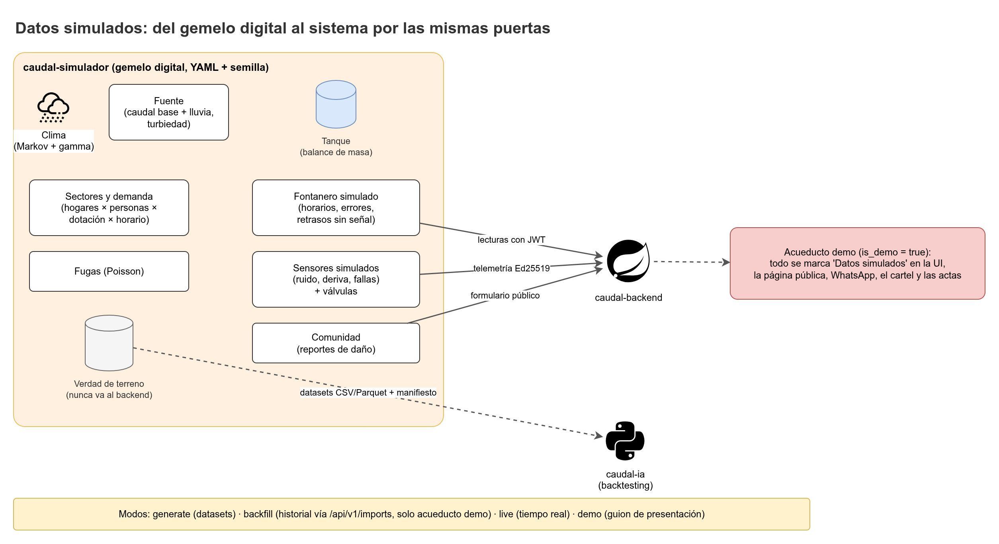
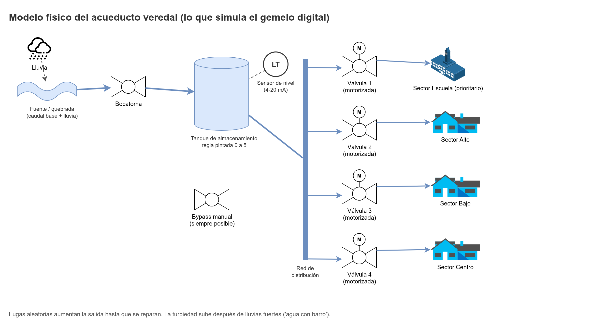

# Datos simulados

CAUDAL no tiene datos reales de las instituciones clientes todavía. Lo que en el futuro llegaría del campo (niveles del tanque, eventos del sensor, comandos de válvula, observaciones) se puede generar con `caudal-simulador`, en instituciones marcadas como simuladas. Este documento explica por qué, cómo funciona, qué supuestos contiene, cómo lo trata el backend y cómo se reemplazaría por datos reales.

> Cambio de alcance B2B (2026-11-20): la simulación ya no vive en un "acueducto demo" de una sola Junta. Es una propiedad de cada institución (`is_simulated`). Cada institución simulada tiene sus propios datos, aislados de las demás. La institución de prueba `maqueta-caudal` **no es simulada**: su tanque es la maqueta física real.



> Diagrama en actualización. Mientras tanto, el flujo es el de las secciones 2 y 5.

## 1. Por qué se simula

| Necesidad | Por qué no basta con esperar datos reales |
|---|---|
| Probar el pronóstico y su evaluación | Chronos necesita historia de niveles. Sin historia no hay banda ni evaluación (ver `Modulo-IA.md`). |
| Probar el sensor en vivo, las anomalías y los eventos | `SENSOR_FAULT`, `STALE_DATA`, `ABNORMAL_DROP` y `POSSIBLE_LEAK` deben aparecer a voluntad, no por azar. |
| Probar el piloto automático y el asistente | Las guardas (piso de reserva y prioridad humana) deben probarse con niveles bajos y críticos. |
| Probar el manejo de errores | Datos fuera de rango, sin eco, duplicados y fallas de la IA deben aparecer a voluntad. |
| Demostrar el sistema | La demostración necesita un guion repetible. |
| Mantener el proyecto avanzando sin acceso al campo | Las instituciones clientes están lejos y el equipo no puede esperar a tener sensores instalados. |

El simulador **no reemplaza** la validación en campo. Un resultado obtenido con datos simulados prueba el sistema, no la institución real.

## 2. Principio: mismas puertas que la realidad

El simulador entra al sistema **por las mismas APIs** que usaría la realidad:

| Actor simulado | Se conecta como | Endpoints |
|---|---|---|
| Operador | Usuario `OPERATOR` con JWT | `POST /api/v1/valve-commands/manual`, `POST /api/v1/observations`, `POST /api/v1/days/{date}/closure` |
| Sensor de nivel y actuador de válvula | Dispositivo con firma Ed25519 | `POST /api/v1/devices/telemetry`, `GET /api/v1/devices/commands`, `POST /api/v1/devices/commands/{id}/ack`, `GET /api/v1/devices/config` |
| Importador de historial | Superadmin de plataforma con permiso `IMPORT_SIMULATED` | `POST /api/v1/imports/readings` (solo instituciones con `is_simulated = true`) |

Consecuencias:

- El backend no tiene rutas "de simulación". La única excepción es la importación de historial, y solo en instituciones simuladas.
- Si un dato simulado entra por una puerta, la validación de telemetría, la cadena de eventos y la auditoría se ejecutan igual que con datos reales.
- Cambiar el simulador por datos reales no cambia el backend: cambian quien llama a la API y el origen de los datos.
- El simulador no envía la verdad de terreno (sección 4).

## 3. Qué se simula

El simulador es un **gemelo digital** de la institución. Sus parámetros viven en archivos YAML con semilla fija (no en el código). Cada componente tiene un modelo y un conjunto de parámetros.



| Componente | Modelo | Parámetros principales (YAML) | Estado de los valores |
|---|---|---|---|
| **Clima** | Cadena de Markov de dos estados (húmedo y seco) por mes. En días húmedos, la lluvia sigue una distribución gamma. | Matriz de transición mensual; forma y escala de la gamma; régimen bimodal andino de Nariño. | Supuesto, verificar con datos meteorológicos de la zona. |
| **Fuente** | Caudal base más respuesta a la lluvia con retardo. | Caudal base (L/s); ganancia y retardo de la respuesta. | Por definir con la institución y medición en campo. |
| **Tanque** | Balance de masa (sección 3.1). Nivel acotado a la geometría del tanque. | Forma, medidas, `empty_distance_mm`, `full_distance_mm`, `blind_zone_mm`. | Medidas de la maqueta en la institución de prueba; las demás, por medir. |
| **Líneas de servicio** | Demanda = hogares × personas × dotación × perfil horario. El agua sale solo con la válvula abierta. | Número de hogares por línea; personas por hogar (3 a 4, supuesto); dotación en L/hab/día (valor de referencia RAS 0330/2017 para más de 2.000 msnm, verificar); perfil horario. | Supuesto, verificar. |
| **Operador** | Abre y cierra válvulas con cierta frecuencia y anota observaciones con probabilidad. | Frecuencia de maniobras; probabilidad de observación por tipo. | Supuesto. |
| **Piloto** | Sigue sus propias reglas (sección 5, `AUTOMATIC`). | Modo y parámetros de `institution_settings`. | Igual que en la institución real. |
| **Fugas** | Proceso de Poisson con tasa `λ` por mes. Una fuga suma caudal de salida hasta que se repara. | `λ` (fugas por mes); caudal de la fuga; tiempo de reparación. | Supuesto, verificar con la historia de la institución. |
| **Sensor de nivel** | Ruido, deriva lineal, valor pegado, picos, caídas de datos y eco perdido (`-1`). Batería solar que puede dejar huecos de datos. | Desviación del ruido; tasa de deriva por día; probabilidad de valor pegado, pico y caída; voltaje de batería. | Supuesto; ajustar con la ficha del sensor real (ver `Simulador-y-hardware.md`). |

### 3.1 Balance de masa del tanque

Para cada paso de tiempo `Δt`:

```
V(t + Δt) = V(t) + [ Q_entrada(t) - Q_salida(t) ] * Δt - Q_rebose(t) * Δt

Q_salida(t) = Σ_líneas  Q_línea(t) * open_línea(t)  +  Q_fuga(t)

Q_rebose(t) = max(0, V_pre(t+Δt) - V_max) / Δt

h(t) = V(t) / A
```

- `V` es el volumen en el tanque (L o m³), `h` el nivel en metros y `A` el área de la sección horizontal.
- `V_pre` es el volumen antes de aplicar el rebose. Si `V_pre` supera `V_max`, el exceso sale por rebose y `V` queda en `V_max`.
- El volumen nunca es negativo. Si la salida pedida supera el volumen disponible, la salida se recorta al volumen existente.
- `h` se recorta al rango útil de la geometría del tanque antes de generar la distancia que envía el sensor simulado.
- `Q_línea(t)` depende de la demanda de la línea en el instante `t` y de su perfil horario.

Para la distancia que mide el sensor: `distance_mm = empty_distance_mm - h_mm`, con `h_mm` recortado al rango útil (`Reglas-de-negocio.md`, sección 2).

### 3.2 Comandos y ejecución

- El simulador abre y cierra válvulas con comandos reales (`POST /valve-commands/manual`). El puente simulado los recibe, los ejecuta en su modelo y confirma con `ack`. Un comando vencido (`EXPIRED`) no se ejecuta.
- Un comando de apertura abre la válvula de la línea desde su entrega. Un comando de cierre la cierra. Un comando que no se confirma a tiempo termina en `FAILED`.
- La observación manual (`WATER_DIRTY`, `WATER_MUDDY`, `VISIBLE_DAMAGE` u `OTHER`) la registra el operador simulado con probabilidad configurada. El simulador puede equivocarse en el registro.

## 4. Verdad de terreno

La **verdad de terreno** es todo lo que el simulador sabe y el sistema no debe saber: nivel real del tanque, fugas activas, demanda real y errores de medición cometidos.

- Se guarda en archivos separados (propuesta: carpeta `truth/` con Parquet por corrida).
- **Nunca** se envía al backend. Ninguna petición de la API incluye esos campos.
- Sirve para tres cosas: comparar lo que el sistema estimó con lo que pasó (por ejemplo, la estimación simple con el nivel real), medir qué tan bien detecta el sistema las fugas, y verificar que el simulador hace lo que dice.
- Una prueba automática revisa que los payloads enviados no contengan columnas de la verdad de terreno.

## 5. Modos del simulador

| Modo | Qué hace | Entrada | Salida | Destino |
|---|---|---|---|---|
| `generate` | Genera datasets de un escenario, sin red. | Escenario YAML y semilla. | Archivos CSV o Parquet de lecturas, comandos, eventos y verdad de terreno, más un manifiesto con la semilla, la versión y los hashes. | Disco local. Para la IA, pruebas y evaluación offline. |
| `backfill` | Carga historial simulado en una institución simulada. | Escenario, semilla, institución simulada. | Lotes de lecturas. | Backend, por `/api/v1/imports/*`. Queda registro en `sim.import_batches`. |
| `live` | Simula la institución en tiempo real: sensor, válvulas, observaciones. | Escenario, institución simulada, credenciales de cada actor simulado. | Eventos en tiempo real. | Backend y tablero del simulador (SSE). |
| `demo` | Ejecuta el guion de la sección 6 paso a paso, con pausas para mostrar cada efecto. | Escenario `presentation` y semilla. | Eventos del guion y lista de comprobación. | Backend (institución simulada). |

- Los lotes de `backfill` tienen un máximo de 5.000 filas o 1 MiB por petición (límite de importación de la API). El simulador parte el archivo en lotes.
- Todas las ejecuciones guardan la semilla y la versión del simulador. Con la misma semilla y escenario, el resultado es idéntico.
- Un modo `live` de la maqueta virtual envía `DISTANCE` cada ~2 s, igual que el puente real (`Simulador-y-hardware.md`, sección 9).

## 6. Guion del modo `demo`

El guion muestra los casos que el sistema debe manejar. Se ejecuta sobre una institución simulada con su configuración vigente y un historial corto cargado con `backfill`. La duración del historial es por definir.

| Paso | Qué ocurre | Qué debe verse en el sistema |
|---|---|---|
| 1. Preparación | La institución simulada tiene `is_simulated = true`, su tanque con geometría y calibración, dos líneas con válvula y el historial cargado. | Banner "Datos simulados" en toda la UI. |
| 2. Sensor normal | El sensor simulado envía `DISTANCE` con agua normal. | El tanque en vivo muestra distancia, nivel, porcentaje, litros y edad del dato. |
| 3. Eco perdido | El sensor simulado envía `-1` (sin eco) durante unos segundos. | El estado del sensor pasa a `NO_ECHO` y se crea un evento `SENSOR_FAULT` si hay una válvula abierta. |
| 4. Abrir una línea | El operador simulado abre "Acueducto 1" desde la app. | Comando `PENDING`, luego `DELIVERED`, luego `ACKED` en unos segundos. La válvula queda `OPEN`. |
| 5. Agua con barro | El operador simulado anota que el agua se ve con barro tras una lluvia fuerte. | Una observación `WATER_MUDDY` aparece en el tanque, en el evento y en el cierre del día. |
| 6. Fuga y anomalía | Una fuga aumenta la salida con todas las válvulas cerradas. | El sistema crea un evento `POSSIBLE_LEAK`. El nivel baja más de lo esperado. |
| 7. Sensor sin señal | El sensor deja de enviar y llega el último dato viejo. | El estado pasa a `STALE` y se crea un evento `STALE_DATA` después de `stale_after_seconds`. |
| 8. IA caída | El servicio de IA se detiene. | El circuito pasa a abierto. La banda de Chronos es la estimación simple con `fallback_reason = CIRCUIT_OPEN`. Las salidas de agua que queda y de tiempo a reserva siguen igual. La UI lo indica. |
| 9. Piloto en `AUTOMATIC` | El nivel baja hasta la zona de reserva con el operador ausente. | El piloto recomienda `CLOSE` o `INSPECT` según el caso, ejecuta solo lo que pasa sus guardas y lo audita en `ops.autopilot_decisions`. Nunca baja del piso de reserva. |
| 10. Cierre y acta | Al final del día, el operador completa el cierre con novedades. | El cierre resume comandos, nivel y eventos. El acta separa observado, estimado, inferido y confirmado. |

## 7. Escenarios

| Escenario | Propósito | Cambios principales respecto al normal |
|---|---|---|
| `normal-year` (nombre propuesto) | Operación típica. Línea base. | Régimen bimodal con lluvias moderadas. |
| `dry-year` (nombre propuesto) | Prueba de racionamiento severo (tipo El Niño). | Menos lluvia; nivel bajo por más tiempo; alertas de nivel bajo y crítico frecuentes. |
| `rainy-year` (nombre propuesto) | Prueba de desbordes y agua con barro (tipo La Niña). | Más lluvia; rebose; más turbiedad. |
| `frequent-leaks` (nombre propuesto) | Prueba de anomalías (`POSSIBLE_LEAK`). | `λ` alto. |
| `defective-sensors` (nombre propuesto) | Prueba de datos viejos, ecos perdidos y valores pegados. | Más deriva, valores pegados y caídas. |
| `presentation` (nombre propuesto) | Guion de la sección 6. | Eventos programados en pasos fijos. |
| `maqueta` (nombre propuesto) | Maqueta virtual con la geometría de la maqueta física (`Simulador-y-hardware.md`, sección 9). | Dos líneas, sin fugas y con el sensor de la maqueta. |

Los escenarios son archivos YAML validados con Pydantic. Ninguno contiene credenciales ni claves privadas: esas van en `.env` o en un directorio de claves ignorado por git.

## 8. Cómo lo trata el backend

| Aspecto | Regla |
|---|---|
| Marca | `org.institutions.is_simulated = true` identifica una institución simulada. Es simulada por definición. La columna se llama hoy `is_demo` en `aqueducts`; el renombre es parte de la migración B2B (por implementar). |
| Importación | Solo `POST /api/v1/imports/readings` (y otros lotes que se definan), y solo si la institución tiene `is_simulated = true`. Un trigger de `sim.import_batches` lo valida. |
| Permiso | Solo el superadmin de plataforma puede importar (permiso `IMPORT_SIMULATED`). El `INSTITUTION_ADMIN` no lo tiene (`Actores-y-permisos.md`). |
| Antigüedad | La importación en una institución simulada puede traer datos más viejos que la regla de antigüedad. Es la única excepción de la regla de fechas. |
| Trazabilidad | Cada importación crea una fila en `sim.import_batches` con `kind`, `scenario_name`, `seed`, `simulator_version`, `rows_received`, `rows_accepted`, `rows_rejected`, `file_sha256`, `imported_by` e `imported_at`. Es append-only. |
| Etiqueta | "Datos simulados" aparece en la UI, en las actas y en los reportes de una institución simulada. La etiqueta depende de `is_simulated`, no de una bandera manual. |
| Aislamiento | Una institución simulada nunca se mezcla con una real. Los datos de una institución simulada no se copian a otra. RLS por `institution_id` lo garantiza (`Seguridad-de-la-base-de-datos.md`). |
| Institución de prueba | `maqueta-caudal` **no** es simulada. Sus datos vienen del sensor y de las válvulas reales de la maqueta. |

Tabla `sim.import_batches` (resumen; especificación completa en `Diccionario-de-datos.md`): `id`, `institution_id`, `kind` (`READINGS`; otros tipos por definir), `scenario_name`, `seed`, `simulator_version`, `rows_received`, `rows_accepted`, `rows_rejected`, `file_sha256`, `imported_by`, `imported_at`.

## 9. Supuestos

Todo valor que no viene de medición se marca **supuesto, verificar**. Esta lista se actualiza cuando se mide algo en campo.

| Supuesto | Valor de partida | Estado |
|---|---|---|
| Ubicación: Guaitarilla (Nariño) a unos 2.600 msnm (referencia de la institución simulada de ejemplo) | 2.600 msnm | Supuesto, verificar. |
| Hogares de 3 a 4 personas | 3 a 4 | Supuesto, verificar con censo local. |
| Dotación de referencia para más de 2.000 msnm | Valor de la RAS 0330/2017 | Supuesto, verificar en la norma vigente. |
| Régimen de lluvia bimodal andino | Dos temporadas de lluvia al año | Supuesto, verificar con datos del IDEAM o estación cercana. |
| Geometría del tanque simulado | Medidas de la maqueta (`empty_distance_mm = 350`, `full_distance_mm = 80`) | Medido en la maqueta; el diámetro, por definir. |
| Capacidad y área del tanque de una institución real | Por medir | Por definir en campo. |
| Número de líneas de servicio y válvulas | Lo configura el administrador | Por definir con cada institución. |
| Perfil horario de consumo | Pico matutino y vespertino | Supuesto, verificar con la institución. |
| Probabilidades de maniobra y de observación del operador | Por definir | Supuesto. |
| Tasa de fugas (`λ`) | Por definir | Supuesto. |
| Fallas de sensor (eco perdido, deriva, picos, caídas) | Por definir | Supuesto; ajustar con la ficha del sensor. |

## 10. Cómo reemplazar los datos simulados por reales

El diseño permite el cambio sin tocar el backend. Los pasos son:

1. **Crear la institución real** con `is_simulated = false`. Sus datos nunca vienen del simulador.
2. **Conectar los actores reales** por las mismas APIs: el sensor real (telemetría firmada), el operador (app) y el puente o actuador de la válvula.
3. **Cargar el historial real** si se necesita. La importación está restringida a instituciones simuladas. Cargar historial de una institución real es un flujo distinto, **por definir**, y debe quedar auditado.
4. **Recalibrar los parámetros** del simulador con los datos reales: geometría del tanque, caudales, demanda, tasa de fugas y lluvia. Los parámetros cambian en el YAML del escenario, no en el código.
5. **Mantener el simulador** como herramienta de pruebas y de demostración. Sus datos no se mezclan con los reales.
6. **Retirar etiquetas** de forma automática: la etiqueta "Datos simulados" depende de `is_simulated`, así que desaparece sola en una institución real.

## 11. Validación del simulador

El simulador se valida con pruebas de propiedades (Hypothesis) además de ejemplos fijos.

| Propiedad | Prueba |
|---|---|
| Balance de masa | Para cualquier escenario generado, `Σ entradas - Σ salidas - rebose = ΔV` dentro de una tolerancia numérica por definir. |
| Rango del nivel | `0 <= h <= H_max`, y la distancia enviada dentro del rango de la geometría del tanque. |
| Agua solo con válvula abierta | Ninguna línea tiene salida con su válvula cerrada. |
| Sin volumen negativo | `V >= 0` en todo el horizonte. |
| Reproducibilidad | Misma semilla y escenario producen el mismo hash de archivo. |
| Frecuencias de eventos | Sobre muchos años simulados, la tasa empírica de fugas se acerca a `λ`. |
| Ruido de sensor | Los residuos del sensor simulado siguen la desviación configurada. |
| Contrato con la API | Cada payload valida contra los modelos Pydantic del simulador y contra el OpenAPI del backend. |
| Sin verdad de terreno en payloads | Ningún payload enviado contiene columnas de la verdad de terreno. |
| Guion `demo` | Ejecutar el guion de la sección 6 contra el backend levantado con Docker Compose y comprobar los efectos esperados. |

Las pruebas de integración del guion requieren el backend y la base de datos locales. Corren en el flujo de CI del simulador (propuesta).

Relacionados: [Simulador-y-hardware.md](Simulador-y-hardware.md), [Modulo-IA.md](Modulo-IA.md), [Actores-y-permisos.md](Actores-y-permisos.md), [Diccionario-de-datos.md](Diccionario-de-datos.md)
