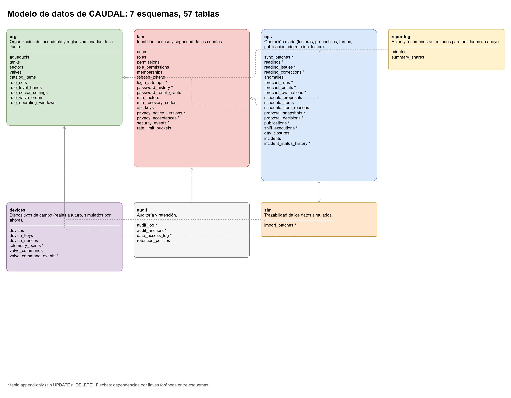
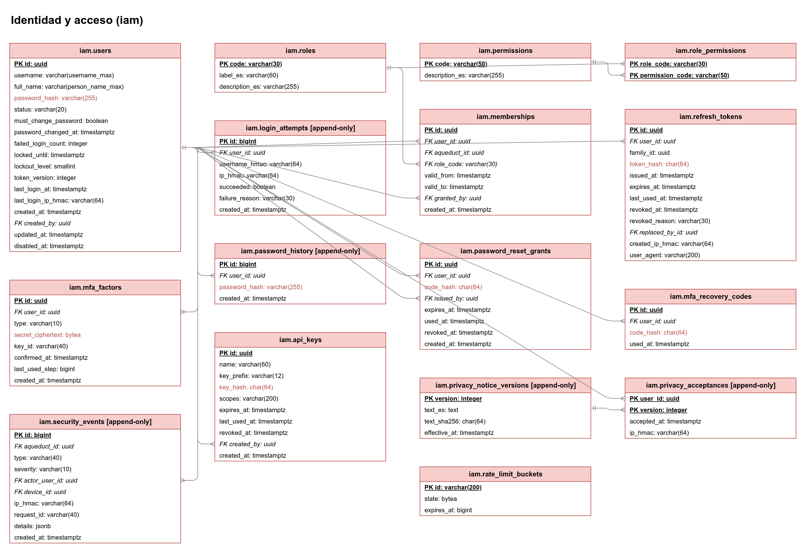
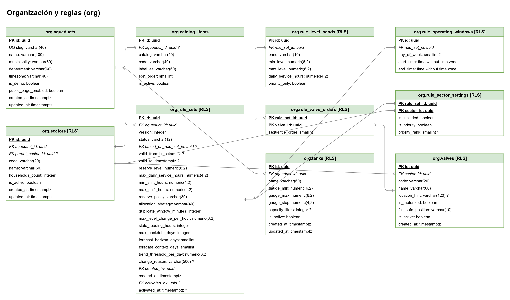
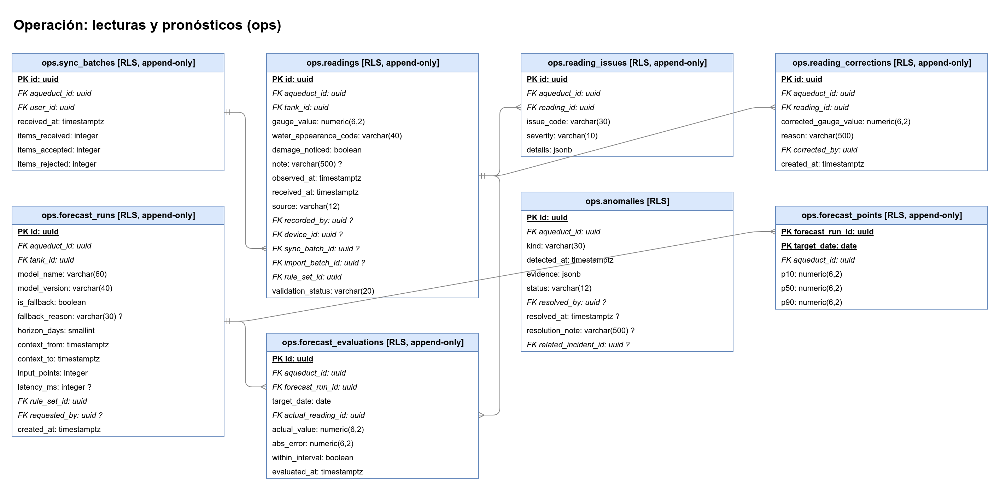
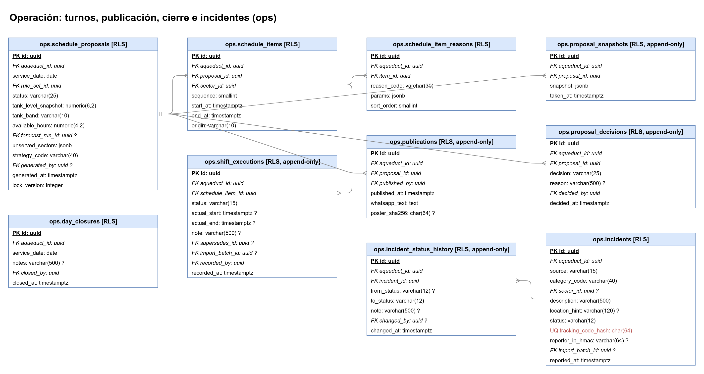
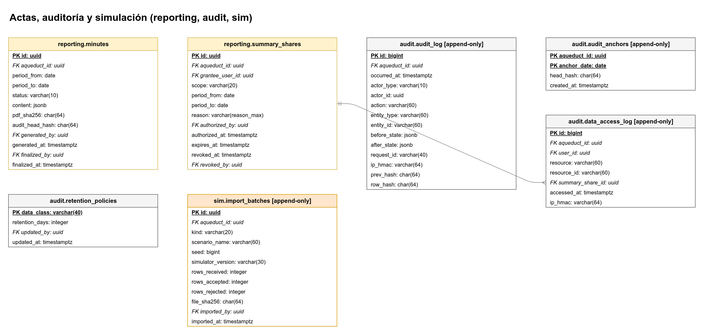
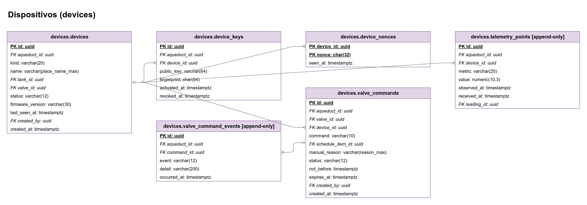

# Modelo de datos de CAUDAL

> PostgreSQL 18 organizado en esquemas por responsabilidad. Este documento explica la estructura, las convenciones y las decisiones de la base de datos en el modelo B2B. El número de tablas se confirma al regenerar el [Diccionario de datos](Diccionario-de-datos.md), que se genera a partir de la especificación del esquema y no se edita a mano.

## 1. Visión general

La base de datos es la fuente de verdad del sistema. Cada **institución** (cliente B2B) tiene sus propios datos, aislados de las demás por `institution_id` y por RLS. Los esquemas agrupan tablas que cambian juntas y tienen el mismo nivel de sensibilidad.

| Esquema | Tablas | Para qué sirve |
|---|---|---|
| `iam` | por verificar al regenerar | Identidad y acceso: cuentas, roles, permisos, membresías, sesiones, MFA, bloqueos, aviso de privacidad y eventos de seguridad. |
| `org` | por verificar al regenerar | Instituciones, configuración (`institution_settings`), tanques con su geometría y calibración, líneas de servicio, válvulas y catálogos. |
| `ops` | por verificar al regenerar | Operación diaria: lecturas del sensor, anomalías, pronósticos, observaciones manuales, decisiones del piloto y cierre del día. |
| `reporting` | por verificar al regenerar | Actas en PDF con sus cuatro secciones epistémicas. |
| `devices` | por verificar al regenerar | Dispositivos (sensor de nivel y actuadores de válvula), claves públicas, nonces, telemetría cruda y comandos de válvula. |
| `audit` | por verificar al regenerar | Auditoría con cadena de hashes por institución, anclas diarias, accesos a datos sensibles y políticas de retención. |
| `sim` | por verificar al regenerar | Trazabilidad de las importaciones de historial simulado. Solo acepta instituciones con `is_simulated = true`. |
| `platform` | solo funciones | Funciones `SECURITY DEFINER` del superadmin de plataforma (`platform.create_institution`, `platform.list_institutions`). No tiene tablas. |

Dependencias entre esquemas (de quién depende cada uno):

```text
org.institutions  <-- casi todas las tablas tienen institution_id
iam.users         <-- created_by, recorded_by, decided_by, ... (autoría)
org               <-- ops, devices, reporting
sim               <-- ops.readings.import_batch_id (historial simulado)
devices           <-- ops.readings.device_id, iam.security_events.device_id
ops               <-- devices.telemetry_points.reading_id, devices.valve_commands.autopilot_decision_id
platform          <-- llama a org.institutions e iam.users con SECURITY DEFINER
audit             <-- solo registra; no es referenciado por el dominio
```

Las ERD por esquema son las imágenes de `images/`. Están enlazadas, pero **son de la versión anterior** (diagrama en actualización): muestran tablas que ya no existen.

| Página | Imagen | Contenido |
|---|---|---|
| Visión general |  | Esquemas y dependencias (diagrama en actualización). |
| `iam` |  | Cuentas, roles, permisos, membresías, sesiones y MFA (diagrama en actualización). |
| `org` |  | Instituciones, tanques, líneas, válvulas (diagrama en actualización). |
| `ops` (lecturas) |  | Lecturas, anomalías y pronósticos (diagrama en actualización). |
| `ops` (turnos) |  | Muestra tablas de turnos que ya se retiran. Pendiente de retirar. |
| `reporting`, `audit` y `sim` |  | Actas, auditoría e importaciones (diagrama en actualización). |
| `devices` |  | Dispositivos, claves, nonces, telemetría y comandos (diagrama en actualización). |

## 2. Tablas por esquema

Cada tabla indica su propósito, si es append-only (solo se insertan filas, sin `UPDATE` ni `DELETE`), si tiene RLS por institución y sus relaciones principales (FK). Las columnas de cada tabla están en el diccionario de datos.

### Esquema `iam`

| Tabla | Propósito | Append-only | RLS | Relaciones principales (FK) |
|---|---|---|---|---|
| `users` | Cuentas de personas. Usuario único por institución: `UNIQUE (institution_id, username)`. `institution_id` nulo solo para el `PLATFORM_ADMIN`, que no tiene membresía. | No | Sí | `institution_id` → `org.institutions`; `created_by` → `iam.users` |
| `roles` | Catálogo de roles: `PLATFORM_ADMIN`, `INSTITUTION_ADMIN`, `OPERATOR`, `VIEWER`. | No | No | Ninguna |
| `permissions` | Permisos finos que el código verifica (por ejemplo `INSTITUTION_CONFIGURE`, `OBSERVATION_CREATE`). | No | No | Ninguna |
| `role_permissions` | Matriz rol-permiso guardada en datos (sin quemar en código). | No | No | `role_code` → `iam.roles`; `permission_code` → `iam.permissions` |
| `memberships` | Pertenencia de un usuario a una institución con un rol y una vigencia. Una sola membresía activa por usuario. | No | Sí | `user_id` → `iam.users`; `institution_id` → `org.institutions`; `role_code` → `iam.roles`; `granted_by` → `iam.users` |
| `refresh_tokens` | Sesiones (refresh tokens opacos con rotación y detección de reutilización). | No | No | `user_id` → `iam.users`; `replaced_by_id` → `iam.refresh_tokens` |
| `login_attempts` | Intentos de inicio de sesión para bloqueo y monitoreo, por (IP, institución). Retención limitada. | Sí | No | `user_id` → `iam.users` |
| `password_history` | Hashes anteriores para impedir reutilizar contraseñas. | Sí | No | `user_id` → `iam.users` |
| `password_reset_grants` | Códigos de un solo uso para restablecer una contraseña, emitidos por quien tiene `USER_MANAGE`. | No | No | `user_id` → `iam.users`; `issued_by` → `iam.users` |
| `mfa_factors` | Segundo factor TOTP opcional. | No | No | `user_id` → `iam.users` |
| `mfa_recovery_codes` | Códigos de respaldo del segundo factor. | No | No | `user_id` → `iam.users` |
| `api_keys` | Llaves para tareas internas (por ejemplo, cron de evaluación). | No | No | `created_by` → `iam.users` |
| `privacy_notice_versions` | Versiones del aviso de privacidad (Ley 1581 de 2012). | Sí | No | Ninguna |
| `privacy_acceptances` | Aceptación del aviso de privacidad por usuario. | Sí | No | `user_id` → `iam.users`; `version` → `iam.privacy_notice_versions` |
| `security_events` | Eventos de seguridad para monitoreo (bloqueos, reutilización de token, firma inválida, etc.). | Sí | Por definir (ver sección 2.1) | `institution_id` → `org.institutions` (nulo en eventos de plataforma); `actor_user_id` → `iam.users`; `device_id` → `devices.devices` |
| `rate_limit_buckets` | Estado de Bucket4j en PostgreSQL para límites compartidos entre instancias. | No | No | Ninguna |

### Esquema `org`

| Tabla | Propósito | Append-only | RLS | Relaciones principales (FK) |
|---|---|---|---|---|
| `institutions` | Instituciones clientes de CAUDAL (antes `org.aqueducts`). `is_simulated` indica si sus datos son simulados. Tiene `slug`, nombre, zona horaria (por defecto `America/Bogota`) y `is_active`. | No | No | Ninguna |
| `institution_settings` | Parámetros de negocio de cada institución: una fila por institución, editable por el administrador, auditada y sin versiones. Ver sección 3.2. | No | Sí | `institution_id` → `org.institutions` |
| `tanks` | Tanque de la institución: `shape` (`CYLINDER` o `RECTANGULAR`), medidas (`height_mm`, `diameter_mm` o `length_mm` y `width_mm`) y calibración (`empty_distance_mm`, `full_distance_mm`, `blind_zone_mm`). | No | Sí | `institution_id` → `org.institutions` |
| `service_lines` | Líneas de servicio que salen del tanque (antes `org.sectors`). En la UI se llaman "Acueducto N" y el nombre es editable. Sin jerarquía: se quitan `is_region` y `parent_sector_id`. Se desactivan con `is_active`; no se borran. | No | Sí | `institution_id` → `org.institutions`; `tank_id` → `org.tanks` |
| `valves` | Válvula de cada línea de servicio, con `is_motorized`, `servo_channel`, `open_angle_deg`, `closed_angle_deg`, `hold_torque_after_move` y `fail_safe_position`. | No | Sí | `institution_id` → `org.institutions`; `service_line_id` → `org.service_lines` |
| `catalog_items` | Opciones de listas con etiqueta en español. Por definir si se conserva: las observaciones usan un enum fijo y los catálogos de aspecto del agua y de daño se retiran. | No | Por definir | `institution_id` → `org.institutions` (nulo = catálogo global) |

### Esquema `ops`

| Tabla | Propósito | Append-only | RLS | Relaciones principales (FK) |
|---|---|---|---|---|
| `readings` | Lecturas efectivas del nivel del tanque, derivadas de la telemetría del sensor. Se guardan cada `persist_interval_seconds` o cuando el nivel cambia más de un umbral (por definir). Estatus epistémico `OBSERVED`. | Sí | Sí | `institution_id` → `org.institutions`; `tank_id` → `org.tanks`; `device_id` → `devices.devices`; `import_batch_id` → `sim.import_batches` |
| `anomalies` | Sospechas inferidas por reglas: `POSSIBLE_LEAK`, `ABNORMAL_DROP`, `SENSOR_FAULT`, `STALE_DATA`. Estatus `INFERRED` hasta que alguien la revisa. | No | Sí | `institution_id` → `org.institutions`; `resolved_by` → `iam.users` |
| `forecast_runs` | Cada pronóstico calculado (Chronos o respaldo simple), con el paso en segundos y el horizonte usados. Estatus `ESTIMATED`. | Sí | Sí | `institution_id` → `org.institutions`; `tank_id` → `org.tanks`; `requested_by` → `iam.users` |
| `forecast_points` | Cuantiles p10, p50 y p90 por paso pronosticado. | Sí | Sí | `forecast_run_id` → `ops.forecast_runs`; `institution_id` → `org.institutions` |
| `forecast_evaluations` | Error de cada punto cuando llega el dato real (IA y respaldo simple). | Sí | Sí | `institution_id` → `org.institutions`; `forecast_run_id` → `ops.forecast_runs`; `actual_reading_id` → `ops.readings` |
| `observations` | Observaciones manuales del operador: `WATER_DIRTY`, `WATER_MUDDY`, `VISIBLE_DAMAGE`, `OTHER`. La fecha la asigna el servidor. | Sí (por definir si se permite anularlas) | Sí | `institution_id` → `org.institutions`; `recorded_by` → `iam.users` |
| `day_closures` | Cierre del día de una institución. Una sola vez por día (`UNIQUE (institution_id, service_date)`). El sistema guarda el resumen automático y el operador agrega las novedades. | No | Sí | `institution_id` → `org.institutions`; `closed_by` → `iam.users` |
| `autopilot_decisions` | Decisiones del piloto automático: acción (`OPEN`, `CLOSE`, `WAIT`, `INSPECT`), motivo, confianza, origen (siempre `RULES`), estado y quién la resolvió. `inputs` guarda el resumen del estado que la originó. | No (solo cambian `status`, `status_detail`, `decided_by` y `decided_at`) | Sí | `institution_id` → `org.institutions`; `valve_id` → `org.valves`; `decided_by` → `iam.users` |

Se retira `ops.sync_batches` (cola sin conexión), `ops.reading_issues` (ver sección 4) y `ops.reading_corrections` (ver sección 4).

### Esquema `reporting`

| Tabla | Propósito | Append-only | RLS | Relaciones principales (FK) |
|---|---|---|---|---|
| `minutes` | Actas por periodo con secciones observado, estimado, inferido y confirmado. Un acta `FINAL` es inmutable. | No | Sí | `institution_id` → `org.institutions`; `generated_by` → `iam.users`; `finalized_by` → `iam.users` |

### Esquema `devices`

| Tabla | Propósito | Append-only | RLS | Relaciones principales (FK) |
|---|---|---|---|---|
| `devices` | Dispositivos de la institución: `LEVEL_SENSOR` (sensor de nivel) y `VALVE_ACTUATOR` (actuador de válvula). La maqueta registra tres: un sensor y dos actuadores. | No | Sí | `institution_id` → `org.institutions`; `tank_id` → `org.tanks`; `valve_id` → `org.valves`; `created_by` → `iam.users` |
| `device_keys` | Claves públicas Ed25519 con rotación (la privada nunca llega al servidor). | No | Sí | `institution_id` → `org.institutions`; `device_id` → `devices.devices` |
| `device_nonces` | Nonces ya vistos (anti-repetición). Se purgan por plazo. | No | No | `device_id` → `devices.devices` |
| `telemetry_points` | Telemetría cruda: métrica `DISTANCE` en mm, tal como la envía el puente. Idempotente por el id del punto. | Sí | Sí | `institution_id` → `org.institutions`; `device_id` → `devices.devices`; `reading_id` → `ops.readings` |
| `valve_commands` | Comandos de válvula con un solo origen: manual (`manual_reason`) o decisión del piloto (`autopilot_decision_id`). Estados `PENDING`, `DELIVERED`, `ACKED`, `FAILED`, `EXPIRED` y `CANCELLED`. Tiene `expires_at`. | No (cambian de estado) | Sí | `institution_id` → `org.institutions`; `valve_id` → `org.valves`; `device_id` → `devices.devices`; `autopilot_decision_id` → `ops.autopilot_decisions`; `created_by` → `iam.users` |
| `valve_command_events` | Historial de entrega y confirmación de cada comando (cada transición). | Sí | Sí | `institution_id` → `org.institutions`; `command_id` → `devices.valve_commands` |

### Esquema `audit`

| Tabla | Propósito | Append-only | RLS | Relaciones principales (FK) |
|---|---|---|---|---|
| `audit_log` | Registro append-only con cadena de hashes por institución (cada fila incluye el hash de la anterior de su institución). | Sí | Sí | `institution_id` → `org.institutions` |
| `audit_anchors` | Hash cabeza diario de la cadena (se imprime en las actas). | Sí | No (ver sección 2.1) | `institution_id` → `org.institutions` |
| `data_access_log` | Quién vio o exportó datos sensibles. | Sí | Sí | `institution_id` → `org.institutions`; `user_id` → `iam.users` |
| `retention_policies` | Días de retención por tipo de dato (parámetro en BD, no en código). | No | No | `updated_by` → `iam.users` |

### Esquema `sim`

| Tabla | Propósito | Append-only | RLS | Relaciones principales (FK) |
|---|---|---|---|---|
| `import_batches` | Importaciones de historial simulado. Solo instituciones con `is_simulated = true`, con el permiso `IMPORT_SIMULATED` (lo usa el superadmin). | Sí | Sí | `institution_id` → `org.institutions`; `imported_by` → `iam.users` |

### 2.1 Tablas con `institution_id` pero sin RLS

Estas tablas tienen la columna de institución y no tienen RLS. Se documentan tal cual están y deben revisarse antes de cerrar la Fase 2.

| Tabla | Situación | Riesgo y decisión pendiente |
|---|---|---|
| `iam.security_events` | `institution_id` nulo en eventos de plataforma. | Un evento de una institución podría verse si la consulta no filtra. Decidir si se activa RLS o si el acceso queda solo en el módulo de auditoría. |
| `audit.audit_anchors` | `institution_id` es parte de la clave primaria, sin RLS. | Las anclas se imprimen en actas. La decisión de activar RLS queda abierta. |
| `org.catalog_items` | `institution_id` nulo significa catálogo global. | Una fila global no debe filtrarse por RLS. La política debe ser `institution_id IS NULL OR institution_id = current_institution_id()`. Por definir si la tabla se conserva. |

Otras tablas sin RLS no tienen institución: son globales o de cuenta (`iam.roles`, `iam.permissions`, `iam.role_permissions`, `iam.refresh_tokens`, `iam.login_attempts`, `iam.password_history`, `iam.password_reset_grants`, `iam.mfa_factors`, `iam.mfa_recovery_codes`, `iam.api_keys`, `iam.privacy_notice_versions`, `iam.privacy_acceptances`, `iam.rate_limit_buckets`, `org.institutions`, `devices.device_nonces`, `audit.retention_policies`). La protección de estas tablas recae en los roles de BD y en la aplicación.

## 3. Relaciones clave

### 3.1 Institución como raíz

`org.institutions` es la raíz de la jerarquía de datos. Casi todas las tablas tienen `institution_id` como FK. La membresía (`iam.memberships`) conecta a un usuario con una institución, un rol y una vigencia. Un usuario entra siempre a una institución; las consultas filtran por la institución del token, nunca por la URL.

Jerarquía física de una institución:

```text
org.institutions
   └── org.tanks                  (forma, medidas, calibración)
         ├── org.service_lines    ("Acueducto N" en la UI)
         │     └── org.valves     (canal de servo, ángulos, posición de seguridad)
         ├── devices.devices      (LEVEL_SENSOR, VALVE_ACTUATOR)
         └── ops.readings         (nivel efectivo)
```

### 3.2 Configuración

- `org.institution_settings` tiene una fila por institución con los parámetros de negocio: alertas de nivel (`reserve_level_pct`, `low_level_pct`, `critical_level_pct`), datos viejos y tendencia (`stale_after_seconds`, `max_level_change_per_minute`, `sensor_stuck_window_seconds`, `trend_window_minutes`), persistencia (`persist_interval_seconds`, `max_backdate_hours`), pronóstico (`forecast_step_seconds`, `forecast_horizon_steps`, `forecast_context_steps`), piloto (`autopilot_mode`, `reserve_floor_pct`, `operator_absence_minutes`). Cambiarlos es una operación auditada del administrador, no una versión nueva.
- `org.tanks` guarda la geometría y la calibración. La conversión `distancia → nivel → volumen` la hace la estrategia de geometría (`TankGeometry`) a partir de estos campos. Los valores de la maqueta están en la sección 8.
- `org.valves` guarda el canal del servo y los ángulos. El firmware no cambia: recibe ángulos crudos.

No existen reglas versionadas, ni tabla de bandas, ni tabla de ventanas de operación.

### 3.3 Cadena de telemetría

```text
devices.telemetry_points (append-only, DISTANCE en mm crudos, cada ~2 s)
   │  validación en cadena (Chain of Responsibility)
   ▼
ops.readings (nivel efectivo: cada persist_interval_seconds o por cambio de umbral)
   ├── ops.anomalies            (SENSOR_FAULT, STALE_DATA, ABNORMAL_DROP, POSSIBLE_LEAK)
   ├── ops.forecast_evaluations (error del pronóstico cuando llega el dato real)
   └── devices.telemetry_points.reading_id (punto de origen de la lectura efectiva)
```

El estado en vivo (`GET /tanks/{id}/live`) se calcula a partir del último punto válido de `devices.telemetry_points`. Las lecturas de `ops.readings` alimentan el historial, el pronóstico y el cierre del día. Las distancias sin eco (`-1`) o en zona ciega no producen nivel, pero cuentan para `SENSOR_FAULT`.

### 3.4 Pronóstico y evaluación

`ops.forecast_runs` guarda cada pronóstico (Chronos o respaldo simple). `ops.forecast_points` guarda los cuantiles p10, p50 y p90 por paso. `ops.forecast_evaluations` compara el p50 contra la lectura real.

Las dos salidas deterministas del pronóstico (litros que quedan y tiempo hasta la reserva o hasta vaciarse) **no se guardan como tabla**: se calculan al pedir `GET /tanks/{id}/outlook` a partir de `ops.readings` y de `org.tanks`.

### 3.5 Observaciones, cierre del día y actas

```text
ops.observations  (manual, append-only, la fecha la asigna el servidor)
ops.day_closures  (una por institución y día: resumen automático + novedades del operador)
   └── reporting.minutes  (acta: observado, estimado, inferido, confirmado)
```

El cierre del día no tiene turnos. El resumen sale de `devices.valve_commands` (aperturas y cierres por válvula con su origen), `ops.readings` (nivel mínimo y máximo), `ops.anomalies` y `ops.observations`. El operador agrega las novedades y cierra una sola vez.

### 3.6 Anomalías

`ops.anomalies` guarda las sospechas inferidas por reglas. Ya no se enlazan a incidentes: los reportes de daño de las familias salen del producto.

### 3.7 Dispositivos y comandos

`devices.devices` son el sensor de nivel y los actuadores de válvula. Sus claves públicas Ed25519 viven en `devices.device_keys` (con rotación). `devices.device_nonces` guarda nonces para evitar repeticiones.

Un comando de válvula (`devices.valve_commands`) nace de un origen y solo de uno:

- **Manual**: `manual_reason` (texto opcional; si falta, se guarda un texto por defecto).
- **Piloto**: `autopilot_decision_id`.

La restricción es `CHECK (manual_reason IS NOT NULL) <> (autopilot_decision_id IS NOT NULL)`, una forma de "exactamente un origen" (XOR). Cada cambio de estado queda en `devices.valve_command_events`. La vigencia (`expires_at`) y los estados están en `Reglas-de-negocio.md`, sección 9.

### 3.8 Actas

`reporting.minutes` guarda el contenido de un acta con sus cuatro secciones epistémicas: observado, estimado, inferido y confirmado. Un acta `FINAL` es inmutable. Las actas no se generan con resúmenes de terceros: el acceso de entidades de apoyo sale del producto y no hay `reporting.summary_shares`.

### 3.9 Auditoría

`audit.audit_log` es un registro append-only donde cada fila guarda `prev_hash` (la fila anterior de la misma institución) y `row_hash` (SHA-256 del contenido y del `prev_hash`). Un trigger calcula el hash. `audit.audit_anchors` guarda la cabeza de la cadena cada día, y ese valor se imprime en las actas. La entrada de un administrador de plataforma en una institución (`act_as=platform`) queda registrada con el actor `PLATFORM_ADMIN` y la institución objetivo.

## 4. Lo que se retira del modelo

Como las migraciones aplicadas no se editan, la retirada se hace con migraciones nuevas (sección 7). Las tablas y columnas que salen son:

| Elemento | Qué era | Motivo |
|---|---|---|
| `org.rule_sets`, `org.rule_level_bands`, `org.rule_sector_settings`, `org.rule_valve_orders`, `org.rule_operating_windows` | Reglas versionadas de la Junta | Se reemplazan por `org.institution_settings`. |
| `org.autopilot_settings` | Configuración del piloto | Sus dos parámetros (`operator_absence_minutes`, `reserve_floor_pct`) y el modo pasan a `org.institution_settings`. |
| `ops.schedule_proposals`, `ops.schedule_items`, `ops.schedule_item_reasons`, `ops.proposal_snapshots`, `ops.proposal_decisions`, `ops.publications`, `ops.shift_executions` | Turnos, propuestas, decisiones y publicación | Se quitan los turnos y la aprobación de la Junta. |
| `ops.reading_corrections` y la vista `ops.effective_readings` | Correcciones de lecturas | Ya no hay lecturas manuales ni correcciones. |
| `ops.reading_issues` | Problemas de la cadena de validación de lecturas manuales | La cadena ahora valida telemetría. Por definir si sus problemas se guardan en `ops.anomalies` o en una tabla nueva de telemetría. |
| `ops.sync_batches` | Lotes de la cola sin conexión | Se quita la cola offline. |
| `ops.incidents`, `ops.incident_status_history` | Reportes de daño públicos o del fontanero | Se reemplazan por `ops.observations`. |
| `reporting.summary_shares` y sus referencias en `audit.data_access_log` | Resúmenes autorizados para entidades | Se quita el rol `SUPPORT_ENTITY`. |
| Columnas `aqueduct_id`, `is_demo`, `public_page_enabled`, `is_region`, `parent_sector_id`, `gauge_min`, `gauge_max`, `gauge_step`, `rule_set_id` | Campos del modelo anterior | Se renombran o desaparecen (ver sección 5). |
| Publicación y página pública | Datos de la página de las familias | Sale del producto (sin datos personales en lo público porque ya no hay lo público). |

Las tablas `org.aqueducts`, `org.sectors` y `org.valves` se renombran o reemplazan como sigue: `org.aqueducts` pasa a `org.institutions`, `org.sectors` pasa a `org.service_lines` y `org.valves` se conserva con columnas nuevas.

## 5. Vista de lecturas

No hay vista de correcciones. El estado y los pronósticos leen `ops.readings` directamente. Si en el futuro se crea una vista sobre tablas con RLS, debe declararse con `WITH (security_invoker = true)`, para que la RLS de las tablas base se aplique a quien consulta la vista.

## 6. Convenciones

| Tema | Convención | Ejemplo |
|---|---|---|
| Idioma | Nombres de esquemas, tablas, columnas y valores de código en inglés, `snake_case`. Las etiquetas visibles en español van en columnas `label_es` o `description_es`. | `ops.observations`, `label_es` |
| Identificadores | `uuid` generado en la BD con `uuidv7()` (nativo en PostgreSQL 18). El cliente puede proponer el UUID en tablas de idempotencia (`devices.telemetry_points`). | `id uuid PRIMARY KEY DEFAULT uuidv7()` |
| Institución | Toda tabla de negocio tiene `institution_id uuid NOT NULL REFERENCES org.institutions(id)`, salvo las excepciones de la sección 2.1. El nombre `aqueduct_id` ya no se usa. | `institution_id uuid NOT NULL` |
| Tiempo | `timestamptz` en UTC. Las fechas de servicio son `date` y se interpretan en la zona de la institución. | `observed_at timestamptz NOT NULL` |
| Auditoría de filas | `created_at` y `updated_at` en tablas mutables. `updated_at` lo actualiza un trigger. Las tablas append-only tienen solo la marca de creación (por ejemplo, `recorded_at`, `decided_at`). | `created_at timestamptz NOT NULL DEFAULT now()` |
| Estados | Columna `varchar` con `CHECK (status IN (...))`. Los estados de comando de válvula son `PENDING`, `DELIVERED`, `ACKED`, `FAILED`, `EXPIRED` y `CANCELLED`. | `CHECK (status IN ('PENDING', 'DELIVERED', ...))` |
| Distancias y niveles | Distancias crudas del sensor en mm enteros (`integer`). Niveles, porcentajes y litros calculados: tipo numérico con escala por definir al implementar. | `distance_mm integer NOT NULL` |
| Intervalos | Intervalos de tiempo en segundos (`integer`), salvo las ventanas de tendencia en minutos, que se nombran con `_minutes`. | `persist_interval_seconds integer` |
| Ángulos | Grados enteros, entre 0 y 180 (restricción `CHECK`). | `open_angle_deg smallint` |
| Textos | `varchar(n)` con el límite de `FieldLimits`, por placeholder de Flyway. Texto libre largo: `text` con límite por `CHECK` de longitud. | `varchar(${person_name_max})` |
| Clasificación de columnas | Cada columna se clasifica en `P` (pública), `I` (interna), `C` (confidencial) o `S` (secreta). Las columnas `S` (por ejemplo `password_hash`, `token_hash`) no tienen permiso de lectura para `caudal_readonly`. | `password_hash` es `S` |
| Claves foráneas | `ON DELETE RESTRICT` en todas. Nada se borra en cascada; las instituciones y sus datos no se borran, se desactivan (`is_active`). | `REFERENCES org.institutions(id) ON DELETE RESTRICT` |
| Unicidad y solapes | `UNIQUE` para identificadores de negocio, por ejemplo `(institution_id, username)` y `(institution_id, service_date)` en `ops.day_closures`. | `UNIQUE (institution_id, service_date)` |
| Datos personales | El nombre (`users.full_name`) es `C`. La institución, sus tanques y sus lecturas no contienen datos personales de familias. | `users.full_name` es `C` |

## 7. Roles de base de datos

| Rol | Uso | Privilegios |
|---|---|---|
| `caudal_migrator` | Dueño del esquema. Solo lo usa Flyway. | DDL completo. Nunca lo usa la aplicación. |
| `caudal_app` | Usuario de la API. | DML mínimo: `SELECT` y `INSERT` en tablas append-only, `UPDATE` solo en columnas permitidas, sin `DELETE` salvo purgas por funciones `SECURITY DEFINER`. `EXECUTE` sobre las funciones `platform.*`. Sin acceso a columnas `S` salvo lo necesario. |
| `caudal_readonly` | Vistas de reportes. | `SELECT` sobre vistas. Sin `password_hash` ni `token_hash`. |

Por rol se configuran los tiempos: `statement_timeout` 5 s, `lock_timeout` 3 s y `idle_in_transaction_session_timeout` 10 s.

### 7.1 Purgas por retención

| Tabla | Tratamiento | Quién purga |
|---|---|---|
| `iam.login_attempts`, `iam.security_events`, `audit.data_access_log`, `devices.telemetry_points` | Append-only con plazo de retención. | Función `SECURITY DEFINER` de purga. |
| `devices.device_nonces`, `iam.refresh_tokens` | No son append-only. Se purgan por plazo. | Función de purga. |

Reglas:
- La función lee el plazo de `audit.retention_policies` (clases `LOGIN_ATTEMPTS`, `DEVICE_NONCES`, `SECURITY_EVENTS`, `REFRESH_TOKENS`, `DATA_ACCESS_LOG`, `TELEMETRY_POINTS`).
- Antes de borrar, escribe un registro `PURGE` en `audit.audit_log` con la clase de dato, la fecha de corte y el número de filas.
- `caudal_app` no tiene `DELETE` directo.

## 8. Semilla: institución de prueba

La semilla crea la institución `maqueta-caudal`, **no simulada** (`is_simulated = false`): es la maqueta real con un Arduino UNO por USB. Sus datos son reales de la maqueta, así que no se marcan como "Datos simulados".

| Elemento | Contenido | Estado |
|---|---|---|
| Institución | `slug` `maqueta-caudal`, `is_simulated = false`, zona `America/Bogota`. | Confirmado. |
| Tanque | Forma y medidas de la maqueta. `empty_distance_mm = 350` y `full_distance_mm = 80` (de `scenarios/maqueta-usb.yaml`). Forma `CYLINDER` o `RECTANGULAR` y diámetro o lados, por definir con la maqueta real. `blind_zone_mm` por definir. | Parcial. |
| Parámetros | Una fila en `org.institution_settings` con los valores por defecto de la sección 3.2. | Por definir los valores finales. |
| Líneas de servicio | "Acueducto 1" y "Acueducto 2" (`org.service_lines`), editables. | Confirmado. |
| Válvulas | Una válvula motorizada por línea, con `servo_channel` 1 y 2. Ángulos abierto y cerrado de ejemplo: 90° y 0°. | Ángulos por definir con la maqueta real. |
| Dispositivos | Un `LEVEL_SENSOR` y dos `VALVE_ACTUATOR` ligados a las válvulas motorizadas. Sus claves se registran con `DEVICE_MANAGE`. | Confirmado. |
| Roles y usuarios | Usuarios locales de `INSTITUTION_ADMIN`, `OPERATOR` y `VIEWER`. La contraseña la define el usuario de forma local, no en el repositorio. | Confirmado. |

Las pruebas que usan datos de institución deben cargar sus propias fixtures, no la semilla de la maqueta.

Para probar multi-institución, el superadmin crea una segunda institución **simulada** desde la plantilla (patrón Prototype). Esa institución no está en la semilla.

## 9. Migraciones

### 9.1 Herramienta y reglas

- Flyway con archivos en `src/main/resources/db/migration/`. La última migración aplicada en el repositorio es `V55__autopilot_permissions.sql`. El nombre real usa el número sin relleno (`V55__...`); la especificación antigua proponía cuatro dígitos y se corrige aquí.
- Las migraciones aplicadas nunca se editan. Si Flyway detecta un cambio de checksum, el arranque falla. `flyway repair` solo con aprobación de quien mantiene la BD.
- El cambio B2B se hace con migraciones nuevas, numeradas a partir de `V56`.
- Los límites de longitud y de caracteres vienen de `FieldLimits` como placeholders (`${person_name_max}`). El valor no se escribe a mano en SQL.
- Flyway se conecta con `FLYWAY_URL` y `FLYWAY_USER` (`caudal_migrator`), siempre por la conexión directa, no por el pooler (verificar).
- Los datos de semilla van en migraciones separadas de la estructura, para revisarlos por aparte.

### 9.2 Orden de las migraciones B2B

Propuesta de secuencia (se confirma al implementar la Fase 2). Cada grupo depende del anterior.

| Grupo | Contenido | Dependencias que resuelve |
|---|---|---|
| 1. Renombre | `org.aqueducts` → `org.institutions`; `aqueduct_id` → `institution_id` en todas las tablas; `is_demo` → `is_simulated`; `audit.current_aqueduct_id()` → `audit.current_institution_id()` con políticas RLS recreadas; `app.aqueduct_id` → `app.institution_id`. | Va primero para que nada nuevo nazca sobre `aqueduct_id`. |
| 2. Retiro | Eliminar las tablas y vistas de la sección 4 (`DROP` con dependencias revisadas), y reescribir el `CHECK` de `devices.valve_commands` para `manual_reason XOR autopilot_decision_id`. | Requiere el renombre, para revisar las FK. |
| 3. Estructura nueva | `org.institution_settings`; columnas nuevas de `org.tanks` (forma, medidas, calibración); `org.service_lines` (con `is_active`, sin jerarquía); columnas de `org.valves` (`servo_channel`, ángulos, `fail_safe_position`); `ops.observations`; `ops.day_closures` sin turnos; `ops.readings` como lectura del sensor; `devices.telemetry_points` con `DISTANCE`. | Requiere las tablas del grupo 1. |
| 4. Roles y permisos | Semilla de roles `PLATFORM_ADMIN`, `INSTITUTION_ADMIN`, `OPERATOR` y `VIEWER`, y permisos nuevos. Migración de roles viejos: `BOARD_*` → `INSTITUTION_ADMIN`; `PROJECT_TEAM` → `VIEWER`. `SUPPORT_ENTITY` se elimina. | Requiere la estructura de `iam`. |
| 5. Login por institución | `UNIQUE (institution_id, username)` en `iam.users`; funciones `platform.create_institution` y `platform.list_institutions` con `SECURITY DEFINER` y `search_path` fijo. | Requiere `org.institutions`. |
| 6. Triggers, RLS y privilegios | Inmutabilidad de `audit.audit_log`, cadena de hashes por institución, políticas RLS con `FORCE`, `GRANT` y `REVOKE` por columna de `org.tanks`, `org.valves` y `org.institution_settings`. | Todas las tablas ya existen. |
| 7. Semilla | `maqueta-caudal`, tanque, líneas, válvulas, dispositivos y usuarios locales (sección 8). | Requiere todo lo anterior. |

Los triggers y las políticas van en una migración aparte del grupo 6 para que sean fáciles de revisar y auditar. La semilla va en su propia migración, separada de la estructura.

## 10. Diccionario de datos y ERD

- [Diccionario de datos](Diccionario-de-datos.md): columna por columna (tipo, banderas, clasificación y descripción). Se regenera con su generador; no se edita a mano.
- Las ERD de `images/` son de la versión anterior y se actualizan después (diagrama en actualización).
- La fuente de las columnas es la especificación del esquema. Si el diccionario y este documento no coinciden, la especificación manda y se corrige el documento afectado.

Relacionados: [Arquitectura](Arquitectura.md), [Seguridad de la base de datos](Seguridad-de-la-base-de-datos.md), [Reglas de negocio](Reglas-de-negocio.md), [Configuración sin valores quemados](Configuracion-sin-valores-quemados.md), [Diccionario de datos](Diccionario-de-datos.md), [Patrones de diseño](Patrones-de-diseno.md), [Pruebas del backend](../.agents/testing-plan.md)
