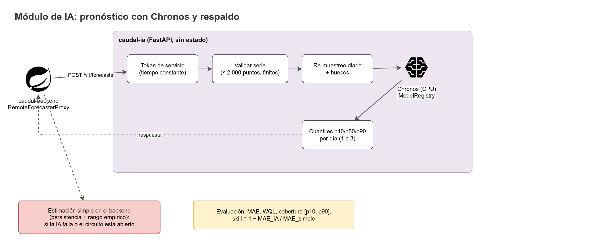
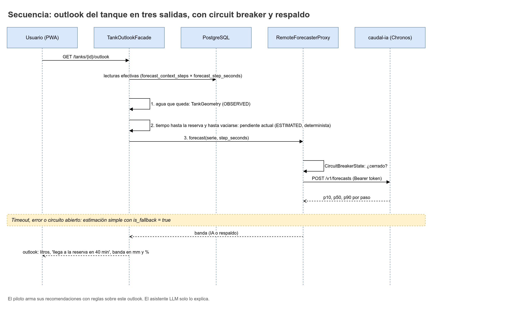

# Módulo de IA (pronóstico, cálculos deterministas y asistente)

Este documento describe el módulo de IA desde el sistema. Separa tres piezas que antes se mezclaban:

1. **Pronóstico con Chronos** (modelo de series de tiempo): la banda p10, p50 y p90 del nivel del tanque.
2. **Cálculos deterministas** (no son IA): cuánta agua queda y en cuánto tiempo se llega a la reserva o se vacía el tanque.
3. **Asistente con un LLM** (modelo de lenguaje): responde preguntas en lenguaje natural y redacta reportes. Como propuesta de recomendación para el piloto automático, también puede sugerir `OPEN`, `CLOSE`, `WAIT` o `INSPECT` (sección 15).

El servicio vive en `caudal-ia`. El cliente, el cálculo determinista, el piloto automático y el asistente viven en `caudal-backend`.

> Cambio de alcance B2B (2026-11-20): el pronóstico ya no es diario ni por "Junta". Corre a la escala de cada institución (`forecast_step_seconds`, en segundos o minutos), el resultado se presenta en tres salidas separadas, y el asistente no decide ni ejecuta nada. Las cifras de la sección 9.5 son de una medición previa con escala diaria.



> Diagrama en actualización. Mientras tanto, la descripción del texto es la referencia.

## 1. Qué pregunta responde

> **Dado el historial reciente del nivel de un tanque, ¿cuál es el nivel más probable dentro de los próximos pasos, y en qué rango puede estar?**

Los pasos son de `forecast_step_seconds` (ejemplo: 300 s, es decir, 5 minutos). La institución define esa escala. La maqueta trabaja en segundos o minutos; un tanque real, en horas.

Ejemplo de lo que ve el operador: "Lo más probable es 50 % dentro de 1 hora, pero podría estar entre 48 % y 52 %".

### 1.1 Tres salidas separadas

El panel de pronóstico muestra tres bloques rotulados. Cada uno tiene su origen. Así no se confunde una cuenta con una predicción.

| Salida | Rótulo en la UI | Qué responde | Origen | Quién la calcula |
|---|---|---|---|---|
| 1. Agua que queda | "Agua que queda" | Litros y porcentaje ahora. | `OBSERVED` | Geometría del tanque (`Reglas-de-negocio.md`, sección 2). No es IA. |
| 2. Tiempo a la reserva o a vaciarse | "Llega a la reserva en…" | Minutos hasta `reserve_level_pct` y hasta vaciarse, con la tasa de cambio actual. | `ESTIMATED` (determinista) | Pendiente sobre `trend_window_minutes`. No es IA. |
| 3. Banda Chronos | "Pronóstico (modelo Chronos)" | p10, p50 y p90 en los próximos `forecast_horizon_steps` pasos. | `ESTIMATED` (modelo) | `caudal-ia` (Chronos), o respaldo simple si Chronos falla (`is_fallback`). |

Los eventos (anomalías y alertas) y las recomendaciones del piloto se muestran aparte de estas tres salidas.

### 1.2 Quién decide

Chronos **pronostica**: solo entrega una estimación con rango. No decide, no abre ni cierra válvulas y no escribe en la base de datos. El asistente (LLM, sección 15) responde y redacta. **El backend decide** qué se hace con cualquier recomendación, según el modo del piloto automático (`MANUAL`, `ASSISTED` o `AUTOMATIC`, sección 15.4).

| Pregunta | Respuesta del módulo | Quién decide |
|---|---|---|
| ¿Cuál es el nivel probable en los próximos pasos? | `p50`, con `p10` y `p90` como rango. | El operador o el administrador lo lee. No hay acción automática sobre esa cifra. |
| ¿Cuánta agua queda y cuándo llega a la reserva? | Litros, porcentaje, minutos (cálculo determinista). | Quien lo lee. |
| ¿La IA le gana a la estimación simple? | No responde en tiempo real: lo calcula la evaluación (sección 9). | Equipo del proyecto y el administrador de la institución. |

## 2. Modelo: Chronos

El modelo es **Chronos** (`chronos-forecasting`), un modelo de series de tiempo preentrenado que se usa en modo *zero-shot*: no se entrena con los datos de la institución.

### 2.1 Familias y modelos por defecto

| Familia | Modelo por defecto | Tamaño | Cuantiles | Notas |
|---|---|---|---|---|
| **Chronos-2** | `autogluon/chronos-2-small` | 28M parámetros | Cuantiles de 0.01 a 0.99; incluye 0.1, 0.5 y 0.9, que son los que usa el servicio. | Admite covariables conocidas en el futuro (sección 11), que el MVP no usa. |
| **Chronos-Bolt** | `amazon/chronos-bolt-small` | 48M parámetros | **Cuantiles fijos** de 0.1 a 0.9; incluye 0.1, 0.5 y 0.9. | Según su documentación, con inferencia más rápida (verificar). |
| **Chronos-Bolt** | `amazon/chronos-bolt-tiny` | 9M parámetros | **Cuantiles fijos** de 0.1 a 0.9; incluye 0.1, 0.5 y 0.9. | Modelo de la imagen desplegada en Render free (sección 12). |

- El modelo se elige con `CHRONOS_MODEL_ID`. El valor por defecto local (`config.py` de `caudal-ia`) es `autogluon/chronos-2-small`; la imagen Docker desplegada usa `amazon/chronos-bolt-tiny`. Los tres identificadores existen en Hugging Face y se cargan con `chronos-forecasting` 2.3.2.
- El campo `model.name` de la respuesta y `model_name` de `ops.forecast_runs` guardan el nombre del modelo usado.
- Otros tamaños se pueden probar en la fase de evaluación, pero no están en el alcance del MVP.

### 2.2 Ejecución en CPU

- El servicio usa **PyTorch CPU**. No requiere GPU.
- El backend pide un pronóstico por tanque en dos casos: a petición (`POST /api/v1/tanks/{id}/forecasts`, con el permiso `FORECAST_RUN` y un límite de 10 por hora por institución) y de forma periódica. La frecuencia periódica está **por definir**; debe ser mucho más lenta que `forecast_step_seconds`, porque el servicio corre en CPU y con poca memoria.
- La latencia real en CPU se mide en la prueba de memoria y tiempo (sección 12.1). Ningún valor de latencia se da por cierto antes de medirlo.

### 2.3 Cuantiles

- El contrato pide `quantile_levels: [0.1, 0.5, 0.9]`, que se convierten en `p10`, `p50` y `p90`.
- `p50` es la mediana, lo más probable. `p10` y `p90` forman el rango.
- La BD exige `p10 <= p50 <= p90` en `ops.forecast_points`. Si el modelo devuelve cuantiles cruzados, el servicio los reordena y registra el hecho en el log, sin los valores.

### 2.4 Unidad de la banda

La banda se expresa en el nivel del tanque. La unidad (`level_pct` o `level_mm`) está **por definir**. Los ejemplos de este documento usan porcentaje.

## 3. Arquitectura del servicio y del cliente

| Repo | Pieza | Patrón | Responsable |
|---|---|---|---|
| `caudal-ia` | `ModelRegistry` (carga del modelo, una sola vez) | P01 Singleton | nicomora70 |
| `caudal-ia` | `ForecasterCreator` según `IA_MODEL_NAME` | P02 Factory Method | nicomora70 |
| `caudal-ia` | `Forecaster` (interfaz) y estrategias | P19 Strategy | nicomora70 |
| `caudal-ia` | `ChronosForecasterAdapter` | P06 Adapter | nicomora70 |
| `caudal-ia` | `CachingForecaster`, `TimingForecaster` | P09 Decorator | nicomora70 |
| `caudal-ia` | `ForecastPipeline` (preprocesado, inferencia, posprocesado) | P20 Template Method | nicomora70 |
| `caudal-ia` | `RollingWindowIterator` (ventanas de contexto) | P14 Iterator | nicomora70 |
| `caudal-ia` | `Backtest` (evaluación offline) | P20 Template Method | nicomora70 |
| `caudal-backend` | `IaForecastClientAdapter` (HTTP al servicio) | P06 Adapter | Drako2305 |
| `caudal-backend` | `RemoteForecasterProxy` (remoto más respaldo) | P11 Proxy | Drako2305 |
| `caudal-backend` | `CircuitBreakerState` (Cerrado, Abierto, Semiabierto) | P18 State | Drako2305 |
| `caudal-backend` | `TankStatusFacade` (estado del tanque para la UI, con las tres salidas) | P10 Facade | Drako2305 |
| `caudal-backend` | Clase de cálculo del outlook (agua que queda y tiempo a reserva, sin IA; nombre por definir) | No aplica (sin patrón del catálogo) | Drako2305 |

El servicio **no tiene estado** y **no accede a la base de datos**. Todo lo que el sistema necesita para decidir (historial, parámetros de `org.institution_settings`, respaldo) vive en el backend. Lo mismo aplica al asistente: la foto del estado llega en cada petición y `caudal-ia` no la guarda (sección 15 y `Contrato-IA.md`, sección 9).

## 4. Contrato backend a IA

Endpoint: `POST /v1/forecasts`. Autenticación: `Authorization: Bearer <IA_SERVICE_TOKEN>`.

El cambio de escala (de días a `step_seconds`) es incompatible con el contrato diario `v1`. Cómo se publica (nueva versión o migración coordinada) está **por definir**. El detalle está en `Contrato-IA.md`.

### 4.1 Petición (resumen)

| Campo | Tipo | Regla |
|---|---|---|
| `series_id` | UUID | Identificador de la serie. Corresponde al `tank_id`. |
| `step_seconds` | entero | Tamaño del paso en segundos. Viene de `institution_settings.forecast_step_seconds`. |
| `timestamps` | arreglo de texto ISO-8601 con zona | Estrictamente crecientes. Máximo 2.000 elementos. |
| `values` | arreglo de número o `null` | Mismo largo que `timestamps`. `null` es una lectura faltante. |
| `prediction_length` | entero | De 1 a 30 (límite técnico). El horizonte de la institución (`forecast_horizon_steps`) lo valida el backend. |
| `quantile_levels` | arreglo de número | Para el MVP: `[0.1, 0.5, 0.9]`. |

Ejemplo abreviado (escala de 5 minutos, valores ilustrativos en porcentaje):

```json
{
  "series_id": "7d3e2b10-4c1f-7a9e-8b25-5f0c9d6a1e42",
  "step_seconds": 300,
  "timestamps": [
    "2026-11-20T10:00:00-05:00",
    "2026-11-20T10:05:00-05:00",
    "2026-11-20T10:10:00-05:00",
    "2026-11-20T10:15:00-05:00",
    "2026-11-20T10:20:00-05:00",
    "2026-11-20T10:25:00-05:00",
    "2026-11-20T10:30:00-05:00",
    "2026-11-20T10:35:00-05:00"
  ],
  "values": [51.4, 51.1, 51.1, 50.8, 50.4, 50.2, 50.1, 50.0],
  "prediction_length": 12,
  "quantile_levels": [0.1, 0.5, 0.9]
}
```

En producción el backend envía hasta `forecast_context_steps` pasos (por ejemplo, 288 pasos de 5 minutos, que son 24 horas).

### 4.2 Respuesta exitosa (`200`, resumen)

| Campo | Tipo | Nota |
|---|---|---|
| `model.name` | texto | Nombre del modelo en Hugging Face, por ejemplo `autogluon/chronos-2-small`. |
| `model.version` | texto | `<versión de chronos-forecasting>+<agregación>`, por ejemplo `2.3.2+last`. |
| `model.notes` | texto, opcional | Solo aparece si hay algo que informar, por ejemplo la cantidad de pasos sin lectura enviados como `NaN`. |
| `generated_at` | ISO-8601 con zona | Momento de la inferencia. |
| `step_seconds` | entero | Eco del paso pedido. |
| `points[].timestamp` | ISO-8601 con zona | Paso pronosticado, uno después del último de la serie. |
| `points[].p10`, `p50`, `p90` | número | Cuantiles. `p10 <= p50 <= p90`. |

Ejemplo (valores ilustrativos, no una predicción):

```json
{
  "model": { "name": "autogluon/chronos-2-small", "version": "2.3.2+last" },
  "generated_at": "2026-11-20T10:35:02-05:00",
  "step_seconds": 300,
  "points": [
    { "timestamp": "2026-11-20T10:40:00-05:00", "p10": 48.6, "p50": 49.4, "p90": 50.1 },
    { "timestamp": "2026-11-20T10:45:00-05:00", "p10": 48.1, "p50": 48.9, "p90": 50.3 }
  ]
}
```

### 4.3 Errores

Formato de error del servicio, alineado con el backend (`error.code` en inglés, `message` en español). La tabla completa está en `Contrato-IA.md`, sección 3.3.

```json
{
  "error": {
    "code": "INSUFFICIENT_HISTORY",
    "message": "La serie tiene 4 pasos con lectura; se requieren al menos 7.",
    "details": { "received": 4, "minimum": 7 },
    "request_id": "9b1e6c0a-2f4d-4e8b-a1c3-6d7f0e5b2a90"
  }
}
```

| HTTP | `code` | Cuándo | Qué hace el backend |
|---|---|---|---|
| `422` | `INSUFFICIENT_HISTORY` | Menos pasos con lectura que el mínimo (después del remuestreo). | No cuenta como fallo del servicio. Usa la estimación simple con `fallback_reason = INSUFFICIENT_HISTORY`. |
| `422` | `INVALID_SERIES` | Largo distinto, valores no finitos (distintos de `null`), fuera del rango de float32, timestamps no crecientes o más de 2.000 puntos. | Error de integración: se registra y se usa la estimación simple con `fallback_reason = IA_ERROR`. Cuenta como fallo. |
| `400` | `VALIDATION_ERROR` | `step_seconds` fuera de rango, `prediction_length` fuera de 1 a 30, cuantiles distintos o campos desconocidos. | Contrato desalineado: alerta y estimación simple con `IA_ERROR`. Cuenta como fallo. |
| `401` | `UNAUTHORIZED` | Token ausente, malformado o no vigente. | Usa la estimación simple con `IA_ERROR` y genera alerta de configuración. Cuenta como fallo. |
| `503` | `MODEL_NOT_READY` | El modelo aún se está cargando (ver `GET /v1/ready`). | Usa la estimación simple con `IA_ERROR`. Cuenta como fallo. |
| `5xx` u otro | `INTERNAL_ERROR` | Error inesperado del servicio. | Usa la estimación simple con `IA_ERROR`. Cuenta como fallo. |
| Sin respuesta en 2 s (conexión) o 10 s (lectura) | No aplica | Timeout del cliente. | Usa la estimación simple con `IA_TIMEOUT`. Cuenta como fallo. |
| Circuito abierto | No aplica | El cliente no llama al servicio. | Usa la estimación simple con `CIRCUIT_OPEN`. No se llama al servicio. |

### 4.4 Salud

| Endpoint | Uso |
|---|---|
| `GET /v1/health` | El proceso responde. No carga el modelo. |
| `GET /v1/ready` | Modelo cargado y listo. Responde `503 MODEL_NOT_READY` mientras carga. |
| `GET /v1/models` | Modelos disponibles y el activo. |

Propuesta: el backend consulta `GET /v1/ready` antes de enviar un pronóstico cuando el circuito está en semiabierto (sección 7).

## 5. Preprocesado

El pipeline de `caudal-ia` (`ForecastPipeline`) recibe la serie cruda y produce la serie en pasos de `step_seconds` que se envía al modelo.

| Paso | Regla | Estado |
|---|---|---|
| 1. Orden y duplicados | Ordenar por `timestamp`. Si hay dos puntos en el mismo instante, se conserva el último recibido. | Definido. |
| 2. Zona horaria | Las marcas de tiempo se expresan en `SERIES_TIMEZONE` (`America/Bogota` por defecto), para etiquetar la respuesta. | Definido. |
| 3. Agregación por paso | Un valor por paso de `step_seconds`. Por defecto, el **último valor del paso** (`RESAMPLE_AGGREGATION = last`). Alternativa: `mean`. | Definido (`last` por defecto; `mean` configurable). |
| 4. Re-muestreo | Se reindexa la serie a la rejilla de `step_seconds`, desde el primer hasta el último paso. Los pasos sin lectura quedan como `null` (`NaN` en el modelo). | Definido. |
| 5. Huecos | No se rellenan. Los pasos sin lectura se envían a Chronos como `NaN` (Chronos-2 y Chronos-Bolt los tratan como valores faltantes) y la cantidad se informa en `model.notes`. | Definido. |
| 6. Mínimo de puntos | Contar los pasos con lectura después del remuestreo. Si son menos que `FORECAST_MIN_POINTS`, responder `422 INSUFFICIENT_HISTORY`, aunque el modelo todavía esté cargando. | Definido. El valor por defecto **por definir** (el valor anterior, 7, eran días; en pasos de 5 minutos, 7 pasos son 35 minutos). |
| 7. Validación final | Valores finitos o `null`, dentro del rango de float32, timestamps estrictamente crecientes, no más de 2.000 puntos. Si falla, `422 INVALID_SERIES`. | Definido. |
| 8. Horizonte | Los pronósticos empiezan en el paso siguiente al último de la serie. Longitud = `prediction_length`. | Definido. |

El backend envía las **lecturas efectivas** (las que pasaron la cadena de validación de telemetría, `Reglas-de-negocio.md`, sección 4.2) de los últimos `forecast_context_steps` pasos.

## 6. Estimación simple (persistencia)

La estimación simple es la línea base y el respaldo. Responde "seguirá igual que ahora", con un rango calculado con el historial del propio tanque.

### 6.1 Fórmula

Sea `x_t` el nivel del tanque en el paso `t` (después del paso 3 del preprocesado) y `L = x_T` el último valor disponible. Los cambios históricos son:

```
d_t = x_t - x_(t-1)        para los pasos t de la ventana de contexto
```

Entonces:

```
p50 = L
p10 = L + Q(0.10; d)
p90 = L + Q(0.90; d)
```

donde `Q(q; d)` es el cuantil `q` de los cambios de la ventana.

Reglas adicionales:

- Los valores se **acotan al rango útil del tanque**: `p10` y `p90` se recortan a `[0, 100]` si la unidad es porcentaje, o a `[0, útil_mm]` si es milímetros (`org.tanks`, `Reglas-de-negocio.md`, sección 2).
- Si hay menos de `N` cambios válidos en la ventana (`N` por definir), la estimación simple no se calcula y el sistema muestra "sin pronóstico" en vez de un rango inventado.
- **Horizontes mayores a un paso:** la fórmula anterior usa los mismos cuantiles para todos los horizontes. Esto subestima la incertidumbre a horizontes largos, porque los cambios de varios pasos no se suman linealmente. Alternativa a evaluar: cuantiles de cambios de `h` pasos (`x_t - x_(t-h)`). **Por definir.**

### 6.2 Ejemplo ilustrativo

Si `L = 50,0 %` y en la ventana `Q(0,10) = -1,2` y `Q(0,90) = +0,8` (puntos porcentuales por paso):

- `p50 = 50,0`
- `p10 = 50,0 - 1,2 = 48,8`
- `p90 = 50,0 + 0,8 = 50,8`

Lectura: "lo más probable es 50,0 %; podría estar entre 48,8 % y 50,8 %".

### 6.3 Dónde vive

- Se calcula en el backend (`RemoteForecasterProxy` y el cálculo de respaldo), sin llamar a la IA.
- Se guarda en `ops.forecast_runs` con `model_name = naive-persistence` y en `ops.forecast_points`.

## 7. Circuit breaker y respaldo

El backend nunca depende de la IA para mostrar el estado del tanque. Las salidas 1 y 2 (agua que queda y tiempo a reserva) no usan IA, así que siguen funcionando. Si Chronos falla, responde lento o está en circuito abierto, la salida 3 usa la estimación simple y se marca como respaldo.

### 7.1 Estados

| Estado | Comportamiento | Transición |
|---|---|---|
| **Cerrado** | Se llama a la IA normalmente. Cada fallo cuenta. | Pasa a **Abierto** al llegar a 5 fallos consecutivos (`CIRCUIT_BREAKER_FAILURE_THRESHOLD`). |
| **Abierto** | No se llama a la IA. Cada solicitud usa la estimación simple con `CIRCUIT_OPEN`. | Pasa a **Semiabierto** al cumplirse 60 s (`CIRCUIT_BREAKER_OPEN_SECONDS`). |
| **Semiabierto** | Se permiten 2 llamadas de prueba (`CIRCUIT_BREAKER_HALF_OPEN_CALLS`). | Pasa a **Cerrado** si las llamadas de prueba responden bien. Vuelve a **Abierto** ante cualquier fallo. |

### 7.2 Qué cuenta como fallo

| Cuenta como fallo | No cuenta como fallo |
|---|---|
| Timeout de conexión (2 s) o de lectura (10 s). | `422 INSUFFICIENT_HISTORY` (el servicio funciona; los datos no alcanzan). |
| `5xx`, `503 MODEL_NOT_READY`, error de conexión. | Respuesta `200` con datos válidos. |
| `401 UNAUTHORIZED` (cuenta como fallo y genera alerta). | |
| `422 INVALID_SERIES` (indica un error del cliente; se registra como fallo para no ocultarlo). | |

### 7.3 Configuración

Los umbrales del circuito son variables de entorno de `caudal-backend`, documentadas en `.env.example`. Los valores de la tabla son los iniciales y son configurables.

| Variable | Qué controla | Valor canónico o de inicio |
|---|---|---|
| `IA_CONNECT_TIMEOUT_MS` | Timeout de conexión, en milisegundos. | 2000 (canónico). |
| `IA_READ_TIMEOUT_MS` | Timeout de lectura, en milisegundos. | 10000 (canónico). |
| `CIRCUIT_BREAKER_FAILURE_THRESHOLD` | Fallos consecutivos para abrir el circuito. | 5. |
| `CIRCUIT_BREAKER_OPEN_SECONDS` | Tiempo en abierto antes de semiabierto. | 60. |
| `CIRCUIT_BREAKER_HALF_OPEN_CALLS` | Llamadas de prueba en semiabierto. | 2. |
| `IA_SERVICE_URL` | URL del servicio de IA. | Por entorno (ver `.env.example`). |
| `IA_SERVICE_TOKEN` | Token de servicio actual. | Secreto. Nunca en git. |
| `IA_SERVICE_TOKEN_PREVIOUS` | Token anterior durante la rotación. | Secreto. Opcional. |

Los parámetros de la institución (`forecast_step_seconds`, `forecast_horizon_steps`, `forecast_context_steps`, `reserve_level_pct`, `trend_window_minutes`) no son variables de entorno. Están en `org.institution_settings`, editables por el administrador de la institución (`Configuracion-sin-valores-quemados.md`).

### 7.4 Estado en memoria

El estado del circuito vive en la memoria de la instancia del backend. Si el backend corre en más de una instancia, cada una tiene su propio circuito (verificar la cantidad de instancias en Render). La decisión de mantenerlo en memoria se revisa si hay más de una.

## 8. Pronóstico en sombra

Siempre se calcula también la estimación simple, aunque la IA responda bien.

- Cada vez que se pide un pronóstico, el backend guarda **dos** corridas en `ops.forecast_runs`: una de la IA (el modelo configurado; en el despliegue, `chronos-bolt-tiny`) y una de `naive-persistence` con los mismos datos de entrada.
- La corrida simple de la sombra lleva `fallback_reason = SHADOW_BASELINE`.
- La UI muestra solo el pronóstico principal (la IA si respondió, la simple si no). La sombra no se muestra como respaldo.
- Ambas corridas se evalúan con los mismos datos reales. Sin esta simetría, la comparación de la sección 9 no vale.

> **Decisión:** la estimación simple de la sombra se guarda con `is_fallback = false` y `fallback_reason = SHADOW_BASELINE`. `is_fallback = true` solo cuando reemplaza a la IA.

## 9. Evaluación

La evaluación responde si la IA ayuda. Se compara con la estimación simple sobre los mismos pasos reales.

### 9.1 Qué se evalúa

Para cada corrida y cada horizonte `h` de evaluación (en pasos de `forecast_step_seconds`; los valores concretos están **por definir**), cuando llega la lectura real `y` del paso objetivo se crea una fila en `ops.forecast_evaluations` con:

- `abs_error = |y - p50|`
- `within_interval = (p10 <= y <= p90)`

### 9.2 Métricas

| Métrica | Fórmula | Lectura |
|---|---|---|
| **MAE** (error absoluto medio del p50) | `MAE_h = (1/n) * Σ |y_t - p50_t|` | Cuánto se equivoca, en promedio, en unidades del nivel. Menor es mejor. |
| **WQL** (pérdida cuantílica ponderada) | Ver abajo. | Calidad de todos los cuantiles a la vez. Menor es mejor. |
| **Cobertura** | `cobertura = (puntos con y dentro de [p10, p90]) / n` | Meta: cerca del 80 %. Un rango que cubre menos o mucho más no es confiable. |
| **Ancho** | `ancho = (1/n) * Σ (p90_t - p10_t)` | Qué tan preciso es el rango. Un rango más angosto con la misma cobertura es mejor. |
| **Skill** | `skill_h = 1 - MAE_IA,h / MAE_simple,h` | Mejora relativa frente a la estimación simple. Mayor a 0 significa que la IA le gana. |

**WQL.** Para el conjunto de cuantiles `Q = {0.1, 0.5, 0.9}`:

```
QL_q(y, ŷ_q) = q * (y - ŷ_q)        si y >= ŷ_q
             = (1 - q) * (ŷ_q - y)  si y <  ŷ_q

WQL = (1/|Q|) * Σ_q [ 2 * Σ_t QL_q(y_t, ŷ_t,q) / Σ_t |y_t| ]
```

El denominador `Σ_t |y_t|` puede ser cero si todos los niveles reales son cero. Caso por definir (por ejemplo, excluir la evaluación de esa ventana). Con el nivel en porcentaje, este caso es poco probable, pero no imposible.

### 9.3 Criterio de "ayuda"

La IA se considera útil para la institución si se cumplen las tres condiciones:

1. **Skill positivo y sostenido:** `skill_h > 0` en los horizontes evaluados, de forma sostenida. Qué significa "sostenido" (ventana de evaluación) **por definir**.
2. **Muestra suficiente:** al menos **30 pronósticos evaluados**.
3. **Cobertura calibrada:** la cobertura queda entre **70 % y 90 %**.

Si no se cumple la muestra, la UI muestra "todavía no hay evidencia suficiente". No se muestra un veredicto. Si la IA no ayuda, el operador sigue con la estimación simple, y el sistema lo indica.

Los datos de evaluación de una institución simulada se marcan "Datos simulados" en la UI (ver `Datos-simulados.md`). Un resultado sobre datos simulados prueba la integración, no la calidad del modelo en el campo.

### 9.4 Dónde se ve

- Endpoint: `GET /api/v1/forecast-evaluation`, con el permiso `EVALUATION_VIEW` (por defecto, `INSTITUTION_ADMIN`; `Actores-y-permisos.md`).
- Módulo M5 del sistema (Pronóstico y eventos).
- Backtest offline en `caudal-ia` (`Backtest`) para comparar modelos antes de activarlos.

### 9.5 Resultado previo con escala diaria

> **Medición previa, no vigente.** Se hizo con la escala diaria del modelo anterior, sobre la serie simulada `normal-year` (semilla 42, horizonte 3 días). Se conserva como referencia histórica. Con la escala de segundos, la evaluación se repite con la institución de la maqueta y con los datos reales.

| Modelo | MAE h1 | MAE h2 | MAE h3 | Cobertura p10-p90 en h3 | Veredicto |
|---|---:|---:|---:|---:|---|
| `amazon/chronos-bolt-tiny` | 0,225 | 0,362 | 0,479 | 0,76 | `does_not_help` |
| `autogluon/chronos-2-small` | 0,212 | 0,332 | 0,434 | 0,73 | `does_not_help` |
| `naive-persistence` (estimación simple) | 0,188 | 0,320 | 0,419 | 0,49 | Referencia |

En esa medición ningún modelo superó a la persistencia en MAE, así que el skill fue negativo. En h3, los rangos de Chronos quedaron dentro de la meta de cobertura y el de la persistencia no. Esto prueba la integración; la evaluación con lecturas reales decide si la IA ayuda.

## 10. Seguridad del servicio

| Control | Regla |
|---|---|
| Autenticación | `Authorization: Bearer <IA_SERVICE_TOKEN>`. Token de al menos 32 bytes aleatorios. |
| Comparación | En tiempo constante (`hmac.compare_digest` u equivalente). |
| Rotación | El servicio acepta el token actual y el anterior (`IA_SERVICE_TOKEN` e `IA_SERVICE_TOKEN_PREVIOUS`). Luego se retira el anterior. |
| Límites | Serie de hasta 2.000 puntos; valores finitos o `null`; timestamps crecientes; `prediction_length` de 1 a 30; `step_seconds` dentro del rango técnico (`Contrato-IA.md`). |
| Tamaño de cuerpo | 256 KiB (`MAX_BODY_BYTES`). |
| Sin almacenamiento | El servicio no guarda series, pronósticos ni tokens de usuario. No tiene acceso a la BD. |
| Logs | Se registran `request_id`, largo de la serie, modelo, latencia y código de respuesta. **No** se registran valores de la serie ni el token. |
| Secretos | `IA_SERVICE_TOKEN` solo en variables de entorno del hosting. Nunca en git. `.env.example` con marcadores. |
| Documentación | Swagger en `/docs`. Solo documenta; ejecutar un pronóstico requiere el token. Apagable con `API_DOCS_ENABLED=false`. |
| Límite de tasa | La protege el backend por institución (`FORECAST_RUN`, 10 por hora). |

## 11. Covariables futuras (a futuro)

Chronos-2 puede usar **covariables conocidas en el futuro**: variables que se saben de antemano para los pasos a pronosticar.

En el modelo B2B **no hay una candidata clara todavía**. El horario publicado se quitó del producto, así que no existe un plan de servicio conocido de antemano. Las maniobras manuales y del piloto no son conocidas por adelantado. Una candidata a evaluar, **por definir**, es el estado programado de las válvulas, si la institución lo llegara a programar.

Para incorporar covariables:

1. Se extiende el contrato con un campo de covariables futuras (por ejemplo, `future_covariates`). Como cambia el contrato, se versiona (`/v3` o equivalente, a decidir).
2. Se evita fuga de información: solo entran covariables que se conocían al momento del pronóstico.
3. Se compara contra la versión sin covariables con la misma evaluación de la sección 9.

Esto **no está en el MVP**.

## 12. Despliegue

| Opción | Estado | Motivo |
|---|---|---|
| **Render free** (Docker, 512 MB, región ohio) | Despliegue actual: servicio `caudal-ia` en `https://caudal-ia.onrender.com`, definido en `render.yaml` de `caudal-ia`. | `amazon/chronos-bolt-tiny` cabe en 512 MB y responde dentro del timeout del backend (sección 12.1). |
| **Hugging Face Spaces** | Descartado. | Las cuentas gratis no permiten Spaces Docker ni visibilidad protegida (exigen PRO), y ZeroGPU exige una cuenta con más de 30 días. |

- Imagen Docker con PyTorch CPU (sin CUDA), con `amazon/chronos-bolt-tiny` y `OMP_NUM_THREADS=1` y `MKL_NUM_THREADS=1`. `autogluon/chronos-2-small` sigue como valor por defecto local, pero no cabe en el plan (sección 12.1).
- Pesos del modelo: descargados al construir la imagen; en ejecución el servicio no los baja de Hugging Face (`HF_HUB_OFFLINE=1`).
- En Render free el servicio se duerme cuando no recibe tráfico. La primera llamada después de dormir vence el timeout del backend, que responde con la estimación simple y `fallback_reason = IA_TIMEOUT`.
- El servicio arranca con `GET /v1/health` disponible de inmediato y `GET /v1/ready` en `503` hasta que el modelo cargue.

### 12.1 Prueba de memoria y tiempo

Antes de elegir hosting, se mide con el modelo elegido:

1. Memoria máxima (RSS) con el modelo cargado y en reposo.
2. Memoria pico con una petición de 2.000 puntos y `prediction_length = 30`.
3. Tiempo de arranque hasta `GET /v1/ready` en `200`.
4. Latencia de una petición del caso típico (8 a 60 puntos, horizonte 3) y del caso máximo.

**Mediciones locales (no del hosting):** con los dos modelos en CPU, la carga tarda entre 5 y 11 s y el proceso ocupa unos 700 MB de RSS. Son cifras de la máquina de desarrollo.

**Mediciones con el límite de Render** (contenedor con `--cpus=0.1 --memory=512m`, sin caché). Se midieron con la serie en escala diaria; **se repiten con la serie en pasos de segundos**.

| Modelo | Hilos de torch | Pronóstico de 2.000 puntos, horizonte 30 | 3 peticiones a la vez | Memoria pico |
|---|---|---|---|---|
| `amazon/chronos-bolt-tiny` | 1 | 0,2 s | 0,6 a 0,7 s | 334 MiB |
| `amazon/chronos-bolt-tiny` | Por defecto | 11,2 s (supera `IA_READ_TIMEOUT_MS=10000`) | - | - |
| `autogluon/chronos-2-small` | - | - | - | Llegó al tope de 512 MiB |

Un guion indica que no hay dato. Por eso la imagen usa `chronos-bolt-tiny` con un hilo.

Criterio de aceptación: la memoria pico queda por debajo del límite del plan con un margen **por definir**. Los resultados se anotan en el README de `caudal-ia`.

## 13. Responsabilidades

| Pieza | Responsable | Notas |
|---|---|---|
| `caudal-ia` (servicio completo: contrato, preprocesado, Chronos, respaldo del servicio, pruebas y despliegue) | **nicomora70** | Se une más adelante al proyecto. |
| Cliente en el backend (`IaForecastClientAdapter`, `RemoteForecasterProxy`, `CircuitBreakerState`, estimación simple, salidas 1 y 2 del outlook, guardado de corridas y evaluación) | **Drako2305** | Mientras `caudal-ia` no esté lista, el backend se prueba contra un servicio simulado que cumple el mismo contrato. |
| Visualización del pronóstico (banda `p10`–`p90` con Recharts y las tres salidas rotuladas) | **NicoalsD** | Componente de pronóstico del frontend. |
| Evaluación, decisión de "ayuda" y revisión de la sección 9 | Equipo del proyecto, con el administrador de la institución para el criterio final | |

Sin `caudal-ia`, el backend funciona con la estimación simple y el circuito en abierto. Las salidas 1 y 2 no dependen de la IA.

## 14. Diagrama de secuencia



> Diagrama en actualización (escala en pasos de segundos y las tres salidas). Mientras tanto, la secuencia es la de las secciones 3, 4 y 7.

## 15. Asistente (modelo de lenguaje)

> Cambio de alcance B2B (2026-11-20): el asistente responde preguntas y redacta reportes. Ya no es el centro de la operación. La decisión la toma el piloto automático, con sus guardas.

El asistente es un LLM compatible con OpenAI. El proveedor y el modelo son configuración (`LLM_BASE_URL`, `LLM_MODEL`, `LLM_API_KEY`). Por defecto es Nemotron de NVIDIA (`nvidia/nemotron-3.5-super-vl:free`) por OpenRouter, gratis (elegido el 2026-11-08); como alternativas, Gemini Flash o Groq. La clave va como secreto en Render y nunca en el repositorio.

### 15.1 Reparto de responsabilidades

| Pieza | Dónde vive | Qué hace |
|---|---|---|
| Agua que queda y tiempo a reserva | `caudal-backend` | Calcula las salidas 1 y 2 con la geometría y la pendiente. No usa IA. |
| Chronos | `caudal-ia` | Pronostica la banda p10, p50 y p90. No decide nada. |
| Asistente LLM | `caudal-ia` | Responde preguntas en lenguaje natural, redacta reportes y propone una recomendación para el piloto. No ejecuta nada. |
| Respaldo determinista | `caudal-ia` | Reglas y plantillas. Responde cuando el LLM falla, no responde a tiempo, se queda sin cuota o devuelve algo inválido. |
| Piloto automático | `caudal-backend` (`application/autopilot/`) | Decide qué hacer con cada recomendación según el modo, ejecuta el comando y audita la decisión. |

### 15.2 Entradas: la foto del estado (`Snapshot`)

Cada petición lleva una foto de la institución: nivel del tanque y su estado del sensor, las tres salidas del pronóstico (`outlook`), los eventos abiertos, el estado de cada válvula con su línea de servicio y su último comando, la reserva, el piso y el modo del piloto.

Los campos exactos están en `Contrato-IA.md`, sección 9.1. El asistente no recibe turnos ni reglas de una Junta, porque ya no existen.

### 15.3 Salidas

| Endpoint de `caudal-ia` | Salida | Quién la usa |
|---|---|---|
| `POST /v1/insights/recommendations` | Lista de recomendaciones `{action, valve_id?, reason, confidence}`. `action` es `OPEN`, `CLOSE`, `WAIT` o `INSPECT`. | El piloto automático. Es una propuesta, no una orden. |
| `POST /v1/insights/report` | Resumen, hallazgos y recomendaciones en español, a partir de los agregados de un periodo. | El reporte y las actas. Se ve en la app. |
| `POST /v1/insights/ask` | Respuesta corta a una pregunta en lenguaje natural, por ejemplo "¿cuánta agua queda?". | El panel "Asistente (modelo de lenguaje)". |

Cada recomendación se valida con Pydantic antes de salir de `caudal-ia`. Lo que no valida se descarta. El backend también la revisa: que `valve_id` exista en la institución de la foto y que no baje del piso de reserva. **La última palabra la tiene el backend**, no el modelo.

Solo las recomendaciones crean filas en `ops.autopilot_decisions`, con `source` (`LLM` o `RULES`) y `status` (`PENDING`, `ACCEPTED`, `REJECTED`, `EXECUTED`, `EXPIRED` o `SKIPPED`). Los reportes y las respuestas no crean decisiones. El asistente no emite comandos.

### 15.4 Qué hace el backend con cada recomendación

| Modo | Comportamiento |
|---|---|
| **MANUAL** | Solo se muestra la recomendación. No genera comandos. |
| **ASSISTED** | El operador acepta o rechaza con un clic. Aceptar genera el comando de válvula con `autopilot_decision_id` (exige `VALVE_COMMAND_MANUAL`). Rechazar exige `ASSISTANT_USE`. |
| **AUTOMATIC** | Si el operador no actúa en `operator_absence_minutes`, el sistema ejecuta la recomendación. Nunca baja del piso de reserva (`reserve_floor_pct`). Solo lo configura el administrador (`AUTOPILOT_CONFIGURE`). |

En todos los modos, **cualquier acción manual pausa el piloto** (prioridad humana). Son las dos únicas guardas: el piso de reserva y la prioridad humana. Los parámetros `operator_absence_minutes` y `reserve_floor_pct` viven en `org.institution_settings`.

### 15.5 Respaldo determinista

Si el LLM falla, `caudal-ia` responde `200` con `source = RULES` y el motivo en `fallback_reason`. El asistente siempre responde, igual que la estimación simple responde cuando Chronos no lo hace.

- **Recomendaciones:** reglas simples. Ejemplos de la intención: si el nivel está por debajo del piso de reserva (`reserve_floor_pct`) y una línea está abierta, recomendar `CLOSE` (guarda de `Reglas-de-negocio.md`, sección 10.2); si hay una falla de sensor abierta (`SENSOR_FAULT`), recomendar `INSPECT`; si no pasa nada de eso, `WAIT`. Las reglas completas están **por definir** y se alinean con `Reglas-de-negocio.md`, sección 10.
- **Reportes:** plantillas con las mismas cifras de la foto o de los agregados.
- **Preguntas:** respuesta de plantilla basada en las salidas 1 y 2 del outlook (por ejemplo, "Quedan 4,24 L (50,0 %)"), o un "no lo puedo responder con esos datos".

Los umbrales de estas reglas no van quemados en el código: vienen de `org.institution_settings` (`Configuracion-sin-valores-quemados.md`).

### 15.6 Límites de las capas gratuitas

Cifras aproximadas. **Verificar en el panel de cada proveedor antes de implementar**; cambian seguido.

| Proveedor | Papel | Límite por minuto (RPM) | Límite por día (RPD) | Nota |
|---|---|---|---|---|
| OpenRouter, `nvidia/nemotron-3.5-super-vl:free` | Por defecto | ~20 | ~50 (~1.000 si la cuenta compró al menos 10 USD de créditos) | Acepta `response_format` JSON. Elegido por el equipo el 2026-11-08. |
| Gemini Flash | Alternativa | ~10 | ~1.500 | No pide tarjeta. |
| Groq | Alternativa | ~30 | ~1.000 | Capa gratuita. |

Consecuencias de diseño:

- Con ~50 llamadas al día (OpenRouter gratis), el piloto no puede consultar al LLM cada pocos segundos: en local se usa `AUTOPILOT_INTERVAL_SECONDS=600` o más, y la cuota queda para las preguntas y los reportes. Las llamadas de recomendación se disparan por cambio relevante de la foto o por un intervalo mínimo (por definir), no por el ciclo del `@Scheduled`.
- Cada reporte y cada pregunta gasta cuota. El backend limita el uso por institución (propuesta: el mismo estilo de límite que el pronóstico).
- Cuota agotada no es un error para el usuario: el asistente responde con el respaldo determinista y `fallback_reason = LLM_QUOTA_EXCEEDED` (propuesta).
- Un LLM gratuito puede ser más lento o menos estable que Chronos. Por eso los timeouts y el circuit breaker del backend aplican también a `/v1/insights/*` (`INSIGHTS_READ_TIMEOUT_MS`, de 20 s según `Reglas-de-negocio.md`, y el resto **por definir**).

Relacionados: [Simulador-y-hardware.md](Simulador-y-hardware.md), [Datos-simulados.md](Datos-simulados.md), [Stack-tecnologico.md](Stack-tecnologico.md), [Diccionario-de-datos.md](Diccionario-de-datos.md), [Contrato-IA.md](Contrato-IA.md), [Reglas-de-negocio.md](Reglas-de-negocio.md)
