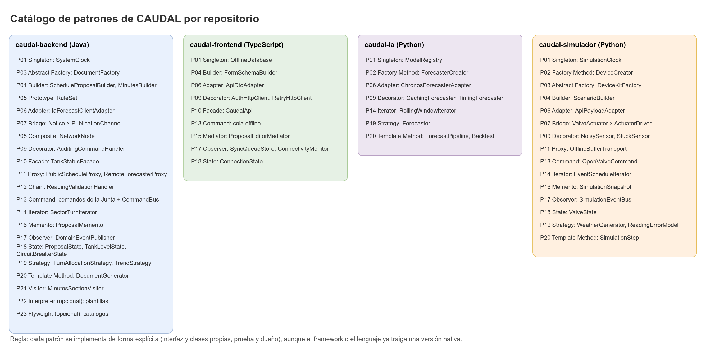
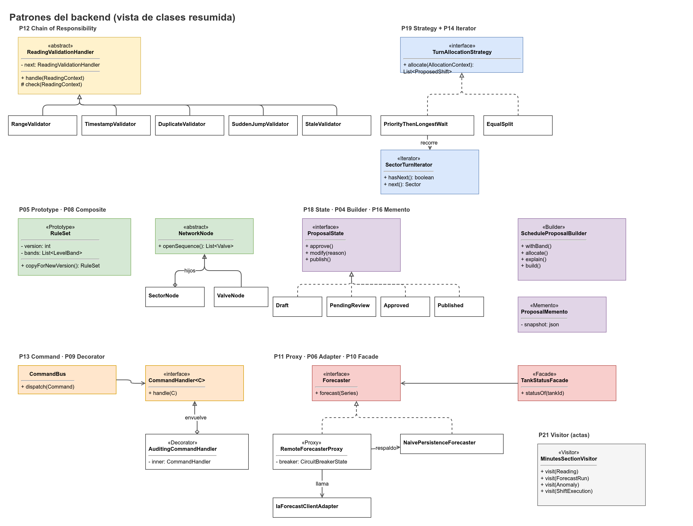

# Patrones de diseño de CAUDAL

> Catálogo global de los patrones del proyecto (P01 a P23) y de los patrones arquitectónicos, en el modelo B2B. Cubre los repositorios `caudal-backend`, `caudal-frontend`, `caudal-ia` y `caudal-simulador`. Este documento es la referencia de intención y de dueño. La guía de implementación para agentes en el backend está en [`.agents/design-patterns.md`](../.agents/design-patterns.md).

Todo el catálogo del curso se conserva. Cuando un patrón dependía de algo que sale del producto (turnos, propuestas, publicación, reglas versionadas, cola offline o árbol de regiones), su clase se retira o se marca **por reubicar**, con el nuevo lugar propuesto si lo hay. La lista de clases que se borran está en la sección 4.

## 1. Introducción

### 1.1 Regla: implementación explícita aunque el framework ya lo ofrezca

CAUDAL implementa cada patrón con interfaces y clases propias, aunque el framework o el lenguaje ya traigan una versión del mismo mecanismo. La regla tiene tres razones:

1. **La intención queda en el código del dominio.** Un `ValveCommandState` con sus transiciones se lee y se revisa; un proxy generado por Spring no.
2. **Las pruebas no dependen del contenedor.** Un patrón explícito se prueba con una prueba unitaria simple. Los beans, los proxies AOP y los decoradores de Spring necesitan contexto.
3. **El framework resuelve el mecanismo, no el problema.** Spring hace singletons y proxies, pero no decide qué cuenta como "eco válido" ni qué datos de una institución pueden verse desde fuera.

Cada patrón documenta qué ofrece el framework y por qué no lo reemplaza. Cuando un framework ya resuelve un problema de infraestructura y no hay lógica de negocio de por medio, se documenta la excepción. Un ejemplo es Resilience4j: existe, pero no se adopta como dependencia del backend; el circuito de la IA es una máquina de estados propia (P18).

### 1.2 Cómo leer el catálogo

- **Dueño.** Persona responsable del patrón en cada repositorio. El líder de seguridad y de patrones en el backend es Drako Salazar (`Drako2305`).
- **Nombres de clase.** En inglés, como manda la regla de idioma del código. Los nombres de los patrones GoF se mantienen.
- **Nombres de prueba.** Son propuestos. Se confirman cuando se implementa cada patrón.
- **Estado.** `vigente` (la clase se conserva), `nuevo` (la clase se crea en el B2B), `reducido` (queda con menos subclases), `retirado` (la clase se borra) o `por reubicar` (el patrón sigue en el catálogo y su clase espera un nuevo lugar).

### 1.3 Tabla resumen

| ID | Patrón | Backend (clase principal) | Estado en el B2B | Otros repositorios | Dueño |
|---|---|---|---|---|---|
| P01 | Singleton | `SystemClock` | vigente | IA `ModelRegistry`; sim `SimulationClock` | Drako / nicomora70 |
| P02 | Factory Method | `DocumentGeneratorCreator` | reducido (solo actas) | IA `ForecasterCreator`; sim `DeviceCreator` | NicoalsD / nicomora70 |
| P03 | Abstract Factory | `DocumentFactory` | reducido (solo PDF de actas) | Sim `DeviceKitFactory` | NicoalsD / nicomora70 |
| P04 | Builder | `MinutesBuilder` | reducido | Front `FormSchemaBuilder` (por reubicar); sim `ScenarioBuilder` | Drako / NicoalsD / nicomora70 |
| P05 | Prototype | `InstitutionTemplate` | nuevo (reemplaza `RuleSet.copyForNewVersion()`) | Ninguno | Drako |
| P06 | Adapter | `IaForecastClientAdapter`, `IaInsightsClientAdapter`, `DeviceTelemetryAdapter` | vigente | Front `ApiDtoAdapter`; IA `ChronosForecasterAdapter`; sim `ApiPayloadAdapter` | Drako / NicoalsD / nicomora70 |
| P07 | Bridge | Por reubicar | por reubicar (sin canales de publicación) | Sim `ValveActuator` x `ActuatorDriver` | NicoalsD / nicomora70 |
| P08 | Composite | Retirado | retirado (la red es plana) | Ninguno | Drako |
| P09 | Decorator | `AuditingCommandHandler` | vigente (comandos de válvula y configuración) | Front `AuthHttpClient`, `RetryHttpClient`, `LoggingHttpClient`; IA `CachingForecaster`, `TimingForecaster`; sim `NoisySensor`, `StuckSensor`, `DriftingSensor` | Drako / NicoalsD / nicomora70 |
| P10 | Facade | `TankStatusFacade` (sensor en vivo y outlook) | vigente | Front `CaudalApi` | Drako / NicoalsD |
| P11 | Proxy | `PublicInstitutionDirectoryProxy`, `RemoteForecasterProxy` | vigente (el proxy público cambia de objeto) | Sim `OfflineBufferTransport` | Drako / NicoalsD / nicomora70 |
| P12 | Chain of Responsibility | `TelemetryValidationHandler` | vigente (valida telemetría) | Ninguno | Drako |
| P13 | Command | `ManualValveCommand` y `ManualValveCommandHandler`; `CommandBus` por definir | reducido | Sim `OpenValveCommand`, `CloseValveCommand` | Drako / nicomora70 |
| P14 | Iterator | Retirado (`SectorTurnIterator`) | retirado | IA `RollingWindowIterator`; sim `EventScheduleIterator` | Drako / nicomora70 |
| P15 | Mediator | Ninguno (solo frontend) | retirado | Front `ProposalEditorMediator` (retirado) | NicoalsD |
| P16 | Memento | Por reubicar (`ProposalMemento` retirado) | por reubicar | Sim `SimulationSnapshot` | Drako / nicomora70 |
| P17 | Observer | `DomainEventPublisher` | vigente | Front `ConnectivityMonitor` (por definir); sim `SimulationEventBus` | Drako / NicoalsD / nicomora70 |
| P18 | State | `ValveCommandState`, `TankLevelState`, `CircuitBreakerState` | vigente (sustituye `ProposalState`) | Sim `ValveState` | Drako / nicomora70 |
| P19 | Strategy | `TankGeometry` (`CylinderGeometry`, `RectangularGeometry`), `TrendStrategy` | vigente (sustituye `TurnAllocationStrategy`) | IA `Forecaster`; sim `WeatherGenerator`, `ReadingErrorModel` | Drako / nicomora70 |
| P20 | Template Method | `DocumentGenerator` (acta) | reducido | IA `ForecastPipeline`, `Backtest`; sim `SimulationStep` | NicoalsD / nicomora70 |
| P21 | Visitor | `MinutesSectionVisitor` | vigente (cuatro estatus) | Ninguno | Drako |
| P22 | Interpreter (opcional) | `MessageTemplate` | vigente (asistente y actas) | Ninguno | NicoalsD |
| P23 | Flyweight (opcional) | `CatalogItem` compartido | por definir (depende de `catalog_items`) | Ninguno | Drako |

Diagramas: el catálogo completo está en `images/catalogo-patrones.png` y los patrones del backend en `images/patrones-backend.png`. Ambos son de la versión anterior (diagrama en actualización).

## 2. Patrones arquitectónicos

| Patrón | Dónde se aplica | Reglas y referencias |
|---|---|---|
| Hexagonal (puertos y adaptadores) | Todo el backend. | Paquetes `api`, `application`, `domain`, `infrastructure`, `shared`. Reglas `ARCH-01` a `ARCH-11` en [Arquitectura](Arquitectura.md), sección 2.3. |
| Repository + Unit of Work | Persistencia. | Puertos `*Port` en `application.port.out`; adaptadores `*PersistenceAdapter`; `UnitOfWork` con `SpringUnitOfWork`. Ver [Arquitectura](Arquitectura.md), sección 8. |
| DTO y Mapper | API. | Records `*Request` y `*Response` en `api`; mapeadores entre DTO, `*Input` y resultados de aplicación. Ninguna entidad JPA sale de la capa de persistencia. |
| Circuit Breaker | Llamadas a la IA. | `CircuitBreakerState` (P18) y `RemoteForecasterProxy` (P11). Ver [Arquitectura](Arquitectura.md), sección 6. |
| Domain Events | Efectos posteriores al commit. | `DomainEventPublisher` (P17). Eventos en `domain.event`. |
| Idempotency Key | Telemetría. | El id del punto de telemetría es la clave primaria de `devices.telemetry_points`; repetir el envío no duplica datos. Además, el nonce de la firma evita repeticiones (ver `Protocolo-de-dispositivos.md`). |
| Registro append-only | Lecturas, observaciones, decisiones y auditoría. | Triggers que impiden `UPDATE` y `DELETE`. Cadena de hashes por institución en `audit.audit_log`. |
| Aislamiento por institución | Toda la base de datos y el caso de uso. | RLS con `FORCE` por `institution_id`, `SET LOCAL app.institution_id` y verificación por objeto (404 entre instituciones). Ver [Seguridad de la base de datos](Seguridad-de-la-base-de-datos.md). |
| Configuración sin valores quemados | Parámetros de negocio y de hardware. | `org.institution_settings`, `org.tanks`, `org.valves` y `GET /devices/config`. Ver [Configuración sin valores quemados](Configuracion-sin-valores-quemados.md). |

## 3. Catálogo de patrones

Cada patrón tiene: intención, problema concreto en CAUDAL, dónde vive, participantes GoF mapeados, qué ofrece el framework o lenguaje y por qué se implementa igual, cómo se prueba y dueño.

### P01. Singleton

- **Intención.** Garantizar una única instancia de un recurso compartido con un punto de acceso conocido.
- **Problema en CAUDAL.** Todo el backend necesita la hora actual. El dominio no puede llamar a `Instant.now()` directamente, porque las reglas de tiempo (futuro de la telemetría, dato viejo, ventana de tendencia) deben ser reproducibles en pruebas.
- **Dónde vive.**
  - Backend: `co.caudal.shared.time.SystemClock`.
  - IA: `ModelRegistry` (el modelo de Chronos se carga una sola vez).
  - Simulador: `SimulationClock`.
  - Frontend: sin singleton propio. La cola offline (`OfflineDatabase`) se retira.
- **Participantes GoF.** `Singleton` = `SystemClock`, con constructor privado e instancia estática. El reloj se usa a través de `java.time.Clock`, que es la interfaz que reciben los casos de uso.
- **Framework nativo.** Los beans de Spring tienen alcance singleton por defecto. No se usa porque el dominio no depende de Spring.
- **Prueba.** `SystemClockTest` (una sola instancia; reloj en UTC). Los casos de uso se prueban con un reloj fijo.
- **Dueño.** Drako (backend). nicomora70 (IA y simulador).

### P02. Factory Method

- **Intención.** Definir una interfaz para crear un objeto y dejar que las subclases decidan qué clase instanciar.
- **Problema en CAUDAL.** El único documento de salida que queda en el producto es el acta. El caso de uso no debe conocer el generador concreto: habla con el puerto `DocumentRenderingPort`, implementado por `DocumentRenderingAdapter`.
- **Estado.** Reducido. Los creadores de cartel (`PosterGeneratorCreator`) y de resumen (`SummaryGeneratorCreator`) se retiran. Queda `MinutesGeneratorCreator`. Si una sola subclase no justifica la clase abstracta, se decide al implementar (por definir).
- **Dónde vive.**
  - Backend: `co.caudal.infrastructure.document.DocumentGeneratorCreator` y `MinutesGeneratorCreator`.
  - IA: `ForecasterCreator` (crea el pronosticador configurado, Chronos o ingenuo).
  - Simulador: `DeviceCreator` (crea un sensor o un actuador según el tipo).
- **Participantes GoF.** `Creator` = `DocumentGeneratorCreator` (método fábrica abstracto `createGenerator()`). `ConcreteCreator` = `MinutesGeneratorCreator`. `Product` = `DocumentGenerator` (ver P20).
- **Framework nativo.** Spring crea beans con métodos `@Bean` y `@ConditionalOnProperty`. La elección del tipo de documento vive en el código, con nombres propios.
- **Prueba.** `DocumentGeneratorCreatorTest` (el acta produce el generador correcto).
- **Dueño.** NicoalsD (backend). nicomora70 (IA y simulador).

### P03. Abstract Factory

- **Intención.** Crear familias de objetos relacionados sin especificar sus clases concretas.
- **Problema en CAUDAL.** El acta necesita encabezado, secciones y firmas coherentes entre sí. Antes también se producía en HTML para la página pública, que sale del producto.
- **Estado.** Reducido. La familia HTML (`HtmlDocumentFactory`) se retira. Queda `PdfDocumentFactory`. Por definir si la interfaz se conserva con una sola implementación o si el patrón se documenta como reubicado.
- **Dónde vive.**
  - Backend: `co.caudal.infrastructure.document.DocumentFactory` (interfaz con `createHeader()`, `createSection()` y `createSignatures()`), con `PdfDocumentFactory` (OpenPDF).
  - Simulador: `DeviceKitFactory` (un kit de dispositivos de la misma familia: sensor y actuador).
- **Participantes GoF.** `AbstractFactory` = `DocumentFactory`. `ConcreteFactory` = `PdfDocumentFactory`. `AbstractProduct` = encabezado, sección y firmas.
- **Framework nativo.** Spring selecciona implementaciones por configuración. Se usa explícitamente porque la familia debe ser coherente entre sus piezas.
- **Prueba.** `DocumentFactoryTest` (la familia PDF produce piezas compatibles entre sí).
- **Dueño.** NicoalsD (backend). nicomora70 (simulador).

### P04. Builder

- **Intención.** Separar la construcción de un objeto complejo de su representación, validando el resultado al final.
- **Problema en CAUDAL.** El acta tiene cuatro secciones obligatorias, y cada registro debe caer en la sección que le corresponde. Un tanque nuevo tiene forma, medidas y calibración que deben ser coherentes antes de guardarse.
- **Estado.** Reducido. `ScheduleProposalBuilder` se retira con los turnos. `MinutesBuilder` se conserva.
- **Dónde vive.**
  - Backend: `co.caudal.domain.minutes.MinutesBuilder`.
  - Frontend: `FormSchemaBuilder`, por reubicar. Hoy arma el esquema desde `/api/v1/meta/constraints` y `/api/v1/rule-sets/current`; la segunda fuente sale, así que el builder solo puede usar `/meta/constraints` y `/institution/settings`.
  - Simulador: `ScenarioBuilder` (arma un escenario desde YAML y lo valida con Pydantic).
- **Participantes GoF.** `Builder` = `MinutesBuilder` con métodos para cada sección. `build()` valida invariantes y devuelve un acta inmutable. `Director` = el caso de uso de generación.
- **Framework nativo.** `record` con constructores compactos y Lombok `@Builder`. El builder explícito se usa porque la validación de invariantes es de dominio y debe probarse sin el framework.
- **Prueba.** `MinutesBuilderTest` (rechaza un acta sin las cuatro secciones).
- **Dueño.** Drako (backend). NicoalsD (frontend). nicomora70 (simulador).

### P05. Prototype

- **Intención.** Crear objetos nuevos copiando uno existente, sin depender de sus clases concretas.
- **Problema en CAUDAL.** CAUDAL da de alta cada institución desde una plantilla. La plantilla copia el tanque, las líneas de servicio, las válvulas y los parámetros de `org.institution_settings`, y reinicia los datos propios de la institución nueva (identificador, usuario admin, dispositivos, lecturas).
- **Estado.** Nuevo. Reemplaza a `RuleSet.copyForNewVersion()`, que se retira con las reglas versionadas.
- **Dónde vive.** Backend: `InstitutionTemplate` en `co.caudal.domain.institution`, con un método de copia (nombre propuesto `copyForNewInstitution()`, por confirmar al implementar). El cliente es el caso de uso de alta, que llama a `platform.create_institution` dentro de la misma transacción.
- **Participantes GoF.** `Prototype` = `InstitutionTemplate` con el método de copia. `ConcretePrototype` = la institución resultante. El cliente es el caso de uso `CreateInstitutionUseCase`.
- **Framework nativo.** `Cloneable` de Java o copias de Jackson. Se evita `Cloneable` porque la copia necesita reglas de negocio (identificador nuevo, sin usuarios, sin lecturas, `is_simulated` decidido por quien da de alta).
- **Prueba.** `InstitutionTemplateTest` (la copia es profunda, la institución nueva no comparte filas con la plantilla y la plantilla no cambia).
- **Dueño.** Drako.

### P06. Adapter

- **Intención.** Convertir la interfaz de un componente externo en la que espera el cliente.
- **Problema en CAUDAL.** `caudal-ia` responde con su propio JSON (`points`, `p10`, `p50`, `p90`) y ahora también con respuestas del asistente. Los dispositivos envían telemetría firmada. La aplicación recibe DTOs de la API. El dominio no debe conocer ninguno de estos formatos.
- **Dónde vive.**
  - Backend: `IaForecastClientAdapter` (implementa `ForecastPort`), `IaInsightsClientAdapter` (implementa el puerto del asistente) y `DeviceTelemetryAdapter` (convierte el payload firmado en `TelemetryPoint`), en `co.caudal.infrastructure`.
  - Frontend: `ApiDtoAdapter` (DTO de la API a modelo de vista).
  - IA: `ChronosForecasterAdapter` (adapta el modelo de Chronos a la interfaz `Forecaster`).
  - Simulador: `ApiPayloadAdapter` (modelo del simulador a cuerpo de la API).
- **Participantes GoF.** `Target` = `ForecastPort`. `Adaptee` = el servicio HTTP de la IA. `Adapter` = `IaForecastClientAdapter`.
- **Framework nativo.** `RestClient` o Jackson con mapeo automático. Se usa un adaptador explícito porque el contrato con la IA tiene reglas (orden de cuantiles, pasos crecientes en segundos) que deben validarse al convertir.
- **Prueba.** `IaForecastClientAdapterTest` (servidor HTTP simulado con respuestas válidas y con los errores `422`, `401` y `503`), `DeviceTelemetryAdapterTest` (firma válida y payload mal formado).
- **Dueño.** Drako (backend). NicoalsD (frontend). nicomora70 (IA y simulador).

### P07. Bridge

- **Intención.** Separar una abstracción de su implementación para que ambas varíen de forma independiente.
- **Estado en el backend.** Por reubicar. Los canales de publicación (página pública, WhatsApp, cartel) salen del producto, así que el puente `Notice` x `PublicationChannel` se retira.
- **Nuevo lugar propuesto (por definir).** Un comando de válvula puede ir a un hardware distinto (puente USB hoy, otro dispositivo mañana). Esa separación sería una abstracción de comando de válvula y un driver de hardware. No se implementa en el B2B sin decisión previa.
- **Dónde vive en el simulador.** `ValveActuator` (abstracción) y `ActuatorDriver` (implementación: simulado, o serie en el futuro).
- **Participantes GoF.** `Abstraction` = `ValveActuator`. `Implementor` = `ActuatorDriver`. `ConcreteImplementor` = cada driver.
- **Framework nativo.** Spring inyecta implementaciones por `@Qualifier`.
- **Prueba.** `ValveActuatorBridgeTest` en el simulador (cada driver produce la misma secuencia de estados).
- **Dueño.** NicoalsD (backend, por reubicar). nicomora70 (simulador).

### P08. Composite

- **Intención.** Tratar objetos individuales y compuestos de la misma forma.
- **Estado.** Retirado. La red del B2B es plana: una institución tiene un tanque, cada tanque tiene líneas de servicio y cada línea tiene una válvula. Sin árbol de regiones ni subsectores no hay caso de uso para el compuesto.
- **Clases que se retiran.** `NetworkNode`, `SectorNode` y `ValveNode`. Si el panel de la red necesita recorrer la jerarquía, se resuelve con consultas simples.
- **Prueba retirada.** `NetworkNodeTest`.
- **Dueño.** Drako.

### P09. Decorator

- **Intención.** Agregar responsabilidades a un objeto dinámicamente, envolviéndolo, sin cambiar su clase.
- **Problema en CAUDAL.** Cada comando de válvula y cada cambio de configuración debe dejar rastro en la auditoría, sin que cada handler lo recuerde. En la aplicación, las llamadas HTTP necesitan autenticación, reintentos y registro. En el simulador, un sensor puede tener ruido, quedarse pegado o derivar.
- **Dónde vive.**
  - Backend: `AuditingCommandHandler` (envuelve un `CommandHandler` de válvula o de configuración) en `co.caudal.application.command`.
  - Frontend: `AuthHttpClient`, `RetryHttpClient` y `LoggingHttpClient`, que envuelven `HttpClient`.
  - IA: `CachingForecaster` y `TimingForecaster`.
  - Simulador: `NoisySensor`, `StuckSensor` y `DriftingSensor`, que envuelven un `Sensor`.
- **Participantes GoF.** `Component` = `CommandHandler` (o `HttpClient`, `Sensor`). `ConcreteComponent` = el handler real. `Decorator` = `AuditingCommandHandler`, con la referencia al componente envuelto.
- **Framework nativo.** Spring AOP (`@Aspect`), la cadena de filtros de Spring Security y los decoradores de Python y de JavaScript. Se usa el decorador explícito para la auditoría porque su registro debe ser parte del contrato del comando.
- **Prueba.** `AuditingCommandHandlerTest` (un comando exitoso y uno fallido dejan un registro; el handler interno se llama una sola vez).
- **Dueño.** Drako (backend). NicoalsD (frontend). nicomora70 (IA y simulador).

### P10. Facade

- **Intención.** Ofrecer una interfaz simple para un subsistema complejo.
- **Problema en CAUDAL.** La vista del tanque necesita la última telemetría válida, el nivel, los litros, el estado del sensor, las tres salidas del pronóstico y los eventos. El controlador y la aplicación no deben orquestar esas consultas.
- **Dónde vive.**
  - Backend: `TankStatusFacade` en `co.caudal.application.facade`. Expone `live` (sensor en vivo) y `outlook` (agua que queda, tiempo a reserva y banda Chronos).
  - Frontend: `CaudalApi`, la fachada única de los servicios HTTP (`src/services`).
- **Participantes GoF.** `Facade` = `TankStatusFacade`. `Subsystems` = los puertos de telemetría, geometría, pronóstico, eventos y configuración.
- **Framework nativo.** Los servicios de Spring (`@Service`) cumplen una función parecida, pero no definen la forma de la respuesta.
- **Prueba.** `TankStatusFacadeTest` (con telemetría vigente, con telemetría vieja que da `STALE`, y sin pronóstico).
- **Dueño.** Drako (backend). NicoalsD (frontend).

### P11. Proxy

- **Intención.** Ofrecer un sustituto de un objeto para controlar el acceso a él.
- **Problema en CAUDAL.** Hay dos necesidades distintas. El directorio público debe mostrar solo `{slug, name}` de las instituciones activas y tener límite de tasa. El pronóstico remoto debe responder siempre, aunque la IA falle.
- **Dónde vive.**
  - Backend: `PublicInstitutionDirectoryProxy` (implementa el puerto del directorio público; filtra a `{slug, name}` de instituciones activas, con límite de tasa) en `co.caudal.infrastructure.institution`. Sustituye a `PublicScheduleProxy`, que se retira. `RemoteForecasterProxy` (implementa `ForecastPort`; llama al adaptador de la IA y, si falla o el circuito está abierto, usa `NaivePersistenceForecastAdapter`) en `co.caudal.infrastructure.forecast`.
  - Simulador: `OfflineBufferTransport` (guarda los envíos cuando no hay red y los reenvía). Es una pieza del simulador, no del producto.
- **Participantes GoF.** `Subject` = `ForecastPort`. `RealSubject` = `IaForecastClientAdapter`. `Proxy` = `RemoteForecasterProxy`.
- **Framework nativo.** Proxies de Spring AOP y proxies dinámicos de Java. Se usan explícitos porque la protección de datos y el respaldo son reglas que se prueban y se revisan.
- **Prueba.** `PublicInstitutionDirectoryProxyTest` (solo salen `slug` y `name`; una institución inactiva responde como inexistente) y `RemoteForecasterProxyTest` (con fallo de la IA responde el respaldo con `is_fallback = true`).
- **Dueño.** Drako (directorio público y pronóstico). NicoalsD (login en dos pasos). nicomora70 (simulador).

### P12. Chain of Responsibility

- **Intención.** Pasar una petición por una cadena de manejadores, cada uno decide si la resuelve o la pasa al siguiente.
- **Problema en CAUDAL.** Validar cada punto de telemetría en etapas, con su propio resultado: sin eco, zona ciega, rango físico, futuro y repetición. Las dos primeras no producen nivel pero cuentan para `SENSOR_FAULT`. Las dos siguientes rechazan el punto (no se guarda). La repetición se rechaza por nonce.
- **Dónde vive.** Backend: `TelemetryValidationHandler` (abstracto, con `setNext`) y los manejadores de la cadena, en `co.caudal.domain.reading.validation`. Sustituye a `ReadingValidationHandler`, que validaba lecturas manuales. Nombres propuestos: `NoEchoCheckHandler`, `BlindZoneCheckHandler`, `PhysicalRangeCheckHandler`, `FutureTimestampCheckHandler` y `NonceReplayCheckHandler`. Los nombres se confirman al implementar.
- **Participantes GoF.** `Handler` = `TelemetryValidationHandler`. `ConcreteHandler` = cada manejador. `Client` = el caso de uso que arma la cadena.
- **Framework nativo.** La cadena de filtros de Spring Security tiene la misma forma, pero está pensada para peticiones HTTP, no para reglas de dominio.
- **Prueba.** `TelemetryValidationHandlerTest` y una prueba por manejador. Orden de la cadena: sin eco, zona ciega, rango físico, futuro, repetición (ver [Reglas de negocio](Reglas-de-negocio.md), sección 4.2).
- **Dueño.** Drako.

### P13. Command

- **Intención.** Encapsular una petición como un objeto, para parametrizarla, registrarla, despacharla y deshacerla.
- **Problema en CAUDAL.** Un comando de válvula (manual o del piloto) debe ser un objeto con origen, vigencia y estado, que se valida, se audita y se despacha con permisos. En la aplicación, abrir y cerrar son acciones sobre una válvula. En el simulador, abrir y cerrar son comandos.
- **Dónde vive.**
  - Backend: `ManualValveCommand` y `ManualValveCommandHandler` (comando de válvula con motivo opcional y texto por defecto). El comando del piloto se crea desde `AutopilotDecision`.
  - `CommandBus` y `SimpleCommandBus` (`co.caudal.application.command`) se conservan solo si hay al menos dos comandos de institución que lo justifiquen (por definir). Los comandos de la Junta (aprobar, modificar, rechazar, publicar, activar reglas) se retiran.
  - Simulador: `OpenValveCommand` y `CloseValveCommand`.
  - Frontend: `SubmitReadingCommand` y `CloseDayCommand` se retiran con la cola offline.
- **Participantes GoF.** `Command` = `ManualValveCommand`. `ConcreteCommand` = el comando de válvula. `Receiver` = el caso de uso. `Invoker` = `ManualValveCommandHandler`. `Client` = el controlador.
- **Framework nativo.** Spring `ApplicationEventPublisher` no es un bus de comandos. Se implementa explícitamente porque el registro del comando es parte de la auditoría.
- **Prueba.** `ManualValveCommandHandlerTest` (un comando sin motivo recibe el texto por defecto; una válvula de otra institución responde `404`) y `CommandBusTest` si el bus se conserva.
- **Dueño.** Drako (backend). nicomora70 (simulador).

### P14. Iterator

- **Intención.** Recorrer una colección sin exponer su estructura interna.
- **Estado en el backend.** Retirado. `SectorTurnIterator` recorría sectores para asignar turnos, y los turnos salen del producto.
- **Dónde vive.**
  - IA: `RollingWindowIterator` (recorre las ventanas de historia que se envían al pronóstico).
  - Simulador: `EventScheduleIterator` (recorre los eventos del día en orden).
- **Participantes GoF.** `Iterator` = `RollingWindowIterator`. `Aggregate` = la serie de niveles.
- **Framework nativo.** `Iterable` y `Stream`. Se usa un iterador propio porque el orden de las ventanas es parte del contrato del pronóstico.
- **Prueba.** `RollingWindowIteratorTest` (las ventanas salen en orden, sin saltos ni repeticiones).
- **Dueño.** nicomora70 (IA y simulador). Drako (retirada del backend).

### P15. Mediator

- **Intención.** Centralizar las interacciones entre componentes para que no se refieran unos a otros directamente.
- **Estado.** Retirado. `ProposalEditorMediator` coordinaba los campos del editor de propuestas, que sale del producto. Si el formulario de calibración del tanque necesita coordinar campos, se evalúa como caso nuevo (por definir).
- **Clase que se retira.** `ProposalEditorMediator` (frontend).
- **Dueño.** NicoalsD.

### P16. Memento

- **Intención.** Capturar y restaurar el estado interno de un objeto sin violar su encapsulamiento.
- **Estado en el backend.** Por reubicar. `ProposalMemento` y `proposal_snapshots` salen con las propuestas.
- **Nuevo lugar propuesto (por definir).** Un snapshot de la configuración de la institución (tanque, líneas y válvulas) antes de un cambio grande, para comparar y explicar qué cambió. Sin decisión previa no se implementa.
- **Dónde vive en el simulador.** `SimulationSnapshot`.
- **Participantes GoF.** `Originator` = el objeto de configuración. `Memento` = snapshot inmutable. `Caretaker` = el caso de uso de cambio.
- **Framework nativo.** Serialización de Java. Se usa un memento explícito porque el contenido es un contrato de auditoría.
- **Prueba.** `SimulationSnapshotTest` (el snapshot no cambia cuando cambia el simulador).
- **Dueño.** Drako (backend, por reubicar). nicomora70 (simulador).

### P17. Observer

- **Intención.** Definir una dependencia uno a muchos, para que los objetos suscritos reciban aviso cuando cambia el sujeto.
- **Problema en CAUDAL.** Cuando se guarda una lectura efectiva, cuando un comando de válvula se confirma o cuando se registra una observación, varias partes del sistema deben reaccionar (recalcular el estado, evaluar anomalías, actualizar la línea de tiempo). El caso de uso no debe conocer a cada una.
- **Dónde vive.**
  - Backend: `DomainEventPublisher` (puerto en `application.event`), `SpringDomainEventPublisher` (adaptador en `infrastructure.event`) y los eventos `ReadingAccepted` y los propuestos `ValveCommandAcked` y `ObservationRecorded` en `domain.event`. Los eventos `RuleSetActivated` y `SchedulePublished` se retiran.
  - Frontend: `ConnectivityMonitor` por definir. `SyncQueueStore` se retira.
  - Simulador: `SimulationEventBus`.
- **Participantes GoF.** `Subject` = `DomainEventPublisher`. `Observer` = los oyentes (`@TransactionalEventListener`). `ConcreteSubject` = el agregado que registra el evento.
- **Framework nativo.** `ApplicationEventPublisher` y `@TransactionalEventListener`. Se usan a través del puerto propio. El dominio no depende de Spring, y la publicación ocurre después del commit.
- **Prueba.** `DomainEventPublisherTest` (el evento se publica solo tras el commit; una transacción revertida no publica nada).
- **Dueño.** Drako (backend). NicoalsD (frontend). nicomora70 (simulador).

### P18. State

- **Intención.** Permitir que un objeto cambie su comportamiento cuando cambia su estado interno.
- **Problema en CAUDAL.** Tres máquinas de estado en el backend:
  - El **comando de válvula**: `PENDING`, `DELIVERED`, `ACKED`, `FAILED`, `EXPIRED` y `CANCELLED`. Sus transiciones son reglas de negocio (solo `ACKED` cambia el estado de la válvula).
  - El **nivel del tanque** para las alertas: `NORMAL`, `LOW` y `CRITICAL`, con los umbrales de `institution_settings`. Por definir si el estado `HIGH` del modelo anterior se conserva; ya no hay bandas de la Junta.
  - El **circuito de la IA**: `CLOSED`, `OPEN` y `HALF_OPEN`.
- **Dónde vive.**
  - Backend: `ValveCommandState` (en `co.caudal.domain.valve`), `TankLevelState` (en `co.caudal.domain.tank`) y `CircuitBreakerState` (en `co.caudal.infrastructure.forecast`). `ProposalState` se retira.
  - Frontend: `ConnectionState` se retira con la cola offline.
  - Simulador: `ValveState`.
- **Participantes GoF.** `Context` = `ValveCommand`, `TankStatus` o `CircuitBreaker`. `State` = la interfaz de cada estado. `ConcreteState` = cada estado.
- **Framework nativo.** `enum` con `switch`. Resilience4j tiene un circuit breaker propio; existe, pero no se adopta en el backend. Se implementa la máquina propia porque las transiciones son reglas de negocio.
- **Prueba.** `ValveCommandStateTest` (cada transición válida pasa, cada transición inválida lanza error; `ACKED`, `FAILED`, `EXPIRED` y `CANCELLED` no tienen salidas), `TankLevelStateTest` (los umbrales de alerta separan los estados) y `CircuitBreakerStateTest` (apertura tras los fallos configurados, paso a `HALF_OPEN` tras el tiempo).
- **Dueño.** Drako (backend). nicomora70 (IA y simulador).

### P19. Strategy

- **Intención.** Definir una familia de algoritmos intercambiables.
- **Problema en CAUDAL.** Convertir la distancia del sensor en nivel, volumen y porcentaje depende de la forma del tanque. Un cilindro y un rectángulo tienen fórmulas distintas, y el tanque guarda su forma. La tendencia del nivel se calcula sobre una ventana de minutos.
- **Dónde vive.**
  - Backend: `TankGeometry` (interfaz) con `CylinderGeometry` y `RectangularGeometry`, en `co.caudal.domain.tank`. Cada una calcula `level_mm`, `level_pct` y `volume_l` con la misma firma. La forma se elige con `org.tanks.shape`.
  - Backend: `TrendStrategy` sobre `trend_window_minutes`. La implementación concreta (`ThresholdTrendStrategy` o una pendiente) se confirma al implementar.
  - Retirado: `TurnAllocationStrategy` con `PriorityThenLongestWaitStrategy` y `EqualSplitStrategy` (turnos).
  - IA: `Forecaster` con `ChronosForecaster` y `NaiveForecaster`.
  - Simulador: `WeatherGenerator` y `ReadingErrorModel`.
- **Participantes GoF.** `Strategy` = `TankGeometry`. `ConcreteStrategy` = `CylinderGeometry` y `RectangularGeometry`. `Context` = `Tank`, que recibe la estrategia por la forma guardada.
- **Framework nativo.** Expresiones lambda. Se usan clases con nombre porque la forma se guarda en la base de datos y debe reconstruirse por código.
- **Prueba.** `CylinderGeometryTest` y `RectangularGeometryTest` (con el ejemplo de la maqueta: `empty = 350`, `full = 80`, `distance = 215` da `level = 135 mm` y `50 %`), y `TrendStrategyTest` (el umbral separa "viene bajando" de "estable").
- **Dueño.** Drako (backend). nicomora70 (IA y simulador).

### P20. Template Method

- **Intención.** Definir el esqueleto de un algoritmo y dejar que las subclases completen ciertos pasos.
- **Problema en CAUDAL.** El acta sigue un orden fijo: encabezado, secciones y firmas. Lo que cambia es el contenido de cada sección.
- **Estado.** Reducido. Solo queda `MinutesGenerator`. El cartel y el resumen se retiran.
- **Dónde vive.**
  - Backend: `DocumentGenerator` (abstracto) en `co.caudal.infrastructure.document`.
  - IA: `ForecastPipeline` y `Backtest`.
  - Simulador: `SimulationStep`.
- **Participantes GoF.** `AbstractClass` = `DocumentGenerator`, con el método plantilla `generate()` marcado como `final`, que llama a `writeHeader()`, `writeSections()` y `writeSignatures()`. `ConcreteClass` = `MinutesGenerator`.
- **Framework nativo.** No hay equivalente directo. Un método plantilla explícito evita que una subclase cambie el orden de los pasos.
- **Prueba.** `DocumentGeneratorTest` (el orden de llamadas es encabezado, secciones y firmas).
- **Dueño.** NicoalsD (backend). nicomora70 (IA y simulador).

### P21. Visitor

- **Intención.** Representar una operación que se aplica a los elementos de una estructura sin modificar las clases de los elementos.
- **Problema en CAUDAL.** Un acta separa la información en cuatro estatus epistémicos: observado, estimado, inferido y confirmado. Cada registro debe ir a su sección sin condicionales en cada lugar.
- **Dónde vive.** Backend: `MinutesSectionVisitor` (interfaz con un método por tipo) y `EpistemicRecord` (interfaz sellada con `ObservedRecord`, `EstimatedRecord`, `InferredRecord` y `ConfirmedRecord`), en `co.caudal.domain.minutes`.
- **Participantes GoF.** `Visitor` = `MinutesSectionVisitor`. `ConcreteVisitor` = el visitante que arma el acta. `Element` = `EpistemicRecord`. `ConcreteElement` = cada tipo de registro.
- **Framework nativo.** `switch` con patrones de Java sobre tipos sellados. Se usa el visitante para que agregar un tipo obligue a revisar cada operación en tiempo de compilación.
- **Prueba.** `MinutesSectionVisitorTest` (cada registro cae en su sección; agregar un tipo nuevo rompe la compilación de los visitantes existentes).
- **Dueño.** Drako.

### P22. Interpreter (opcional)

- **Intención.** Definir una gramática para un lenguaje y un intérprete que evalúe sus frases.
- **Problema en CAUDAL.** Los textos de respaldo del asistente y los textos del acta tienen marcadores (`{linea}`, `{litros}`), plurales ("1 hora" y "2 horas") y coma decimal ("2,1"). Los mensajes de WhatsApp y las explicaciones de turnos salen del producto.
- **Dónde vive.** Backend: `MessageTemplate` (analizador) y las expresiones `TextExpression`, `PlaceholderExpression`, `PluralExpression` y `DecimalExpression`, en `co.caudal.shared.text`.
- **Participantes GoF.** `AbstractExpression` = la interfaz de expresión. `TerminalExpression` = texto y marcadores. `NonterminalExpression` = plural y decimal. `Context` = los valores del mensaje.
- **Framework nativo.** `java.text.MessageFormat` y `ResourceBundle`. Se usa un intérprete propio porque los marcadores llevan significado de negocio y los errores deben ser de dominio.
- **Prueba.** `MessageTemplateTest` (plurales en español, coma decimal, marcador desconocido produce error).
- **Dueño.** NicoalsD.

### P23. Flyweight (opcional)

- **Intención.** Compartir objetos pequeños e inmutables para reducir el uso de memoria.
- **Problema en CAUDAL.** Los catálogos de opciones se repiten en muchas filas. Hoy el enum de observaciones (`WATER_DIRTY`, `WATER_MUDDY`, `VISIBLE_DAMAGE`, `OTHER`) es fijo, y los catálogos de aspecto del agua y de daño se retiran. Por definir si `org.catalog_items` se conserva; si no, este patrón queda sin caso de uso.
- **Dónde vive (si se conserva).** Backend: `CatalogItem` (estado intrínseco: catálogo, código y etiqueta) y `CatalogItemFlyweightFactory` (devuelve una instancia compartida por clave), en `co.caudal.domain.catalog`.
- **Participantes GoF.** `Flyweight` = `CatalogItem`. `FlyweightFactory` = `CatalogItemFlyweightFactory`. `ConcreteFlyweight` = la instancia compartida.
- **Framework nativo.** Caché de segundo nivel de JPA, que no se adopta. Se usa una fábrica propia porque el objeto del dominio debe ser inmutable y compartible sin depender de la capa de persistencia.
- **Prueba.** `CatalogItemFlyweightFactoryTest` (la misma clave devuelve la misma instancia; una clave nueva crea una instancia).
- **Dueño.** Drako.

## 4. Clases que se retiran con el modelo B2B

Estas clases dejan de existir en el backend con sus migraciones y sus pruebas. Su patrón sale del catálogo activo o se reubica como indica la sección 3.

| Clase | Patrón | Motivo |
|---|---|---|
| `ScheduleProposalBuilder`, `ScheduleProposal`, `ProposalState`, `ProposalMemento` | P04, P16, P18 | Propuestas de turnos y aprobación de la Junta. |
| `TurnAllocationStrategy`, `PriorityThenLongestWaitStrategy`, `EqualSplitStrategy` | P19 | Asignación de turnos. |
| `SectorTurnIterator` | P14 | Recorrido de sectores para turnos. |
| `NetworkNode`, `SectorNode`, `ValveNode` | P08 | Árbol de regiones y sectores. La red es plana. |
| `RuleSet`, `RuleSet.copyForNewVersion()`, `LevelBand` | P05 | Reglas versionadas. Sustituidas por `InstitutionTemplate` y `org.institution_settings`. |
| `PublicScheduleProxy`, `PublicPageChannel`, `WhatsAppChannel`, `PosterChannel`, `PublicationChannel`, `Notice`, `ScheduleNotice`, `DamageReportNotice` | P07, P11 | Página pública, WhatsApp y cartel. |
| `PosterGeneratorCreator`, `SummaryGeneratorCreator`, `HtmlDocumentFactory` | P02, P03, P20 | Cartel, resumen y HTML de la página pública. |
| `ValveCommandScheduler` y las asignaciones de turnos | P13 | Ejecución de turnos. |
| `ReadingValidationHandler` (y sus subclases de lectura manual) | P12 | Validación de lecturas manuales. Sustituida por `TelemetryValidationHandler`. |
| `ProposalEditorMediator` (frontend) | P15 | Editor de propuestas. |
| `SyncQueueStore`, `ConnectionState`, `SubmitReadingCommand`, `CloseDayCommand` (frontend), `OfflineDatabase` | P01, P13, P17, P18 | Cola sin conexión. |
| `FormSchemaBuilder` (frontend, parte que usa `/rule-sets/current`) | P04 | Solo se reubica la parte que sigue vigente. |

## 5. Relación con las pruebas y la documentación

- Cada patrón del backend tiene una prueba de la clase principal. La lista de pruebas está en [Plan de pruebas](../.agents/testing-plan.md).
- El Javadoc de cada clase de patrón incluye la etiqueta `@pattern` con el identificador (por ejemplo, `@pattern P18 State`). Así el catálogo y el código pueden buscarse juntos. Las reglas están en [Patrones para agentes](../.agents/design-patterns.md).
- Los cambios de patrón se revisan en la plantilla de PR (sección "Patrones de diseño involucrados").
- Las clases de la sección 4 se borran con migraciones y cambios de código en la Fase 2 (ver [Plan de commits](Plan-de-commits.md)), no antes.

Relacionados: [Arquitectura](Arquitectura.md), [Modelo de datos](Modelo-de-datos.md), [Reglas de negocio](Reglas-de-negocio.md), [Guía operativa de patrones](../.agents/design-patterns.md), [Plan de pruebas](../.agents/testing-plan.md)
