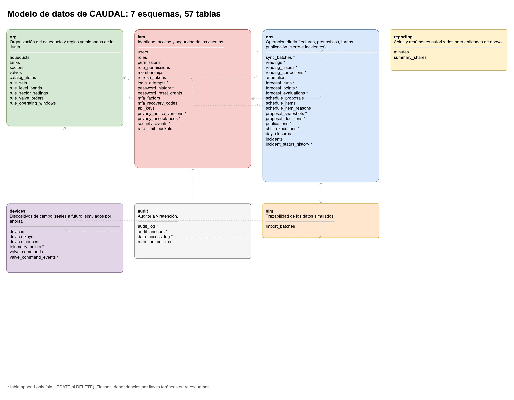

# Seguridad de la base de datos

Este documento describe cómo se protege la base de datos PostgreSQL 18 de CAUDAL: quién puede hacer qué, cómo se aísla cada institución, qué tablas no se pueden modificar, cómo se encadena la auditoría, qué funciones pueden operar entre instituciones y cómo se prueba todo lo anterior.

La especificación de columnas es la fuente `schema.yaml` del equipo de documentación (fuera del repositorio). Su versión publicada, columna por columna, está en el [diccionario de datos](Diccionario-de-datos.md). Las cifras de seguridad de la base de datos se resumen aquí. El modelo general de amenazas y los controles de la aplicación están en [`Seguridad.md`](Seguridad.md).

 (diagrama en actualización)

## 1. Números clave

| Concepto | Valor |
|---|---|
| Esquemas | 8: `iam`, `org`, `ops`, `reporting`, `devices`, `audit`, `sim` y `platform` (solo funciones) |
| Tablas | Por verificar al regenerar el diccionario. El modelo B2B quita tablas de reglas, turnos, publicaciones, correcciones, incidentes públicos y resúmenes, y agrega `org.institution_settings`, `ops.observations` y `ops.autopilot_decisions` |
| Tablas con RLS (`FORCE`) | Las listadas en la sección 5.2 |
| Tablas append-only | 17 (sección 6) |
| Columnas secretas (S) | 7 (sección 4) |
| Extensiones | `pgcrypto`. `btree_gist` se quita si ninguna restricción la necesita (verificar) |

## 2. Roles

| Rol | Para qué | Puede | No puede |
|---|---|---|---|
| `caudal_migrator` | Dueño de todos los objetos. Único con DDL. Lo usa Flyway en el despliegue | Crear, alterar y borrar tablas, índices, triggers, funciones y políticas. Ejecutar las migraciones | Lo usa la aplicación en tiempo de ejecución. Sus credenciales no están en el contenedor de la API |
| `caudal_app` | Lo usa la API en tiempo de ejecución | DML mínimo, según la tabla de privilegios de la sección 3. Ejecutar las funciones `platform.*` y de purga | DDL. `DELETE` directo. Modificar tablas append-only. Leer columnas `S` que no necesita. Saltarse RLS |
| `caudal_readonly` | Reportes y consultas de solo lectura | `SELECT` sobre las vistas de reportes (lista por definir) | Leer tablas base. Leer `password_hash` o cualquier columna `S` o `C` |

Atributos (implementado en `V1`): `caudal_app` y `caudal_readonly` son roles `LOGIN` sin contraseña. Así los tiempos límite de la sección 2.1 se aplican a la sesión, porque `ALTER ROLE ... SET` solo afecta al rol con el que se inicia sesión. La contraseña se fija fuera de git (consola de Neon o `ALTER ROLE ... PASSWORD` por la persona que opera) y nunca viaja en una migración ni en un placeholder. `V1` falla si alguno de los dos tiene `SUPERUSER`, `BYPASSRLS`, `CREATEROLE`, `CREATEDB` o `REPLICATION`. `caudal_app` y `caudal_readonly` no tienen `BYPASSRLS`, no son `SUPERUSER` y no son dueños de ningún objeto. No tienen `CREATE` sobre el esquema `public`. Se revoca `CREATE ON SCHEMA public FROM PUBLIC`.

### 2.1 Tiempos límite por rol

Los hechos fijan los tiempos para el rol de la aplicación. Para `caudal_readonly` el `statement_timeout` es 15 s, y `caudal_migrator` no tiene límite de sentencia (solo se usa en migraciones). Los demás tiempos de esos roles quedan por definir.

| Rol | `statement_timeout` | `lock_timeout` | `idle_in_transaction_session_timeout` |
|---|---|---|---|
| `caudal_app` | 5 s | 3 s | 10 s |
| `caudal_readonly` | 15 s | por definir (propuesta: 3 s) | por definir (propuesta: 10 s) |
| `caudal_migrator` | sin límite (solo migraciones) | por definir | por definir |

```sql
ALTER ROLE caudal_app SET statement_timeout = '5s';
ALTER ROLE caudal_app SET lock_timeout = '3s';
ALTER ROLE caudal_app SET idle_in_transaction_session_timeout = '10s';
ALTER ROLE caudal_readonly SET statement_timeout = '15s';
```

### 2.2 Conexión segura

- Toda conexión usa `sslmode=verify-full`. Se valida el certificado del servidor y su nombre de host.
- La ruta del certificado de la autoridad (`sslrootcert`) se define en configuración (ver [`Configuracion-sin-valores-quemados.md`](Configuracion-sin-valores-quemados.md)).
- En local (Docker Compose) también se usa `verify-full`, con una autoridad local. Cómo se genera esa autoridad: por definir.
- Cada servicio tiene su propio usuario. Las contraseñas de los roles se rotan (ver [`Seguridad.md`](Seguridad.md), sección de secretos).

## 3. Privilegios por tabla

Códigos: `S` = `SELECT`, `I` = `INSERT`, `U` = `UPDATE` (entre paréntesis, las columnas permitidas), `D` = `DELETE` solo por función o trigger que lo condiciona. `No` = sin privilegio. "AO" = append-only (ver sección 6).

Regla general para `caudal_app`: `S` e `I` por defecto. `U` solo en columnas de estado o de configuración permitida. `D` no existe, salvo las excepciones marcadas. Las tablas AO solo tienen `S` e `I`.

### 3.1 `iam`

| Tabla | Clase | `caudal_app` | `caudal_readonly` |
|---|---|---|---|
| `users` | Normal, con `S` | S, I, U(`full_name`, `status`, `must_change_password`, `password_hash`, `password_changed_at`, `failed_login_count`, `locked_until`, `lockout_level`, `token_version`, `last_login_at`, `last_login_ip_hmac`, `updated_at`, `disabled_at`). `institution_id` no se cambia nunca | No |
| `roles` | Catálogo | S | No |
| `permissions` | Catálogo | S | No |
| `role_permissions` | Catálogo | S (escritura solo por migración) | No |
| `memberships` | RLS. Estado por definir (ver [`Actores-y-permisos.md`](Actores-y-permisos.md), sección 1) | S, I, U(`valid_to`) si se mantiene | No |
| `refresh_tokens` | Normal | S, I, U(`last_used_at`, `revoked_at`, `revoked_reason`, `replaced_by_id`) | No |
| `login_attempts` | AO | S, I | No |
| `password_history` | AO | S, I | No |
| `password_reset_grants` | Normal | S, I, U(`used_at`, `revoked_at`) | No |
| `mfa_factors` | Normal | S, I, U(`confirmed_at`, `last_used_step`) | No |
| `mfa_recovery_codes` | Normal | S, I, U(`used_at`) | No |
| `api_keys` | Normal | S, I, U(`last_used_at`, `revoked_at`) | No |
| `privacy_notice_versions` | AO | S, I | No |
| `privacy_acceptances` | AO | S, I | No |
| `security_events` | AO | S, I | No |
| `rate_limit_buckets` | Normal | S, I, U(`state`, `expires_at`). `D` solo por función de limpieza | No |

El cambio de rol o la desactivación de un usuario actualizan `iam.users` y revocan sus refresh tokens. No se borran filas.

### 3.2 `org`

| Tabla | Clase | `caudal_app` | `caudal_readonly` |
|---|---|---|---|
| `institutions` | Directorio. Sin RLS (sección 5.2) | S (todas las columnas), U(`name`, `is_active`, `updated_at`). `slug` y `is_simulated` no se cambian después de crear. Las altas solo por `platform.create_institution` | No |
| `institution_settings` | RLS, una fila por institución | S, U(todas las columnas de parámetros, `updated_at`, `updated_by`). I solo por `platform.create_institution`. Cada cambio se audita (trigger, sección 8) | No |
| `tanks` | RLS | S, I, U(`name`, `shape`, `height_mm`, `diameter_mm`, `length_mm`, `width_mm`, `empty_distance_mm`, `full_distance_mm`, `blind_zone_mm`, `is_active`, `updated_at`). No hay `DELETE` | No |
| `service_lines` | RLS | S, I, U(`name`, `is_active`, `updated_at`). No hay `DELETE`: la línea se desactiva | No |
| `valves` | RLS | S, I, U(`location_hint`, `is_motorized`, `servo_channel`, `open_angle_deg`, `closed_angle_deg`, `fail_safe_position`, `is_active`, `updated_at`). No hay `DELETE` | No |
| `catalog_items` | Catálogo | S. Escritura por migración (por definir si la edita `PLATFORM_ADMIN`) | No |

Columnas de `org.tanks` y `org.valves` que se pueden cambiar en caliente: las de calibración y ángulos. El `GRANT` de columnas de la migración nueva debe incluir exactamente esas columnas y ninguna más. La prueba `ColumnPrivilegesIT` lo verifica.

### 3.3 `ops`

| Tabla | Clase | `caudal_app` | `caudal_readonly` |
|---|---|---|---|
| `readings` | AO, RLS | S, I | No |
| `observations` | AO, RLS | S, I | No |
| `anomalies` | RLS | S, I, U(`status`, `resolved_by`, `resolved_at`, `resolution_note`) | No |
| `forecast_runs` | AO, RLS | S, I | No |
| `forecast_points` | AO, RLS | S, I | No |
| `forecast_evaluations` | AO, RLS | S, I | No |
| `autopilot_decisions` | AO, RLS | S, I | No |
| `day_closures` | RLS. Un cierre por día y tanque | S, I. Sin `UPDATE` ni `DELETE`: el cierre se escribe una vez | No |
| `reading_issues` | Por definir (registro de validaciones de lectura; se decide al regenerar el diccionario) | Por definir | No |

Las lecturas, observaciones y decisiones del piloto son registros históricos: no se corrigen. Un dato erróneo se marca con un evento, no se reescribe.

### 3.4 `reporting`

| Tabla | Clase | `caudal_app` | `caudal_readonly` |
|---|---|---|---|
| `minutes` | RLS, `FINAL` inmutable (trigger) | S, I, U(`status`, `content`, `pdf_sha256`, `audit_head_hash`, `finalized_by`, `finalized_at`) solo en `DRAFT` | Vista de actas (por definir) |

### 3.5 `devices`

| Tabla | Clase | `caudal_app` | `caudal_readonly` |
|---|---|---|---|
| `devices` | RLS | S, I, U(`name`, `status`, `firmware_version`, `last_seen_at`, `config_version`) | No |
| `device_keys` | RLS | S, I, U(`revoked_at`) | No |
| `device_nonces` | Normal, purga por retención | S, I. `D` solo por función de purga | No |
| `telemetry_points` | AO, RLS | S, I | No |
| `valve_commands` | RLS | S, I, U(`status`, `updated_at`), sujeto al trigger de transiciones (sección 8) | No |
| `valve_command_events` | AO, RLS | S, I | No |

`telemetry_points.reading_id` se llena al insertar. Para no necesitar `UPDATE` sobre una tabla AO, la aplicación decide primero si el punto se persiste como lectura (`persist_interval_seconds` o cambio de nivel). Si sí, inserta la lectura y después el punto en la misma transacción. Si no, `reading_id` queda nulo. Esta decisión debe confirmarse con Drako Salazar.

### 3.6 `audit`

| Tabla | Clase | `caudal_app` | `caudal_readonly` |
|---|---|---|---|
| `audit_log` | AO, RLS, cadena de hashes | S, I | No |
| `audit_anchors` | AO, con RLS propuesta (ver sección 5.2) | S. `I` solo por función `audit.write_daily_anchor()` | No |
| `data_access_log` | AO, RLS | S, I. `D` solo por función de purga | No |
| `retention_policies` | Configuración | S, U(`retention_days`, `updated_by`, `updated_at`) | No |

### 3.7 `sim`

| Tabla | Clase | `caudal_app` | `caudal_readonly` |
|---|---|---|---|
| `import_batches` | AO, RLS. Solo instituciones con `is_simulated = true` (trigger) | S, I | No |

### 3.8 `platform`

Este esquema no tiene tablas. Contiene solo las funciones `SECURITY DEFINER` de la sección 5.4. `caudal_app` tiene `EXECUTE` sobre cada una, y nada más.

## 4. Privilegios por columna

Las columnas `S` (secretas) y las de hashes de credenciales tienen permisos propios. Las siete columnas `S` del modelo B2B son:

| Columna | Tabla | Quién la lee | Quién la escribe | Notas |
|---|---|---|---|---|
| `password_hash` | `iam.users` | `caudal_app` (login y cambio de contraseña) | `caudal_app` | Nunca en `caudal_readonly`. Nunca en respuestas ni logs |
| `password_hash` | `iam.password_history` | `caudal_app` (historial) | `caudal_app` | AO |
| `token_hash` | `iam.refresh_tokens` | `caudal_app` | `caudal_app` | SHA-256 del token. El token nunca se guarda |
| `code_hash` | `iam.password_reset_grants` | `caudal_app` | `caudal_app` | Código de un solo uso, mostrado una sola vez |
| `code_hash` | `iam.mfa_recovery_codes` | `caudal_app` | `caudal_app` (solo `used_at` después) | Códigos de respaldo hasheados |
| `secret_ciphertext` | `iam.mfa_factors` | `caudal_app`, solo en la verificación TOTP | `caudal_app`, solo al inscribir | Cifrado con AES-256-GCM. La clave no está en la BD (`key_id` indica cuál usar) |
| `key_hash` | `iam.api_keys` | `caudal_app` | `caudal_app` | SHA-256 de la llave. El prefijo visible está en `key_prefix` |

Las columnas `C` (confidenciales) no se leen desde `caudal_readonly`. Las más sensibles son `full_name`, `last_login_ip_hmac`, `closed_by`, `finalized_by`, `minutes.content`, `audit_log.before_state` y `after_state`, y las IP en HMAC. Su acceso se registra en `audit.data_access_log` cuando se exponen.

Implementación en SQL:

```sql
REVOKE ALL ON iam.users FROM caudal_app;
GRANT SELECT (id, username, full_name, status, must_change_password, password_changed_at,
              failed_login_count, locked_until, lockout_level, token_version,
              last_login_at, created_at, updated_at, disabled_at, password_hash, institution_id)
  ON iam.users TO caudal_app;
GRANT UPDATE (full_name, status, must_change_password, password_hash, password_changed_at,
              failed_login_count, locked_until, lockout_level, token_version,
              last_login_at, last_login_ip_hmac, updated_at, disabled_at)
  ON iam.users TO caudal_app;
```

La prueba de privilegios (sección 14) confirma que `caudal_readonly` no puede leer `iam.users` ni ninguna columna `S`.

## 5. Aislamiento por institución (RLS)

### 5.1 Cómo se fija `app.institution_id`

1. El filtro de autenticación valida el JWT y lee el claim `institution_id`.
2. Al abrir cada transacción, la capa de persistencia ejecuta:

```sql
SELECT set_config('app.institution_id', :institutionId, true);
```

3. El tercer parámetro `true` equivale a `SET LOCAL`. El valor dura solo hasta el `COMMIT` o el `ROLLBACK`. Así no se filtra entre peticiones que comparten una conexión del pool.
4. La aplicación nunca toma el valor de la petición, de un parámetro de consulta ni de una cabecera. Solo del JWT validado.
5. Si la transacción no fija el valor, `audit.current_institution_id()` devuelve `NULL`, la comparación da `NULL` y no se devuelve ninguna fila. Es un fallo cerrado.

```sql
CREATE OR REPLACE FUNCTION audit.current_institution_id()
RETURNS uuid
LANGUAGE sql
STABLE
AS $$
  SELECT NULLIF(current_setting('app.institution_id', true), '')::uuid
$$;
```

El token de plataforma (`scope=platform`) no tiene `institution_id`, así que su transacción no fija `app.institution_id`. Solo puede usar las funciones de la sección 5.4. El token `act_as=platform` sí lo fija, porque entra a una institución concreta.

### 5.2 Políticas

Plantilla estándar para cada tabla con RLS:

```sql
ALTER TABLE ops.readings ENABLE ROW LEVEL SECURITY;
ALTER TABLE ops.readings FORCE ROW LEVEL SECURITY;

CREATE POLICY readings_tenant ON ops.readings
  USING      (institution_id = audit.current_institution_id())
  WITH CHECK (institution_id = audit.current_institution_id());
```

- `USING` filtra lo que se lee o modifica. `WITH CHECK` impide insertar o mover filas a otra institución.
- `FORCE ROW LEVEL SECURITY` aplica las políticas también al dueño de la tabla. Sin `FORCE`, el dueño las saltaría. **En Neon el dueño es `neondb_owner`, que tiene `BYPASSRLS` por diseño de la plataforma**: para ese login el `FORCE` no aplica. Por eso ese login solo lo usa Flyway, y la aplicación entra siempre como `caudal_app`, que no tiene `BYPASSRLS` (verificado en Neon el 2026-10-09).
- Las tablas hijas sin `institution_id` usan una política que consulta la tabla padre con `EXISTS`. Es más lenta; se revisa con `EXPLAIN` en la prueba de rendimiento. En el modelo B2B se evita: las tablas hijas llevan `institution_id` propio, con una llave foránea compuesta (sección 13).

Tablas con RLS en el modelo B2B:

| Esquema | Tablas con RLS |
|---|---|
| `iam` | `users` y `memberships` (si se mantiene) |
| `org` | `institution_settings`, `tanks`, `service_lines`, `valves` |
| `ops` | `readings`, `observations`, `anomalies`, `forecast_runs`, `forecast_points`, `forecast_evaluations`, `autopilot_decisions`, `day_closures` |
| `reporting` | `minutes` |
| `devices` | `devices`, `device_keys`, `telemetry_points`, `valve_commands`, `valve_command_events` |
| `audit` | `audit_log`, `data_access_log` |
| `sim` | `import_batches` |

Tablas sin RLS que tienen `institution_id` (hay que decidirlas):

| Tabla | Por qué no tiene RLS | Riesgo | Propuesta |
|---|---|---|---|
| `org.institutions` | Es el directorio de instituciones. Sus columnas son `slug`, `name`, `is_simulated`, `is_active` y fechas, sin datos de operación | Una institución puede ver el nombre de las demás. Es el mismo dato que el directorio público (riesgo aceptado, RG-06) | Sin RLS. `caudal_app` no tiene `INSERT` ni `DELETE`, y su `UPDATE` está limitado a columnas de estado |
| `iam.security_events` | `institution_id` es nulo en eventos globales (por ejemplo, un login a una institución inexistente) | Una institución podría leer eventos de otra si la consulta olvida el filtro | Política `institution_id IS NULL OR institution_id = audit.current_institution_id()` para la lectura de auditoría. Por definir |
| `audit.audit_anchors` | Solo escribe una función y la lectura va por la API de auditoría | Lectura directa de anclas de otra institución | Activar RLS (propuesta) |
| `org.catalog_items` | `institution_id` nulo = catálogo global | Ninguno para catálogos globales. Los catálogos por institución necesitan RLS | Política de lectura: `institution_id IS NULL OR institution_id = audit.current_institution_id()` |

Los eventos globales van a `iam.security_events`, que no tiene cadena de hashes. `audit.audit_log` solo recibe eventos de una institución. Así la cadena no necesita un caso especial para `NULL` (ver sección 7).

### 5.3 Login: resolver la institución antes de leer al usuario

En el login, la aplicación no conoce todavía `app.institution_id`. Con la política estándar no podría leer al usuario. El orden es:

1. `platform.institution_for_login(:slug)` (sección 5.4) devuelve el `id` y si la institución está activa. No devuelve nada más. Si no existe o está inactiva, la API responde `INVALID_CREDENTIALS` con el mismo tiempo que para una contraseña incorrecta (ver [`Seguridad.md`](Seguridad.md), sección 2.2).
2. La transacción de login fija `app.institution_id` con ese `id`.
3. Solo entonces lee `iam.users` por `(institution_id, username)`, bajo RLS.

Así no hace falta una política especial que deje leer usuarios sin institución. El camino que usa el login es el único que puede leer usuarios antes de conocer la institución, y pasa por una función con entrada y salida fijas.

### 5.4 Funciones de plataforma (`SECURITY DEFINER`)

Son el único camino para operaciones entre instituciones y para la lectura pública del directorio. Reglas comunes:

- Propiedad de `caudal_migrator`, definidas con `SECURITY DEFINER` y `SET search_path = pg_catalog, ...` fijo.
- `REVOKE ALL ... FROM PUBLIC` y `GRANT EXECUTE ... TO caudal_app`. Nadie más las ejecuta.
- Parámetros tipados. Nunca aceptan SQL, nombres de tabla ni nombres de columna.
- Cuando tocan tablas con RLS de una institución concreta, fijan `app.institution_id` para esa institución con `set_config(..., true)`, y al terminar **restauran el valor anterior** que tenía la transacción de quien llamó. Sin esa restauración, el resto de la transacción quedaría apuntando a la institución equivocada.
- Cada llamada que cambia datos escribe en `audit.audit_log` antes de devolver el resultado.

| Función | Quién la llama | Qué hace | Devuelve |
|---|---|---|---|
| `platform.public_directory()` | `GET /api/v1/public/institutions` (sin login) | Lista las instituciones activas | Solo `slug` y `name` |
| `platform.institution_for_login(slug)` | `POST /api/v1/auth/login` (sin login) | Resuelve la institución del login | `id` y `is_active`. Nada más |
| `platform.list_institutions()` | `GET /api/v1/platform/institutions` (`PLATFORM_MANAGE`) | Lista todas las instituciones | `id`, `slug`, `name`, `is_simulated`, `is_active`. Sin datos de operación |
| `platform.create_institution(...)` | `POST /api/v1/platform/institutions` (`PLATFORM_MANAGE`) | En una sola transacción: crea la fila de `org.institutions`, copia la plantilla (tanque, líneas, válvulas y `institution_settings`), crea el primer `INSTITUTION_ADMIN` con su hash de contraseña (calculado por la aplicación) y registra sus dispositivos. Fija `app.institution_id` al `id` nuevo para las filas hijas y lo restaura al final | El `id` de la institución |

Las siguientes operaciones de la plataforma necesitan funciones con el mismo patrón, pero sus nombres y firmas son propuesta: editar una institución (`PATCH /platform/institutions/{id}`), crear el admin de una institución existente (`POST /platform/institutions/{id}/admin`) y registrar la entrada `act_as` (`POST /platform/institutions/{id}/act-as`). Por definir.

Ejemplo de la función de directorio, con los campos fijos:

```sql
CREATE OR REPLACE FUNCTION platform.public_directory()
RETURNS TABLE (slug text, name text)
LANGUAGE sql
STABLE
SECURITY DEFINER
SET search_path = pg_catalog, org
AS $$
  SELECT i.slug, i.name
    FROM org.institutions i
   WHERE i.is_active
   ORDER BY i.name
$$;

REVOKE ALL ON FUNCTION platform.public_directory() FROM PUBLIC;
GRANT EXECUTE ON FUNCTION platform.public_directory() TO caudal_app;
```

La función no recibe parámetros y no puede devolver más columnas que las declaradas. Así el límite `{slug, name}` también se cumple en la base de datos, no solo en `PublicInstitutionDirectoryProxy`.

## 6. Tablas append-only

Las 17 tablas con `append_only: true` del modelo B2B son:

| Esquema | Tablas AO |
|---|---|
| `iam` (5) | `login_attempts`, `password_history`, `privacy_notice_versions`, `privacy_acceptances`, `security_events` |
| `ops` (6) | `readings`, `observations`, `forecast_runs`, `forecast_points`, `forecast_evaluations`, `autopilot_decisions` |
| `devices` (2) | `telemetry_points`, `valve_command_events` |
| `audit` (3) | `audit_log`, `audit_anchors`, `data_access_log` |
| `sim` (1) | `import_batches` |

Protección en dos capas:

1. **Privilegios.** `caudal_app` tiene solo `SELECT` e `INSERT`. Sin `UPDATE` ni `DELETE`. `TRUNCATE` revocado.
2. **Trigger.** Bloquea cualquier `UPDATE` o `DELETE` que llegue por cualquier vía, incluidas las del dueño. La excepción es la purga autorizada de la sección 6.1.

```sql
CREATE OR REPLACE FUNCTION audit.forbid_mutation()
RETURNS trigger
LANGUAGE plpgsql
SET search_path = pg_catalog, audit
AS $$
BEGIN
  IF TG_OP = 'DELETE' AND audit.is_object_owner() THEN
    RETURN OLD;  -- purga autorizada: solo se ejecuta dentro de una función SECURITY DEFINER
  END IF;
  RAISE EXCEPTION 'append_only_violation'
    USING ERRCODE = 'insufficient_privilege',
          HINT = format('%I.%I es append-only', TG_TABLE_SCHEMA, TG_TABLE_NAME);
END;
$$;

CREATE TRIGGER readings_append_only
  BEFORE UPDATE OR DELETE ON ops.readings
  FOR EACH ROW EXECUTE FUNCTION audit.forbid_mutation();

REVOKE TRUNCATE ON ops.readings FROM caudal_app;
```

Cada tabla AO tiene su propio trigger. Se generan con una migración que recorre la lista de esta sección, y la prueba de privilegios verifica que existen.

### 6.1 Purga de tablas con retención

Cuatro tablas AO tienen plazo de retención (`login_attempts`, `security_events`, `data_access_log` y `telemetry_points`). Dos tablas que no son AO también se purgan (`device_nonces` y `refresh_tokens`). Como `caudal_app` no puede borrar, la purga pasa por funciones `SECURITY DEFINER`, que son el único camino de borrado además de la migración:

- La función es propiedad del dueño de los objetos (el usuario de Flyway) y se define con `SECURITY DEFINER` y `SET search_path`.
- El trigger de inmutabilidad deja pasar el `DELETE` solo si `current_user` es el dueño de los objetos (`audit.is_object_owner()`, que lee el dueño del esquema `audit` del catálogo). `caudal_app` nunca tiene esa identidad, aunque llame a la función. Dentro de la función, `current_user` sí es el dueño.
- La función lee el plazo de `audit.retention_policies`, escribe primero en `audit.audit_log` un registro `PURGE` con la clase de dato, la fecha de corte y el número de filas, y después borra.

```sql
CREATE OR REPLACE FUNCTION audit.purge_login_attempts()
RETURNS integer
LANGUAGE plpgsql
SECURITY DEFINER
SET search_path = pg_catalog, iam, audit
AS $$
DECLARE
  v_days integer;
  v_deleted integer;
BEGIN
  SELECT retention_days INTO STRICT v_days
    FROM audit.retention_policies WHERE data_class = 'LOGIN_ATTEMPTS';

  DELETE FROM iam.login_attempts
   WHERE created_at < now() - make_interval(days => v_days);
  GET DIAGNOSTICS v_deleted = ROW_COUNT;
  RETURN v_deleted;
END;
$$;

REVOKE ALL ON FUNCTION audit.purge_login_attempts() FROM PUBLIC;
GRANT EXECUTE ON FUNCTION audit.purge_login_attempts() TO caudal_app;
```

La versión final de `audit.forbid_mutation()` (la de la sección 6) deja pasar el `DELETE` solo cuando `current_user` es el dueño de los objetos. Dos advertencias:

- El nombre del dueño no se escribe en el trigger: se lee del catálogo con `audit.is_object_owner()`. Así funciona igual con `caudal_migrator` en local y con `neondb_owner` en Neon. La prueba `AppendOnlyAndTriggersIT` lo cubre.
- El propio login del migrador puede borrar filas AO. Por eso el login del migrador solo lo usa Flyway en el despliegue y nunca la aplicación. Restringir más ese login (por ejemplo, con un rol de migración sin `DELETE` sobre AO y una función dueña separada) queda por definir.

Purga por clase (`retention_policies.data_class`):

| `data_class` | Función | Qué borra | Retención |
|---|---|---|---|
| `LOGIN_ATTEMPTS` | `audit.purge_login_attempts()` | `iam.login_attempts` | Por definir |
| `DEVICE_NONCES` | `audit.purge_device_nonces()` | `devices.device_nonces` | Por definir (el nonce solo importa 10 minutos; la retención es de auditoría) |
| `SECURITY_EVENTS` | `audit.purge_security_events()` | `iam.security_events` | Por definir |
| `REFRESH_TOKENS` | `audit.purge_refresh_tokens()` | `iam.refresh_tokens` revocados o vencidos | Por definir. No borra filas referenciadas por `replaced_by_id` (FK `RESTRICT`) |
| `DATA_ACCESS_LOG` | `audit.purge_data_access_log()` | `audit.data_access_log` | Por definir |
| `TELEMETRY_POINTS` | `audit.purge_telemetry_points()` | `devices.telemetry_points` | Por definir. Los puntos ya convertidos en lecturas se conservan en `ops.readings`; los que no se persistieron se purgan |

`audit.audit_log` no tiene clase de retención: la cadena de auditoría no se purga (por definir si la institución pide algo distinto).

## 7. Cadena de hashes de auditoría

### 7.1 Fórmula

Cada fila de `audit.audit_log` guarda el hash de la fila anterior de su institución:

```text
row_hash = sha256( prev_hash || contenido_canonico )
```

- `prev_hash`: `row_hash` de la fila anterior de la misma `institution_id`. Para la primera fila de una institución se usa el valor génesis (propuesta: 64 ceros).
- `contenido_canonico`: propuesta: texto JSON de `jsonb_build_object(...)` con los campos `id`, `occurred_at` (en UTC, formato fijo), `actor_type`, `actor_id`, `action`, `entity_type`, `entity_id`, `before_state`, `after_state`, `request_id`, `ip_hmac`. El texto de `jsonb` tiene un orden de claves determinista. Alternativa: serialización JCS (RFC 8785) calculada en la aplicación. Por definir.
- `sha256` con `pgcrypto`, en hexadecimal minúscula, 64 caracteres (`char(64)`).

### 7.2 Trigger de inserción

```sql
CREATE OR REPLACE FUNCTION audit.chain_audit_row()
RETURNS trigger LANGUAGE plpgsql SET search_path = pg_catalog, public, audit AS $$
DECLARE
  v_prev char(64);
  v_canonical text;
BEGIN
  -- Serializa las inserciones de cada cadena para que dos transacciones no tomen el mismo prev_hash.
  PERFORM pg_advisory_xact_lock(hashtextextended('audit:' || COALESCE(NEW.institution_id::text, 'global'), 0));

  SELECT row_hash INTO v_prev
    FROM audit.audit_log
   WHERE institution_id IS NOT DISTINCT FROM NEW.institution_id
   ORDER BY id DESC
   LIMIT 1;

  NEW.prev_hash := COALESCE(v_prev, repeat('0', 64));

  v_canonical := jsonb_build_object(
    'id', NEW.id,
    'occurred_at', to_char(NEW.occurred_at AT TIME ZONE 'UTC', 'YYYY-MM-DD"T"HH24:MI:SS.US"Z"'),
    'actor_type', NEW.actor_type, 'actor_id', NEW.actor_id,
    'action', NEW.action, 'entity_type', NEW.entity_type, 'entity_id', NEW.entity_id,
    'before_state', NEW.before_state, 'after_state', NEW.after_state,
    'request_id', NEW.request_id, 'ip_hmac', NEW.ip_hmac
  )::text;

  NEW.row_hash := encode(digest(NEW.prev_hash || v_canonical, 'sha256'), 'hex');
  RETURN NEW;
END;
$$;

CREATE TRIGGER audit_log_chain
  BEFORE INSERT ON audit.audit_log
  FOR EACH ROW EXECUTE FUNCTION audit.chain_audit_row();
```

Dos detalles:

- `NEW.id` ya tiene valor en un trigger `BEFORE INSERT`, porque el `DEFAULT` de la identidad se evalúa antes. Por eso puede formar parte del contenido.
- La expresión `institution_id IS NOT DISTINCT FROM` hace que los eventos sin institución formen su propia cadena (`global`). Pero la política de la sección 5.2 deja fuera esas filas. Por eso los eventos globales van a `iam.security_events` y no a `audit_log`. Si aun así se necesita una cadena global en `audit_log`, hay que definir su política de lectura (por definir).

### 7.3 Verificación

Función `audit.verify_chain(p_institution uuid)` (propuesta): recorre las filas de la institución en orden de `id`, recalcula cada `row_hash` con la fórmula de la sección 7.1 y devuelve la primera fila que no coincide, o nulo si la cadena es válida. La función se ejecuta en un job diario y en la prueba de integridad.

### 7.4 Anclas diarias

- Un job diario ejecuta `audit.write_daily_anchor()` (propuesta: `SECURITY DEFINER`). La función toma el último `row_hash` del día para cada institución y lo guarda en `audit.audit_anchors(institution_id, anchor_date, head_hash)`.
- El día se calcula en la zona de la institución. Zona por institución: por definir (propuesta: `America/Bogota` como valor inicial).
- Al generar un acta, `reporting.minutes.audit_head_hash` guarda el hash cabeza del momento de la finalización. El acta impresa muestra ese hash. Quien tenga una copia en papel puede comprobar que la cadena no se reescribió después.
- La defensa de las anclas es que un administrador de base de datos podría deshabilitar triggers y reescribir la cadena. Un hash impreso en un documento firmado fuera de la base de datos no se puede reescribir sin que se note.
- Si la verificación diaria encuentra una discrepancia, se registra un evento `CRITICAL` en `iam.security_events` (propuesta).

## 8. Triggers de negocio

| Trigger | Tabla | Qué impide | Estado |
|---|---|---|---|
| `forbid_mutation` | 17 tablas AO | `UPDATE` y `DELETE` (salvo purga autorizada) | Definido (sección 6) |
| `valve_command_transition` | `devices.valve_commands` | Un cambio de `status` que no esté en la tabla de transiciones de [`Reglas-de-negocio.md`](Reglas-de-negocio.md), sección 9.4 (por ejemplo, `ACKED` a `PENDING`). Los estados finales no cambian | Propuesta (patrón State en la BD como segunda barrera) |
| `institution_settings_audit` | `org.institution_settings` | Cualquier `UPDATE` escribe en `audit.audit_log` la acción `INSTITUTION_SETTINGS_CHANGED` con `before_state` y `after_state`, incluso si el cambio no pasa por la API | Propuesta |
| `import_simulated_only` | `sim.import_batches` | Insertar lotes en una institución con `is_simulated = false` | Definido |
| `audit_log_chain` | `audit.audit_log` | Fila sin `prev_hash` y `row_hash` válidos | Definido (sección 7) |
| `set_updated_at` | Todas las tablas con `updated_at` | Nada: fija `updated_at = now()` en cada `UPDATE` | Definido |

### 8.1 Rango físico del sensor

Un valor de distancia fuera del rango físico del sensor no se guarda. La API responde `422` y la aplicación lo rechaza en la cadena de validación de telemetría ([`Reglas-de-negocio.md`](Reglas-de-negocio.md), sección 4.2). La base de datos lo repite con una restricción `CHECK`, que usa el placeholder de la constante física:

```sql
ALTER TABLE ops.readings
  ADD CONSTRAINT readings_distance_range
  CHECK (distance_mm BETWEEN 0 AND ${sensor_max_distance_mm});
```

La zona ciega (`blind_zone_mm`) y el valor `-1` (sin eco) no se validan en la base de datos, porque dependen de la calibración del tanque y de la forma en que el puente reporta. Se resuelven en la aplicación. Una lectura sin nivel no se guarda como lectura. El evento de falla del sensor (`SENSOR_FAULT`) sí queda registrado. Si conviene una defensa adicional en la BD, es una propuesta para revisar.

## 9. Restricciones de integridad

### 9.1 CHECK generados desde `FieldLimits`

Los límites de longitud y de formato se escriben con placeholders de Flyway. El valor sale de `FieldLimits` (Java). Así la base de datos y la validación de la API usan el mismo número. Ver [`.agents/input-validation.md`](../.agents/input-validation.md) para la lista de constantes.

Ejemplo ilustrativo (no es una migración real):

```sql
-- V0007__iam_users.sql (ilustrativo)
CREATE TABLE iam.users (
  id                 uuid PRIMARY KEY DEFAULT uuidv7(),
  institution_id     uuid NOT NULL REFERENCES org.institutions (id) ON DELETE RESTRICT,
  username           varchar(${username_max}) NOT NULL,
  full_name          varchar(${person_name_max}) NOT NULL,
  password_hash      varchar(255) NOT NULL,
  status             varchar(20) NOT NULL DEFAULT 'ACTIVE',
  must_change_password boolean NOT NULL DEFAULT true,
  failed_login_count integer NOT NULL DEFAULT 0,
  lockout_level      smallint NOT NULL DEFAULT 0,
  token_version      integer NOT NULL DEFAULT 0,
  created_at         timestamptz NOT NULL DEFAULT now(),
  updated_at         timestamptz NOT NULL DEFAULT now(),
  CONSTRAINT users_institution_username_unique UNIQUE (institution_id, username),
  CONSTRAINT users_username_length
    CHECK (char_length(username) BETWEEN ${username_min} AND ${username_max}),
  CONSTRAINT users_username_format
    CHECK (username ~ $re${username_pattern}$re$),
  CONSTRAINT users_full_name_length
    CHECK (char_length(full_name) BETWEEN ${person_name_min} AND ${person_name_max}),
  CONSTRAINT users_failed_login_nonneg CHECK (failed_login_count >= 0),
  CONSTRAINT users_status_values CHECK (status IN ('ACTIVE', 'LOCKED', 'DISABLED'))
);
```

Reglas:

- Los patrones se escriben con comillas de dólar (`$re$...$re$`). Así una comilla simple dentro del patrón no rompe el SQL. Ejemplo: el patrón de `PERSON_NAME` tiene `'`. Como el patrón termina en `$`, el cierre `$re$` queda pegado a ese signo: el resultado es correcto, pero conviene probarlo en la prueba de deriva.
- Los patrones con `\p{L}` **no** se escriben en la base de datos: PostgreSQL no garantiza esa sintaxis (verificar en PG 18). En la base de datos solo van longitud y patrones ASCII. La validación Unicode vive en la API.
- Las listas de valores (`IN (...)`) son identificadores de dominio, no límites de negocio. Deben coincidir con los enums de Java, y la prueba de deriva lo verifica.
- Las constantes físicas se pasan también por placeholder: `${percent_max}` (100, en `reserve_level_pct`) y `${servo_angle_max_deg}` (180, en los ángulos del servo), ambas por confirmar.

### 9.2 Placeholders

| Placeholder | Constante | Columna de ejemplo |
|---|---|---|
| `${username_min}`, `${username_max}`, `${username_pattern}` | `FieldLimits.USERNAME_*` | `iam.users.username` |
| `${person_name_max}` | `FieldLimits.PERSON_NAME_MAX` | `iam.users.full_name` |
| `${institution_slug_max}`, `${institution_slug_pattern}` | `FieldLimits.INSTITUTION_SLUG_*` | `org.institutions.slug` |
| `${institution_name_max}` | `FieldLimits.INSTITUTION_NAME_MAX` | `org.institutions.name` |
| `${place_name_max}` | `FieldLimits.PLACE_NAME_MAX` | `org.tanks.name`, `org.service_lines.name`, `devices.devices.name` |
| `${location_hint_max}` | `FieldLimits.LOCATION_HINT_MAX` | `org.valves.location_hint` |
| `${observation_text_min}`, `${observation_text_max}` | `FieldLimits.OBSERVATION_TEXT_MIN` y `_MAX` (10 y 500) | `ops.observations.text` |
| `${note_max}` | `FieldLimits.NOTE_MAX` | `ops.day_closures.notes` y otras |
| `${reason_max}` | `FieldLimits.REASON_MAX` | `devices.valve_commands.manual_reason` |
| `${catalog_code_max}` | `FieldLimits.CATALOG_CODE_MAX` | `org.catalog_items.code` |
| `${catalog_label_max}` | `FieldLimits.CATALOG_LABEL_MAX` | `org.catalog_items.label_es` |
| `${sensor_max_distance_mm}` | Constante física del HC-SR04 (4000 mm, por confirmar) | `ops.readings.distance_mm` |
| `${percent_max}` | Constante física (100, por confirmar) | `org.institution_settings.*_pct` |
| `${servo_angle_max_deg}` | Constante física del MG90S (180, por confirmar) | `org.valves.open_angle_deg`, `closed_angle_deg` |

Flyway toma estos valores de un mapa que construye la aplicación desde `FieldLimits` (customizador de configuración de Flyway en Spring Boot, nombre exacto por verificar en 4.1). El mismo mapa lo usa la prueba de deriva.

Contradicciones a corregir: el patrón de `permissions.code` (`^[A-Z][A-Z0-9_]*$`) está escrito como literal en el esquema. Hay que moverlo a `FieldLimits`.

### 9.3 Restricciones de exclusión

En el modelo B2B no hay restricciones `EXCLUDE`: las bandas de nivel y los turnos, que las usaban, se eliminan. Si las autorizaciones de membresía (`iam.memberships`) se mantienen, sus solapes siguen por definir.

### 9.4 Claves únicas, expresiones de origen y clave foránea

- `UNIQUE (slug)` en `org.institutions`.
- `UNIQUE (institution_id, username)` en `iam.users` (con la migración de la sección 13 para los nombres ya existentes).
- `UNIQUE (institution_id)` en `org.institution_settings`: una fila por institución.
- `UNIQUE (service_line_id)` en `org.valves`: una válvula por línea. Un `UNIQUE (institution_id, servo_channel)` impide dos válvulas en el mismo canal (propuesta).
- `UNIQUE (tank_id, service_date)` en `ops.day_closures`: un cierre por día y tanque.
- Un solo comando activo por válvula: índice único parcial propuesto. Si la API rechaza el segundo comando (la decisión está por definir en [`Reglas-de-negocio.md`](Reglas-de-negocio.md), sección 9.3), el índice solo protege la regla.

```sql
CREATE UNIQUE INDEX valve_commands_one_active_per_valve
  ON devices.valve_commands (valve_id)
  WHERE status IN ('PENDING', 'DELIVERED');
```

- Origen del comando (una de dos fuentes, sin ambigüedad):

```sql
ALTER TABLE devices.valve_commands
  ADD CONSTRAINT valve_commands_one_origin
  CHECK ((manual_reason IS NULL) <> (autopilot_decision_id IS NULL));
```

- Un tanque por institución: el modelo supone uno. Si se permiten varios, la restricción cambia. Por definir.
- Todas las claves foráneas usan `ON DELETE RESTRICT`. Como las tablas AO no se pueden borrar, `RESTRICT` es lo que se espera. Una purga respeta las referencias (por ejemplo, `refresh_tokens.replaced_by_id`).
- Las llaves foráneas compuestas `(x_id, institution_id)` → `(id, institution_id)` evitan que una fila de una institución apunte a un recurso de otra (sección 13).

```sql
ALTER TABLE ops.readings
  ADD CONSTRAINT readings_tank_fk FOREIGN KEY (tank_id, institution_id)
  REFERENCES org.tanks (id, institution_id) ON DELETE RESTRICT;
```

## 10. Retención y purga

Ver la tabla de la sección 6.1. Los días de retención son parámetros de `audit.retention_policies` (en BD, no en código). Los valores iniciales de la semilla son: `LOGIN_ATTEMPTS` 90 días, `DEVICE_NONCES` 1 día, `SECURITY_EVENTS` 365, `REFRESH_TOKENS` 30 días después de expirar, `DATA_ACCESS_LOG` 365 y `TELEMETRY_POINTS` 730.

Reglas:

- Ninguna función de purga borra sin registrar antes un `PURGE` en `audit.audit_log`.
- Las purgas se ejecutan con un job programado (por definir: cron de Render o job de GitHub Actions).
- Un cambio de `retention_days` queda en `audit.audit_log` (acción `RETENTION_POLICY_CHANGED`).

## 11. Clasificación de datos

| Clase | Significado | Ejemplos de columnas |
|---|---|---|
| P (pública) | Puede verse sin login, solo en el directorio | `org.institutions.slug` y `org.institutions.name` (solo instituciones activas, vía `platform.public_directory()`) |
| I (interna) | Personal del sistema (cualquier rol con acceso a la institución) | `org.tanks.height_mm`, `org.tanks.empty_distance_mm`, `org.valves.servo_channel`, `org.institution_settings.*`, `ops.readings.distance_mm`, `ops.readings.level_pct`, `devices.valve_commands.status`, `ops.autopilot_decisions.recommendation`, `iam.users.username` |
| C (confidencial) | Datos personales o identificadores de decisión. No se muestran fuera de la institución | `iam.users.full_name`, `iam.users.last_login_ip_hmac`, `ops.observations.created_by`, `ops.day_closures.closed_by`, `reporting.minutes.content`, `audit.audit_log.before_state` y `after_state` |
| S (secreta) | Hashes de credenciales o material cifrado. Nunca se lee salvo para verificar | `iam.users.password_hash`, `iam.refresh_tokens.token_hash`, `iam.mfa_factors.secret_ciphertext`, `iam.api_keys.key_hash` |

Totales por clase: se recalculan al regenerar el diccionario de datos. Las siete columnas `S` de la sección 4 son el único conjunto fijo de este documento.

Reglas que dependen de la clase:

- `S` nunca aparece en logs, respuestas, `details` de errores, exportaciones ni `caudal_readonly`.
- `C` no aparece en el directorio público, en el asistente ni en el pronóstico. Las personas de una institución solo ven sus propios datos de operación.
- `P` solo es el `slug` y el `name` de una institución activa. Cualquier cambio de esos dos campos o de `is_active` queda en `audit.audit_log`.

## 12. Respaldo y recuperación

- Neon guarda la historia del proyecto para recuperación a un punto en el tiempo (PITR). La ventana de retención de PITR depende del plan y **no está fijada en los hechos**: verificar en la configuración del proyecto Neon antes de depender de ella.
- Objetivo de punto de recuperación (RPO) y objetivo de tiempo de recuperación (RTO): por definir.
- Prueba de restauración: por definir (propuesta: una restauración en una rama de prueba de Neon antes de cada release `release/<versión>`).
- En local (Docker Compose) no hay PITR. Se usa un volcado `pg_dump` por definir.
- Los respaldos contienen datos `S` y `C`, y de todas las instituciones. Su acceso se trata como el de la base de datos en producción.

## 13. Implementación (migraciones V1 a V47 y las del modelo B2B)

Las migraciones V1 a V47 ya están aplicadas (en Neon, proyecto `CAUDAL`, rama `production`, base `caudal`, 2026-10-09). Una migración aplicada no se edita. El modelo B2B se aplica con migraciones nuevas, cuya numeración está por definir, en este orden:

1. **Renombre de `aqueduct` a `institution`.** `org.aqueducts` pasa a `org.institutions`, `aqueduct_id` a `institution_id`, `audit.current_aqueduct_id()` a `audit.current_institution_id()`, con las políticas RLS recreadas. Va primero para que nada nuevo nazca con el nombre viejo.
2. **Limpieza.** Se quitan las tablas y políticas de reglas, turnos, publicaciones, correcciones, incidentes y resúmenes: `org.rule_sets`, `org.rule_level_bands`, `org.rule_sector_settings`, `org.rule_valve_orders`, `org.rule_operating_windows`, `ops.schedule_proposals`, `ops.schedule_items`, `ops.schedule_item_reasons`, `ops.proposal_snapshots`, `ops.proposal_decisions`, `ops.publications`, `ops.shift_executions`, `ops.reading_corrections`, `ops.sync_batches`, `ops.incidents`, `ops.incident_status_history`, `reporting.summary_shares`. Se reescribe el `CHECK` de origen de `devices.valve_commands` (sección 9.4) y se quitan `org.sectors` (pasa a `org.service_lines`) y las columnas de regla de `org.tanks`.
3. **Nuevas tablas y columnas.** `org.institution_settings`, `ops.observations`, `ops.autopilot_decisions`, las columnas de geometría y calibración de `org.tanks`, `org.service_lines` (antes `org.sectors`, sin árbol de regiones) y los campos de `org.valves`.
4. **Semilla.** Institución `maqueta-caudal` (no simulada), un tanque con las medidas de la maqueta, dos líneas ("Acueducto 1" y "Acueducto 2") con su válvula motorizada en los canales 1 y 2, y los usuarios locales. Los roles nuevos se cargan con la semilla de `iam.roles`.

| Decisión | Por qué |
|---|---|
| Llaves foráneas compuestas `(x_id, institution_id)` → `(id, institution_id)` | Una llave foránea no pasa por RLS. Sin la llave compuesta, una lectura de la institución A podría apuntar al tanque de la institución B. Cada tabla con `institution_id` tiene `UNIQUE (id, institution_id)` para eso |
| Índice en cada columna de llave foránea, más índices de consulta (lecturas por tanque y hora, cadena de auditoría, comandos por válvula) | PostgreSQL no indexa las llaves foráneas por sí solo; sin índice, `ON DELETE RESTRICT` y los `JOIN` recorren la tabla |
| `audit.current_institution_id()` en las políticas | Convierte un `app.institution_id` vacío en `NULL` (fallo cerrado) en vez de un error de conversión a `uuid` |
| Política `global_maintenance` en `audit.audit_log` | Las purgas de tablas sin institución escriben su `PURGE` con `institution_id` nulo. Solo el dueño, dentro de las funciones `SECURITY DEFINER`, ve o escribe esas filas |
| Purgas de tablas con RLS por institución | La función fija `app.institution_id` para cada institución y restaura al final el valor de quien la llamó |
| Funciones `platform.*` con `SET search_path` y restauración de `app.institution_id` | Sin restauración, la transacción que las llama quedaría apuntando a la institución que la función tocó (sección 5.4) |
| Patrones ASCII entre comillas simples (`'${username_pattern}'`) | Flyway no separa bien las sentencias con comillas de dólar que terminan en `$`. Los patrones que llegan a la BD no tienen comillas ni barras invertidas |
| `TRUNCATE` bloqueado por trigger en las tablas AO | El trigger por fila no cubre `TRUNCATE` |
| Semilla de la institución maqueta con una cuenta de sistema `DISABLED` cuyo `password_hash` no es PHC | Ninguna contraseña verifica contra ese valor; la cuenta solo firma la semilla |

## 14. Pruebas que verifican este documento

Todas las pruebas usan Testcontainers con PostgreSQL 18 y se ejecutan en CI. Los nombres van en inglés.

| Prueba | Qué verifica |
|---|---|
| `RowLevelSecurityIsolationIT` | Una institución no ve ni modifica filas de otra. `WITH CHECK` impide mover filas. Sin `app.institution_id`, no hay filas |
| `InstitutionIsolationIT` | Un usuario de la institución A recibe `404` al pedir un tanque, una válvula o un comando de la institución B. Dos instituciones con un usuario `admin` cada una no ven los datos de la otra |
| `RowLevelSecurityForcedIT` | `FORCE ROW LEVEL SECURITY` activo en las tablas de la sección 5.2 |
| `PlatformFunctionsIT` | Cada función `platform.*` tiene `SECURITY DEFINER`, `search_path` fijo, `EXECUTE` solo para `caudal_app`, y restaura `app.institution_id` al terminar |
| `PublicDirectoryIT` | `platform.public_directory()` devuelve solo `slug` y `name` de instituciones activas |
| `AppendOnlyAndTriggersIT` | Las tablas AO rechazan `UPDATE` y `DELETE` de `caudal_app` y del dueño, salvo la purga autorizada |
| `ValveCommandTransitionIT` | Las transiciones de `devices.valve_commands` son solo las de la sección 9.4 de las reglas. Los estados finales no cambian |
| `InstitutionSettingsAuditIT` | Un cambio de `org.institution_settings` deja su fila en `audit.audit_log` con `before_state` y `after_state` |
| `PurgeFunctionsIT` | Cada función de purga borra solo lo vencido, escribe `PURGE` antes, y no borra filas referenciadas |
| `DatabasePrivilegesIT` | La tabla de la sección 3 coincide con `information_schema.role_table_grants` y `role_column_grants` |
| `ColumnPrivilegesIT` | `caudal_readonly` no lee ninguna columna `S` ni `C`. `caudal_app` no escribe `password_hash` fuera del cambio de contraseña. `caudal_app` solo cambia las columnas de calibración y ángulos de `org.tanks` y `org.valves` |
| `SchemaDriftIT` | Los `varchar(n)`, los `CHECK` de longitud, los patrones ASCII y los rangos físicos coinciden con `FieldLimits` |
| `EnumDriftIT` | Los `IN (...)` del esquema coinciden con los enums de Java |
| `AuditHashChainIT` | La cadena se recalcula bien por institución. Insertar en paralelo no rompe `prev_hash`. Alterar una fila hace fallar `verify_chain` |
| `AuditAnchorIT` | `write_daily_anchor` escribe una ancla por institución y día |
| `ReadingDistanceRangeIT` | Una distancia fuera del rango físico no se inserta |
| `ImportSimulatedOnlyIT` | Un lote de importación en una institución no simulada falla |
| `ExclusionConstraintsIT` | Sin restricciones de exclusión en el modelo B2B (la prueba queda para verificar que no hay ninguna) |
| `ForeignKeyRestrictIT` | Todas las FK son `ON DELETE RESTRICT` |
| `RoleTimeoutsIT` | `statement_timeout`, `lock_timeout` e `idle_in_transaction_session_timeout` coinciden con la sección 2.1 |
| `TlsRequiredIT` | Una conexión sin TLS verificado se rechaza |

Relacionados: [`Seguridad.md`](Seguridad.md), [`Configuracion-sin-valores-quemados.md`](Configuracion-sin-valores-quemados.md), [`Actores-y-permisos.md`](Actores-y-permisos.md), [`Reglas-de-negocio.md`](Reglas-de-negocio.md), [`Diccionario-de-datos.md`](Diccionario-de-datos.md), [`../.agents/input-validation.md`](../.agents/input-validation.md)
