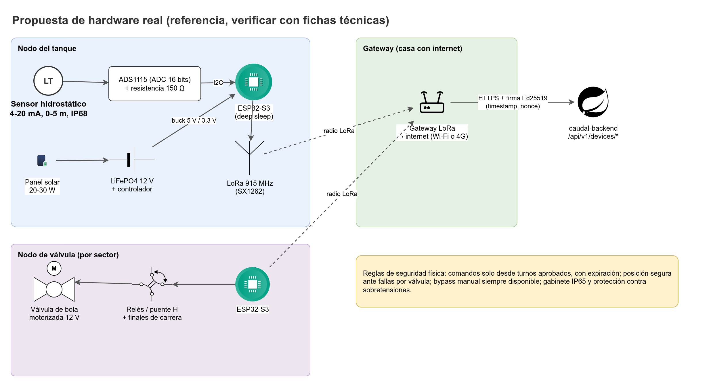
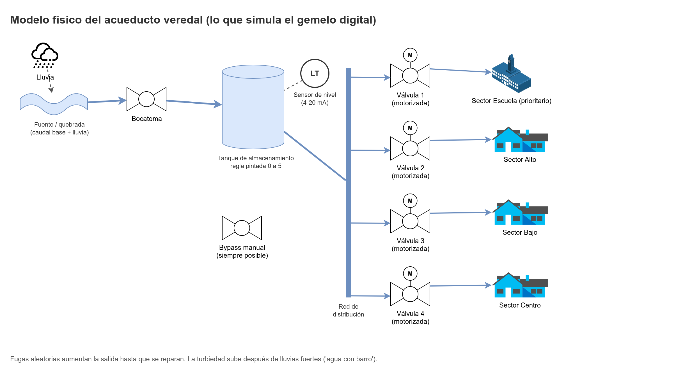

# Simulador, maqueta y hardware real

Este documento describe la **maqueta física** que sí existe (`caudal-maqueta`, secciones 8 y 8.x), cómo `caudal-simulador` la representa (sección 9), y el hardware de campo que CAUDAL usaría en un acueducto real (secciones 1 a 7). El hardware de campo sigue siendo una propuesta documentada, con valores de referencia que deben verificarse con fichas técnicas y proveedores locales antes de cualquier compra.

> Cambio de alcance B2B (2026-11-20): la maqueta real es un **Arduino UNO por USB** con un HC-SR04 y dos servos MG90S que pisan dos mangueras de suero. Cada manguera simula un acueducto ("Acueducto 1" y "Acueducto 2"). La maqueta con ESP32, bomba y lazo cerrado de la versión anterior queda como alternativa futura (sección 8.9). La institución de prueba es `maqueta-caudal`, no simulada.





> Diagramas en actualización. Los de hardware de campo describen la versión anterior hasta que se reexporten.

## 1. Alcance y fases de adopción

El hardware de campo se adopta en tres fases. Cada fase agrega una capacidad sin depender de la siguiente. La maqueta (sección 8) valida la fase C en laboratorio antes de cualquier instalación real.

| Fase | Nombre | Qué incluye | Qué no incluye | Condición para pasar a la siguiente |
|---|---|---|---|---|
| **A** | Operación con bypass | Válvulas manuales, observaciones manuales (`OBSERVATION_CREATE`) y cierre del día en la app. | Sensores y válvulas electrónicas. | Operación estable durante un ciclo de racionamiento completo (duración por definir). |
| **B** | Sensor de nivel en vivo | Sensor sumergido o ultrasónico, nodo, radio y telemetría `DISTANCE` (mm). El backend convierte con la geometría y calcula el estado en vivo y el outlook. | Actuación de válvulas. El operador sigue usando el bypass. | Telemetría con continuidad aceptable y calibración validada contra medidas reales (criterio por definir). |
| **C** | Actuación de válvulas | Válvulas de bola motorizadas con finales de carrera, comandos firmados con origen registrado (manual o del piloto), acuse de recibo (`ACKED`) y bypass manual. | Nada fuera de las guardas del piloto. | Piloto sin incidentes de seguridad y con la decisión del administrador de la institución registrada en la auditoría (criterio por definir). |

> **Regla de la fase C:** el sistema mueve una válvula solo con un comando firmado que tenga un origen registrado: un comando manual con motivo opcional (permiso `VALVE_COMMAND_MANUAL`, con texto por defecto si falta), o una decisión del piloto automático (`autopilot_decision_id`). El piloto existe en tres modos por institución (`MANUAL`, `ASSISTED`, `AUTOMATIC`) que configura el `INSTITUTION_ADMIN` con `AUTOPILOT_CONFIGURE`. En `AUTOMATIC` nunca baja del piso de reserva (`reserve_floor_pct`) y cualquier acción manual lo pausa.

## 2. Arquitectura del nodo de campo

Un nodo de campo cubre un tanque o una válvula. Todos los componentes son propuestos.

| Capa | Componente | Función |
|---|---|---|
| Medición | Sensor de nivel: ultrasónico (mismo protocolo que la maqueta) o hidrostático 4–20 mA (0–5 m, IP68) | Mide el nivel del tanque. La conversión a `DISTANCE` (mm) para el hidrostático está **por definir**. |
| Conversión | ADS1115 (ADC de 16 bits, I2C) con resistencia de precisión, si el sensor es de corriente | Convierte la corriente del lazo en voltaje legible por el controlador. |
| Control | ESP32-S3 | Lee el sensor, controla el driver de la válvula, guarda los datos si no hay señal, firma las peticiones y envía telemetría. |
| Actuación | Válvula de bola motorizada 12 V con finales de carrera, driver puente H y relés | Abre y cierra la línea de servicio. Los finales de carrera confirman la posición. |
| Comunicación | LoRa 915 MHz punto a punto hacia un gateway con internet | Envía telemetría y recibe comandos. Alternativa: LTE Cat-1. |
| Energía | Panel solar 20–30 W, controlador de carga, batería LiFePO4 12 V | Alimenta el nodo sin red eléctrica. |
| Protección | Gabinete IP65, prensaestopas, fusibles, DPS (protector de sobretensiones), puesta a tierra | Protege la electrónica de humedad, polvo y picos de voltaje. |
| Respaldo | Válvula manual en paralelo (bypass) | Permite operar el agua a mano si el sistema falla. |

### 2.1 Sensor de nivel

**Ultrasónico (como la maqueta).** Mide la distancia del sensor a la superficie. El nodo envía `DISTANCE` en mm crudos y el backend convierte con `org.tanks` (`empty_distance_mm`, `full_distance_mm`, `blind_zone_mm`). Es el camino más simple y el que ya probamos.

**Hidrostático sumergido (propuesta de campo).** Va en el fondo del tanque, o en un tubo de sondeo. La presión sobre el sensor depende de la altura de agua (`P = ρ · g · h`), así que no depende de la superficie, de la espuma ni de la condensación del techo.

- La salida es un lazo de corriente de 4 a 20 mA para 0 a 5 m. Con una resistencia de precisión de **150 Ω** (valor de referencia, verificar), 4 mA dan 0,6 V y 20 mA dan 3,0 V. Ese rango cabe en la entrada del ADS1115 con ganancia 1 (verificar la configuración final).
- Cálculo de referencia: `h = (I_mA - 4) / 16 * 5` metros. Cómo se traduce a `DISTANCE` para que el backend use la misma geometría (`empty_distance_mm`, `full_distance_mm`) está **por definir**.
- La calibración no va en el firmware. Se hace desde la app con "usar lectura actual como vacío/lleno" (`Reglas-de-negocio.md`, sección 3), y los valores quedan en `org.tanks`.
- Cable blindado, de dos hilos más malla, con prensaestopas en la entrada del tanque. La malla va conectada a tierra en un solo punto.
- El sensor se instala lejos de la entrada de agua para no medir la turbulencia.

### 2.2 Controlador ESP32-S3

- Lectura del sensor cada intervalo de muestreo, que viene de `GET /devices/config` (`sample_interval_seconds`). El valor de referencia de campo es de unos 2 s, igual que la maqueta, sujeto a la carga de la red y del límite de 60 peticiones por minuto.
- Registro de los puntos en memoria no volátil mientras no hay señal, con un identificador de punto generado en el dispositivo (la BD los trata como idempotentes por `id`).
- Firma Ed25519 de cada petición (sección 5).
- Control del driver de la válvula con tiempo máximo de maniobra y lectura de los finales de carrera.
- Monitoreo de voltaje de batería.

### 2.3 Válvulas de bola motorizadas

- **Por qué bola motorizada y no solenoide:** la válvula solenoide necesita una presión diferencial mínima para abrir. En un sistema por gravedad de baja presión, como el de una vereda, puede no abrir. La válvula de bola motorizada no tiene ese requisito.
- Voltaje 12 V. Corriente de movimiento de referencia: 2 A (verificar con la ficha del motor). Tiempo de recorrido por definir (verificar).
- **Dos finales de carrera** por válvula: uno para abierta y otro para cerrada. La posición reportada sale de los finales de carrera, no de la orden enviada.
- **Tiempo máximo de maniobra** (`max_travel_seconds`): si el final de carrera no se activa antes de ese tiempo, el firmware detiene el motor y reporta falla (`FAILED`). Es un parámetro por válvula.
- **Driver:** puente H para la dirección del motor, protegido por fusible. Nunca se conecta el motor directo al GPIO.
- **Bypass manual:** una válvula manual en paralelo, con su propia caja. El bypass se opera a mano cuando el sistema electrónico falla, y el día registra cada uso como observación manual.

### 2.4 Comunicación

| Opción | Ventajas | Desventajas | Uso propuesto |
|---|---|---|---|
| **LoRa 915 MHz** punto a punto hacia un gateway con internet | Bajo consumo. Alcance de kilómetros según el terreno. Sin plan mensual por dispositivo. | Requiere un gateway con internet y línea de vista razonable. Banda y potencia máxima: **verificar el plan regional vigente en Colombia**. | Propuesta para el campo real (no se construye en esta versión). |
| **LTE Cat-1** (SIM7600 o A7670) | Sin gateway propio. Cobertura directa donde haya señal. | Costo mensual por SIM. Mayor consumo, que la energía solar debe cubrir. | Alternativa si la vereda tiene cobertura celular estable. |
| **USB** (puente local) | Sin red de campo. Sin costo de radio. | Requiere una computadora conectada a la placa. | **Montaje actual de la maqueta** (sección 8). |
| **Wi-Fi** | Alto ancho de banda y sin costo de radio. | No hay red de acceso confiable en las veredas (verificar en cada punto). | Alternativa futura para la maqueta (sección 8.9). Para el campo queda descartado por ahora. |

- El gateway hace de puente entre LoRa y la API. Su ubicación depende de la línea de vista desde los nodos (por definir).
- Sin señal de ningún tipo, el nodo guarda los puntos y los envía cuando vuelve la conexión. Esto es un buffer del dispositivo, no una cola offline de la app.

### 2.5 Energía solar

**Presupuesto de energía (referencia, verificar):**

| Carga | Supuesto de referencia | Energía diaria |
|---|---|---|
| Controlador ESP32-S3 y radio LoRa | Consumo promedio de 0,15 W con la mayor parte del tiempo en reposo | 3,6 Wh |
| Sensor de nivel | Alimentado solo durante la lectura, con conmutación (supuesto) | 0,5 Wh |
| Válvulas (2 maniobras por día, 2 A, 12 V, 15 s por maniobra, por válvula) | `2 A * 12 V * 15 s * 2 = 720 W·s`, es decir, unos 0,2 Wh por válvula | 0,4 Wh (2 válvulas) |
| Driver, pérdidas del convertidor | Margen del 10 % | 0,5 Wh |
| **Total de referencia** | | **5 Wh/día** |
| **Total de diseño (margen de 2x)** | | **10 Wh/día** |

**Autonomía sin sol:**

- Batería LiFePO4 12 V 20 Ah: unos 256 Wh nominales (12,8 V × 20 Ah). Con profundidad de descarga del 80 %, unos 205 Wh utilizables.
- A 10 Wh/día, la autonomía es de unos **20 días** sin carga solar (verificar con la descarga real y la temperatura del sitio).

**Generación:**

- Panel de 30 W. Horas solares pico de referencia: 4 h/día (supuesto, verificar con datos de radiación de la zona). Pérdidas del sistema: 25 % (supuesto).
- Energía diaria: `30 W × 4 h × 0,75 = 90 Wh/día`, unas nueve veces el consumo de diseño.
- Un panel de 20 W da unos 60 Wh/día, también suficiente en condiciones normales. Se elige 30 W para cubrir días nublados.

**Controlador de carga:** MPPT recomendado por eficiencia (verificar). Un PWM es más barato, pero desperdicia parte de la potencia del panel.

**Batería:** LiFePO4 con BMS (protección contra sobrecarga, descarga profunda y temperatura). Las baterías de plomo-ácido se descartan por su vida útil más corta con descargas profundas.

### 2.6 Gabinete y protección eléctrica

- **Gabinete IP65** con prensaestopas para cada cable (sensor, panel, antena, motor). Montado sobre soporte, protegido de la lluvia directa y fuera del alcance de personas no autorizadas.
- **Fusibles** en cada línea de 12 V (panel, batería, motor, sensor), dimensionados por la corriente de cada carga (por definir).
- **Protector de sobretensiones (DPS)** en la línea del panel, en el cable del sensor y en la línea de la antena. Las tormentas son frecuentes en la zona (supuesto, verificar).
- **Puesta a tierra** del gabinete y del pararrayos de la antena, con un solo punto de conexión.
- **Instalación eléctrica:** verificar los requisitos del RETIE (Reglamento Técnico de Instalaciones Eléctricas) aplicables a la instalación.

### 2.7 Instalación en el tanque y en las válvulas

| Sitio | Qué se instala | Consideraciones |
|---|---|---|
| Tanque | Sensor, cable blindado, prensaestopas en la tapa, gabinete a la intemperie protegido. | Sensor lejos de la entrada de agua. Tapa cerrada y sellada. Acceso para mantenimiento. Sin contacto con sedimentos del fondo (altura de montaje por definir). |
| Válvula | Válvula de bola motorizada en la línea de servicio, válvula manual en paralelo, caja IP67 con los finales de carrera y el motor. | Válvula de bloqueo aguas arriba para mantenimiento. Acceso para operar el bypass. Caja con drenaje. |
| Gabinete | Controlador, driver, relés, DPS, fusibles, convertidor, batería y controlador de carga. | Montaje vertical, ventilado, lejos del agua. Panel orientado al sol (acimut y inclinación por definir por latitud). |

## 3. Bypass manual y operación sin electrónica

- Cada válvula motorizada tiene una válvula manual en paralelo que permite el mismo control de la línea sin energía ni sistema.
- Cada uso del bypass se anota como **observación manual** (`OBSERVATION_CREATE`, tipo `OTHER`) y aparece en el cierre del día (`Reglas-de-negocio.md`, sección 11).
- Si el nodo está fuera de servicio, el sistema sigue funcionando en fase A: el operador opera a mano y registra lo que hace.

## 4. Lista de materiales (BOM de referencia, sin precios)

Las cantidades son por nodo, salvo que se indique otra cosa. Las marcas y modelos se definen al comprar, con fichas técnicas.

| Componente | Cantidad | Nota |
|---|---|---|
| Sensor de nivel (ultrasónico o hidrostático sumergible 4–20 mA, 0–5 m, IP68) | 1 por tanque | Longitud de cable según la altura del tanque. Verificar alimentación del sensor (rango típico, verificar). |
| Módulo ADS1115 (ADC de 16 bits, I2C) | 1 por nodo de nivel con sensor de corriente | Ganancia y dirección I2C a definir. |
| Resistencia de precisión 150 Ω | 1 por nodo de nivel con sensor de corriente | Tolerancia baja (verificar). Valor de referencia. |
| ESP32-S3 (módulo con antena) | 1 por nodo | Firmware en PlatformIO (sección 6). |
| Módulo LoRa 915 MHz | 1 por nodo | Verificar banda y potencia en Colombia. |
| Gateway LoRa con conexión a internet | 1 por zona (por definir) | Ubicado con línea de vista a los nodos. |
| Antena LoRa con cable y pararrayos | 1 por nodo y 1 por gateway | Cable de baja pérdida. |
| Válvula de bola motorizada 12 V | 1 por línea motorizada | Tiempo de recorrido y corriente por verificar. |
| Finales de carrera | 2 por válvula | Abierta y cerrada. |
| Driver puente H para motor | 1 por válvula | Corriente mayor que la de arranque del motor. |
| Relés de 12 V | Según el diseño | Solo si el driver no integra la lógica necesaria. |
| Caja de conexiones IP67 | 1 por válvula | Para el motor y los finales de carrera. |
| Válvula manual de bypass | 1 por válvula | Misma medida de tubería. |
| Panel solar 30 W | 1 por nodo | Ver sección 2.5. |
| Controlador de carga solar (MPPT preferido) | 1 por nodo | Compatible con batería LiFePO4 de 12 V. |
| Batería LiFePO4 12 V 20 Ah con BMS | 1 por nodo | Ver sección 2.5. |
| Gabinete IP65 con prensaestopas | 1 por nodo | Tamaño según componentes. |
| Fusibles y portafusibles de 12 V | Según el diseño | Dimensionados por carga. |
| Protector de sobretensiones (DPS) | 1 por línea (panel, sensor, antena) | Verificar clase y tensión. |
| Convertidor DC-DC 12 V a 5 V y 3,3 V | 1 por nodo | Para el ESP32-S3 y los módulos. |
| Cable blindado de dos hilos más malla | Por metro | Para el sensor. |
| Soporte de montaje del panel y del gabinete | 1 por nodo | Resistente a viento. |
| Puesta a tierra (varilla y conductor) | 1 por instalación | Verificar con el RETIE. |

## 5. Seguridad del dispositivo

### 5.1 Identidad y firma

| Control | Regla |
|---|---|
| Algoritmo | Ed25519, una clave por dispositivo. |
| Clave privada | Solo en el dispositivo. Para la maqueta, en disco local con permisos 600 (solo el dueño puede leerla). Para el campo, almacenamiento cifrado en el ESP32-S3 (mecanismo por verificar). Nunca en git, nunca en el servidor. |
| Clave pública | En `devices.device_keys`. Rotación: se registra una clave nueva y la anterior se marca inactiva. |
| Cabeceras | `X-Device-Id`, `X-Timestamp` (unix en segundos), `X-Nonce` (128 bits en hexadecimal), `X-Signature` (Ed25519 en base64url). |
| Cadena firmada | `método\nruta\ntimestamp\nnonce\nsha256(cuerpo)`. |
| Ventana de tiempo | `±300 s` respecto al servidor. |
| Anti-repetición | Cada nonce es único durante 10 minutos (`devices.device_nonces`). |
| Límite de cuerpo | 256 KiB para telemetría. |
| Límite de tasa | 60 peticiones por minuto por dispositivo. A 2 s de telemetría hay 30 por minuto, dentro del límite. |

El detalle de la cadena, las cabeceras y los errores está en `Protocolo-de-dispositivos.md`.

### 5.2 Comandos de válvula

- Un comando tiene un **origen** que se guarda en `devices.valve_commands`: un comando manual con motivo (`manual_reason`, creado con `POST /api/v1/valve-commands/manual`) o una decisión del piloto (`autopilot_decision_id`). Exactamente uno de los dos.
- Cada comando tiene `not_before` y `expires_at`. El dispositivo no ejecuta un comando antes de `not_before` ni después de `expires_at`.
- Estados del comando: `PENDING`, `DELIVERED`, `ACKED`, `FAILED`, `EXPIRED`, `CANCELLED`. Cada transición queda en `devices.valve_command_events`.
- El dispositivo recibe comandos con `GET /api/v1/devices/commands` (firmado) y confirma con `POST /api/v1/devices/commands/{id}/ack`.
- La configuración de canal, ángulos y calibración la recibe con `GET /api/v1/devices/config` (firmado). Cada actuador recibe `valve_id`, `servo_channel`, `open_angle_deg`, `closed_angle_deg` y `fail_safe_position`.
- **Por definir:** si los comandos que el servidor envía al dispositivo llevan firma propia, además del TLS. Se evalúa antes de la fase C.

### 5.3 Comportamiento seguro ante fallas

| Situación | Comportamiento del nodo |
|---|---|
| Pérdida de comunicación | Guarda los puntos. Mantiene la última posición física. No ejecuta comandos vencidos. |
| Final de carrera no llega en el tiempo máximo | Detiene el motor, reporta `FAILED` y no reintenta sin orden nueva. |
| Batería baja | Reporta `BATTERY_V`. Deja de maniobrar por debajo de un voltaje mínimo (valor por definir). |
| Sensor fuera de rango o sin señal | Reporta el valor y la falla (`NO_ECHO` o `STALE`). No mueve válvulas por sí mismo. |
| Falla del nodo o pérdida de energía | La válvula va a su `fail_safe_position`, si el mecanismo lo permite. |

**`fail_safe_position`** es un campo de cada válvula (`org.valves.fail_safe_position`) con tres valores:

| Valor | Significado | Cuándo usarlo |
|---|---|---|
| `KEEP` | La válvula conserva su posición. | Valor por defecto. Es el que no cambia el agua ante una falla. |
| `OPEN` | Se abre ante una falla. | Solo si el administrador de la institución decide que cortar el agua es peor que abrirla. |
| `CLOSED` | Se cierra ante una falla. | Solo si el administrador decide que el riesgo de un flujo sin control es mayor. |

La elección de `fail_safe_position` por válvula es una decisión del administrador de la institución y queda en la auditoría. El disparador exacto de cada valor está **por definir** (`Reglas-de-negocio.md`, sección 9.5).

### 5.4 Reglas de operación

- **Toda maniobra automática pasa por el piloto y sus guardas.** El administrador de la institución configura el modo. Ninguna anomalía, pronóstico u observación mueve una válvula por sí sola: solo lo hace una decisión del piloto en `AUTOMATIC`, registrada en `ops.autopilot_decisions`.
- Las dos guardas del piloto son el piso de reserva (`reserve_floor_pct`) y la prioridad humana (cualquier acción manual pausa el piloto).
- El dispositivo nunca decide solo: ejecuta el comando firmado dentro de su ventana y, si pierde contacto, aplica `fail_safe_position`.
- El bypass manual siempre está disponible y no depende del sistema.
- Cada maniobra queda registrada con su resultado.
- Las pruebas de la fase C se hacen primero en la maqueta (banco y luego lazo completo, sección 8.6) y después, si se decide, en una línea piloto de campo.

## 6. Firmware futuro

El firmware de campo se escribe en **C++ con PlatformIO** para el ESP32-S3. El firmware de la maqueta (Arduino UNO) no cambia: recibe ángulos crudos por serie y responde `DONE` (sección 8.5). Usa los mismos patrones del simulador, para que el comportamiento sea el mismo en el simulador y en el hardware.

| Patrón | Clase en firmware (propuesta) | Uso |
|---|---|---|
| State | `ValveState` (`CLOSED`, `OPEN`, `MOVING`, `FAULT`) | Estado de la válvula según finales de carrera y comandos. |
| Command | `OpenValveCommand`, `CloseValveCommand` | Maniobras con `not_before` y `expires_at`. |
| Observer | Bus de eventos local | Notifica cambios de estado a telemetría y a la pantalla de estado (si existe). |
| Bridge | `ValveActuator` × `ActuatorDriver` | Separa la lógica de la válvula del driver concreto del motor. |
| Adapter | `DeviceTelemetryAdapter` | Convierte lecturas a la forma de la API (`DISTANCE` en mm). |
| Decorator | Filtros del sensor (`NoisySensor` y similares) | Suavizado y validación de la lectura antes de enviarla. |
| Singleton | Reloj del dispositivo | Una sola fuente de tiempo. |

Consideraciones:

- El firmware no reinicia ni borra los puntos pendientes al perder la señal.
- La firma Ed25519 se implementa con una librería de C++ verificada (por definir).
- Las actualizaciones de firmware (OTA) quedan **por definir**. Antes de la fase B debe decidirse cómo se actualiza un nodo en campo.

## 7. Cómo el simulador representa cada componente real

El simulador tiene las mismas clases que el firmware real, para que las pruebas de software hablen del mismo modelo.

| Componente real | Clase del simulador | Patrón | Comportamiento simulado |
|---|---|---|---|
| Sensor de nivel | Sensor base (por definir) con `NoisySensor`, `DriftingSensor`, `StuckSensor` | P09 Decorator | Ruido, deriva, valor pegado, picos y caídas. |
| ADS1115 y resistencia | `NoisySensor` (ruido de cuantización) | P09 Decorator | Ruido de conversión. |
| HC-SR04 de la maqueta | `DistanceSensor` (por implementar) | P09 Decorator | Distancia en mm con eco ausente (`-1`) y zona ciega. |
| ESP32-S3 y firmware | `DeviceCreator` y `DeviceKitFactory` | P02 Factory Method, P03 Abstract Factory | Crean un nodo completo (sensor, actuador, transporte). |
| Radio LoRa y gateway | `OfflineBufferTransport` | P11 Proxy | Pérdida de paquetes y buffer cuando no hay señal. |
| Válvula de bola motorizada | `ValveActuator` | P07 Bridge | Maniobra con tiempo de recorrido. |
| Driver del motor o servo | `ActuatorDriver` | P07 Bridge | Corriente y falla del motor, o ángulo del servo. |
| Finales de carrera | `ValveState` | P18 State | Posición reportada por los finales de carrera. |
| Comando de abrir y cerrar | `OpenValveCommand`, `CloseValveCommand` | P13 Command | Ejecución con `not_before` y `expires_at`. |
| Firma Ed25519 y cabeceras | `ApiPayloadAdapter` | P06 Adapter | Firma y arma las peticiones igual que el firmware. |
| Tanque físico | `SimulationStep` y el balance de masa | P20 Template Method | Ver `Datos-simulados.md`, sección 3.1. |
| Reloj de la simulación | `SimulationClock` | P01 Singleton | Tiempo único para todos los actores. |
| Bypass manual | Por definir | Por definir | Operación a mano registrada como observación manual. |
| Panel, batería y controlador de carga | Por definir (`PowerSupply`) | Por definir | Energía diaria y voltaje de batería. |
| Gabinete y protecciones | No se simulan | No aplica | Fuera del alcance del simulador. |

Notas:

- La tabla no pretende reproducir la electrónica. Reproduce el comportamiento observable que el sistema consume: lecturas, posiciones, fallas y tiempos.
- Los parámetros de cada componente (ruido, tiempo de recorrido, tasa de caídas) salen de la ficha técnica real y se guardan en el YAML del escenario.

## 8. Maqueta física (`caudal-maqueta`)

La maqueta es un acueducto a escala de laboratorio. Cierra el lazo completo con el backend: telemetría firmada, comando de válvula, ejecución y acuse de recibo (`ACKED`). Repositorio `caudal-maqueta`. Responsable: nicomora70.

Institución de prueba: **`maqueta-caudal`** (no simulada). Tiene un tanque con las medidas de la maqueta y dos líneas de servicio, "Acueducto 1" y "Acueducto 2", cada una con su válvula motorizada en el canal de servo 1 y 2 (`Reglas-de-negocio.md`, sección 1.3).

### 8.1 Componentes

| Cantidad | Componente | Función | Nota |
|---|---|---|---|
| 1 | Arduino UNO | Lee el sensor, mueve los servos y responde por serie. | Conectado por USB a una computadora local. |
| 1 | Sensor ultrasónico HC-SR04 | Mide la distancia del sensor a la superficie del agua en el tanque. | Medidas de referencia: vacío a 350 mm y lleno a 80 mm de distancia (`scenarios/maqueta-usb.yaml`). Rango útil: 270 mm. El diámetro del tanque está **por definir** con la maqueta real. |
| 2 | Servo MG90S | Cada servo presiona una manguera de suero y la cierra o la libera. | Un servo por línea. Ángulos abierto y cerrado en `org.valves` (por ejemplo, 90° y 0°, como ejemplo). |
| 2 | Mangueras de suero | Cada una simula un acueducto. | "Acueducto 1" y "Acueducto 2". |
| 1 | Tanque de la maqueta | Contiene el agua que el sensor mide. | Descripción física (medidas, entrada y salida de agua) por completar con fotos. |

### 8.2 Conexiones

Pines confirmados en `uno/caudal_uno/caudal_uno.ino`:

```text
HC-SR04   TRIG -> pin D9
          ECHO -> pin D8
Servo 1   señal -> pin D10   (canal 1, "Acueducto 1")
Servo 2   señal -> pin D11   (canal 2, "Acueducto 2")
UNO       USB -> computadora local (puerto serie a 115200 baudios)
```

- Los servos y el sensor se alimentan desde el USB de la placa. Al mover los dos servos a la vez, la caída de voltaje puede reiniciar el UNO. Si aparece `READY` en medio de una prueba, el problema es de alimentación, no del código. La solución (fuente externa de 5 V común a la placa) está **por definir**.

### 8.3 Protocolo serie con la placa

La placa responde estas líneas (`uno/caudal_uno`, detalle en `Protocolo-de-dispositivos.md`):

| Línea | Significado |
|---|---|
| `READY caudal-uno <ver>` | La placa arrancó (o se reinició). |
| `PING` / `PONG` | Comprobación de vida. |
| `INFO` | Versión y configuración de la placa. |
| `D` / `D <mm>` | Pide una distancia. Responde la mediana de 5 lecturas en mm; `-1` si no hay eco. |
| `S<n> <deg>` / `OK S<n> <deg>` / `DONE S<n> <deg>` | Mueve el servo `n` al ángulo indicado. `DONE` cuando termina el recorrido. |
| `R<n>` | Lee la posición del servo `n`. |
| `ERR <motivo>` | Error de la placa. |

Velocidad: 115200 baudios. Abrir el puerto reinicia la placa: lo primero que llega es `READY caudal-uno <versión>`. Los servos y el sensor se alimentan del riel de 5 V que indica el firmware. El puente traduce `OPEN` y `CLOSE` al ángulo que le da el backend. El firmware nunca conoce las palabras "abierto" o "cerrado".

### 8.4 Puente USB (`caudal-sim maqueta-usb`)

El puente vive en `caudal-simulador`. Es un proceso local que:

- Lee la distancia con `D` y envía `DISTANCE` (mm crudos) al backend cada ~2 s, firmado con Ed25519.
- Consulta `GET /api/v1/devices/commands` cada ~2 s. Por cada comando: lo marca `DELIVERED`, envía `S<n> <deg>` a la placa, espera `DONE` y confirma con `POST /api/v1/devices/commands/{id}/ack` (`ACKED`). Si no llega `DONE` en `max_travel_seconds`, confirma `FAILED`.
- Lee canal, ángulos y calibración con `GET /api/v1/devices/config`, firmado. El puente la relee sin reiniciarse. **Por implementar.** El YAML del puente queda solo con el puerto serie y los tiempos.

Subcomandos:

| Subcomando | Uso |
|---|---|
| `puertos` | Lista los puertos serie disponibles. |
| `probar` | Prueba de vida con `PING` y `INFO`. |
| `servo` | Mueve un servo a un ángulo, para revisar el montaje. |
| `calibrar` | Herramienta de banco. La calibración normal se hace desde la app (sección 8.6). |
| `correr` | Corre el puente en modo normal, con telemetría y comandos. |

### 8.5 Firmware

- **Arduino UNO** (`uno/caudal_uno/*.ino`, en `caudal-maqueta`). **No cambia**: recibe ángulos crudos y responde `DONE`. Solo cambia la documentación.
- Las credenciales y la clave privada del dispositivo no van en el repositorio. La clave vive en disco local del equipo que corre el puente.

### 8.6 Ciclo de un comando de válvula en la maqueta

```text
UI o API: POST /valve-commands/manual          -> PENDING
Puente:   GET /devices/commands (cada ~2 s)    -> DELIVERED
Puente:   S<n> <deg> por serie                 -> la placa mueve el servo
Placa:    DONE S<n> <deg>                      -> el puente lo recibe
Puente:   POST /devices/commands/{id}/ack      -> ACKED
UI:       GET /valves/live                      -> OPEN / CLOSED / UNKNOWN
```

Objetivo: de pulsar en la UI a `ACKED` en menos de unos 5 s, con la manguera pisada o libre de verdad.

### 8.7 Pruebas de banco

Orden de la fase 0 (antes de tocar nada del código de las líneas):

1. **Permisos del puerto:** el usuario de la computadora debe estar en el grupo `dialout` (`sudo usermod -aG dialout $USER`) y volver a iniciar sesión.
2. **Flasheo y prueba de la placa:** compilar y subir `uno/caudal_uno` con `arduino-cli`. Luego correr `caudal-sim maqueta-usb probar`, `servo` y `calibrar`.
3. **Stack local:** base de datos de desarrollo, backend, `caudal-ia` (puerto 8002) y el frontend.
4. **Registro de dispositivos:** un `LEVEL_SENSOR` y dos `VALVE_ACTUATOR`, ligados a las válvulas motorizadas.
5. **Lazo completo:** correr `caudal-sim maqueta-usb correr`, pulsar una llave en la UI y ver `PENDING`, luego `DELIVERED`, luego `ACKED`, con la manguera pisada o libre.
6. **Alimentación:** repetir el paso 5 moviendo los dos servos a la vez. Si la placa se reinicia (`READY` en medio), es un problema de alimentación.
7. **Sensor:** poner una regla física dentro del tanque y comparar la distancia y el nivel de `GET /tanks/{id}/live` con la medida real (±1 cm). Calibrar desde la app con "usar lectura actual como vacío/lleno".

Repetición final: el mismo lazo, desde la UI, abriendo y cerrando cada válvula, con ACKED en menos de unos 5 s.

### 8.8 Relación con el modelo físico

La maqueta real no tiene bomba ni lazo cerrado: el agua no se recircula. Por eso el balance de masa de `Estudio-llenado-de-tanques.md` aplica a la **maqueta virtual** (sección 9) y a un tanque real, no a la maqueta física. La geometría de la maqueta sale de sus medidas (sección 8.1) y se calibra con la app.

### 8.9 Alternativa futura: ESP32 con Wi-Fi

La versión anterior de la maqueta planeaba un ESP32 por Wi-Fi, un tanque con bomba y reservorio en lazo cerrado, electroválvulas NC, caudalímetros YF-S201 y flotadores de corte. **Ese diseño no es el montaje actual.** Queda como referencia para una maqueta futura con medición de caudal, sin cambiar el protocolo firmado.

## 9. Maqueta virtual (`caudal-simulador`)

El simulador incluye una **maqueta virtual**: un dispositivo firmado con 1 tanque, dos líneas de servicio, sensor de nivel (`DISTANCE`) y una válvula por línea. Habla con el backend por el **mismo protocolo HTTP Ed25519** que la maqueta física:

- Envía `DISTANCE` cada ~2 s.
- Consulta `GET /devices/commands` cada ~2 s.
- Ejecuta la orden en su modelo de masa, con `Q ∝ √h`.
- Responde con `POST .../ack`.

Así la escena del tanque y el piloto automático se construyen y se prueban sin el hardware. La maqueta virtual no tiene sensor de caudal, porque la física tampoco. El escenario se define en `maqueta.yaml` y se corre con `caudal-sim live --scenario maqueta`.

Relacionados: [Datos-simulados.md](Datos-simulados.md), [Modulo-IA.md](Modulo-IA.md), [Stack-tecnologico.md](Stack-tecnologico.md), [Protocolo-de-dispositivos.md](Protocolo-de-dispositivos.md), [Estudio-llenado-de-tanques.md](Estudio-llenado-de-tanques.md)
