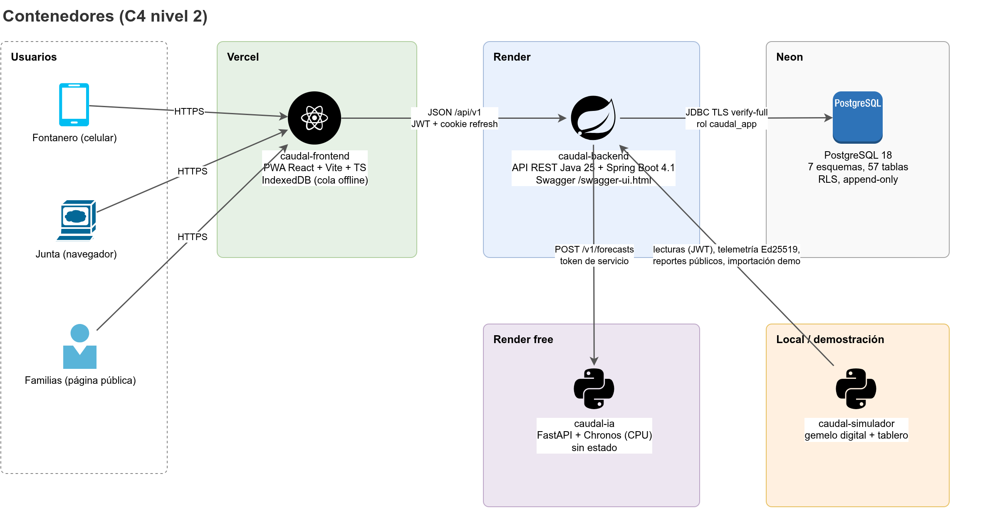
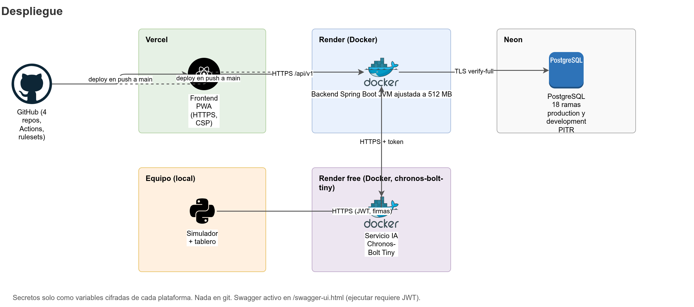

# Stack tecnológico

El stack responde a tres tipos de restricciones:

- **De la materia:** el backend debe ser Java (Patrones de Software) y el repositorio `caudal-backend` debe tener la mayor carga de commits del proyecto.
- **Del producto:** CAUDAL es B2B. Cada institución tiene su tanque, su sensor ultrasónico y sus válvulas, y los datos personales se minimizan (Ley 1581 de 2012).
- **De presupuesto y operación:** costo cercano a cero en la fase de prueba y un solo equipo pequeño. Por eso el pronóstico corre en CPU, el asistente usa un LLM con capa gratuita y la institución de prueba es una maqueta local.

> Cambio de alcance B2B (2026-11-20): CAUDAL pasa a ser un producto multi-institución. Se retiran la cola sin conexión, la página pública, WhatsApp, el cartel y las propuestas de turnos. Se agregan el control de válvulas con Arduino UNO por USB, el sensor en vivo con geometría, el pronóstico en tres salidas y el asistente con un LLM compatible con OpenAI. La cola offline de la versión 2 queda retirada (ver `Riesgos.md`).

(Diagrama en actualización.)

(Diagrama en actualización.)

Cada tabla de este documento sigue el mismo formato: **Tecnología**, **Uso**, **Por qué** y **Alternativa descartada y motivo**. Cuando una alternativa se descarta por una cifra o una limitación técnica concreta, el motivo lo dice. Cuando la decisión es de criterio del equipo, el motivo lo dice también.

## Versiones de referencia

| Componente | Versión | Nota |
|---|---|---|
| Java | 25 LTS | Lenguaje del backend. |
| Spring Boot | 4.1.x | Framework del backend. |
| springdoc-openapi | 3.x | Swagger UI y OpenAPI del backend. |
| PostgreSQL | 18 | Base de datos (Neon en la nube, Docker Compose en local). |
| React | 19 | UI de la aplicación web. |
| Python | 3.12 | Servicio de IA, simulador y puente USB. |
| Arduino UNO | Firmware `caudal_uno` | Placa de la maqueta. Se compila con `arduino-cli`. |

> **Fijar versiones exactas al crear cada proyecto.** Las versiones de esta tabla son el rango de referencia. Al crear cada repositorio se fija la versión exacta (por ejemplo, en el Maven Wrapper, `package.json` con `pnpm`, `pyproject.toml` con `uv.lock`, y la versión del core de Arduino en `arduino-cli`) y se registra en el README del repositorio. Una actualización de versión mayor es un commit propio con su prueba.

## Base de datos

| Tecnología | Uso | Por qué | Alternativa descartada y motivo |
|---|---|---|---|
| **PostgreSQL 18** | Base de datos de los esquemas por responsabilidad (`iam`, `org`, `ops`, `reporting`, `devices`, `audit`, `sim` y `platform` con funciones). Ver [Modelo de datos](Modelo-de-datos.md). | El dominio es relacional y necesita restricciones fuertes: `FORCE ROW LEVEL SECURITY` por institución, triggers de inmutabilidad, `CHECK` y `UNIQUE` (por ejemplo, `(institution_id, username)`), funciones `SECURITY DEFINER` para el superadmin, `timestamptz` y `uuidv7()` nativo en PostgreSQL 18. Neon ofrece PITR y ramas para pruebas. | **MySQL:** no ofrece RLS equivalente a la usada aquí. **MongoDB:** el modelo es relacional (instituciones, configuración, comandos y auditoría con cadena de hashes) y las transacciones multi-documento pesarían sobre la integridad. |
| **Flyway** | Migraciones versionadas en SQL puro, con placeholders (`${person_name_max}`) alimentados por `FieldLimits`. | Los triggers, roles, políticas RLS y privilegios por columna se escriben como SQL explícito y revisable. El cambio B2B entra con migraciones nuevas, porque las aplicadas no se editan. | **Liquibase:** su modelo de changelogs XML/YAML abstrae el SQL que aquí debe verse tal cual. |
| **Neon** | PostgreSQL gestionado en la nube, con PITR y ramas. | Plan gratuito suficiente para la fase de prueba y recuperación a un punto en el tiempo. | **Amazon RDS:** costo mensual fijo mayor para una fase sin usuarios reales. **Supabase:** agrega servicios (autenticación, almacenamiento) que el diseño ya resuelve en el backend. |
| **Docker Compose** | PostgreSQL local para desarrollo y pruebas de integración (base de desarrollo en el puerto 5435). | Mismo motor y versión que en la nube. | **H2 en memoria para pruebas:** no reproduce RLS, triggers ni las restricciones de la base. Las pruebas de BD usan Testcontainers con PostgreSQL 18 real. |

## Backend (`caudal-backend`)

| Tecnología | Uso | Por qué | Alternativa descartada y motivo |
|---|---|---|---|
| **Java 25 LTS** | Lenguaje del backend. | Requisito de la materia. Versión LTS con soporte de largo plazo. | **Java 21 LTS:** válido, pero el equipo fija la última LTS disponible al iniciar el proyecto. |
| **Spring Boot 4.1.x** | Web MVC, Security, Data JPA, Validation y Actuator. | Un solo ecosistema cubre API REST, seguridad (filter chain, OAuth2 Resource Server), persistencia y salud del servicio. | **Quarkus y Micronaut:** son válidos y ofrecen arranque más rápido. Se descartan para no sumar un segundo ecosistema a un proyecto académico con tres integrantes. |
| **springdoc-openapi 3.x** | Swagger UI en `/swagger-ui.html` y OpenAPI en `/v3/api-docs`, con esquema bearer JWT y descripciones en español. | Genera el contrato desde los controladores; la aplicación genera sus tipos con `openapi-typescript`. | **Documentación escrita a mano:** se desalinea del código en la primera semana. |
| **Spring Security + OAuth2 Resource Server (Nimbus, HS256)** | Autenticación JWT de acceso, deny-by-default y filter chain. El token lleva `institution_id` o `scope=platform`. | Un solo emisor y un solo validador (el mismo backend), por lo que HS256 con un secreto de al menos 256 bits basta. | **JWT firmado con RS256 o EdDSA:** tiene sentido cuando varios servicios validan tokens sin compartir secreto. Aquí no aplica. |
| **Argon2id con `Argon2PasswordEncoder` (BouncyCastle)** | Hash de contraseñas (m=19456 KiB, t=2, p=1). | Memory-hard, recomendado por OWASP para contraseñas nuevas, con soporte directo en Spring Security. | **bcrypt:** no es memory-hard y su límite de 72 bytes obliga a reglas adicionales. **PBKDF2:** más débil frente a hardware especializado. |
| **Hibernate Validator** | Validación de entradas con `@Size`, `@Pattern`, `@NotNull` y `@Min`/`@Max` (para los ángulos de 0 a 180) alimentados por `FieldLimits`. | Estándar de Jakarta Validation; los mensajes salen en español desde `messages_es.properties`. | **Validación manual en cada servicio:** dispersa las reglas y rompe la fuente única de límites. |
| **Flyway** | Migraciones versionadas en SQL puro, con placeholders alimentados por `FieldLimits`. | El SQL de triggers, roles y políticas RLS debe verse tal cual y ser revisable. | **Liquibase:** changelogs XML o YAML que abstraen el SQL que aquí debe ser explícito. |
| **Bucket4j con almacenamiento en PostgreSQL** | Límites de tasa: login por (IP, institución) con 5 intentos por minuto (`valor por confirmar), directorio público de instituciones (valor por definir), API 120/min/usuario, telemetría 60/min/dispositivo y recálculo de pronóstico 10/h/institución. | Los contadores viven en la base de datos (`iam.rate_limit_buckets`), así que son compartidos entre instancias y sobreviven a reinicios. | **Resilience4j RateLimiter:** los contadores son en memoria de cada instancia. **Limitador del proxy (Render):** no cubre límites por usuario, dispositivo o institución. |
| **OpenPDF** | Actas en PDF, con la familia `DocumentFactory` (PDF). Ya no hay cartel ni resumen. | Librería ligera, programable desde Java, sin herramienta de diseño aparte. Licencia LGPL/MPL (verificar antes de publicar). | **JasperReports:** requiere plantillas `.jrxml` con su herramienta de diseño y una huella de dependencias mucho mayor para un documento. |
| **Circuit breaker propio** | Circuito de la IA (`CircuitBreakerState`: Cerrado, Abierto, Semiabierto). Aplica a pronóstico y asistente. | El estado y las transiciones son parte del patrón State que se evalúa en la materia. | **Resilience4j CircuitBreaker:** es una opción correcta en producción. Se descarta para este proyecto porque ocultaría el patrón que debe verse en el código. |
| **JWT de Nimbus** | Firma y validación de tokens HS256 con `alg` explícito, `iss`, `aud`, `exp` y `nbf`. | Incluido con el Resource Server. | **Librerías JWT propias:** riesgo de errores de validación de `alg`. |
| **Verificación Ed25519 (JCA o Bouncy Castle)** | Firma de las peticiones de dispositivo (`X-Signature`). Solo se guarda la clave pública. | Mismo algoritmo que firma el puente. Sin secreto compartido. | **HMAC compartido:** el secreto quedaría en el dispositivo y en el servidor. |
| **JUnit 5 / 6, AssertJ, Mockito** | Pruebas unitarias y de integración. | Estándar del ecosistema Spring. | **TestNG:** equivalente, pero distinto del resto de herramientas del stack. |
| **Testcontainers** | Pruebas de integración contra PostgreSQL 18 real. | Las restricciones de la BD (RLS, triggers, `CHECK`) solo se prueban contra el motor real. | **H2:** no reproduce esas restricciones. |
| **ArchUnit** | Reglas de arquitectura: `domain` sin Spring, JPA ni Jackson; sin ciclos entre paquetes. | Convierte la arquitectura hexagonal en una prueba que falla. | **Revisión manual en code review:** no escala y se olvida. |
| **JaCoCo** | Cobertura de pruebas. | Reporte en CI. | **Ninguna:** el equipo necesita evidencia de cobertura para la entrega. |
| **Spotless (google-java-format), Checkstyle (incluye `MagicNumber`), SpotBugs + FindSecBugs** | Formato, estilo, errores comunes y patrones de seguridad. | Corren en CI y bloquean el merge si fallan. | **Solo el formateador:** no detecta errores de lógica ni problemas de seguridad. |

## Aplicación web (`caudal-frontend`)

| Tecnología | Uso | Por qué | Alternativa descartada y motivo |
|---|---|---|---|
| **React 19 + TypeScript estricto** | Aplicación web por roles: login en dos pasos, inicio, administración, eventos, cierre, actas y consola de plataforma. | Requisito del equipo. Modo estricto con `strict`, `noUncheckedIndexedAccess` y `exactOptionalPropertyTypes` para atrapar errores de datos nulos y opcionales. | **Vue o Svelte:** no hay experiencia del equipo en ellos y React tiene el ecosistema de formularios que el proyecto usa. |
| **Vite + `vite-plugin-pwa` (Workbox)** | Build, servidor de desarrollo y service worker. La aplicación es instalable, pero **sin cola offline**. | Vite es rápido. El plugin PWA genera el service worker sin configuración de bajo nivel. | **Next.js:** su valor está en el renderizado en el servidor, que la app autenticada no necesita. |
| **React Router** | Rutas por rol en `src/app`: `/inicio`, `/eventos`, `/cierre/:date`, `/actas`, `/admin/*` y `/plataforma/*`. El viewer entra a las mismas vistas sin controles. | Modelo de rutas maduro y controlable por código. | **TanStack Router:** válido y con tipado más estricto de rutas. Se descarta por ser menos conocido para el equipo. |
| **TanStack Query** | Estado del servidor: caché, reintentos e invalidación tras abrir una válvula, guardar la configuración o registrar una observación. | Separa el estado del servidor del estado de la UI. | **Redux:** más ceremonia para un estado que casi todo viene de la API. |
| **TanStack Query (polling)** | Vista en vivo: polling cada 2 s a `/tanks/{id}/live` y `/valves/live`. Sin SSE. | Un solo mecanismo de actualización, fácil de probar con MSW. | **SSE:** queda fuera para no sumar otro canal de tiempo real. |
| **React Hook Form + Zod** | Formularios de configuración. Los esquemas se arman en tiempo de ejecución con `GET /api/v1/meta/constraints` y `GET /api/v1/institution/settings`. | Las reglas de validación vienen del backend y no se escriben dos veces. | **Formik + Yup:** más código para el mismo resultado, y sin el armado en tiempo de ejecución. |
| **Radix UI** | Primitivas accesibles sin estilo (diálogos, menús, selects). | Accesibilidad de teclado y foco resuelta; el aspecto lo define el sistema de tokens propio. | **MUI:** trae un lenguaje visual propio (Material) que contradice el criterio del proyecto. Además pesa más. |
| **CSS Modules + tokens en variables CSS** | Estilos. Modo claro primero; modo oscuro por variables. | Sin dependencia de un framework de utilidades; los tokens son la única fuente del color y el espacio. | **Tailwind CSS:** válido; se descarta para que el equipo use una sola forma de definir tokens. |
| **Recharts** | Gráfica del pronóstico con la banda p10–p90 de Chronos. | Componentes declarativos para líneas y áreas. | **Chart.js:** requiere más código para la banda de incertidumbre. |
| **three.js** (con CSS2DRenderer y controles de órbita) | Escena 3D de la institución (`src/ui/scene`): tanque y líneas con su válvula, y el flujo de agua. La escena se escala a las medidas reales del tanque. Se usa a todo el ancho de la vista de inicio. | Permite ver la profundidad y la apertura de cada válvula en una sola escena, y pulsarla. | **SVG o Canvas 2D:** no dan la profundidad ni el control orbital que pide la escena. |
| **sonner** | Avisos breves (comando confirmado, configuración guardada). | Sencillo y accesible. | **Notificaciones propias:** trabajo sin beneficio. |
| **lucide-react** | Iconos. | Conjunto consistente y ligero. | **Iconos sueltos en SVG:** inconsistentes en tamaño y trazo. |
| **openapi-typescript** | Tipos generados desde el OpenAPI del backend. | Un cambio de contrato rompe la compilación de la aplicación, no producción. | **Tipos escritos a mano:** se desalinean. |
| **Vitest + Testing Library + MSW + Playwright (+ axe)** | Pruebas unitarias, de componentes, de flujos completos y de accesibilidad. Playwright cubre el login en dos pasos. | Un solo runner para unitarias (Vitest) y navegador real para flujos (Playwright). | **Jest:** requiere configuración extra con Vite. |
| **ESLint (`no-magic-numbers`, sin `dangerouslySetInnerHTML`) + Prettier, pnpm** | Calidad y gestor de paquetes. | Reglas de seguridad y de constantes con nombre aplicadas en CI. | **npm:** más lento y sin el mismo control estricto de dependencias. |

## IA (`caudal-ia`)

| Tecnología | Uso | Por qué | Alternativa descartada y motivo |
|---|---|---|---|
| **Chronos (`chronos-forecasting`)** | Modelo de pronóstico de series de tiempo en modo *zero-shot*. Predice el nivel del tanque en la escala de cada institución (`forecast_step_seconds` y `forecast_horizon_steps`; la maqueta usa segundos o minutos) con cuantiles p10, p50 y p90. | Modelo fundacional preentrenado: no necesita entrenamiento con datos de la institución. Ver la tabla de decisión siguiente. | **Entrenar un modelo propio:** no hay historial real. Entrenar con datos simulados aprendería el simulador, no el tanque, y la evaluación sería circular. |
| **Chronos-2 (`autogluon/chronos-2-small`, 28M) y Chronos-Bolt (`amazon/chronos-bolt-small`, 48M, y `amazon/chronos-bolt-tiny`, 9M)** | Modelos elegibles por variable de entorno. `chronos-2-small` es el valor por defecto local; la imagen desplegada en Render free usa `chronos-bolt-tiny`, el único que cupo en 512 MB. | Tamaños pequeños que corren en CPU. | **Modelos grandes:** pesan más en memoria y en tiempo de CPU; no caben con holgura en el hosting gratuito (verificar). |
| **ARIMA y Prophet** | Candidatos a comparar en la fase de evaluación (no se implementan en el MVP). | Son referencias clásicas con buen comportamiento en series cortas. | **Como modelo principal:** requieren ajuste por tanque y supuestos que el nivel de un tanque no garantiza. |
| **Estimación simple de persistencia** | Respaldo y pronóstico en sombra. `p50` = último valor; `p10` y `p90` con cuantiles de cambios históricos. | Es la línea base que la IA debe superar para justificar su uso. Funciona sin modelo. | Ninguna: es requisito del diseño (ver `Modulo-IA.md`). |
| **FastAPI + Pydantic v2 + pydantic-settings** | Contrato `POST /v1/forecasts`, asistente `/v1/insights/*`, salud (`/v1/health`, `/v1/ready`) y configuración por variables de entorno. | Mismo stack que el simulador; Swagger en `/docs`. | **Flask:** sin validación tipada integrada. |
| **PyTorch CPU, pandas, numpy** | Ejecución del modelo y preprocesado (remuestreo a `forecast_step_seconds`). | PyTorch CPU evita la descarga de librerías CUDA. | **PyTorch con CUDA:** innecesario en el alcance actual. |
| **uv, pytest, ruff (`PLR2004`), mypy** | Gestor, pruebas, lint y tipos. | Rápidos y con el mismo estilo de los demás repos Python. | **poetry + black + flake8:** más piezas para lo mismo. |
| **LLM compatible con OpenAI** (por defecto **Nemotron de NVIDIA** gratis en **OpenRouter**; alternativas **Gemini Flash** o **Groq**) | Asistente de `caudal-ia`: responde preguntas en lenguaje natural y redacta reportes. Recibe el `outlook`, los eventos y el estado de las válvulas, y no decide ni inventa cifras. Se llama por `chat/completions`; el proveedor se cambia con `LLM_BASE_URL`, `LLM_MODEL` y `LLM_API_KEY`. | Costo cero o bajo, sin hardware propio. Cualquier proveedor que hable el formato de OpenAI se cambia por configuración. Las cuotas gratuitas (cifras aproximadas) están en `Modulo-IA.md` y se verifican en el panel de cada proveedor. | **Modelo local (abierto, en el propio servidor):** descartado por RAM. El hosting gratuito de `caudal-ia` tiene 512 MB, y el pico de Chronos ya llega a 334 MiB (ver `Modulo-IA.md`). |

**Por qué Chronos y por qué en CPU:**

| Decisión | Razón | Consecuencia |
|---|---|---|
| Modelo preentrenado (zero-shot) | No hay historial real de las instituciones. El simulador produce datos de prueba, no de entrenamiento válido. | Se evalúa contra la estimación simple desde el primer día. |
| Modelos pequeños (9M a 48M) | Presupuesto de hosting gratuito (Render free, 512 MB, CPU). | Mayor incertidumbre que un modelo grande; se mide con la evaluación. |
| Ejecución en CPU | Un pronóstico por tanque y por petición manual no necesita GPU. | Latencia por verificar. El backend tiene timeouts de 2 s de conexión y 10 s de lectura, con respaldo a la estimación simple si se exceden. |
| Servicio sin estado | La IA no accede a la BD; recibe la serie y devuelve cuantiles o una respuesta del asistente. | Facilita reemplazar el modelo o el proveedor del LLM sin migraciones ni cambios en el backend. |

## Simulador y puente USB (`caudal-simulador`)

| Tecnología | Uso | Por qué | Alternativa descartada y motivo |
|---|---|---|---|
| **Python 3.12 + numpy + pandas + pyarrow** | Generación de datasets (CSV y Parquet) y cálculo del balance del tanque para las instituciones simuladas. | Generación vectorizada y formatos estándar para la IA. | **Simulación pura en Python sin numpy:** lenta para años de datos. |
| **Motor de simulación propio** (paso de tiempo, patrones explícitos) | Gemelo digital de una institución simulada: clima, fuente, tanque, líneas de servicio, fugas, sensores y uso. | Los patrones de la materia (State, Strategy, Decorator, Observer, Command, Iterator, Template Method) quedan visibles en el código del simulador. | **SimPy:** su bucle de eventos oculta la planeación de los procesos dentro de la biblioteca. |
| **Typer** | CLI con los modos `generate`, `backfill`, `live`, `demo` y `maqueta-usb` (`puertos`, `probar`, `servo`, `calibrar`, `correr`). | Construye la CLI a partir de funciones con tipos de Python. | **argparse:** más código para el mismo resultado. |
| **pyserial** | Puerto serie con el Arduino UNO (115200 baudios) en el puente `maqueta-usb`. | Librería estándar para serie en Python. | **Firmata u otras librerías de firmware:** agregan protocolo y firmware propio que la maqueta no necesita. |
| **Escenarios en YAML validados con Pydantic** | Parámetros y escenarios (año normal, seco, lluvioso, fugas frecuentes, sensores defectuosos, presentación). La maqueta solo guarda el puerto serie y los tiempos en su YAML. | Los valores viven en archivos, no en el código, y una semilla fija los hace reproducibles. | **Parámetros en el código:** contradice la regla de valores sin quemar. |
| **httpx** | Cliente de la API del backend (como administrador, dispositivo o importador). | Cliente HTTP asíncrono y con los mismos tipos que el resto de Python. | **requests:** síncrono; el puente necesita sondear comandos cada 2 s mientras envía telemetría. |
| **`cryptography` (Ed25519)** | Firma de las peticiones de dispositivo con Ed25519, desde el puente. La clave privada vive en disco local con permisos 600. | Mismo algoritmo que el backend valida. | **HMAC compartido:** el secreto quedaría en el dispositivo y en el servidor. |
| **FastAPI + SSE** | API local del tablero (estado en vivo). | SSE basta para enviar cambios de estado de un solo sentido. | **WebSockets:** bidireccional sin necesidad. |
| **Tablero Vite + React + TypeScript** | Vista de la simulación en vivo. | Mismo stack que la aplicación web. | **Panel en Streamlit:** otra tecnología a mantener. |
| **pytest + Hypothesis, ruff, mypy, uv** | Pruebas de propiedades (balance de masa, reproducibilidad), lint y tipos. | Hypothesis genera casos que los ejemplos fijos no cubren. | **Solo pruebas con ejemplos:** no prueban invariantes. |

## Hardware: maqueta física y propuesta real

Los valores de esta sección son de referencia. Antes de cualquier compra se verifican con fichas técnicas y proveedores locales. Detalle en [Simulador-y-hardware.md](Simulador-y-hardware.md).

### Maqueta física (`caudal-maqueta`, sí se construye)

La maqueta es la institución de prueba `maqueta-caudal`. Tiene un tanque con un sensor ultrasónico en la tapa y dos servos que pisan dos mangueras de suero. Cada manguera simula una línea de servicio ("Acueducto 1" y "Acueducto 2"). La placa se conecta por USB al equipo que corre el puente. El firmware no cambia: recibe ángulos crudos.

| Tecnología | Uso | Por qué | Alternativa descartada y motivo |
|---|---|---|---|
| **Arduino UNO (ATmega328P) por USB** | Controlador de la maqueta: lee el HC-SR04, mueve los servos y responde por serie (`READY`, `D <mm>`, `S<n> <deg>`, `DONE`, `ERR`). | Lo que el equipo tiene a mano, con soporte de `arduino-cli`. El enlace es local, así que no hace falta red en la placa. | **ESP32 con Wi-Fi:** queda como alternativa futura si la maqueta se separa del equipo. Ver ADR-07 en [Arquitectura](Arquitectura.md). |
| **`arduino-cli`** | Compilar y cargar el firmware `uno/caudal_uno` desde la terminal. | Un comando por operación, reproducible entre equipos. Requiere pertenecer al grupo `dialout` para abrir el puerto. | **IDE de Arduino:** válido para programar, pero no deja el paso de carga en un comando que el banco de pruebas pueda repetir. |
| **HC-SR04** | Sensor ultrasónico del nivel del tanque. Alcance de 4000 mm según el datasheet. Tiene una zona ciega (`blind_zone_mm`, por definir con la maqueta). | Barato y directo para una maqueta, y el firmware ya lo usa. | **JSN-SR04T:** es impermeable, alternativa si el tanque lo requiere. **Sensor hidrostático sumergible:** la alternativa de la propuesta real; sobre la maqueta no hace falta. |
| **Servos MG90S (2)** | Pisan cada manguera. El ángulo abierto y el cerrado se configuran por válvula (`open_angle_deg`, `closed_angle_deg`) desde la aplicación. | Control por ángulo, sin presión mínima para operar. Se alimentan por USB; con dos servos puede haber caídas de voltaje que reinician el UNO. | **Electroválvulas solenoides de 12 V:** requieren una fuente de 12 V aparte y presión diferencial para abrir. La maqueta no las usa. |
| **Puente Python `caudal-sim maqueta-usb`** | Traduce entre la placa y la API: lee `D <mm>` y envía `DISTANCE`, sondea `GET /devices/commands`, envía `S<n> <deg>` y confirma con `ack`. Firma cada petición con Ed25519. | Un solo proceso en el equipo, sin firmware de criptografía en la placa. | **Firmware con firma en la placa (Monocypher):** la placa no tiene la capacidad ni la necesidad. La firma vive en el puente. |

### Propuesta real (no se construye)

Esta sección describe el hardware de campo que el proyecto podría usar en una vereda real. No se construye ni se compra en la fase actual.

| Tecnología | Uso | Por qué | Alternativa descartada y motivo |
|---|---|---|---|
| **Sensor hidrostático sumergible 4–20 mA (0–5 m, IP68)** | Medición del nivel del tanque por presión. | Va sumergido y no depende de la superficie del agua. Tolera el polvo, la espuma y la condensación del techo del tanque. | **Ultrasónico (HC-SR04 o JSN-SR04T):** se instala arriba del tanque, es sensible a la temperatura y a la espuma. Queda como alternativa si el tanque no permite un sensor sumergido. |
| **ADS1115 (ADC de 16 bits, I2C)** | Lectura del lazo de corriente 4–20 mA convertido a voltaje con una resistencia de precisión. | El ADC interno del ESP32 tiene poca linealidad y ruido para una medición de nivel. | **ADC interno del ESP32:** descartado por precisión. |
| **ESP32-S3** | Controlador del nodo de campo: lectura, control de válvulas, telemetría y firma de peticiones. | Wi-Fi, BLE, bajo consumo en reposo y soporte de PlatformIO. Puede enlazar un módulo LoRa por SPI o UART. | **Arduino UNO:** sin conectividad. **Raspberry Pi:** requiere sistema operativo, consume más energía y no es adecuada para operar con panel solar y batería pequeña. |
| **Válvula de bola motorizada 12 V con finales de carrera** | Abrir y cerrar cada línea de servicio. | No requiere presión mínima para operar, por lo que sirve en sistemas por gravedad. Los finales de carrera confirman la posición real. | **Válvula solenoide:** necesita una presión diferencial mínima para abrir. |
| **Driver de motor (puente H) y relés de control** | Dirección del motor de la válvula. | Control seguro de la dirección y del tiempo de recorrido. | **Control directo desde el GPIO:** el motor puede dañar el microcontrolador. |
| **LoRa 915 MHz punto a punto hacia un gateway con internet** | Transmisión de telemetría desde el tanque y las válvulas hasta el gateway. | Bajo consumo, alcance de kilómetros sin plan mensual por dispositivo y sin dependencia de cobertura celular. Banda y potencia por verificar con el plan regional vigente en Colombia. | **LTE Cat-1 (SIM7600 o A7670):** cobertura directa, pero con costo mensual de SIM y mayor consumo. **Wi-Fi:** en veredas no hay red de acceso confiable. |
| **Panel solar 20–30 W con controlador y batería LiFePO4 12 V** | Energía del nodo de campo. | Los sitios pueden no tener red eléctrica estable (verificar en cada punto). | **Batería de plomo-ácido:** más barata, pero con vida útil menor. **Red eléctrica:** solo donde haya suministro estable. |
| **Gabinete IP65 con prensaestopas y protección contra sobretensiones** | Protección de la electrónica en campo. | Protege contra humedad, polvo y picos de voltaje por tormentas. | **Caja plástica sin clasificación IP:** no protege contra el polvo ni la humedad de una vereda. |
| **Válvula manual en paralelo (bypass)** | Operación manual cuando el sistema electrónico falla. | El agua siempre se puede controlar a mano. | **Solo válvula electrónica:** cualquier falla deja la línea sin control. |

## Infraestructura

| Tecnología | Uso | Por qué | Alternativa descartada y motivo |
|---|---|---|---|
| **Render (Docker)** | Hosting del backend `caudal-backend`. | Despliegue desde Docker o GitHub, plan económico, HTTPS. | **Railway y Fly.io:** válidos. Se elige Render por el plan y la configuración ya definida. |
| **Vercel** | Hosting de la aplicación web `caudal-frontend`. | Despliegue por cada PR, HTTPS obligatorio para el service worker. | **Netlify:** equivalente. Se elige Vercel por la integración con el flujo de PR. |
| **Render free (Docker, CPU, 512 MB)** | Hosting de `caudal-ia`, con `amazon/chronos-bolt-tiny` y un hilo de torch (pico de 334 MiB en la prueba de memoria). | Plan gratuito con Docker donde el modelo cabe y responde dentro del timeout del backend. | **Hugging Face Spaces:** las cuentas gratis no permiten Spaces Docker ni visibilidad protegida. **GPU en la nube:** fuera del presupuesto. |
| **GitHub Actions** | CI de los repositorios: `commit-lint`, pruebas, análisis estático, CodeQL, gitleaks. | Integrado con el repositorio y con los rulesets. | **Jenkins u otro CI propio:** operación adicional para el equipo. |
| **Dependabot y CodeQL** | Actualizaciones de dependencias y análisis de seguridad. | Automatizan la detección de vulnerabilidades conocidas. Disponibilidad según el plan del repositorio (verificar). | **Revisión manual de dependencias:** no escala. |
| **Secret scanning, push protection, gitleaks** | Evitar que un secreto llegue a git. | Doble barrera: en GitHub y en CI. | **Solo revisión visual:** insuficiente. |

## Herramientas del equipo

| Tecnología | Uso | Por qué | Alternativa descartada y motivo |
|---|---|---|---|
| **draw.io** (desktop y MCP de draw.io con sus iconos) | Diagramas. Fuente `.drawio` y exportación `.png` en `docs/images/` de cada repo. | Formato abierto y editable; el MCP permite generarlos con los iconos oficiales. | **Mermaid:** no tiene los iconos de despliegue ni el control de diseño que los diagramas de arquitectura necesitan. |
| **Docker Engine + Compose** | PostgreSQL local, servicios de prueba y ensayos de despliegue. | Mismo entorno que la nube. | **Instalación manual de PostgreSQL:** difícil de reproducir entre equipos. |
| **JDK 25, Maven (Wrapper)** | Compilación del backend. | El Maven Wrapper fija la versión de Maven en el repositorio, así todos compilan igual. | **Gradle:** válido. Se elige Maven Wrapper por ser el mecanismo que el proyecto ya define. |
| **Git Flow con `develop` por defecto** | Ramas y releases. Ver [Roles-y-planeacion.md](Roles-y-planeacion.md). | Un flujo conocido por el equipo y compatible con los rulesets. | **Trunk-based:** no se usa porque la institución necesita versiones estables con etiqueta. |
| **gh CLI** | Operaciones de GitHub con la cuenta del integrante que corresponde. | Un comando por operación; evita usar la interfaz web para cambios repetibles. | **Interfaz web:** válida para revisar, no para automatizar. |

## Notas de mantenimiento

- Cambiar un parámetro de negocio (por ejemplo, la reserva o el tiempo de dato viejo) es una actualización auditada de `org.institution_settings`, no un cambio de código ni de este documento.
- Cambiar una versión de tecnología es un commit `build:` con su prueba.
- Un cambio de tecnología en esta tabla se registra aquí con su alternativa y su motivo, antes de implementarlo.

Relacionados: [Arquitectura](Arquitectura.md), [Modulo-IA.md](Modulo-IA.md), [Simulador-y-hardware.md](Simulador-y-hardware.md), [Datos-simulados.md](Datos-simulados.md), [Protocolo-de-dispositivos.md](Protocolo-de-dispositivos.md), [Diccionario-de-datos.md](Diccionario-de-datos.md)
